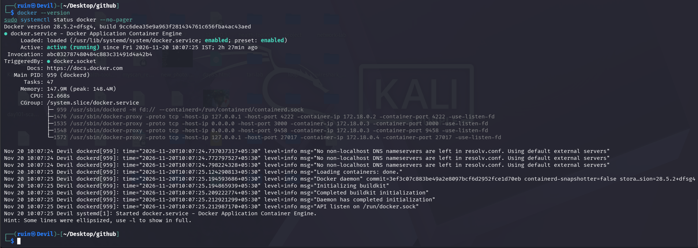
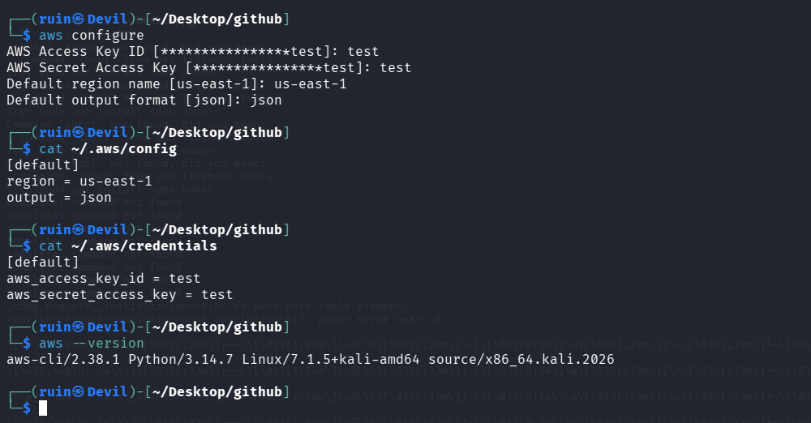
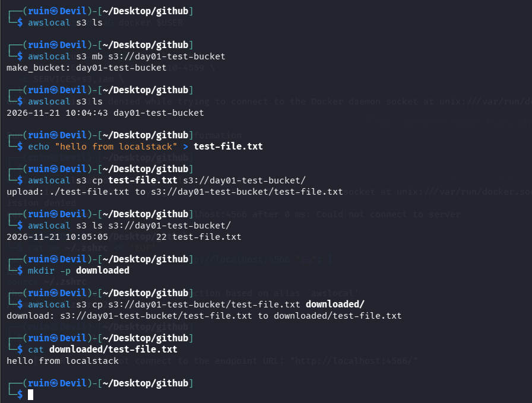
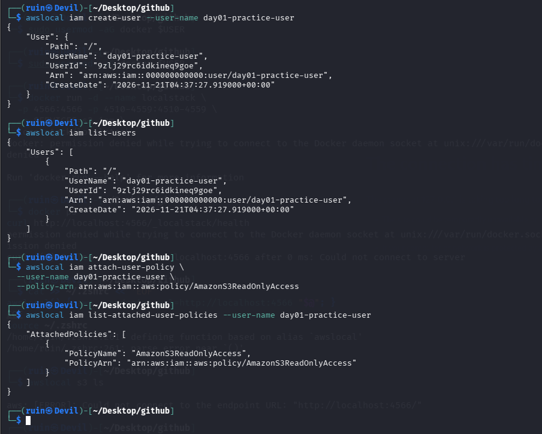

# ☁️ Cloud/DevOps Day 01: LocalStack Setup + AWS CLI Basics (S3 + IAM)

<p align="center">
  
  
  
  
</p>

> First day of a new phase, and a new kind of lesson: most of today wasn't AWS at all — it was fixing Docker permissions and a broken shell config just to get to the point where AWS commands could even run. Once that was sorted, S3 and IAM both worked cleanly, end to end, with no credit card and no AWS account.

---

## 🎯 Mission Briefing

LocalStack emulates AWS services (S3, IAM, and more) inside a local Docker container, so every `aws` CLI command practiced here is the *same* command that would run against real AWS — only the endpoint differs. No cost, no card, no real cloud risk. Getting there, though, took real troubleshooting: a Docker permissions issue, a corrupted shell alias, and a licensing wall on LocalStack's newest version.

```
☁️ MISSION: Get LocalStack Running, Then Practice S3 + IAM
──────────────────────────────────────────
[x] Fix Docker group permissions (newgrp docker)
[x] Clean up a corrupted .zshrc with duplicate/broken awslocal definitions
[x] Hit LocalStack's "latest" tag licensing wall; pin to :3.4 instead
[x] Confirm LocalStack healthy, AWS CLI configured with dummy credentials
[x] S3: bucket created, file uploaded, downloaded, content verified
[x] IAM: user created, policy attached, attachment confirmed
[?] A separate, unexplained "aws-emulator" tool also found running on port 9297 — not
    the same thing as the Docker LocalStack container, origin unclear
──────────────────────────────────────────
STATUS: Cloud/DevOps Day 01 — Complete success on S3 + IAM, plus one open mystery to resolve
```

---

## ⚡ Quick Theory

```
LocalStack           ->  emulates AWS services locally in Docker; same aws CLI, different
                        endpoint (http://localhost:4566 instead of real AWS)
awslocal (custom)     ->  shell function/alias that adds --endpoint-url automatically
S3                    ->  object storage: buckets (containers) + objects (files) inside them
IAM                    ->  identity and access management: users, groups, policies (permissions)
```

> 💰 **Why this matters for cost:** everything today ran in a local container — zero AWS spend, zero real-account risk, because no real AWS account was ever involved.

---

## 💻 What I Actually Ran (and Fixed)

*(Machine: Kali Linux, user `ruin`)*

### 🏗️ Step 0 — Docker confirmed working
```bash
$ docker --version
Docker version 28.5.2+dfsg4, build 9cc6dea35e9a963f281434761c656fba4ac43aed
$ sudo systemctl status docker --no-pager
Active: active (running) since Fri 2026-11-20 10:07:25 IST; 2h 27min ago
```
Docker itself was already installed and running — other, unrelated containers (`rocketchat-compose-*`, `mongodb`) were already up on this machine from earlier work, which is why `docker ps` later showed more than just LocalStack.



### 🔍 Troubleshooting chain (the real work of today)

**Problem 1 — Docker permission denied.** The initial `docker ps` failed with `permission denied ... /var/run/docker.sock`, because the user wasn't in the `docker` group yet.
```bash
sudo usermod -aG docker $USER
newgrp docker      # applied the group membership without a full logout
docker ps          # worked cleanly afterward
```

**Problem 2 — a corrupted `.zshrc`.** Several earlier attempts to define an `awslocal` shortcut (first as an `alias`, then as a multi-line `function`) left **conflicting, duplicate definitions** in `.zshrc`, causing `zsh: parse error near '()'` on every new shell.
```bash
sed -i '/awslocal/d' ~/.zshrc          # remove every old, broken attempt
printf '\nawslocal() { aws --endpoint-url=http://localhost:4566 "$@"; }\n' >> ~/.zshrc
exec zsh
```

**Problem 3 — LocalStack's `latest` tag demanded a license.** `docker run ... localstack/localstack` (no tag = `latest`, version 2026.10.8) started and then immediately exited:
```
LocalStack returning with exit code 55. Reason: License activation failed!
Reason: No credentials were found in the environment. Please set the LOCALSTACK_AUTH_TOKEN...
```
Even adding `LOCALSTACK_ACKNOWLEDGE_ACCOUNT_REQUIREMENT=1` didn't bypass it on this version. The fix was pinning to an older, still-open release:
```bash
docker rm -f localstack
docker run -d --name localstack \
  -p 4566:4566 -p 4510-4559:4510-4559 \
  -e SERVICES=s3,iam \
  localstack/localstack:3.4
```
This version started cleanly and stayed **"Up ... (healthy)"**.

### 🔍 Part B — AWS CLI configured with dummy credentials
```bash
$ aws configure
AWS Access Key ID: test
AWS Secret Access Key: test
Default region name: us-east-1
Default output format: json

$ cat ~/.aws/config
[default]
region = us-east-1
output = json

$ cat ~/.aws/credentials
[default]
aws_access_key_id = test
aws_secret_access_key = test

$ aws --version
aws-cli/2.38.1 Python/3.14.7 Linux/7.1.5+kali-amd64 source/x86_64.kali.2026
```
LocalStack doesn't validate these at all — `test`/`test` is enough, because nothing is actually checked against a real AWS account.



### 🔍 Part C — S3: full success
```bash
$ awslocal s3 ls
$ awslocal s3 mb s3://day01-test-bucket
make_bucket: day01-test-bucket
$ awslocal s3 ls
2026-11-21 10:04:43 day01-test-bucket

$ echo "hello from localstack" > test-file.txt
$ awslocal s3 cp test-file.txt s3://day01-test-bucket/
upload: ./test-file.txt to s3://day01-test-bucket/test-file.txt
$ awslocal s3 ls s3://day01-test-bucket/
2026-11-21 10:05:05         22 test-file.txt

$ mkdir -p downloaded
$ awslocal s3 cp s3://day01-test-bucket/test-file.txt downloaded/
download: s3://day01-test-bucket/test-file.txt to downloaded/test-file.txt
$ cat downloaded/test-file.txt
hello from localstack
```
Every step worked exactly as expected: bucket created, file uploaded (22 bytes, matching), downloaded, and the content came back **identical** to what was uploaded.



### 🔍 Part D — IAM: full success
```bash
$ awslocal iam create-user --user-name day01-practice-user
{
    "User": {
        "UserName": "day01-practice-user",
        "Arn": "arn:aws:iam::000000000000:user/day01-practice-user",
        ...
    }
}
$ awslocal iam list-users
(shows day01-practice-user)

$ awslocal iam attach-user-policy \
  --user-name day01-practice-user \
  --policy-arn arn:aws:iam::aws:policy/AmazonS3ReadOnlyAccess

$ awslocal iam list-attached-user-policies --user-name day01-practice-user
{
    "AttachedPolicies": [
        {
            "PolicyName": "AmazonS3ReadOnlyAccess",
            "PolicyArn": "arn:aws:iam::aws:policy/AmazonS3ReadOnlyAccess"
        }
    ]
}
```
Note the account ID in the ARN: **`000000000000`** — LocalStack's fixed placeholder account, a clear visual reminder this is emulated, not a real AWS account. User created, policy attached, attachment confirmed.



### 🔍 An unresolved find: a second, separate "aws-emulator" tool
```bash
$ aws-emulator -v
Version: 1.0.533
Release date: 2026.11.19

$ aws-emulator
{"message":"aws-emulator emulator starting"}
{"message":"request authentication enabled","credentials_file":"/home/ruin/.aws/emulator/9297/emulator_credentials"}
{"message":"emulator server information","endpoint_url":"https://127.0.0.1:9297","health_check_url":"https://127.0.0.1:9297/__admin/health",...}
```
This is a **completely separate tool** from the Docker-based LocalStack container worked through above — a different binary (`aws-emulator`), a different port (**9297**, not 4566), **HTTPS** instead of HTTP, and its own credentials file. It wasn't part of today's Docker troubleshooting at all, and its origin on this machine isn't yet clear — it may be a bundled component of a newer LocalStack release, or an unrelated pre-existing tool.


---

## 🧪 What I Actually Found

- [x] **Docker permissions fixed**: `usermod -aG docker` + `newgrp docker` resolved the initial `permission denied`
- [x] **`.zshrc` corruption fixed**: multiple conflicting `awslocal` definitions removed, one clean function left in place
- [x] **LocalStack's `latest` tag requires a license/auth token** (exit code 55); pinning to `localstack/localstack:3.4` avoided this entirely
- [x] **S3 fully confirmed**: bucket created, file uploaded (22 bytes), downloaded, content byte-for-byte identical
- [x] **IAM fully confirmed**: user created, policy attached, attachment verified — account ID `000000000000` confirms this is LocalStack, not real AWS
- [ ] **A second "aws-emulator" tool on port 9297 (HTTPS) is unexplained** — not investigated further this session

---

## 🎯 Mini Challenges

> **🥊 Challenge 1: Why Did Pinning to `:3.4` Fix the License Error?**
> The `latest` tag failed with a licensing error; `:3.4` didn't. Why?

<details>
<summary>My answer</summary>

LocalStack's newest releases (`latest`, here version 2026.10.8) have apparently started requiring an account/auth token even to start the emulator, as part of their licensing model. Tag `3.4` is an older release from before that requirement existed, so it starts without needing any credentials. Pinning a specific, older version sidesteps a newer policy change entirely.

</details>

> **🥊 Challenge 2: Why Did `newgrp docker` Work Without a Full Logout?**
> Normally, group membership needs a fresh login session to take effect. Why did `newgrp` work immediately?

<details>
<summary>My answer</summary>

`newgrp docker` starts a new sub-shell with the specified group active immediately, without needing to end the whole login session — it's a shortcut specifically for this situation. A full logout/login (or reboot) would have worked too, just slower; `newgrp` is the faster way to pick up a just-added group membership in the current terminal.

</details>

> **🥊 Challenge 3: Why Does the `000000000000` Account ID in the IAM ARN Matter?**
> The user's ARN showed a string of zeros as the account ID. Why is that worth noticing?

<details>
<summary>My answer</summary>

It's LocalStack's fixed placeholder account ID, used for every emulated resource regardless of what credentials you configured. Seeing it confirms, concretely, that everything created today is local and emulated — a real AWS account would show a genuine 12-digit account number, never all zeros.

</details>

> **🥊 Challenge 4: Why Not Just Ignore the "aws-emulator" Tool Since LocalStack Already Works?**
> S3 and IAM both worked through the Docker container. Why flag the other tool at all?

<details>
<summary>My answer</summary>

Because an unexplained second tool emulating AWS, on a different port, with its own auth setup, is exactly the kind of thing that causes confusing bugs later — if a future command accidentally points at `9297` instead of `4566`, the error would be baffling without today's note explaining that two separate emulators exist on this machine. Documenting the mystery now, even unresolved, saves real debugging time later.

</details>

---

## 🧩 Quick Brain Check

1. Why does LocalStack accept any Access Key/Secret, while real AWS would reject `test`/`test`?
2. What's the practical difference between an `alias` and a `function` in zsh, and why did mixing both cause a parse error?
3. Why would a company deliberately move a previously-free tool's latest version behind a license requirement?
4. What real-world AWS concept does an S3 "bucket" most closely resemble?
5. Why is discovering a duplicate/competing tool on your own machine worth documenting, even if your original approach already works?

---

## 🐛 Errors / Gotchas I Hit

- **`docker ps` → permission denied** — user wasn't in the `docker` group; fixed with `usermod -aG docker` + `newgrp docker`.
- **`zsh: parse error near '()'`** on every new shell — leftover, conflicting `awslocal` alias/function definitions in `.zshrc` from earlier attempts; fixed by deleting all of them and adding exactly one clean version.
- **LocalStack `latest` tag exits immediately with code 55** — "License activation failed," requiring `LOCALSTACK_AUTH_TOKEN`; resolved by pinning to `localstack/localstack:3.4` instead.
- **A second, unexplained `aws-emulator` tool** exists on this machine, running on port 9297 over HTTPS with its own credentials file — not investigated further, flagged for next time.
- **`zsh: corrupt history file`** warning appeared a few times — cosmetic, unrelated to today's actual work, not yet cleaned up (`rm ~/.zsh_history` would fix it).

---

## 🔐 Security Relevance

Today's real lesson wasn't an AWS concept — it was **infrastructure hygiene before the actual work**: fixing permissions properly (rather than running everything as root to dodge the Docker group issue), cleaning up a corrupted config file instead of layering more patches on top of it, and recognizing when a tool's licensing has changed rather than assuming a config mistake. The `000000000000` placeholder account ID is also a good habit to internalize early: knowing at a glance whether you're looking at a real AWS account or a local emulation matters a lot once real AWS work starts.

---

## 🧠 Today's Takeaway

Day 1 of Cloud/DevOps looked nothing like Day 1 of Pentesting — instead of a new tool's commands, it was a real troubleshooting chain: Docker group permissions, a corrupted shell config, and a licensing wall on LocalStack's newest version. Once those were actually fixed (not worked around), S3 and IAM both worked cleanly and completely, with clear, verifiable evidence (matching file content, a confirmed policy attachment, the `000000000000` account ID). The one loose thread — a second, unexplained local AWS emulator on port 9297 — is worth a few minutes next session, purely so it doesn't cause a confusing bug later.

---

➡️ Next up: **Cloud/DevOps Day 02**
