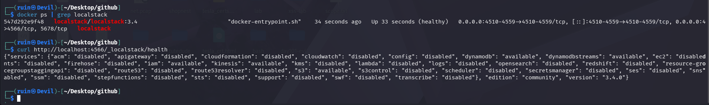
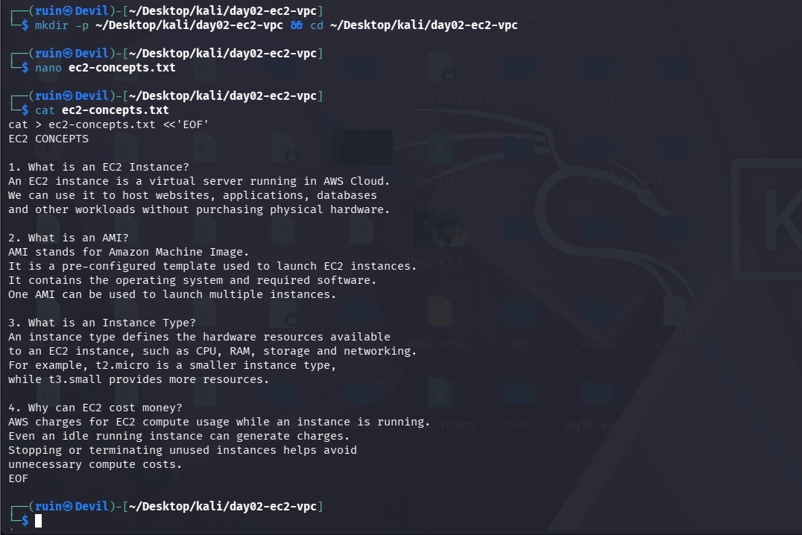
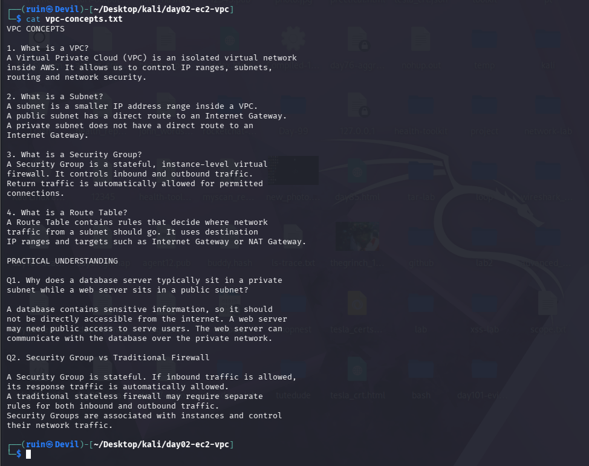
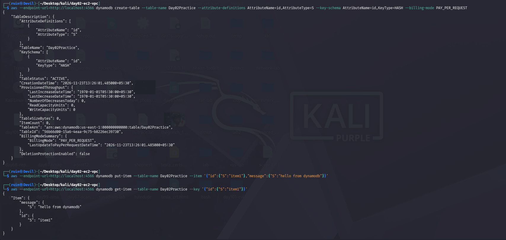
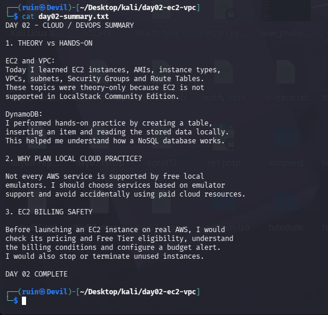

# ☁️ Cloud/DevOps Day 02: EC2 + VPC Concepts, DynamoDB Hands-On

<p align="center">
  
  
  
  
</p>

> Day 01 was a troubleshooting marathon just to get LocalStack running at all. Day 02 is the payoff: a clean, fully working session, plus direct proof — straight from LocalStack's own health check — that EC2 really is Pro-only, exactly as the Lab warned.

---

## 🏆 Day 01 Recap — What Setting Up LocalStack Taught Me

- Three real problems (Docker permissions, a corrupted `.zshrc`, LocalStack's licensed `latest` tag) all got fixed properly, not worked around.
- S3 and IAM both worked end-to-end once the environment was actually healthy.

---

## 🎯 Mission Briefing

Today split cleanly in two: EC2 and VPC as **concepts only** (LocalStack Community doesn't emulate EC2), and DynamoDB as **real, hands-on practice** (fully supported for free). The health check at the start confirmed exactly why that split is necessary — straight from LocalStack itself.

```
☁️ MISSION: EC2/VPC Theory + Real DynamoDB Practice
──────────────────────────────────────────
[x] Confirmed DynamoDB available, EC2 confirmed DISABLED (community edition)
[x] EC2 concepts written in my own words
[x] VPC concepts written in my own words, with practical Q&A
[x] DynamoDB: table created, item put in, item read back — matched exactly
[~] DynamoDB cleanup (scan + delete-table + confirm removal) -> not captured
[x] Day summary written, tying theory and hands-on together
──────────────────────────────────────────
STATUS: Cloud/DevOps Day 02 — Clean, fully successful session; one small cleanup step unverified
```

---

## 💻 What I Actually Ran

*(Machine: Kali Linux, user `ruin`, working in `~/Desktop/kali/day02-ec2-vpc`)*

### 🏗️ Step 0 — Confirm DynamoDB is available, and that EC2 genuinely isn't
```bash
$ docker ps | grep localstack
localstack/localstack:3.4   Up 33 seconds (healthy)   0.0.0.0:4566->4566/tcp

$ curl http://localhost:4566/_localstack/health
{"services": {
  "dynamodb": "available",
  "s3": "available",
  "iam": "available",
  "ec2": "disabled",
  "lambda": "disabled",
  ...
}, "edition": "community", "version": "3.4.0"}
```
Direct, concrete confirmation from LocalStack itself: **`ec2: "disabled"`**, right there in the health check, on the `community` edition. This is exactly the constraint the Lab sheet warned about — not a guess, a documented fact from the tool's own API.



### 🔍 Part A — EC2 concepts, in my own words
```bash
$ cat ec2-concepts.txt
EC2 CONCEPTS

1. What is an EC2 Instance?
An EC2 instance is a virtual server running in AWS Cloud.
We can use it to host websites, applications, databases
and other workloads without purchasing physical hardware.

2. What is an AMI?
AMI stands for Amazon Machine Image.
It is a pre-configured template used to launch EC2 instances.
It contains the operating system and required software.
One AMI can be used to launch multiple instances.

3. What is an Instance Type?
An instance type defines the hardware resources available
to an EC2 instance, such as CPU, RAM, storage and networking.
For example, t2.micro is a smaller instance type,
while t3.small provides more resources.

4. Why can EC2 cost money?
AWS charges for EC2 compute usage while an instance is running.
Even an idle running instance can generate charges.
Stopping or terminating unused instances helps avoid
unnecessary compute costs.
```
Clean, accurate, and specifically addresses the billing-safety angle from Day 01 — the exact thing a free/local-only approach to EC2 is meant to protect against.



### 🔍 Part B — VPC concepts, with practical reasoning
```bash
$ cat vpc-concepts.txt
VPC CONCEPTS

1. What is a VPC?
A Virtual Private Cloud (VPC) is an isolated virtual network
inside AWS. It allows us to control IP ranges, subnets,
routing and network security.

2. What is a Subnet?
A subnet is a smaller IP address range inside a VPC.
A public subnet has a direct route to an Internet Gateway.
A private subnet does not have a direct route to an
Internet Gateway.

3. What is a Security Group?
A Security Group is a stateful, instance-level virtual
firewall. It controls inbound and outbound traffic.
Return traffic is automatically allowed for permitted
connections.

4. What is a Route Table?
A Route Table contains rules that decide where network
traffic from a subnet should go. It uses destination
IP ranges and targets such as Internet Gateway or NAT Gateway.

PRACTICAL UNDERSTANDING

Q1. Why does a database server typically sit in a private
subnet while a web server sits in a public subnet?
A database contains sensitive information, so it should
not be directly accessible from the internet. A web server
may need public access to serve users. The web server can
communicate with the database over the private network.

Q2. Security Group vs Traditional Firewall
A Security Group is stateful. If inbound traffic is allowed,
its response traffic is automatically allowed.
A traditional stateless firewall may require separate
rules for both inbound and outbound traffic.
```
Not just definitions — the two practical Q&A answers show real understanding of *why* the architecture pattern exists, not just what the terms mean.



### 🔍 Part C — DynamoDB: real hands-on, verified
```bash
$ aws --endpoint-url=http://localhost:4566 dynamodb create-table \
  --table-name Day02Practice \
  --attribute-definitions AttributeName=id,AttributeType=S \
  --key-schema AttributeName=id,KeyType=HASH \
  --billing-mode PAY_PER_REQUEST
{
  "TableDescription": {
    "TableName": "Day02Practice",
    "TableStatus": "ACTIVE",
    "TableArn": "arn:aws:dynamodb:us-east-1:000000000000:table/Day02Practice",
    "BillingModeSummary": {"BillingMode": "PAY_PER_REQUEST"}
  }
}

$ aws --endpoint-url=http://localhost:4566 dynamodb put-item \
  --table-name Day02Practice \
  --item '{"id":{"S":"item1"},"message":{"S":"hello from dynamodb"}}'

$ aws --endpoint-url=http://localhost:4566 dynamodb get-item \
  --table-name Day02Practice \
  --key '{"id":{"S":"item1"}}'
{
  "Item": {
    "message": {"S": "hello from dynamodb"},
    "id": {"S": "item1"}
  }
}
```
Table created instantly as `ACTIVE` (no waiting, since this is emulated), with `PAY_PER_REQUEST` billing confirmed and the familiar `000000000000` LocalStack account ID in the ARN. The item read back via `get-item` **matches exactly** what was put in — `id: item1`, `message: hello from dynamodb`, nothing missing or altered.



> **Gap to note:** today's evidence stops here. The Lab's own next step — `scan` the whole table, then `delete-table` and confirm it's gone from `list-tables` — wasn't captured. The core read/write behavior is fully verified; the cleanup step is not.

### 🔍 Part D — Tying it together
```bash
$ cat day02-summary.txt
DAY 02 — CLOUD / DEVOPS SUMMARY

1. THEORY vs HANDS-ON

EC2 and VPC:
Today I learned EC2 instances, AMIs, instance types,
VPCs, subnets, Security Groups and Route Tables.
These topics were theory-only because EC2 is not
supported in LocalStack Community Edition.

DynamoDB:
I performed hands-on practice by creating a table,
inserting an item and reading the stored data locally.
This helped me understand how a NoSQL database works.

2. WHY PLAN LOCAL CLOUD PRACTICE?

Not every AWS service is supported by free local
emulators. I should choose services based on emulator
support and avoid accidentally using paid cloud resources.

3. EC2 BILLING SAFETY

Before launching an EC2 instance on real AWS, I would
check its pricing and Free Tier eligibility, understand
the billing conditions and configure a budget alert.
I would also stop or terminate unused instances.

DAY 02 COMPLETE
```
A genuinely useful closing reflection — it correctly identifies *why* today was split the way it was, not just *that* it was.



---

## 🧪 What I Actually Found

- [x] LocalStack's own health check **confirms `ec2: "disabled"`** on the `community` edition — not an assumption, a documented fact
- [x] `dynamodb`, `s3`, and `iam` all confirmed `"available"`
- [x] EC2 concepts written accurately, including the billing-risk angle
- [x] VPC concepts written accurately, with correct practical reasoning (private subnet for DBs, stateful vs stateless firewalls)
- [x] DynamoDB table created (`ACTIVE` immediately, `PAY_PER_REQUEST` billing, `000000000000` account ID)
- [x] `put-item` → `get-item` round-trip **verified exact match**
- [ ] `scan`, `delete-table`, and a follow-up `list-tables` confirming removal — not captured this session

---

## 🎯 Mini Challenges

> **🥊 Challenge 1: Why Trust the Health Check Over Just Trying the Command?**
> The Lab could have just said "try EC2, it'll fail." Why check the health endpoint first instead?

<details>
<summary>My answer</summary>

Because a failed command alone doesn't tell you *why* it failed — it could be a typo, a missing region, a permissions issue, or (as here) a genuine licensing limit. The health check removes the guesswork: `"ec2": "disabled"` is LocalStack stating its own capabilities directly, so there's no ambiguity about whether this is a mistake to fix or a real limit to work around.

</details>

> **🥊 Challenge 2: Why Did `create-table` Return `"TableStatus": "ACTIVE"` Immediately?**
> On real AWS, a new DynamoDB table can take a moment to become active. Why was it instant here?

<details>
<summary>My answer</summary>

LocalStack emulates the AWS API's behavior and responses, not real infrastructure provisioning — there's no actual distributed database cluster being spun up behind the scenes, just a local process tracking the table's state. So operations that would involve real propagation delay on AWS complete instantly here, which is convenient for practice but also a reminder that LocalStack's timing doesn't always match real AWS.

</details>

> **🥊 Challenge 3: Why Does the Missing Cleanup Step Matter, Even Though the Table Is Local and Free?**
> The table costs nothing and isn't visible to anyone else. Why bother confirming it was deleted?

<details>
<summary>My answer</summary>

Because the habit matters more than this specific table. On real AWS, forgetting to clean up test resources is exactly how small, forgotten things turn into unexpected charges — practicing the full lifecycle (create, use, confirm deletion) now, even where it's free, builds the muscle memory needed once real billing is involved.

</details>

> **🥊 Challenge 4: Why Does a DynamoDB Table Not Need a Fixed Schema Like a SQL Table?**
> Only `id` was defined up front, yet `message` was stored too without declaring it. How is that possible?

<details>
<summary>My answer</summary>

DynamoDB only requires you to define the **key schema** (here, `id` as the partition key) — every other attribute on an item is flexible and can differ from item to item. This is the core difference from a SQL table, which requires every column to be defined in advance for every row. It's part of why DynamoDB is called "NoSQL": structure is per-item, not enforced table-wide.

</details>

---

## 🧩 Quick Brain Check

1. What did the health check prove about EC2 that a failed command alone wouldn't have?
2. Why did the DynamoDB table become `ACTIVE` instantly instead of taking real provisioning time?
3. Why is confirming a resource was actually deleted part of good cloud hygiene, even on a free local setup?
4. What's the key structural difference between a DynamoDB item and a SQL row?
5. Why does planning which services to practice around emulator support matter before diving into hands-on work?

---

## 🐛 Errors / Gotchas I Hit

- None from the tooling side — today ran cleanly from start to finish.
- **One real gap:** the DynamoDB cleanup steps (`scan`, `delete-table`, confirming removal via `list-tables`) weren't captured in today's evidence, even though the create/put/get steps were fully verified.
- Minor style note: today's DynamoDB commands used the full `aws --endpoint-url=http://localhost:4566 ...` form rather than the `awslocal` shortcut from Day 01 — functionally identical, just more typing.

---

## 🔐 Security Relevance

The real lesson today is about **matching your practice environment to what it can actually teach you**: trying to force EC2 work into a free local setup would have wasted time chasing a non-issue, while DynamoDB — genuinely supported — gave real, verifiable hands-on results instead. The VPC concepts (especially the public/private subnet split and stateful Security Groups) are exactly the controls that, misconfigured on real AWS, lead to databases being accidentally exposed to the internet — a very common real-world finding.

---

## 🧠 Today's Takeaway

Day 02 showed the payoff of Day 01's troubleshooting: a clean, fully working session with genuine evidence at every step, including concrete proof — straight from LocalStack's own API — of exactly which services are and aren't available for free. The theory-vs-hands-on split wasn't a workaround, it was the correct call, and the closing summary shows real understanding of *why*. The one thing to close out next time: finish the DynamoDB cleanup steps so the full create-to-delete lifecycle is verified, not just the first half.

---

⬅️ [Back to Cloud/DevOps index](/Cloud ) | ➡️ Next up: **Cloud/DevOps Day 03**
