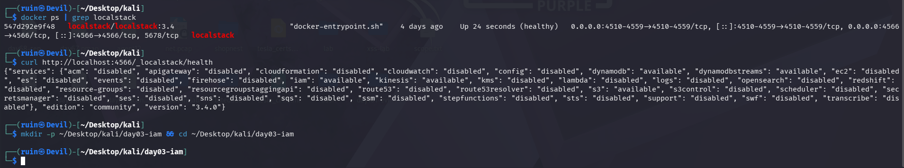
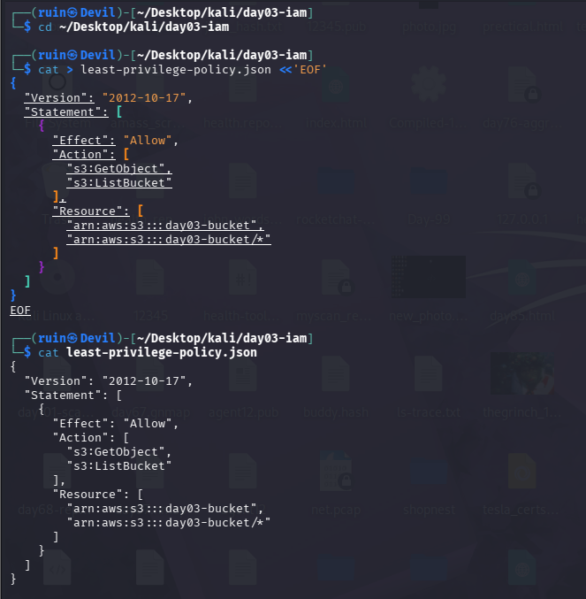
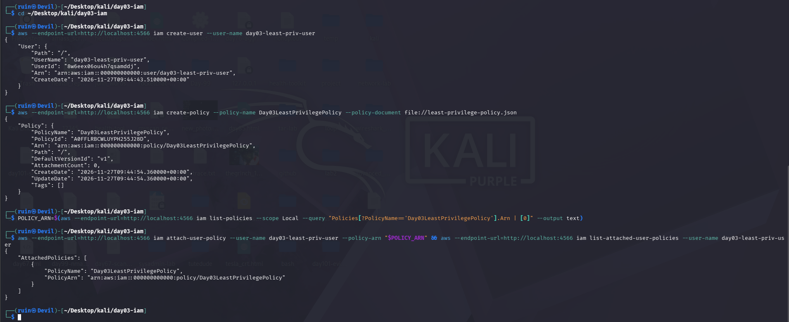
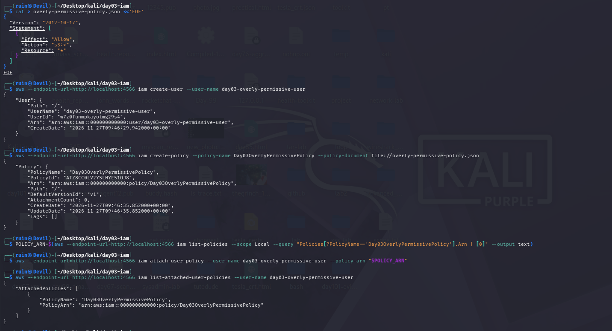

# 🔐 Cloud/DevOps Day 03: IAM Deep Dive — Policies, Roles & Least Privilege

<p align="center">
  
  
  
  
</p>

> Day 02 proved EC2 really is disabled in LocalStack Community, straight from its own health check. Day 03 is a fully clean session: a least-privilege policy and an overly-permissive one, built side by side, plus a role — all confirmed, all attached correctly, no snags.

---

## 🏆 Day 02 Recap — What EC2/VPC Concepts + DynamoDB Taught Me

- LocalStack's health check directly confirmed `"ec2": "disabled"` — a documented fact, not a guess.
- DynamoDB create/put/get all verified end-to-end, with the `000000000000` LocalStack account ID as a clear "this is emulated" marker.

---

## 🎯 Mission Briefing

Today built two policies side by side — one scoped tightly (least privilege), one deliberately wide open (`s3:*` on `*`) — plus an IAM role with a trust policy. The real point: seeing the exact JSON difference between "safe" and "a real-world audit red flag," not just reading about it.

```
🔐 MISSION: Build, Attach, and Compare IAM Policies + a Role
──────────────────────────────────────────
[x] Confirm environment: IAM/S3/DynamoDB available; Lambda still disabled (flagged for Day 04)
[x] Least-privilege policy written, created, attached to a user
[x] Overly-permissive policy written, created, attached to a second user
[x] IAM role created with a lambda.amazonaws.com trust policy
[x] Every attachment confirmed via list-attached-user-policies / list-roles
──────────────────────────────────────────
STATUS: Cloud/DevOps Day 03 — Fully clean session, no errors
```

---

## 💻 What I Actually Ran

*(Machine: Kali Linux, user `ruin`, working in `~/Desktop/kali/day03-iam`)*

### 🏗️ Step 0 — Confirm the environment, and flag something for next time
```bash
$ docker ps | grep localstack
localstack/localstack:3.4   Up 24 seconds (healthy)

$ curl http://localhost:4566/_localstack/health
{"services": {
  "iam": "available", "s3": "available", "dynamodb": "available",
  "lambda": "disabled", "ec2": "disabled", ...
}, "edition": "community", "version": "3.4.0"}
```
IAM, S3, and DynamoDB are all available — everything today's lab needs. **`lambda` still shows `"disabled"`** — expected, since Day 02's container restart only enabled `s3,iam,dynamodb`. This is a direct heads-up for **Day 04**: the container will need restarting with `lambda` added to `SERVICES` before that session's Lambda work can begin.



### 🔍 Part A — The least-privilege policy, written by hand
```bash
$ cat least-privilege-policy.json
{
  "Version": "2012-10-17",
  "Statement": [
    {
      "Effect": "Allow",
      "Action": ["s3:GetObject", "s3:ListBucket"],
      "Resource": [
        "arn:aws:s3:::day03-bucket",
        "arn:aws:s3:::day03-bucket/*"
      ]
    }
  ]
}
```
Scoped to exactly two read-only S3 actions, on exactly one named bucket (plus its objects) — nothing broader.



### 🔍 Part B — Created and attached to a user, confirmed
```bash
$ aws --endpoint-url=http://localhost:4566 iam create-user --user-name day03-least-priv-user
$ aws --endpoint-url=http://localhost:4566 iam create-policy \
  --policy-name Day03LeastPrivilegePolicy --policy-document file://least-privilege-policy.json
"Arn": "arn:aws:iam::000000000000:policy/Day03LeastPrivilegePolicy"

$ POLICY_ARN=$(aws --endpoint-url=http://localhost:4566 iam list-policies --scope Local \
  --query "Policies[?PolicyName=='Day03LeastPrivilegePolicy'].Arn | [0]" --output text)
$ aws --endpoint-url=http://localhost:4566 iam attach-user-policy \
  --user-name day03-least-priv-user --policy-arn "$POLICY_ARN" && \
  aws --endpoint-url=http://localhost:4566 iam list-attached-user-policies --user-name day03-least-priv-user
{
  "AttachedPolicies": [
    {"PolicyName": "Day03LeastPrivilegePolicy", "PolicyArn": "arn:aws:iam::000000000000:policy/Day03LeastPrivilegePolicy"}
  ]
}
```
User created, policy created with a real ARN, attached, and confirmed in one clean chain.



### 🔍 Part C — The overly-permissive policy, for direct comparison
```bash
$ cat overly-permissive-policy.json
{
  "Version": "2012-10-17",
  "Statement": [
    {"Effect": "Allow", "Action": "s3:*", "Resource": "*"}
  ]
}

$ aws --endpoint-url=http://localhost:4566 iam create-user --user-name day03-overly-permissive-user
$ aws --endpoint-url=http://localhost:4566 iam create-policy \
  --policy-name Day03OverlyPermissivePolicy --policy-document file://overly-permissive-policy.json
$ POLICY_ARN=$(aws --endpoint-url=http://localhost:4566 iam list-policies --scope Local \
  --query "Policies[?PolicyName=='Day03OverlyPermissivePolicy'].Arn | [0]" --output text)
$ aws --endpoint-url=http://localhost:4566 iam attach-user-policy \
  --user-name day03-overly-permissive-user --policy-arn "$POLICY_ARN"
$ aws --endpoint-url=http://localhost:4566 iam list-attached-user-policies --user-name day03-overly-permissive-user
{
  "AttachedPolicies": [
    {"PolicyName": "Day03OverlyPermissivePolicy", "PolicyArn": "arn:aws:iam::000000000000:policy/Day03OverlyPermissivePolicy"}
  ]
}
```
Same exact workflow as Part B, but the policy itself is the textbook red flag: **`"Action": "s3:*", "Resource": "*"`** — every S3 action, on every resource, no scoping at all.



### 🔍 Part D — An IAM role, with a trust policy
```bash
$ cat > trust-policy.json <<'EOF'
{
  "Version": "2012-10-17",
  "Statement": [
    {"Effect": "Allow", "Principal": {"Service": "lambda.amazonaws.com"}, "Action": "sts:AssumeRole"}
  ]
}
