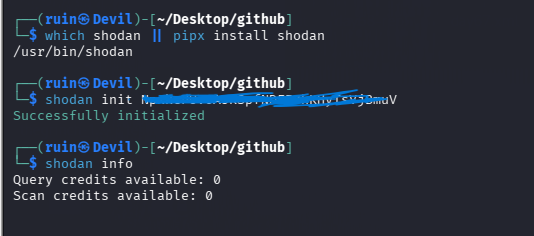
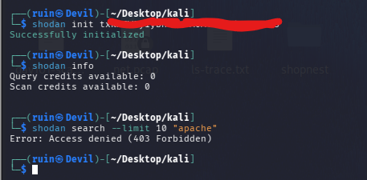
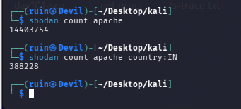
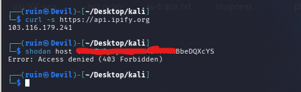
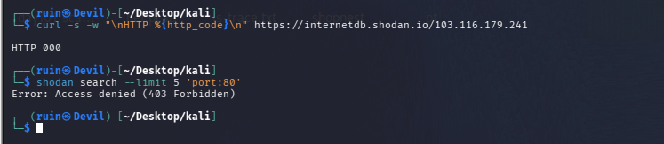

# 🛰️ Pentesting Day 02: Shodan Basics (Internet-Wide Device Search)

<p align="center">
  
  
  
  
</p>

> Day 01 asked "what does a company expose publicly?" Day 02 asks "what has the internet already indexed about devices and services?" Shodan is a search engine for exactly that. 🛰️

---

## 🏆 Day 01 Recap — What theHarvester Taught Me

- Different sources give very different results: DuckDuckGo returned **27 hosts** for `microsoft.com`, crt.sh returned **0**.
- An empty result is not proof that nothing exists — it can be a source or connectivity problem.
- Scraped results contain junk (`2Fblogs.microsoft.com` — a URL-encoded `%2F` leftover), so results must be validated.

---

## 🎯 Mission Briefing

Shodan has already scanned the public internet and indexed what it found (open ports, banners, software versions). Querying it is passive — I read Shodan's data, I don't scan anyone myself. Today I tried to use the CLI on a **free account**, and found out exactly where its limits are.

```
🛰️ MISSION: Query Shodan From the CLI
──────────────────────────────────────────
[x] Install the Shodan CLI and set the API key
[x] Check account plan and credits
[x] Count devices with shodan count
[x] Narrow a count with a country filter
[ ] shodan search            -> blocked (403, free account)
[ ] shodan host on my own IP -> blocked (403, free account)
[ ] InternetDB lookup        -> failed (HTTP 000)
[ ] MongoDB exposure count   -> not run yet
──────────────────────────────────────────
STATUS: Pentesting Day 02 — Partially complete (free-account limits)
```

---

## ⚡ Quick Theory

**Shodan** continuously scans the internet and stores the **banners** services return (open port, software, version, location, organization). You search that database instead of scanning yourself.

**Three CLI commands that matter today:**
```
shodan count <query>    ->  how many devices match (totals only, no result list)
shodan search <query>   ->  the actual matching results (IP, port, org, location)
shodan host <ip>        ->  everything Shodan has indexed about one IP
```

**Credits and plans:** Shodan limits what an account can do. `shodan info` shows **query credits** and **scan credits**. Search needs credits and, for filters like `port:` or `country:`, a membership or paid plan. A free account has 0 query credits.

**Search filters** narrow a query: `country:IN` (country), `port:80` (port), `product:` (software).

**Passive vs active:** Shodan shows what *it* scanned earlier. `nmap -sV` run by me would connect to the target *now* — fresher data, but active scanning.

---

## 💻 Lab: Commands + My Real Output

*(Machine: Kali Linux, user `ruin`. API key hidden in all screenshots.)*

### 🔑 Setup and account check
```bash
$ which shodan || pipx install shodan
/usr/bin/shodan

$ shodan init <API-KEY-HIDDEN>
Successfully initialized

$ shodan info
Query credits available: 0
Scan credits available: 0
```
The key was accepted, but the account has **0 query credits and 0 scan credits** — a free account without membership.



### 🔍 shodan search — blocked
```bash
$ shodan search --limit 10 "apache"
Error: Access denied (403 Forbidden)

$ shodan search --limit 5 'port:80'
Error: Access denied (403 Forbidden)
```
Both searches failed with **403 Forbidden**. The key is valid (init worked) — the account just isn't allowed to run searches.



### 🔍 shodan count — worked
```bash
$ shodan count apache
14403754

$ shodan count apache country:IN
388228
```
About **14.4 million** Apache devices are indexed worldwide; **388,228** of them are in India (roughly 2.7%). Notably, `count` accepted a `country:` filter on this account while `search` did not.



### 🔍 Looking up my own public IP
```bash
$ curl -s https://api.ipify.org
<my-public-ip>

$ shodan host <my-public-ip>
Error: Access denied (403 Forbidden)
```
Finding my public IP worked; asking Shodan about it was blocked with the same 403.



### 🔍 InternetDB (free, no key) — failed
```bash
$ curl -s -w "\nHTTP %{http_code}\n" https://internetdb.shodan.io/<my-public-ip>

HTTP 000
```
`HTTP 000` means curl did **not receive an HTTP response at all** — this is not a status code from the server. So the request failed before reaching a normal reply (network, DNS or TLS problem, or blocking). I haven't diagnosed the exact cause yet.



---

## 🧪 What I Actually Found

- [x] Shodan CLI installed at `/usr/bin/shodan`, API key accepted
- [x] Account has **0 query credits, 0 scan credits** (free account)
- [x] `shodan count apache` → **14,403,754** devices worldwide
- [x] `shodan count apache country:IN` → **388,228** devices in India
- [x] `shodan search` (with or without filters) → **403 Forbidden**
- [x] `shodan host <my-ip>` → **403 Forbidden**
- [x] InternetDB request → **HTTP 000** (no response received)
- [ ] MongoDB exposure count (Lab Part D) — not run yet
- [ ] `shodan search` results and `shodan host` data — need a membership/credits

---

## 🎯 Mini Challenges

> **🥊 Challenge 1: Count vs Search**
> What does `count` return versus `search`, and why check `count` before a broad `search`?

<details>
<summary>My answer</summary>

`count` returns only a total number of matches, while `search` returns the actual results (IP, port, organization, location). Checking `count` first shows how big a query is before spending credits on a full search — a query returning 14 million devices needs narrowing with filters first.

</details>

> **🥊 Challenge 2: Why a Specific Version String?**
> Why would an attacker or a defender search for something like `nginx 1.18` instead of just `nginx`?

<details>
<summary>My answer</summary>

A specific version narrows results to systems running software with known weaknesses. An attacker uses it to find likely-vulnerable targets; a defender uses the same query to find which of their own systems still run an outdated version.

</details>

> **🥊 Challenge 3: Shodan vs nmap -sV**
> Both can show open ports and versions. What's the key difference in how each gets that information?

<details>
<summary>My answer</summary>

Shodan returns data *it* collected earlier (passive for me — I send nothing to the target). `nmap -sV` connects to the target directly right now (active), so it is current but touches the target and needs permission.

</details>

> **🥊 Challenge 4: The 403**
> `shodan init` succeeded but `shodan search` returned 403. Is the API key wrong?

<details>
<summary>My answer</summary>

No. `init` only stores the key; `shodan info` showed 0 query credits. The 403 means this account isn't allowed to run searches, not that the key is invalid. A wrong key would fail at authentication instead.

</details>

---

## 🧩 Quick Brain Check

1. What is the difference between `shodan count`, `shodan search` and `shodan host`?
2. Why is querying Shodan considered passive recon?
3. What does `HTTP 000` from curl actually mean?
4. How can you tell from `shodan info` that searches will fail?
5. Why is the exposure data in Shodan useful to defenders as well as attackers?

---

## 🐛 Errors / Gotchas I Hit

- **`403 Forbidden` on `shodan search` and `shodan host`** even though `shodan init` said "Successfully initialized". Cause: free account, 0 query credits. Fix: check `shodan info` first; use `shodan count`, or upgrade/use an academic membership for search.
- **`shodan count` worked with a `country:` filter** while `shodan search` with the same kind of filter did not — different commands have different permission rules.
- **InternetDB returned `HTTP 000`** — no response received. Still to diagnose (try `curl -sS -v`, check DNS with `dig`, try from another network).
- **API key in screenshots:** my first setup screenshot showed the key. Always hide it before committing — a key shown publicly should be treated as exposed.
- **`curl -s` hides errors** — an empty output gave no clue. Use `-sS` (show errors) or `-w "%{http_code}"` to see what happened.

---

## 🔐 Security Relevance

Shodan is a core **passive reconnaissance** tool: it reveals exposed services, software versions and misconfigurations without sending a single packet to the target. Attackers use it to find vulnerable systems; defenders use it to see their own organization's internet-facing exposure the way an attacker would. Looking at search results is fine — **connecting to or interacting with any device found through Shodan is out of scope** unless it's mine or an authorized lab.

---

## 🧠 Today's Takeaway

Shodan = a search engine for internet-connected devices, and it's passive. A valid API key doesn't mean full access — **account plan and credits decide what works**. On my free account `count` worked and `search`/`host` didn't, and recording that honestly is part of the lab. Always check `shodan info` before planning a lab around a tool.

---

⬅️ [Back to Pentesting index](../README.md) | ➡️ Next up: **Day 03: gobuster & ffuf**
