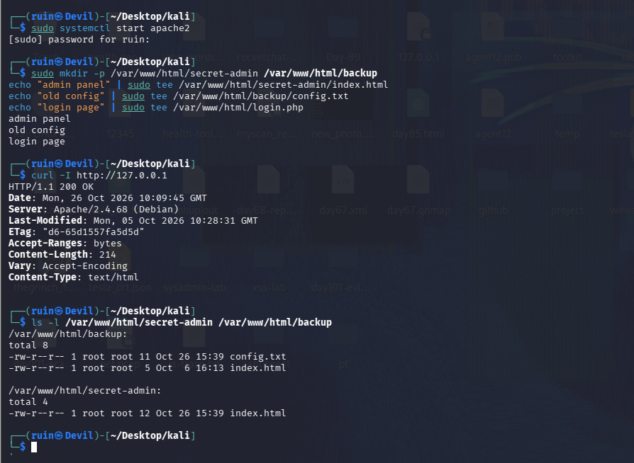
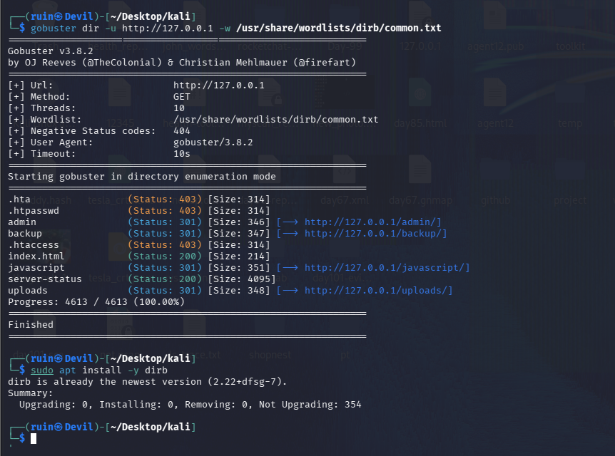
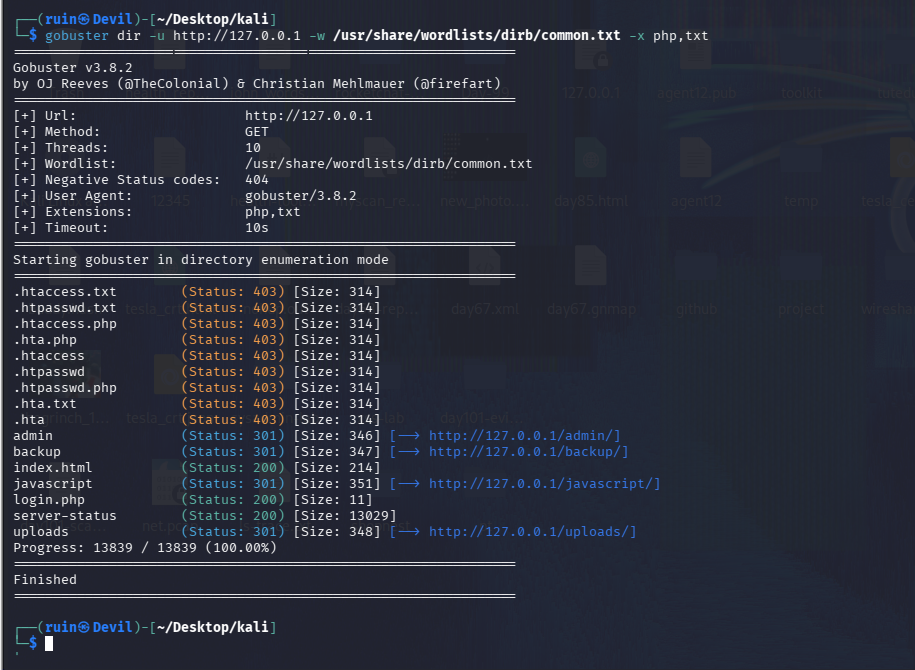
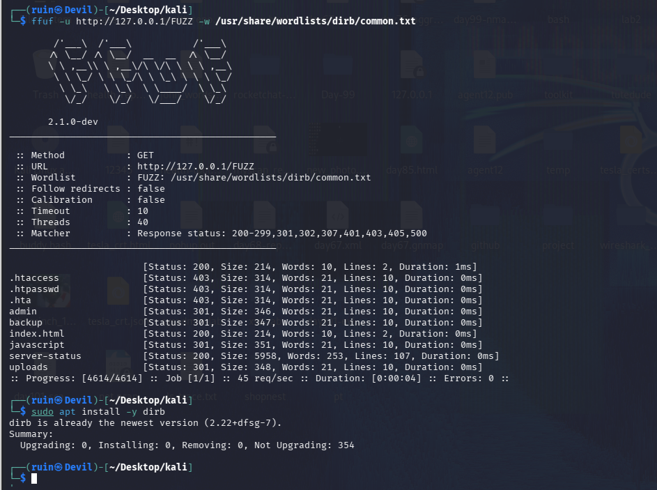
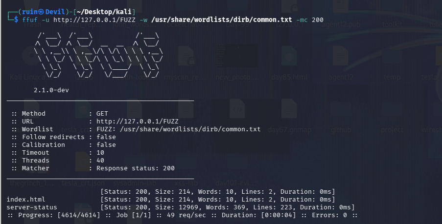
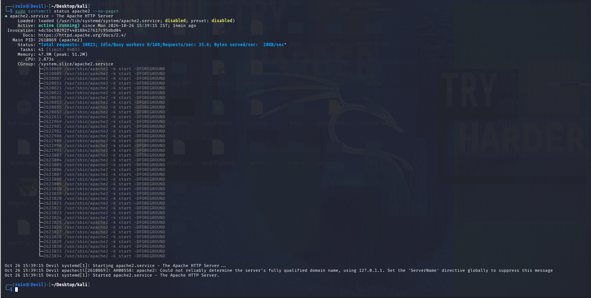
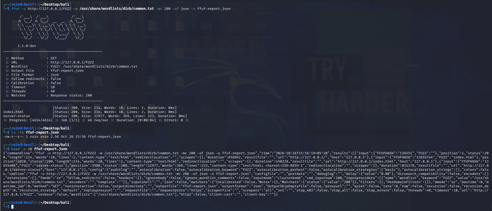
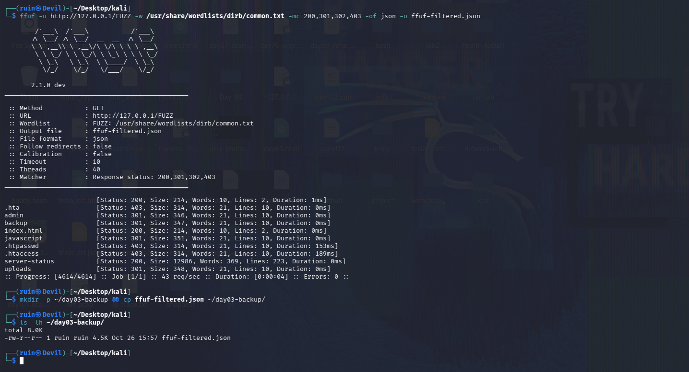

# 🕵️ Pentesting Day 03: gobuster & ffuf (Content Discovery)

<p align="center">
  
  
  
  
</p>

> Day 01 and 02 were passive: public data, nothing sent to the target. Day 03 is **active** — asking a web server "does `/admin` exist? what about `/backup`?" thousands of times. That's why it runs only against my own machine. 🕵️

---

## 🏆 Day 02 Recap — What Shodan Taught Me

- A valid API key doesn't mean full access: my free account had **0 query credits**, so `shodan search` and `shodan host` returned **403 Forbidden**.
- `shodan count` still worked: **14,403,754** Apache devices worldwide, **388,228** in India.
- Recording what *didn't* work, and why, is part of the lab.

---

## 🎯 Mission Briefing

Web servers often hold paths that nothing links to — admin panels, backups, old config files. Content discovery finds them by trying words from a wordlist and watching the HTTP status codes. Today I built my **own target** (local Apache on Kali) and scanned it with two tools.

```
🕵️ MISSION: Find Hidden Web Content on My Own Server
──────────────────────────────────────────
[x] Start local Apache and create test content
[x] Directory scan with gobuster
[x] gobuster with file extensions (-x php,txt)
[x] Same scan with ffuf
[x] ffuf status-code matching (-mc) and JSON report
[ ] gobuster saved output file (-o)      -> not run
[ ] ffuf extensions (-e)                  -> not run
[ ] ffuf -fc 404 filter                   -> not run
[ ] Scan inside /backup for the .bak file -> not run
──────────────────────────────────────────
STATUS: Pentesting Day 03 — Core done, a few extras pending
```

---

## ⚡ Quick Theory

**Content discovery** = request many candidate paths from a wordlist and see which ones the server answers. The tool only finds names that are **in the wordlist**.

| Tool | Idea |
|------|------|
| `gobuster dir` | Simple, fast directory/file brute forcer |
| `ffuf` | Flexible fuzzer — the word `FUZZ` marks where each wordlist entry goes; strong matching/filtering |

**Status codes you'll see:**
```
200  ->  exists, content returned
301  ->  redirect (here: a directory, e.g. /admin -> /admin/)
403  ->  exists, but access is forbidden
404  ->  not found (hidden by default)
```

**Extensions** (`-x` in gobuster, `-e` in ffuf) make the tool try each word again with a suffix, e.g. `login` → `login.php`. Every extension multiplies the number of requests.

> ⚖️ **Scope:** these tools send thousands of requests. I ran them only against `127.0.0.1` — my own Apache. Never against a site I don't own or have permission to test.

---

## 💻 Lab: Commands + My Real Output

*(Machine: Kali Linux, user `ruin`. Target: local Apache 2.4.68, `http://127.0.0.1`)*

### 🏗️ Step 1 — Build my own target
```bash
$ sudo systemctl start apache2
$ sudo mkdir -p /var/www/html/secret-admin /var/www/html/backup
$ echo "admin panel" | sudo tee /var/www/html/secret-admin/index.html
$ echo "old config"  | sudo tee /var/www/html/backup/config.txt
$ echo "login page"  | sudo tee /var/www/html/login.php

$ curl -I http://127.0.0.1
HTTP/1.1 200 OK
Server: Apache/2.4.68 (Debian)
Content-Length: 214
Content-Type: text/html
```
The server answers `200 OK`. I created `secret-admin/`, `backup/config.txt` and `login.php` as the "hidden" content to find.



### 🔍 gobuster — basic directory scan
```bash
$ gobuster dir -u http://127.0.0.1 -w /usr/share/wordlists/dirb/common.txt
.hta          (Status: 403) [Size: 314]
.htpasswd     (Status: 403) [Size: 314]
admin         (Status: 301) [Size: 346] [--> http://127.0.0.1/admin/]
backup        (Status: 301) [Size: 347] [--> http://127.0.0.1/backup/]
.htaccess     (Status: 403) [Size: 314]
index.html    (Status: 200) [Size: 214]
javascript    (Status: 301) [Size: 351] [--> http://127.0.0.1/javascript/]
server-status (Status: 200) [Size: 4095]
uploads       (Status: 301) [Size: 348] [--> http://127.0.0.1/uploads/]
Progress: 4613 / 4613 (100.00%)
```
gobuster v3.8.2 hid `404` by default and scanned **4,613** words. It found `backup/` but **not** `secret-admin/` — that name isn't in the wordlist.



### 🔍 gobuster — with file extensions
```bash
$ gobuster dir -u http://127.0.0.1 -w /usr/share/wordlists/dirb/common.txt -x php,txt
...
login.php     (Status: 200) [Size: 11]
...
Progress: 13839 / 13839 (100.00%)
```
Adding `-x php,txt` found **`login.php`** (200, 11 bytes) that the basic scan missed, plus 403 variants like `.htaccess.php` and `.htpasswd.txt`. Requests tripled: 4,613 × 3 = **13,839**.



### 🔍 ffuf — basic scan
```bash
$ ffuf -u http://127.0.0.1/FUZZ -w /usr/share/wordlists/dirb/common.txt

.htaccess      [Status: 403, Size: 314]
.htpasswd      [Status: 403, Size: 314]
.hta           [Status: 403, Size: 314]
admin          [Status: 301, Size: 346]
backup         [Status: 301, Size: 347]
index.html     [Status: 200, Size: 214]
javascript     [Status: 301, Size: 351]
server-status  [Status: 200, Size: 5958]
uploads        [Status: 301, Size: 348]
:: Progress: [4614/4614] :: 45 req/sec :: Duration: [0:00:04] :: Errors: 0
```
ffuf 2.1.0-dev used **40 threads** by default and finished 4,614 requests in about 4 seconds. Its default matcher shows `200-299, 301, 302, 307, 401, 403, 405, 500`, so 403s and redirects appear automatically. I also confirmed the wordlist came from the `dirb` package (`already the newest version`).



### 🔍 ffuf — match only 200
```bash
$ ffuf -u http://127.0.0.1/FUZZ -w /usr/share/wordlists/dirb/common.txt -mc 200

                 [Status: 200, Size: 214]
index.html       [Status: 200, Size: 214]
server-status    [Status: 200, Size: 12969]
```
`-mc 200` cut the output from 10 lines to 3. The first, blank-named line is the **root path `/`** (the wordlist has an empty entry).



How noisy was it? Apache's own status output after my scans:

```text
Total requests: 30823; Requests/sec: 35.6
```


### 🔍 ffuf — JSON report
```bash
$ ffuf -u http://127.0.0.1/FUZZ -w /usr/share/wordlists/dirb/common.txt -mc 200 -of json -o ffuf-report.json
$ ls -lh ffuf-report.json
-rw-r--r-- 1 ruin ruin 2.5K Oct 26 15:56 ffuf-report.json
$ head -n 20 ffuf-report.json
{"commandline":"ffuf -u http://127.0.0.1/FUZZ ...","results":[{"input":{"FFUFHASH":"...","FUZZ":""},"status":200,...
```
`-of json -o <file>` saved a 2.5 KB report. `head -n 20` printed the whole thing as one long line because ffuf writes the JSON on a **single line**.



### 🔍 ffuf — wider matcher + report backup
```bash
$ ffuf -u http://127.0.0.1/FUZZ -w /usr/share/wordlists/dirb/common.txt -mc 200,301,302,403 -of json -o ffuf-filtered.json
.hta  admin  backup  index.html  javascript  .htpasswd  .htaccess  server-status  uploads  (+ root)

$ mkdir -p ~/day03-backup && cp ffuf-filtered.json ~/day03-backup/
$ ls -lh ~/day03-backup/
-rw-r--r-- 1 ruin ruin 4.5K Oct 26 15:57 ffuf-filtered.json
```
Matching `200,301,302,403` gives the full picture (files, directories and forbidden items), and the 4.5 KB report is copied to a backup folder.



---

## 🧪 What I Actually Found

- [x] Local Apache 2.4.68 answered `200 OK` on `127.0.0.1`
- [x] Directories found: `admin/`, `backup/`, `javascript/`, `uploads/` (all `301`)
- [x] Files found: `index.html` (200), `server-status` (200); with `-x php,txt` also `login.php` (200)
- [x] Forbidden (403): `.htaccess`, `.htpasswd`, `.hta`
- [x] `secret-admin/` was **not** found — not in `common.txt`
- [x] gobuster: 4,613 requests (13,839 with 2 extensions); ffuf: 4,614 requests in ~4 s
- [x] `-mc 200` reduced ffuf output from 10 lines to 3; JSON report saved and backed up
- [ ] gobuster `-o` output file, ffuf `-e` extensions, `-fc 404`, and a scan inside `/backup` — still to do

---

## 🎯 Mini Challenges

> **🥊 Challenge 1: The Hidden Directory**
> Find the hidden `secret-admin` directory without being told its name.

<details>
<summary>My answer</summary>

With `common.txt` I could **not** find it — gobuster and ffuf only find names that are in the wordlist, and `secret-admin` isn't. To find it I'd need a bigger wordlist (e.g. SecLists), a custom list, or a guess like `admin` variants. The tool isn't magic; the wordlist decides.

</details>

> **🥊 Challenge 2: The Backup File**
> Find the leftover file inside `backup/`.

<details>
<summary>My answer (not run yet)</summary>

Run a scan inside the folder: `gobuster dir -u http://127.0.0.1/backup -w /usr/share/wordlists/dirb/common.txt -x txt,bak`. In my lab the file is `config.txt` (not `.bak`), so `-x txt` is what would reveal it. I haven't captured this scan yet.

</details>

> **🥊 Challenge 3: Cut the Noise**
> With ffuf, show only successful responses.

<details>
<summary>My answer</summary>

`ffuf -u http://127.0.0.1/FUZZ -w <wordlist> -mc 200` — it showed just the root, `index.html` and `server-status`, instead of the 10 lines the default matcher printed (which also includes 301 and 403).

</details>

> **🥊 Challenge 4: Why Use Extensions?**
> The basic gobuster scan didn't show `login.php`. Why did `-x php,txt` find it?

<details>
<summary>My answer</summary>

The wordlist has `login`, not `login.php`. A basic scan requests `/login`, which doesn't exist. With `-x php`, gobuster also requests `/login.php`, which exists. The price: every extension adds a full extra pass (4,613 → 13,839 requests for two extensions).

</details>

---

## 🧩 Quick Brain Check

1. What does a `301` mean in a content-discovery scan, and what does a `403` mean?
2. Why did `secret-admin` not show up in my scan?
3. Why did `-x php,txt` triple the number of requests?
4. What does `FUZZ` do in an ffuf URL?
5. Why is running these tools against someone else's server a problem even though each request looks normal?

---

## 🐛 Errors / Gotchas I Hit

- **`secret-admin` wasn't found** — not an error in the tool; the name isn't in `common.txt`. Wordlist choice decides the result.
- **`admin/` showed up though I didn't create it** — it already existed on my local server from earlier practice. Always know what's already on your own target before interpreting results.
- **Lab said `config.txt.bak`, my target has `config.txt`** — I created a slightly different file than planned, so the `-x bak` idea needs `-x txt` for this lab.
- **`server-status` size changes every run** (4,095 / 5,958 / 12,969 …) — it's a live status page, so a size filter (`-fs`) on it wouldn't be reliable.
- **ffuf's JSON is one long line** — `head -n 20` printed everything; use `jq` to read it properly.
- **Apache warning on start:** `AH00558: Could not reliably determine the server's fully qualified domain name` — harmless; set `ServerName` to silence it.
- **gobuster 4,613 vs ffuf 4,614 requests** — ffuf also tries the blank line in the wordlist, which is the root path `/`.

---

## 🔐 Security Relevance

Content discovery is how testers find what a site's navigation never shows: admin panels, backup and config files, and leftovers like `.bak`. Two things stood out in my own scan: `.htaccess` and `.htpasswd` return **403** — they exist but are blocked, which still confirms their presence — and `server-status` returned **200**; it's normally limited to local connections, but on an internet-facing server an exposed status page would leak live request data. These tools are loud — thousands of requests leave obvious traces in server logs, which is also how defenders spot them. Only run them on systems you own or are explicitly authorized to test.

---

## 🧠 Today's Takeaway

gobuster is the simple directory brute forcer; ffuf is the flexible one, with `FUZZ` and powerful matching (`-mc`) and filtering (`-fc`). Both are only as good as the **wordlist** and **extensions** you give them, and both are **active** — thousands of requests — so they stay on my own lab. The most useful lesson came from a miss: `secret-admin` wasn't found, and that was the wordlist, not a bug.

---

⬅️ [Back to Pentesting index](/Pentesting) | ➡️ Next up: **Day 04**
