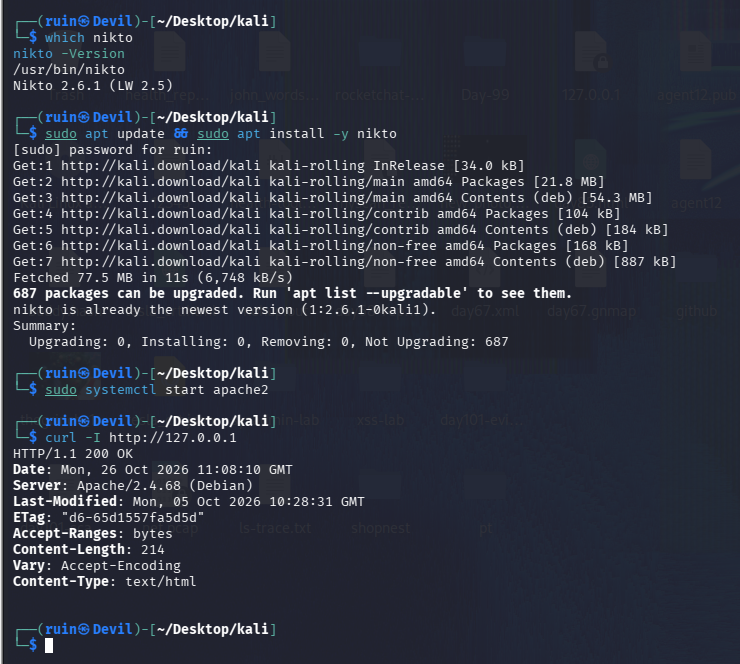
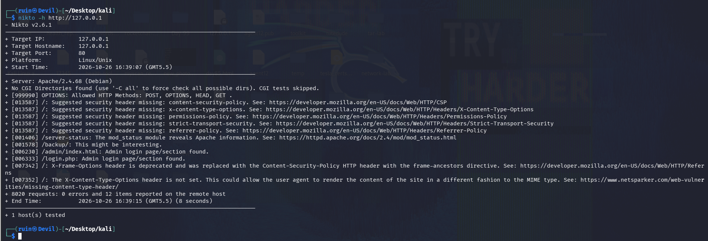
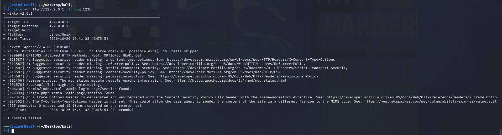
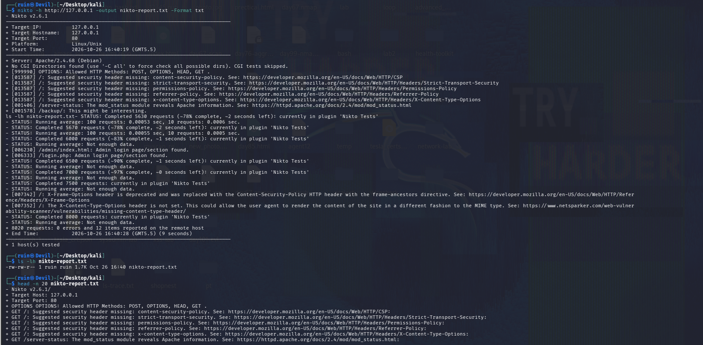
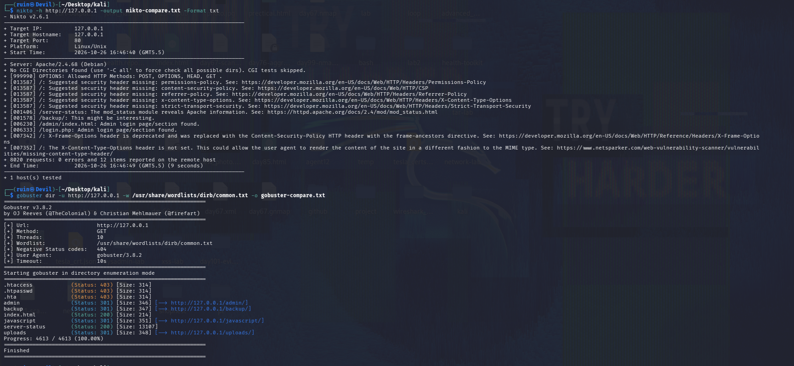

# 🔦 Pentesting Day 04: nikto (Web Server Vulnerability Scanner)

<p align="center">
  
  
  
  
</p>

> Day 03 asked "which paths exist on this server?" Day 04 asks "is this server itself configured safely?" nikto checks the web server for outdated software, risky files, dangerous methods and missing security headers. 🔦

---

## 🏆 Day 03 Recap — What gobuster & ffuf Taught Me

- On my own Apache they found `admin/`, `backup/`, `javascript/`, `uploads/`, `index.html` and `server-status`; `-x php,txt` also found `login.php`.
- `secret-admin/` was **not** found because it isn't in the wordlist — the wordlist decides the result.
- Scans are noisy: Apache counted **30,823** requests after my Day 03 runs.

---

## 🎯 Mission Briefing

nikto is an **active** web server scanner. Unlike a directory brute forcer, it carries its own database of known-risky files, server checks and header checks. I scanned only my own local Apache (`127.0.0.1`) and compared the result with Day 03.

```
🔦 MISSION: Scan My Own Web Server With nikto
──────────────────────────────────────────
[x] Check nikto version and confirm the target is mine
[x] Run a full scan
[x] Narrow the scan with -Tuning
[x] Save a text report and read it
[x] Compare nikto with gobuster
[ ] Explicit port scan (-p 80)  -> not run
[ ] Time limit (-maxtime)       -> not run
[ ] HTML report (-Format htm)   -> not run
──────────────────────────────────────────
STATUS: Pentesting Day 04 — Core done, a few extras pending
```

---

## ⚡ Quick Theory

**nikto** tests a web server against a large database of checks and prints a line (`+`) for every finding. It looks at:

```
Server software + version     ->  outdated or revealing banners
HTTP methods allowed          ->  OPTIONS, PUT, DELETE, ...
Missing security headers      ->  CSP, X-Content-Type-Options, HSTS, ...
Risky / interesting files     ->  /server-status, /backup/, admin pages
```

**Findings are leads, not proof.** A line like "Admin login page found" means nikto saw a path from its database — it still has to be checked by hand.

**Options used today:**

| Option | Purpose |
|--------|---------|
| `-h <target>` | Target host/URL |
| `-Tuning <codes>` | Choose which test categories run (`1` interesting files, `2` misconfiguration, `3` information disclosure, `b` software identification) |
| `-output <file>` / `-Format txt` | Save a report |

> ⚖️ **Scope:** nikto sends thousands of requests and is easy to spot in logs. I ran it only against `127.0.0.1`, my own machine.

---

## 💻 Lab: Commands + My Real Output

*(Machine: Kali Linux, user `ruin`. Target: local Apache, `http://127.0.0.1`)*

### 🏗️ Step 0 — Tool and target check
```bash
$ which nikto
/usr/bin/nikto
$ nikto -Version
Nikto 2.6.1 (LW 2.5)

$ sudo apt update && sudo apt install -y nikto
nikto is already the newest version (1:2.6.1-0kali1).

$ sudo systemctl start apache2
$ curl -I http://127.0.0.1
HTTP/1.1 200 OK
Server: Apache/2.4.68 (Debian)
Content-Length: 214
Content-Type: text/html
```
nikto **2.6.1** is installed and my Apache answers `200 OK` with `Server: Apache/2.4.68 (Debian)`.



### 🔍 Part A — Full scan
```bash
$ nikto -h http://127.0.0.1
+ Target IP:    127.0.0.1
+ Target Port:  80
+ Platform:     Linux/Unix
+ Server: Apache/2.4.68 (Debian)
+ No CGI Directories found (use '-C all' to force check all possible dirs). CGI tests skipped.
+ [999990] OPTIONS: Allowed HTTP Methods: POST, OPTIONS, HEAD, GET .
+ [013587] /: Suggested security header missing: content-security-policy. ...
+ [013587] /: Suggested security header missing: x-content-type-options. ...
+ [013587] /: Suggested security header missing: permissions-policy. ...
+ [013587] /: Suggested security header missing: strict-transport-security. ...
+ [013587] /: Suggested security header missing: referrer-policy. ...
+ [001406] /server-status: The mod_status module reveals Apache information. ...
+ [001578] /backup/: This might be interesting.
+ [006230] /admin/index.html: Admin login page/section found.
+ [006333] /login.php: Admin login page/section found.
+ [007342] /: X-Frame-Options header is deprecated and was replaced with the Content-Security-Policy HTTP header with the frame-ancestors directive. ...
+ [007352] /: The X-Content-Type-Options header is not set. ...
+ 8020 requests: 0 errors and 12 items reported on the remote host
+ End Time: ... (8 seconds)
```
nikto sent **8,020 requests in 8 seconds** and reported **12 items**: server version, allowed methods, 5 missing security headers, 4 interesting paths, and 2 header notes.



### 🔍 Part B — Tuned scan
```bash
$ nikto -h http://127.0.0.1 -Tuning 123b
...
+ 4265 requests: 0 errors and 12 items reported on the remote host
+ End Time: ... (4 seconds)
```
With tuning `1` (interesting files), `2` (misconfiguration), `3` (information disclosure) and `b` (software identification) nikto sent **4,265 requests** — about 47% fewer — in **4 seconds** and still reported the **same 12 items**.



### 🔍 Part C — Save and read a report
```bash
$ nikto -h http://127.0.0.1 -output nikto-report.txt -Format txt
...
+ 8020 requests: 0 errors and 12 items reported on the remote host

$ ls -lh nikto-report.txt
-rw-rw-r-- 1 ruin ruin 1.7K Oct 26 16:40 nikto-report.txt

$ head -n 20 nikto-report.txt
- Nikto v2.6.1/
+ Target Host: 127.0.0.1
+ Target Port: 80
+ GET /: Suggested security header missing: content-security-policy. ...
+ GET /server-status: The mod_status module reveals Apache information. ...
```
The text report is **1.7 KB**. In the file each finding is prefixed with the HTTP method that triggered it (`GET /...`).



### 🔍 Part D — nikto vs gobuster
```bash
$ nikto -h http://127.0.0.1 -output nikto-compare.txt -Format txt
+ 8020 requests: 0 errors and 12 items reported on the remote host   (9 seconds)

$ gobuster dir -u http://127.0.0.1 -w /usr/share/wordlists/dirb/common.txt -o gobuster-compare.txt
.htaccess     (Status: 403)    .htpasswd   (Status: 403)    .hta       (Status: 403)
admin         (Status: 301)    backup      (Status: 301)    index.html (Status: 200)
javascript    (Status: 301)    server-status (Status: 200)  uploads    (Status: 301)
Progress: 4613 / 4613 (100.00%)
```
Both found `/server-status`, `/backup/` and `/admin/`. nikto added server details, methods and header findings and also flagged `/login.php`; gobuster found `javascript/`, `uploads/`, `index.html` and the 403 dotfiles that nikto didn't list.



---

## 🧪 What I Actually Found

- [x] nikto 2.6.1; target Apache/2.4.68 (Debian) on Linux/Unix, port 80
- [x] Full scan: **8,020 requests, 12 items, 8–9 seconds, 0 errors**
- [x] Allowed HTTP methods: `POST, OPTIONS, HEAD, GET`
- [x] **5 security headers missing:** content-security-policy, x-content-type-options, permissions-policy, strict-transport-security, referrer-policy
- [x] `/server-status` exposes Apache info; `/backup/`, `/admin/index.html`, `/login.php` flagged
- [x] `-Tuning 123b`: 4,265 requests, same 12 items, 4 seconds
- [x] Text report saved: 1.7 KB
- [x] nikto and gobuster overlap on `server-status`, `backup`, `admin`, but each found things the other didn't
- [ ] `-p 80`, `-maxtime`, and HTML report — not run yet

---

## 🎯 Mini Challenges

> **🥊 Challenge 1: Tuning vs Full Scan**
> Why use `-Tuning` instead of always running a full scan?

<details>
<summary>My answer</summary>

Tuning runs only the categories I choose, so the scan is faster and quieter. On my server `-Tuning 123b` cut requests from 8,020 to 4,265 and still found all 12 items. The risk: a category I leave out could hide a finding, so a full scan is still worth running at least once.

</details>

> **🥊 Challenge 2: nikto vs a Directory Brute Forcer**
> How is nikto different from gobuster?

<details>
<summary>My answer</summary>

gobuster guesses paths from a wordlist I give it. nikto uses its own database of known risky files and server checks, and also looks at headers, methods and the server version. nikto reported missing headers and allowed methods, which gobuster never checks; gobuster found `uploads/` and `javascript/`, which nikto didn't list.

</details>

> **🥊 Challenge 3: "Admin login page found"**
> nikto flagged `/login.php` as an admin login page. Is that a real login page?

<details>
<summary>My answer</summary>

Not in my lab. `login.php` is a test file I created that only contains the text "login page" (11 bytes). nikto matched the path name against its database. A finding is a lead to verify by hand, not proof of what the page really is.

</details>

> **🥊 Challenge 4: Missing Headers**
> Is "Suggested security header missing" a vulnerability someone can exploit directly?

<details>
<summary>My answer</summary>

Usually not directly — it's a hardening gap. Headers like Content-Security-Policy or X-Content-Type-Options make some browser-side attacks harder, so missing them weakens defence but isn't an exploit by itself. They're cheap to fix in the web server config.

</details>

---

## 🧩 Quick Brain Check

1. What does nikto check that a directory brute forcer does not?
2. Why did `-Tuning 123b` find the same 12 items with fewer requests?
3. Why is a nikto finding a "lead" and not proof?
4. What does `/server-status` expose, and why is that a concern on an internet-facing server?
5. Why is running nikto against a server you don't own a problem?

---

## 🐛 Errors / Gotchas I Hit

- **"Admin login page found" for a plain text file** — nikto matched path names from its database; my `login.php` isn't a real login page. Always verify findings by hand.
- **`No CGI Directories found ... CGI tests skipped`** — nikto skips CGI tests unless it finds a CGI directory; `-C all` forces them.
- **I typed the next command while the scan was running** — `ls -lh nikto-report.txt` ended up in the middle of nikto's output. Wait for the scan to finish before typing.
- **Extra `STATUS: Completed ... requests` lines** appeared in the terminal while saving to a file — progress information, not findings.
- **Findings differ in style from Day 03** — nikto reports headers and methods, gobuster reports paths. Neither replaces the other.
- **Lab said `-Tuning 2` and `-Tuning b` separately; I ran `-Tuning 123b` once** — it still showed the effect of tuning clearly.

---

## 🔐 Security Relevance

nikto-style scanning finds the easy wins on a web server: outdated versions, exposed status pages, leftover backup and admin paths, and missing hardening headers. For a defender the fixes are concrete — restrict `/server-status` to local access, remove `backup/` and test files from the web root, and add the missing security headers. It is also very loud: **8,020 requests in 8 seconds** is obvious in server logs, which is exactly how defenders notice scanners. Only run it on systems I own or am explicitly authorized to test.

---

## 🧠 Today's Takeaway

nikto checks the **server and its configuration**, gobuster checks **which paths exist** — they complement each other. On my own Apache nikto found 12 items, including 5 missing security headers and an exposed `/server-status`. Tuning made the scan faster without losing findings, and every nikto line is a **lead to verify**, not a confirmed vulnerability.

---

⬅️ [Back to Pentesting index](/Pentesting) | ➡️ Next up: **Day 05**
