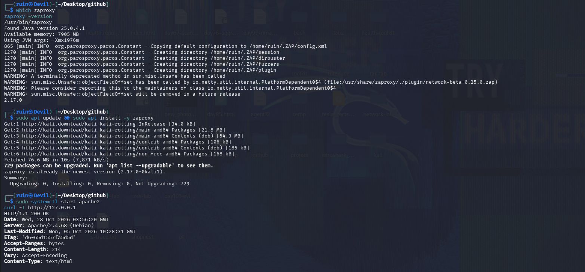
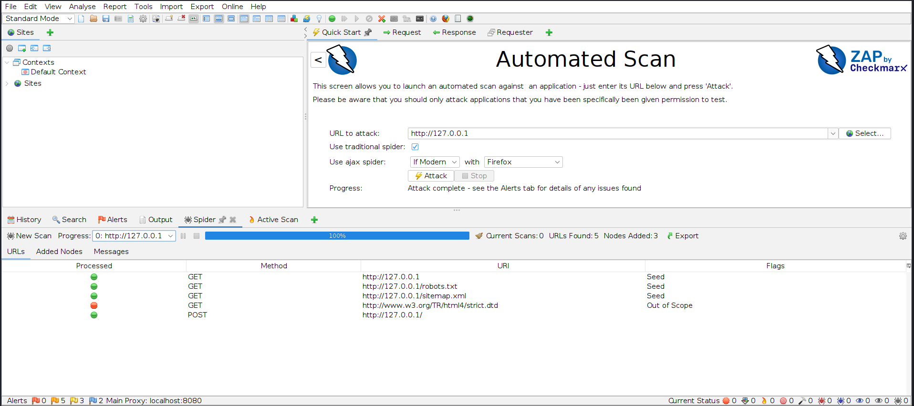
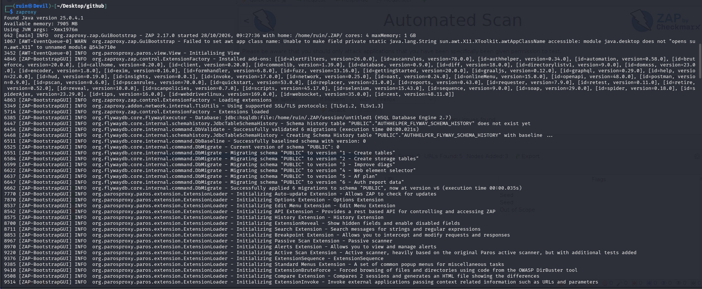
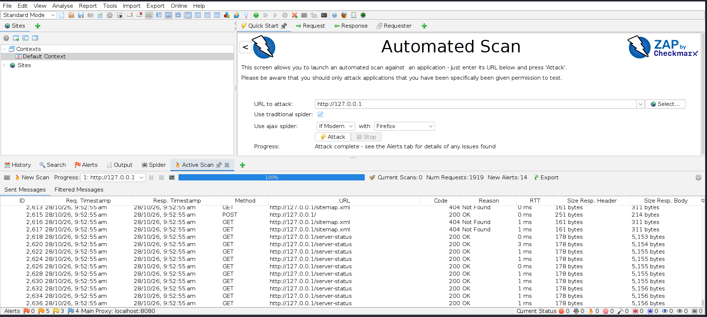
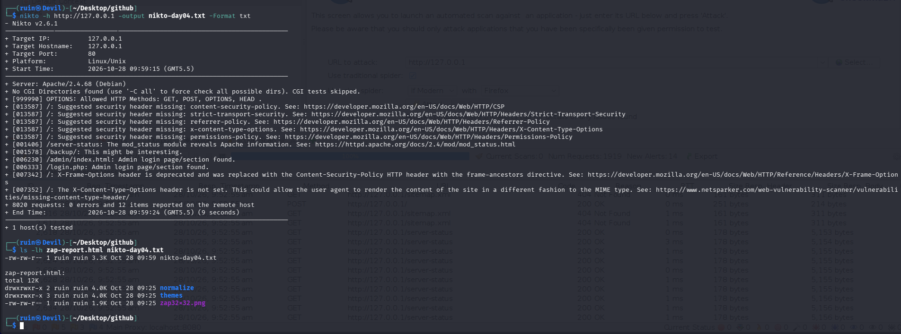

# 🕷️ Pentesting Day 05: OWASP ZAP (Web App Scanner)

<p align="center">
  
  
  
  
</p>

> Day 04 checked the **server** (nikto). Day 05 checks the **application** — ZAP crawls the site, watches the traffic, and then actively probes it for weaknesses. 🕷️

---

## 🏆 Day 04 Recap — What nikto Taught Me

- One full scan: **8,020 requests, 12 items, 8–9 seconds, 0 errors**.
- 5 security headers missing (CSP, X-Content-Type-Options, HSTS, referrer-policy, permissions-policy).
- `/server-status`, `/backup/`, `/admin/index.html`, `/login.php` flagged.
- Every nikto line is a **lead**, not proof — `/login.php` turned out to be a plain test file, not a real login page.

---

## 🎯 Mission Briefing

ZAP (Zed Attack Proxy) is an intercepting proxy and web application scanner. Instead of guessing paths from a wordlist (Day 03) or matching a fixed list of server checks (Day 04), it **crawls the site, then sends attack payloads** to find real application-level issues. I ran it against my own local Apache only.

```
🕷️ MISSION: Scan My Own Web App With ZAP
──────────────────────────────────────────
[x] Launch ZAP and confirm the target is mine
[x] Run an Automated Scan (spider + active scan)
[x] Check the Spider tab (pages discovered)
[x] Check the Alerts tab (findings by risk)
[x] Generate and inspect an HTML report
[x] Re-run nikto for a side-by-side comparison
──────────────────────────────────────────
STATUS: Pentesting Day 05 — Done
```

---

## ⚡ Quick Theory

**ZAP's building blocks:**
```
Spider       ->  crawls links to discover pages (GET/POST requests it can find)
Passive scan ->  analyses traffic ZAP already saw, no extra requests sent
Active scan  ->  sends crafted payloads to find real vulnerabilities (can change data)
Alerts       ->  findings, grouped by risk: High / Medium / Low / Informational
```

An **Automated Scan** in the GUI runs the spider and then the active scan against one URL in a single click.

> ⚖️ **Scope:** Active Scan sends real attack-style payloads. I ran it only against `http://127.0.0.1` — my own Apache — never a site I don't own.

---

## 💻 Lab: Commands + My Real Output

*(Machine: Kali Linux, user `ruin`. Target: local Apache 2.4.68, `http://127.0.0.1`)*

### 🏗️ Step 0 — Launch ZAP, confirm my target
```bash
$ which zaproxy
/usr/bin/zaproxy
$ zaproxy -version
2.17.0

$ sudo apt update && sudo apt install -y zaproxy
zaproxy is already the newest version (2.17.0-0kali1).

$ sudo systemctl start apache2
$ curl -I http://127.0.0.1
HTTP/1.1 200 OK
Server: Apache/2.4.68 (Debian)
Content-Length: 214
```
ZAP **2.17.0** (Java 25.0.4.1, 7905 MB available) and my Apache answer `200 OK`. Its startup log listed every bundled add-on — ascanrules, pscan, spider, bruteforce, websocket and more — already installed.



### 🔍 Part A — Automated Scan
In the GUI: **Quick Start → Automated Scan**, URL `http://127.0.0.1`, traditional spider on, **Attack**.

```
Progress: Attack complete - see the Alerts tab for details of any issues found
Current Scans: 0   Num Requests: 1919   New Alerts: 14
```
The scan sent **1,919 requests** and raised **14 new alerts**. The live Active Scan log showed it repeatedly probing `/server-status` and `/sitemap.xml` (404) with different payloads.



### 🔍 Part B — Spider results and alert counts
The Spider tab (same scan) showed what it actually crawled:

```
URLs Found: 5   Nodes Added: 3
GET  http://127.0.0.1
GET  http://127.0.0.1/robots.txt
GET  http://127.0.0.1/sitemap.xml
GET  http://www.w3.org/TR/html4/strict.dtd   [Out of Scope]
POST http://127.0.0.1/
```
Only **5 URLs** found — the spider follows links, and my plain test pages (`index.html`, `login.php`, `backup/`) aren't linked from anywhere, so it didn't find them (same limitation as Day 03's wordlist). The bottom status bar showed alert counts by risk level after the scan (flag icons: High/Medium/Low/Informational).



### 🔍 Part C — Generate and check the report
```bash
$ zaproxy &
# Report menu -> Generate Report... -> HTML -> saved as zap-report.html

$ ls -lh zap-report.html
total 12K
drwxrwxr-x 2 ruin ruin 4.0K Oct 28 09:25 normalize
drwxrwxr-x 3 ruin ruin 4.0K Oct 28 09:25 themes
-rw-rw-r-- 1 ruin ruin 1.9K Oct 28 09:25 zap32x32.png
```
`zap-report.html` turned out to be a **folder**, not a single file — ZAP's HTML report ships with its own `normalize`/`themes` CSS and a logo image alongside the actual report page. Good to know before trying to just `cat` it or email a single file.



### 🔍 Part D — ZAP vs nikto, side by side
```bash
$ nikto -h http://127.0.0.1 -output nikto-day04.txt -Format txt
...
+ [013587] /: Suggested security header missing: content-security-policy. ...
+ [013587] /: Suggested security header missing: strict-transport-security. ...
+ [013587] /: Suggested security header missing: referrer-policy. ...
+ [013587] /: Suggested security header missing: x-content-type-options. ...
+ [013587] /: Suggested security header missing: permissions-policy. ...
+ [001406] /server-status: The mod_status module reveals Apache information. ...
+ [001578] /backup/: This might be interesting.
+ [006230] /admin/index.html: Admin login page/section found.
+ [006333] /login.php: Admin login page/section found.
+ 8020 requests: 0 errors and 12 items reported on the remote host

$ ls -lh zap-report.html nikto-day04.txt
-rw-rw-r-- 1 ruin ruin 3.3K Oct 28 09:59 nikto-day04.txt
zap-report.html: [directory, see above]
```
Re-running nikto reproduced the **same 12 items** as Day 04. Side by side: both tools flagged missing security headers and `/server-status`; ZAP's active scan additionally probed live application paths (`/sitemap.xml`, repeated `/server-status` requests with different payloads) that nikto's fixed database doesn't attempt.



---

## 🧪 What I Actually Found

- [x] ZAP 2.17.0 running, target confirmed as my own `127.0.0.1` Apache
- [x] Automated Scan: **1,919 requests, 14 new alerts**
- [x] Spider: only **5 URLs found / 3 nodes added** (nothing linked beyond the homepage, robots.txt, sitemap.xml)
- [x] HTML report generated — turned out to be a **folder**, not one file
- [x] nikto re-run for comparison: same 12 items as Day 04
- [x] Both tools agree on missing headers and `/server-status`; ZAP also actively probed `/sitemap.xml` and repeated `/server-status`
- [ ] Separate Spider-only vs Active-Scan-only alert-count comparison (Lab Part B) — not isolated as two distinct runs

---

## 🎯 Mini Challenges

> **🥊 Challenge 1: Spider vs Active Scan**
> In your own words — what does the spider do, and what does the active scan do differently?

<details>
<summary>My answer</summary>

The spider just follows links to find pages that exist (5 URLs found here). The active scan then sends crafted payloads to those (and other guessed) paths to look for real weaknesses — that's why the Automated Scan sent 1,919 requests but the spider itself only listed 5 URLs.

</details>

> **🥊 Challenge 2: Why So Few URLs?**
> The spider found only 5 URLs on a server I know has `backup/`, `login.php`, and `admin/`. Why?

<details>
<summary>My answer</summary>

The spider only follows links it can find in pages (HTML links, forms, robots.txt, sitemap.xml). My test files from Day 03 aren't linked from `index.html`, so nothing points the spider to them — same root cause as gobuster needing the names to be in a wordlist. Discovery tools only find what they're pointed at or guess correctly.

</details>

> **🥊 Challenge 3: The Report "File" That Wasn't**
> `ls -lh zap-report.html` showed a directory, not a file. What does that tell you?

<details>
<summary>My answer</summary>

ZAP's HTML report isn't self-contained — it's a small site: a main HTML page plus `normalize`/`themes` CSS and an image, in their own folder. If I need to share or archive it, I need to zip the whole folder, not just grab one file.

</details>

> **🥊 Challenge 4: ZAP vs nikto**
> Both flagged missing headers and `/server-status`. What's the actual difference between them?

<details>
<summary>My answer</summary>

nikto compares the server against a fixed database of known checks — fast and consistent, but it only knows what's in that database. ZAP crawls the live application and then actively sends payloads tailored to what it found, so it can catch application-specific issues nikto's static checks would miss — at the cost of being slower (1,919 vs 8,020 requests is actually fewer here, but ZAP's scan took noticeably longer due to the GUI spidering/active-scan cycle).

</details>

---

## 🧩 Quick Brain Check

1. What's the difference between the spider, a passive scan, and an active scan in ZAP?
2. Why did the spider only find 5 URLs?
3. Why is a ZAP HTML report a folder instead of one file?
4. What did ZAP and nikto agree on? What might each catch that the other wouldn't?
5. Why is Active Scan something you only ever point at your own systems?

---

## 🐛 Errors / Gotchas I Hit

- **`zap-report.html` is a directory, not a file** — `ls -lh` on it listed `normalize/`, `themes/`, and `zap32x32.png` inside. I'd have tried to `cat` or email a single file otherwise.
- **Spider found far fewer URLs than I expected** — it only follows discoverable links; unlinked test pages from Day 03 were invisible to it, same lesson as wordlist-based tools.
- **ZAP's startup log is long** — Java version, add-on list (40+ extensions), database migrations all print before the GUI is usable; easy to mistake for an error.
- **`robots.txt` and `sitemap.xml` don't exist on my server** (404) but the spider still requested them — it always checks these by convention, whether or not they're present.
- **`W3C` DTD link appeared as "Out of Scope"** — ZAP followed an external reference inside a page but correctly refused to spider outside the target domain.

---

## 🔐 Security Relevance

ZAP represents the step up from "does this path exist" (Day 03) and "does this server have known misconfigurations" (Day 04) to "does this **application** actually behave insecurely when attacked." Its active scan is the same category of testing a real penetration test report is built on. The fact that my spider found almost nothing is itself a useful defensive lesson: unlinked "hidden" pages aren't truly hidden — anyone with a wordlist (Day 03) finds them anyway, so "security through obscurity" (no link to the page) is not real protection.

---

## 🧠 Today's Takeaway

ZAP crawls first, then attacks — spider, passive scan, and active scan are three distinct steps, not one. On my own server it found the same core issues nikto did (missing headers, `/server-status`) but reached them by actively probing the live application rather than matching a fixed checklist. And the report "file" lesson — it's actually a folder — is the kind of practical detail you only learn by actually running the tool.

---

⬅️ [Back to Pentesting index](/Pentesting) | ➡️ Next up: **Day 06: sqlmap**
