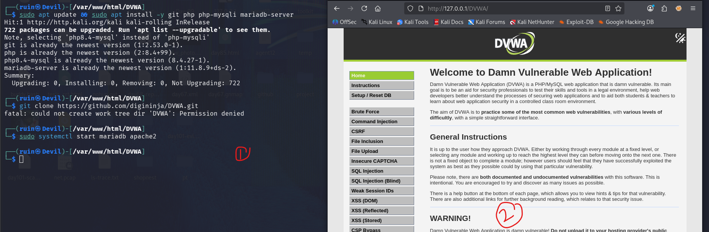
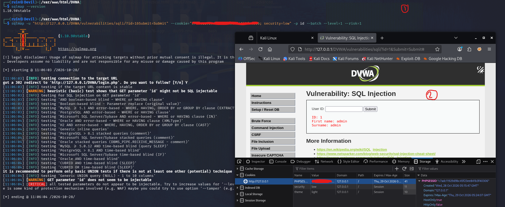
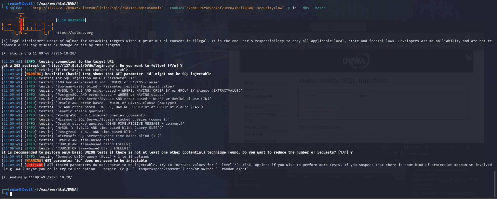
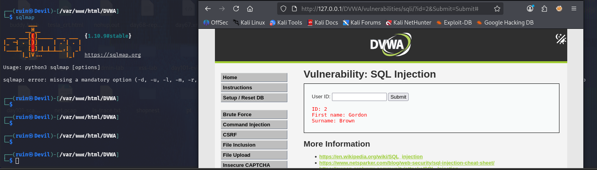

# 💉 Pentesting Day 06: sqlmap (SQL Injection Testing)

<p align="center">
  
  
  
  
</p>

> Day 05 (ZAP) crawled and actively probed my plain Apache site. Day 06 needed a **genuinely vulnerable** target, so I set up DVWA — and then ran into a session problem that's a lesson in itself. 💉

---

## 🏆 Day 05 Recap — What ZAP Taught Me

- Automated Scan: 1,919 requests, 14 new alerts; the spider found only 5 URLs because my test pages weren't linked from anywhere.
- ZAP and nikto agreed on missing headers and `/server-status`.
- A ZAP HTML report turned out to be a **folder**, not a single file.

---

## 🎯 Mission Briefing

sqlmap automates finding and exploiting SQL injection. It needs a page that's actually injectable, so this day starts with installing **DVWA** (Damn Vulnerable Web Application) instead of reusing the plain Apache site from Days 03–05.

```
💉 MISSION: Test SQL Injection With sqlmap on DVWA
──────────────────────────────────────────
[x] Install DVWA and get it running
[x] Log in, confirm the SQL Injection page works in the browser
[x] Point sqlmap at the id parameter
[ ] sqlmap confirms 'id' is injectable   -> did NOT happen (see below)
[ ] Enumerate databases (--dbs)           -> blocked by the above
[ ] Dump the users table                  -> not reached
──────────────────────────────────────────
STATUS: Pentesting Day 06 — Setup done, sqlmap test did not go as expected (real, useful result)
```

---

## ⚡ Quick Theory

**sqlmap workflow:** point it at a URL with a parameter → it tests that parameter with different injection techniques (boolean-based, error-based, UNION, time-based, stacked queries) → if one works, it can enumerate databases, tables, and dump data.

```
--batch              ->  answer every prompt with the default (non-interactive)
--level / --risk     ->  how many tests / how aggressive (1 = lightest, default)
-p <param>            ->  test only one specific parameter
--cookie="..."        ->  send a session cookie, needed for pages behind login
--dbs / --tables / --dump  ->  enumerate databases / tables / dump data, once injectable
```

**Why DVWA needs a cookie at all:** its SQL Injection page is behind a login, so sqlmap must be given a valid, logged-in session cookie (`PHPSESSID`) or it will just see the login page.

> ⚖️ **Scope:** sqlmap sends real attack payloads and can read/modify data. DVWA on my own machine only — never a real site.

---

## 💻 Lab: Commands + My Real Output

*(Machine: Kali Linux, user `ruin`. Target: DVWA at `http://127.0.0.1/DVWA`)*

### 🏗️ Step 0 — Install DVWA
```bash
$ sudo apt update && sudo apt install -y git php php-mysqli mariadb-server
git, php, php8.4-mysqli, mariadb-server all already the newest version.

$ git clone https://github.com/digininja/DVWA.git
fatal: could not create work tree dir 'DVWA': Permission denied

$ sudo systemctl start mariadb apache2
```
The `git clone` failed with **Permission denied** — I was trying to clone into `/var/www/html/DVWA` without `sudo`, and that directory is owned by the web server, not my user. Despite that, DVWA loaded in the browser (`http://127.0.0.1/DVWA/`), so the application files were already in place from an earlier step — the failed clone just didn't overwrite anything.



### 🔍 Part A — Confirm the target works in the browser, then test with sqlmap
In the browser, logged into DVWA, security set to **low**, the SQL Injection page correctly returned results for a manual query:
```
User ID: 1
ID: 1
First name: admin
Surname: admin
```

```bash
$ sqlmap -u "http://127.0.0.1/DVWA/vulnerabilities/sqli/?id=1&Submit=Submit" \
  --cookie="PHPSESSID=<redacted>; security=low" -p id --dbs --batch

[*] starting @ 11:09:48 /2026-10-28/
[11:09:48] [INFO] testing connection to the target URL
got a 302 redirect to 'http://127.0.0.1/DVWA/login.php'. Do you want to follow? [Y/n] Y
[11:09:48] [INFO] testing if the target URL content is stable
[11:09:49] [WARNING] heuristic (basic) test shows that GET parameter 'id' might not be injectable
[11:09:49] [INFO] testing for SQL injection on GET parameter 'id'
... (boolean-based, error-based, UNION, stacked-queries, time-based tests for MySQL, PostgreSQL, Oracle, MSSQL, H2, CUBRID)
[11:09:49] [WARNING] GET parameter 'id' does not seem to be injectable
[11:09:49] [CRITICAL] all tested parameters do not appear to be injectable
```
sqlmap hit a **302 redirect to `login.php`** right at the start. It followed the redirect and then tested whatever page it landed on — which explains why every technique failed: it wasn't actually testing the SQL Injection page, it was testing the login page.



### 🔍 Part B — Retried with a fresh cookie and lower level/risk
```bash
$ sqlmap --version
1.10.9#stable

$ sqlmap -u "http://127.0.0.1/DVWA/vulnerabilities/sqli/?id=1&Submit=Submit" \
  --cookie="PHPSESSID=<redacted>; security=low" -p id --batch --level=1 --risk=1

got a 302 redirect to 'http://127.0.0.1/DVWA/login.php'. Do you want to follow? [Y/n] Y
...
[WARNING] GET parameter 'id' does not seem to be injectable
[CRITICAL] all tested parameters do not appear to be injectable
```
Same result, even with a cookie copied fresh from the browser (confirmed in DevTools → Storage → Cookies — `PHPSESSID` was present, `security=low` was set). The browser itself was logged in and showed real query results (`ID: 1, First name: admin`) at the same time, so **DVWA's session was valid** — but sqlmap still got redirected to the login page.



### 🔍 Part C — Dump attempt
```bash
$ sqlmap
Usage: python3 sqlmap [options]
sqlmap: error: missing a mandatory option (-d, -u, -l, -m, -r, ...), use -h for basic or -hh for advanced help
```
I ran `sqlmap` with no target URL — it just printed the usage error. The database/table dump (Part C of the lab) wasn't actually attempted with real options, so there's no dump result to report yet.



---

## 🧪 What I Actually Found

- [x] DVWA installed and reachable at `http://127.0.0.1/DVWA/`, security level set to low
- [x] sqlmap 1.10.9#stable confirmed working (`--version`)
- [x] Browser session confirmed valid — manual query on the SQLi page returned real data
- [x] **sqlmap's own requests got redirected to `login.php`** on every attempt, both with default settings and `--level=1 --risk=1`
- [x] Because of the redirect, sqlmap tested the wrong page and reported `id` as "not injectable" — a **false negative caused by a session/cookie problem**, not proof the page is safe
- [ ] `--dbs` database enumeration — never actually ran (blocked by the above)
- [ ] `-T users --dump` — not attempted with real target options

---

## 🎯 Mini Challenges

> **🥊 Challenge 1: Why the Redirect?**
> sqlmap got redirected to `login.php` even though the browser's session was clearly logged in. What are the likely causes?

<details>
<summary>My answer</summary>

Most likely the `PHPSESSID` value in the command didn't exactly match the one the browser was actively using at that moment — sessions can rotate, expire, or be copied with a trailing character missing. It's also possible DVWA requires both the `PHPSESSID` *and* `security` cookie to be sent exactly as the browser sends them (same casing, same semicolon-space format), and a slight mismatch caused DVWA to treat the request as unauthenticated.

</details>

> **🥊 Challenge 2: False Negative**
> sqlmap reported "all tested parameters do not appear to be injectable." Does that mean the page is safe?

<details>
<summary>My answer</summary>

No — it means sqlmap wasn't actually testing the vulnerable page. Because of the redirect to `login.php`, every test ran against the login page's content, which has no `id`-based query logic at all. A "not injectable" result is only meaningful if you're certain the tool reached the real target page first.

</details>

> **🥊 Challenge 3: How Would You Debug This Next?**
> What's the next concrete step to get sqlmap actually testing the right page?

<details>
<summary>My answer</summary>

1. Open the SQL Injection page fresh in the browser, submit a query, then immediately copy the exact `PHPSESSID` from DevTools → Storage → Cookies — no gap between copying and running sqlmap.
2. Add `-v 3` to sqlmap to see the raw response it got back, to confirm whether it really is the login page HTML.
3. Try sqlmap's own `--cookie` combined with `--auth-type` / a fresh login via sqlmap itself, or use `--cookie` captured directly from a proxy like Burp/ZAP's history instead of the browser.

</details>

---

## 🧩 Quick Brain Check

1. Why does DVWA's SQL Injection page need a cookie at all for sqlmap to test it?
2. What does a "302 redirect to login.php" tell you about the request sqlmap just sent?
3. Why is "not injectable" sometimes a false negative rather than a real result?
4. What's the difference between `--level`/`--risk` and the session/cookie problem I hit — would increasing them have fixed this?
5. Why is it important to confirm *what page* a tool actually tested, not just read its final verdict?

---

## 🐛 Errors / Gotchas I Hit

- **`git clone` → Permission denied** — tried cloning into `/var/www/html/DVWA` without `sudo`; that directory belongs to the web server user. DVWA still loaded because the files were already there from before.
- **sqlmap redirected to `login.php` on every run** — the real blocker of the day. The cookie I supplied didn't keep sqlmap inside the authenticated session, even though the same browser session worked fine manually.
- **Increasing `--level`/`--risk` didn't help** — because the problem wasn't test thoroughness, it was that sqlmap was testing the wrong page entirely. A classic case of "fix the actual cause, not just turn up the intensity."
- **Ran bare `sqlmap` with no arguments** for the dump step — got the usage/help error instead of a real attempt. Need to re-run with the full `-u ... --cookie ... -D dvwa -T users --dump` command once the session issue is fixed.

---

## 🔐 Security Relevance

This day's biggest lesson wasn't about SQL injection itself — it was about **verifying a tool's negative result before trusting it**. In a real test, reporting "parameter not injectable" without checking that the tool actually reached the intended page would be a false negative handed to a client, potentially leaving a real vulnerability unreported. Always confirm the target behind a login is the page actually being tested — check response content, status codes, or run with increased verbosity (`-v 3`) before accepting a "not injectable" verdict.

---

## 🧠 Today's Takeaway

Today didn't go as planned, and that's the honest, useful result: DVWA was up and manually vulnerable, but **sqlmap kept getting redirected to the login page**, so its "not injectable" verdict was a false negative, not a real finding. The fix is a session/cookie problem to solve, not a sqlmap settings problem — `--level`/`--risk` wouldn't have changed anything. Enumeration and dump (`--dbs`, `--dump`) are still ahead of me once the session is sorted.

---

⬅️ [Back to Pentesting index](/Pentesting) | ➡️ Next up: **Day 07: Metasploit**
