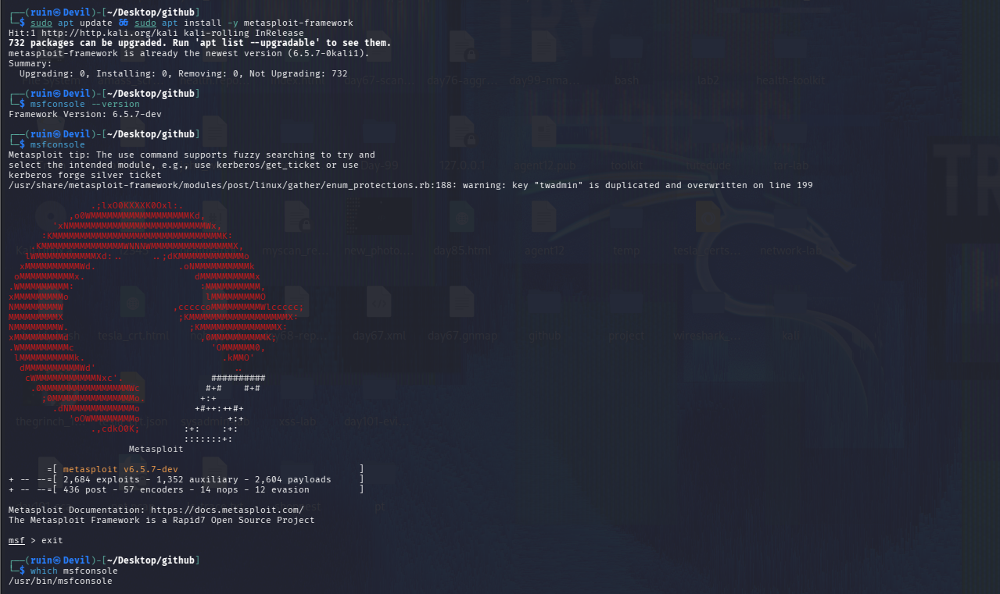
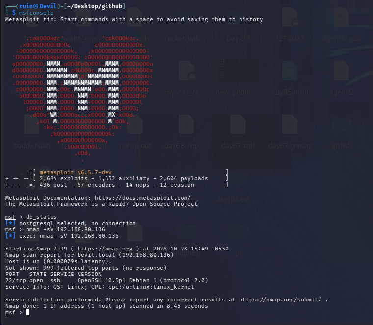
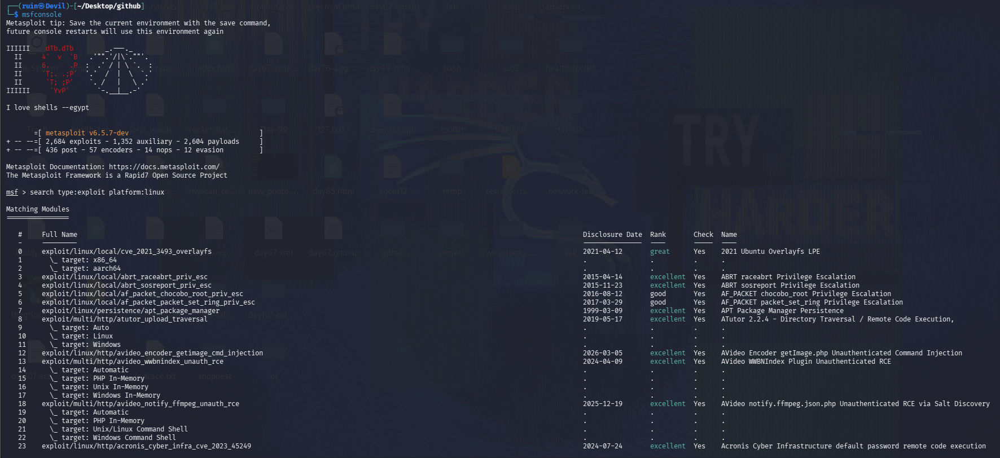
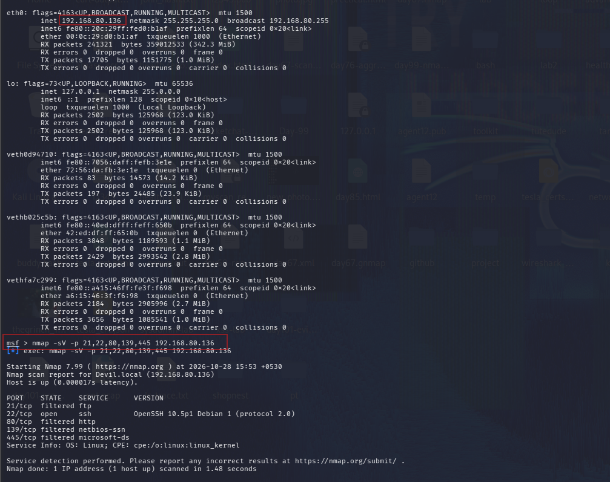

# 🎯 Pentesting Day 07: Metasploit Basics

<p align="center">
  
  
  
  
</p>

> Day 06 (sqlmap) taught me to double-check what a tool is actually testing before trusting its verdict. Day 07 (Metasploit) handed me the same lesson again — from a different angle. 🎯

---

## 🏆 Day 06 Recap — What sqlmap Taught Me

- sqlmap got redirected to DVWA's login page on every run and reported "not injectable" — a **false negative** caused by a session/cookie problem, not a real result.
- Takeaway: always confirm *what page a tool actually reached* before trusting its verdict.

---

## 🎯 Mission Briefing

Metasploit is a framework for finding, configuring and running exploits against a target. I scanned a target at `192.168.80.136` with nmap (from inside `msfconsole`) and searched for matching exploits — but a few things about the scan results didn't add up, which is this day's real lesson.

```
🎯 MISSION: Scan and Attempt an Exploit With Metasploit
──────────────────────────────────────────
[x] Install / confirm metasploit-framework
[x] Launch msfconsole
[x] Scan the target with nmap from inside msfconsole
[x] Search for exploits (broad search, platform:linux)
[ ] Select a specific exploit module (use ...)   -> not done
[ ] Configure RHOSTS and run it                  -> not done
[ ] Get a shell / confirm access                 -> not reached
──────────────────────────────────────────
STATUS: Pentesting Day 07 — Setup + recon done, exploit not run, and the recon itself raised a red flag (see below)
```

---

## ⚡ Quick Theory

**Metasploit workflow:** `search` for a module → `use` it → `show options` → `set RHOSTS` (and other required options) → `run`/`exploit`.

```
search <keyword>       ->  find modules matching a service/CVE/platform
use <module-path>      ->  select one
show options           ->  see what it needs (RHOSTS, RPORT, ...)
set RHOSTS <ip>         ->  point it at the target
run                     ->  attempt the exploit
```

Metasploit also wraps other recon tools — running `nmap` *inside* `msfconsole` works the same as a normal terminal, and with its database connected (`msfdb init`), results get saved automatically for later use (`db_nmap`, `hosts`, `services`).

> ⚖️ **Scope:** exploitation only against a target VM I control, on an isolated network — never a real machine.

---

## 💻 Lab: Commands + My Real Output

*(Machine: Kali Linux, user `ruin`. Target scanned: `192.168.80.136`, hostname resolved as `Devil.local`)*

### 🏗️ Step 0 — Confirm Metasploit is installed
```bash
$ sudo apt update && sudo apt install -y metasploit-framework
metasploit-framework is already the newest version (6.5.7-0kali1).

$ msfconsole --version
Framework Version: 6.5.7-dev

$ msfconsole
...
msf > exit

$ which msfconsole
/usr/bin/msfconsole
```
Metasploit **6.5.7-dev** was already installed: **2,684 exploits, 1,352 auxiliary, 2,604 payloads**.



### 🔍 Part A — Scan the target from inside msfconsole
```bash
$ msfconsole
msf > db_status
[*] postgresql selected, no connection
msf > nmap -sV 192.168.80.136
[*] exec: nmap -sV 192.168.80.136

Starting Nmap 7.99 at 2026-10-28 15:49 +0530
Nmap scan report for Devil.local (192.168.80.136)
Host is up (0.000079s latency).
Not shown: 999 filtered tcp ports (no-response)
PORT   STATE SERVICE VERSION
22/tcp open  ssh     OpenSSH 10.5p1 Debian 1 (protocol 2.0)
Service Info: OS: Linux; CPE: cpe:/o:linux:linux_kernel
Nmap done: 1 IP address (1 host up) scanned in 8.45 seconds
```
`db_status` showed **"no connection"** — Metasploit's database wasn't initialized (`msfdb init` from the lab's Step 0 wasn't run, or didn't take). The scan itself found only **one open port: SSH (OpenSSH 10.5p1)**, with 999 ports filtered. OpenSSH **10.5p1** is a current, up-to-date version — not the old, vulnerable services a real Metasploitable2 box normally exposes.



### 🔍 Part B — Broad exploit search
```bash
msf > search type:exploit platform:linux

Matching Modules
================
#  Full Name                                           Disclosure Date  Rank       Check  Name
-  ---------                                           ---------------  ----       -----  ----
0  exploit/linux/local/cve_2021_3493_overlayfs          2021-04-12       great      Yes    2021 Ubuntu Overlayfs LPE
3  exploit/linux/local/abrt_raceabrt_priv_esc            2015-04-14       excellent  Yes    ABRT raceabrt Privilege Escalation
...
23 exploit/linux/http/acronis_cyber_infra_cve_2023_45249 2024-07-24       excellent  Yes    Acronis Cyber Infrastructure default password RCE
```
This was a **generic `platform:linux` search**, not targeted at a specific service I found open. With only SSH available, there wasn't a matching web/FTP/SMB exploit (like the lab's `vsftpd_234_backdoor` example) to actually `use`.



### 🔍 Part C — A second, port-restricted scan
```bash
$ ifconfig
eth0: inet 192.168.80.136 netmask 255.255.255.0 broadcast 192.168.80.255
lo:   inet 127.0.0.1
veth0d94710, vethb025c5b, vethfa7c299: ... (Docker-style virtual interfaces)

msf > nmap -sV -p 21,22,80,139,445 192.168.80.136
[*] exec: nmap -sV -p 21,22,80,139,445 192.168.80.136

Nmap scan report for Devil.local (192.168.80.136)
PORT    STATE    SERVICE      VERSION
21/tcp  filtered ftp
22/tcp  open     ssh          OpenSSH 10.5p1 Debian 1 (protocol 2.0)
80/tcp  filtered http
139/tcp filtered netbios-ssn
445/tcp filtered microsoft-ds
```
Restricting the scan to the classic Metasploitable2 ports (21, 22, 80, 139, 445) still showed only **SSH open**; FTP, HTTP, and SMB were all **filtered**, not open. That's the opposite of what a real Metasploitable2 VM looks like — it deliberately ships with vsftpd, Samba, and a web server wide open.



---

## 🧪 What I Actually Found

- [x] Metasploit 6.5.7-dev confirmed installed and launching correctly
- [x] `db_status` → **no database connection** (postgresql selected but not connected)
- [x] Full scan of `192.168.80.136`: only **port 22 (SSH, OpenSSH 10.5p1)** open, 999 ports filtered
- [x] Port-restricted scan (21/22/80/139/445): still only SSH open, rest filtered
- [x] Hostname resolved to **`Devil.local`** — the same hostname as my own Kali shell prompt (`ruin@Devil`)
- [x] Broad `platform:linux` exploit search returned generic results, nothing tied to an actually-open service
- [ ] No specific exploit module was `use`d, configured, or `run`
- [ ] No shell obtained

---

## 🎯 Mini Challenges

> **🥊 Challenge 1: What's Suspicious About the Scan?**
> The target's hostname resolved as `Devil.local`, and only a modern, patched SSH was open. What does that suggest?

<details>
<summary>My answer</summary>

`Devil` is the hostname of my own Kali machine (visible in my shell prompt, `ruin@Devil`). A real Metasploitable2 VM has its own separate hostname and exposes many old, vulnerable services (FTP, Samba, web apps) by default — not just one modern SSH. This strongly suggests `192.168.80.136` was actually my own Kali box's network interface, not a separate Metasploitable2 VM, possibly because Metasploitable2 was never actually started/connected on this network, or the IP noted down was wrong.

</details>

> **🥊 Challenge 2: Why Did the Exploit Search Come Up Empty-Handed?**
> `search type:exploit platform:linux` returned dozens of modules, but none got `use`d. Why?

<details>
<summary>My answer</summary>

The search was too broad — it matches any Linux exploit in the whole framework, not ones relevant to what's actually running on the target. With only SSH (and a current, patched version) open, there's no matching open service to target; the lab's `vsftpd_234_backdoor` example assumes vsftpd is running, which it isn't here.

</details>

> **🥊 Challenge 3: `db_status` Said "No Connection" — Does That Matter?**
> Does an uninitialized database stop Metasploit from working?

<details>
<summary>My answer</summary>

No — `nmap` and exploit modules still ran fine. But without the database, Metasploit can't save scan results for later (`hosts`, `services`, `db_nmap` wouldn't persist anything), so every recon step has to be re-run and re-read manually instead of being tracked automatically. Running `sudo msfdb init` first would fix this.

</details>

> **🥊 Challenge 4: What Should the Next Step Be?**
> Given today's results, what's the right next move — not just "try an exploit anyway"?

<details>
<summary>My answer</summary>

Stop and verify the target first: confirm Metasploitable2 is actually powered on and reachable, check its own `ifconfig`/login banner directly (not just trust an IP I wrote down), and re-run `msfdb init` before scanning again. Running an exploit search against an IP I haven't confirmed is the real target wastes time and risks accidentally testing the wrong machine — exactly the kind of mistake Day 06 already taught me to catch before trusting a tool's output.

</details>

---

## 🧩 Quick Brain Check

1. What does `db_status` tell you, and why does an uninitialized database matter?
2. Why is a broad `platform:linux` search less useful than searching for a specific service/version?
3. What's suspicious about a target hostname matching your own attacking machine's hostname?
4. Why does a real Metasploitable2 VM normally show many open ports, and what does it mean if it doesn't?
5. Why is verifying the target before exploiting it just as important as verifying a tool's "not vulnerable" result (Day 06)?

---

## 🐛 Errors / Gotchas I Hit

- **`db_status` → "no connection"** — `msfdb init` wasn't run first, so Metasploit's database was never connected. Recon results weren't being saved.
- **Hostname `Devil.local` matched my own Kali hostname** — strong sign the scanned IP may have been my own machine, not a separate Metasploitable2 VM. Need to verify the target VM is actually running and get its real IP directly from its own console.
- **Only SSH open, with a modern/patched version** — doesn't match what Metasploitable2 is supposed to look like (many old, intentionally vulnerable services). Confirms the target-identity suspicion above.
- **Searched broadly instead of by service** — `search type:exploit platform:linux` with no specific product/CVE wasted effort; should search by the actual service found open (e.g. `search ssh` once I confirm it's really the intended target).
- **No exploit was actually selected or run** — today ended at the recon stage once the target looked wrong, rather than exploiting a possibly-incorrect machine.

---

## 🔐 Security Relevance

The real lesson today: **verify your target before you attack it.** Running scans or exploits against an unconfirmed IP risks hitting the wrong machine — in a real engagement that could mean testing a system outside the agreed scope, which is a serious problem regardless of intent. A hostname that matches your own attacking machine, or a port profile that doesn't match what you expected, are both signals to stop and re-verify before going further — not something to explain away and push through.

---

## 🧠 Today's Takeaway

Today's `msfconsole` basics (search / use / set / run) are straightforward, but the scan results themselves were the real teaching moment: a hostname matching my own Kali box and only one modern, patched port open are both signs the intended Metasploitable2 target wasn't actually what I was scanning. Before trying Part B/C of the lab (selecting and running a real exploit) again, I need to confirm Metasploitable2 is powered on, isolated, and reachable at a verified IP — not assume the first scan result was hitting the right machine.

---

⬅️ [Back to Pentesting index](../README.md) | ➡️ Next up: **Day 08: John the Ripper**
