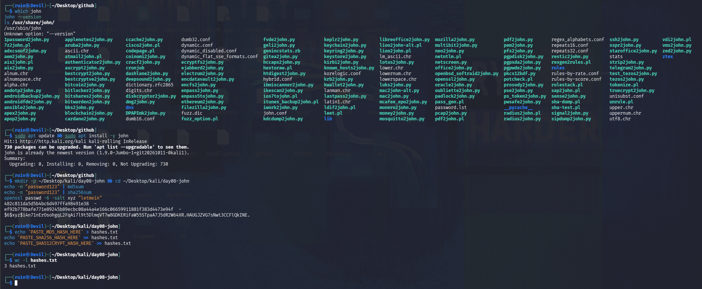
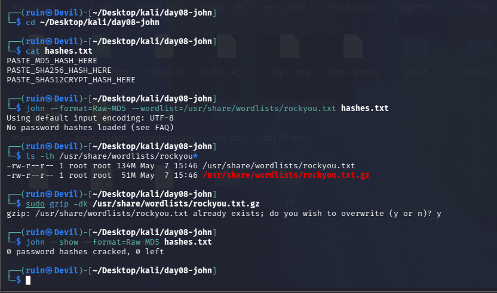
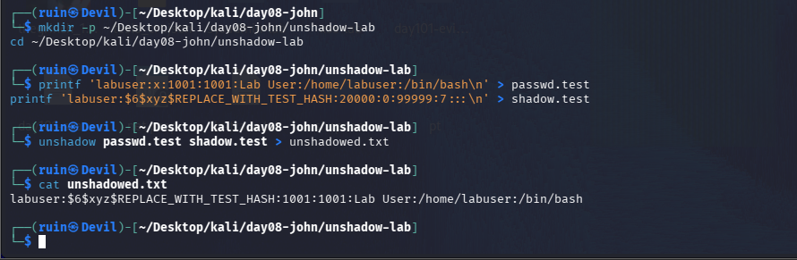
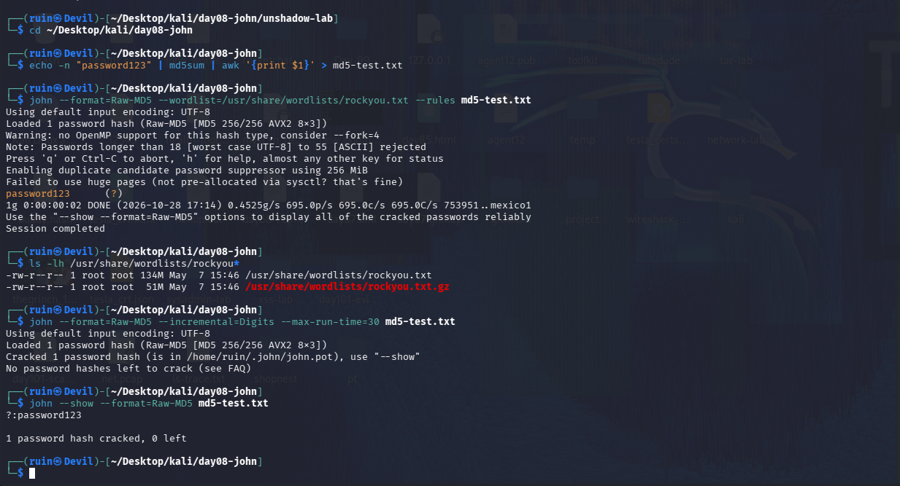
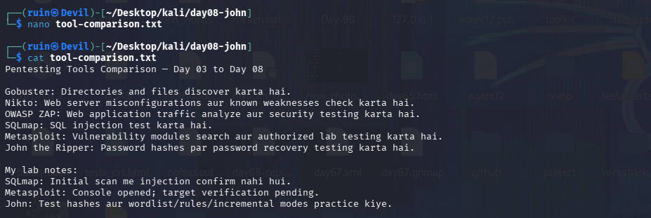

# 🔓 Pentesting Day 08: John the Ripper (Password Cracking)

<p align="center">
  
  
  
  
</p>

> Day 07 (Metasploit) ended with "verify your target before attacking it." Day 08 (John) adds the matching lesson for data: **verify your hash file actually has hashes in it.** 🔓

---

## 🏆 Day 07 Recap — What Metasploit Taught Me

- `db_status` showed no database connection, and a scanned target's hostname matched my own Kali hostname (`Devil.local`) — a sign I may have scanned the wrong machine.
- Only one modern, patched SSH was open — not the wide-open service list a real Metasploitable2 box should show.
- Lesson: confirm the target is really what you think it is before running anything against it.

---

## 🎯 Mission Briefing

John the Ripper cracks password hashes with a wordlist, mangling rules, or brute force. I tested it three different ways: a hash I generated and plugged in correctly, a placeholder file I forgot to fill in, and a synthetic `/etc/shadow`-style entry instead of my real account.

```
🔓 MISSION: Crack Test Password Hashes With John
──────────────────────────────────────────
[x] Install check, list bundled wordlists
[x] Generate real test hashes (MD5, SHA-256, sha512crypt)
[x] Crack a correctly-built hash with wordlist + rules
[x] Try incremental mode
[ ] hashes.txt with real hash VALUES   -> left as placeholder text, never filled in
[ ] Crack my own Kali account (unshadow)  -> used a fake placeholder hash instead
──────────────────────────────────────────
STATUS: Pentesting Day 08 — One real crack succeeded; a setup mistake explains the rest
```

---

## ⚡ Quick Theory

```
john --wordlist=<list> --format=<type> <file>   ->  dictionary attack
john --wordlist=<list> --rules <file>            ->  mangled variations (leet, capitals, numbers)
john --incremental --format=<type> <file>        ->  brute force, slow on long real passwords
john --show --format=<type> <file>               ->  display already-cracked results
```

`unshadow` combines `/etc/passwd` + `/etc/shadow` into one crackable file — John needs both to match a username to its hash.

> ⚖️ **Scope:** only hashes I generated myself, or a synthetic test entry — never a real account's actual hash.

---

## 💻 Lab: Commands + My Real Output

*(Machine: Kali Linux, user `ruin`)*

### 🏗️ Step 0 — Install check, wordlists, and generating test hashes
```bash
$ which john
/usr/sbin/john
$ john --version
ls /usr/share/john/
... 1password2john.py  password.lst  rules  dictionary.rfc2865 ...

$ sudo apt update && sudo apt install -y john
john is already the newest version (1.9.0-Jumbo-1+git20261011-0kali1).

$ mkdir -p ~/Desktop/kali/day08-john && cd ~/Desktop/kali/day08-john
$ echo -n "password123" | md5sum
482c811da5d5b4bc6d497ffa98491e38  -
$ echo -n "password123" | sha256sum
ef92b778bafe771e89245b89ecbc08a44a4e166c06659911881f383d4473e94f  -
$ openssl passwd -6 -salt xyz "letmein"
$6$xyz$i4n71nErOsohgqL2FqAi7l9t5DlmqVT7w8GDKERiFaW55STpaA7J5dR2W64XR.HAUGJZVG7sNwt3CCFlQkINE.

$ echo 'PASTE_MD5_HASH_HERE' > hashes.txt
echo 'PASTE_SHA256_HASH_HERE' >> hashes.txt
echo 'PASTE_SHA512CRYPT_HASH_HERE' >> hashes.txt
$ wc -l hashes.txt
3 hashes.txt
```
`/usr/share/john/` is mostly format-conversion scripts (`*2john.py`), with `password.lst` as the one bundled wordlist. I generated three real hashes — but then **wrote the literal placeholder text into `hashes.txt` instead of pasting the actual hash values**. That mistake carries through the rest of the day.



### 🔍 Part A — Cracking `hashes.txt` (the placeholder file)
```bash
$ cat hashes.txt
PASTE_MD5_HASH_HERE
PASTE_SHA256_HASH_HERE
PASTE_SHA512CRYPT_HASH_HERE

$ john --format=Raw-MD5 --wordlist=/usr/share/wordlists/rockyou.txt hashes.txt
No password hashes loaded (see FAQ)

$ ls -lh /usr/share/wordlists/rockyou*
-rw-r--r-- 1 root root 134M May  7 15:46 /usr/share/wordlists/rockyou.txt
-rw-r--r-- 1 root root  51M May  7 15:46 /usr/share/wordlists/rockyou.txt.gz

$ sudo gzip -dk /usr/share/wordlists/rockyou.txt.gz
gzip: /usr/share/wordlists/rockyou.txt already exists; do you wish to overwrite (y or n)? y

$ john --show --format=Raw-MD5 hashes.txt
0 password hashes cracked, 0 left
```
John correctly reported **"No password hashes loaded"** — because the file contained the literal text `PASTE_MD5_HASH_HERE`, not a real MD5 hash. This is the expected, correct behavior, not a bug: the fix is to replace the placeholder lines with the real hash values from Step 0.



### 🔍 Part B — Synthetic unshadow test (not my real account)
```bash
$ mkdir -p ~/Desktop/kali/day08-john/unshadow-lab
$ cd ~/Desktop/kali/day08-john/unshadow-lab
$ printf 'labuser:x:1001:1001:Lab User:/home/labuser:/bin/bash\n' > passwd.test
$ printf 'labuser:$6$xyz$REPLACE_WITH_TEST_HASH:20000:0:99999:7:::\n' > shadow.test
$ unshadow passwd.test shadow.test > unshadowed.txt
$ cat unshadowed.txt
labuser:$6$xyz$REPLACE_WITH_TEST_HASH:1001:1001:Lab User:/home/labuser:/bin/bash
```
Instead of running `unshadow` against my real `/etc/passwd`/`/etc/shadow` (the lab's original plan), I built a **synthetic** fake user and a **placeholder** hash (`REPLACE_WITH_TEST_HASH`) rather than a real one. `unshadow` worked correctly — it just merged the two files — but this file isn't crackable either, for the same reason as Part A: there's no real hash in it.



### 🔍 Part C — A real, successful crack
```bash
$ cd ~/Desktop/kali/day08-john
$ echo -n "password123" | md5sum | awk '{print $1}' > md5-test.txt

$ john --format=Raw-MD5 --wordlist=/usr/share/wordlists/rockyou.txt --rules md5-test.txt
Loaded 1 password hash (Raw-MD5 [MD5 256/256 AVX2 8x3])
password123      (?)
1g 0:00:00:02 DONE (2026-10-28 17:14) 0.4525g/s 695.0p/s 695.0c/s 695.0C/s 753951..mexico1
Session completed

$ john --format=Raw-MD5 --incremental=Digits --max-run-time=30 md5-test.txt
Loaded 1 password hash (Raw-MD5 [MD5 256/256 AVX2 8x3])
Cracked 1 password hash (is in /home/ruin/.john/john.pot), use "--show"
No password hashes left to crack (see FAQ)

$ john --show --format=Raw-MD5 md5-test.txt
password123
1 password hash cracked, 0 left
```
This time I wrote the **actual MD5 hash** (not a placeholder) into `md5-test.txt`, and John cracked `password123` in **2 seconds** using rockyou.txt with `--rules`. The incremental run found nothing new because John had already cracked and cached it — `--show` confirms the one hash is cracked.



### 🔍 Part D — Comparing every tool so far
```bash
$ cat tool-comparison.txt
Pentesting Tools Comparison — Day 03 to Day 08

Gobuster: Directories and files discover karta hai.
Nikto: Web server misconfigurations aur known weaknesses check karta hai.
OWASP ZAP: Web application traffic analyze aur security testing karta hai.
SQLmap: SQL injection test karta hai.
Metasploit: Vulnerability modules search aur authorized lab testing karta hai.
John the Ripper: Password hashes par password recovery testing karta hai.

My lab notes:
SQLmap: Initial scan me injection confirm nahi hui.
Metasploit: Console opened; target verification pending.
John: Test hashes aur wordlist/rules/incremental modes practice kiye.
```
I wrote my own one-line summary of every tool from Day 03 to today, plus an honest note on each day's actual outcome — including the two that didn't fully succeed (sqlmap, Metasploit).



---

## 🧪 What I Actually Found

- [x] John **1.9.0-Jumbo** installed; `/usr/share/john/` holds mostly `*2john.py` conversion scripts plus `password.lst`
- [x] Generated real MD5, SHA-256, and sha512crypt (`openssl passwd -6`) hashes of test passwords
- [x] **Mistake:** wrote literal placeholder text into `hashes.txt` instead of the real hash values — John correctly refused to load it ("No password hashes loaded")
- [x] Built a synthetic (not my real account) `unshadow` test — also used a placeholder hash, so nothing to crack there either
- [x] **Real success:** `md5-test.txt` with an actual MD5 of "password123" — cracked in **2 seconds** with `--wordlist=rockyou.txt --rules`
- [x] `--incremental=Digits --max-run-time=30` found nothing new (already cracked); `--show` confirmed the result
- [x] Wrote my own tool-comparison notes for Day 03–08

---

## 🎯 Mini Challenges

> **🥊 Challenge 1: "No password hashes loaded" — bug or correct behavior?**
> John refused to crack `hashes.txt`. Was that a problem with John, or with the file?

<details>
<summary>My answer</summary>

The file, not John. `hashes.txt` contained literal placeholder text (`PASTE_MD5_HASH_HERE`), not a real hash — John correctly recognized there was nothing valid to load. The fix is simply pasting the real hash values generated in Step 0.

</details>

> **🥊 Challenge 2: Why Did `--incremental` Find Nothing New?**
> The incremental run on `md5-test.txt` reported no new cracks. Why, if incremental is supposed to brute-force?

<details>
<summary>My answer</summary>

John caches cracked results in `~/.john/john.pot`. Since the wordlist+rules run had already cracked that exact hash seconds earlier, John recognized it as already-solved and had nothing left to do — that's why it said "No password hashes left to crack" instead of actually brute-forcing anything.

</details>

> **🥊 Challenge 3: Placeholder vs Real Hash in `unshadow`**
> The `unshadow` test used `REPLACE_WITH_TEST_HASH` instead of a real hash. What would need to change to actually crack it?

<details>
<summary>My answer</summary>

The `shadow.test` line would need a genuine `$6$salt$hash` value — e.g. from `openssl passwd -6 -salt xyz "somepassword"` like I generated in Step 0 — in place of the placeholder text, with the same salt format John expects (`sha512crypt`). As built, there's no real hash for John to attack.

</details>

> **🥊 Challenge 4: What's the Common Thread With Day 06/07?**
> Day 06 (sqlmap) tested the wrong page; Day 07 (Metasploit) may have scanned the wrong machine; Day 08 (John) tried to crack a file with no real hash in it. What's the pattern?

<details>
<summary>My answer</summary>

In all three, the **tool worked correctly** — the problem was always upstream, in what I actually gave it to work with (wrong session, unverified target, placeholder text instead of real data). A tool's negative or empty result is only meaningful once you've confirmed the input was actually correct.

</details>

---

## 🧩 Quick Brain Check

1. What's the difference between a wordlist attack, a rules attack, and incremental mode?
2. Why did John say "No password hashes loaded" instead of just failing to crack anything?
3. What is `unshadow` combining, and why does John need both files?
4. Why does John's `.pot` file matter when you re-run a cracking attempt?
5. What's the recurring lesson across Days 06, 07, and 08 about trusting a tool's result?

---

## 🐛 Errors / Gotchas I Hit

- **Wrote placeholder text (`PASTE_MD5_HASH_HERE`) into `hashes.txt` instead of the real hash** — easy mistake when prepping a file ahead of generating the actual values; John's "No password hashes loaded" was the correct, helpful signal that something upstream was wrong.
- **Used a placeholder hash (`REPLACE_WITH_TEST_HASH`) in the `unshadow` test** instead of a real `sha512crypt` value, so that file wasn't crackable either — same root cause as above.
- **Chose a synthetic fake user over my real Kali account** for the `unshadow` exercise — safer (never touched my real password hash), but means the "crack my own account" objective from the lab wasn't actually completed with real data.
- **`gzip -dk` on `rockyou.txt.gz` asked to overwrite** — the `.txt` version was already extracted from a previous session; answered yes, no change in outcome.

---

## 🔐 Security Relevance

The successful crack says more about password strength than about John: `password123` is a dictionary-list word, cracked in **2 seconds** against a single MD5 hash. A single bad password choice on a real system — even behind a modern hashing scheme — is one of the lowest-effort ways in. The placeholder mistakes today reinforce Day 06/07's lesson from the defender's side too: before reporting "nothing crackable" or "not vulnerable" in a real test, verify the input (hash, session, target) was actually valid in the first place.

---

## 🧠 Today's Takeaway

John worked exactly as expected throughout — it was **my own setup** that produced the "nothing to crack" results in two of three attempts, and both times the cause was placeholder text standing in for a real hash. The one correctly-built test (`md5-test.txt`) cracked `password123` in 2 seconds flat. Combined with Day 06 and Day 07, the running theme through this whole second half of Pentesting week is the same: **the tool is rarely wrong — check what you actually gave it first.**

---

⬅️ [Back to Pentesting index](/Pentesting) | ➡️ Next up: **Day 09**
