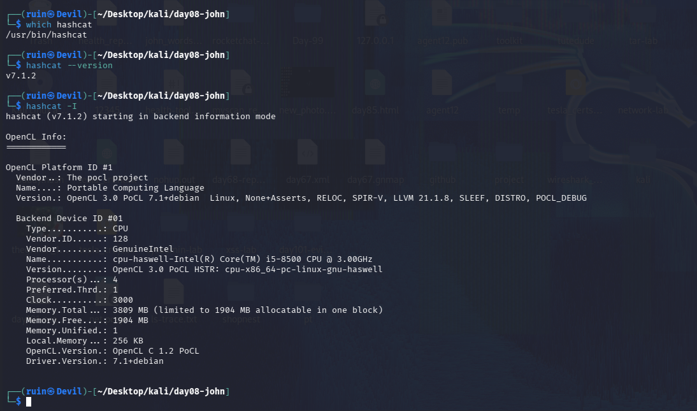
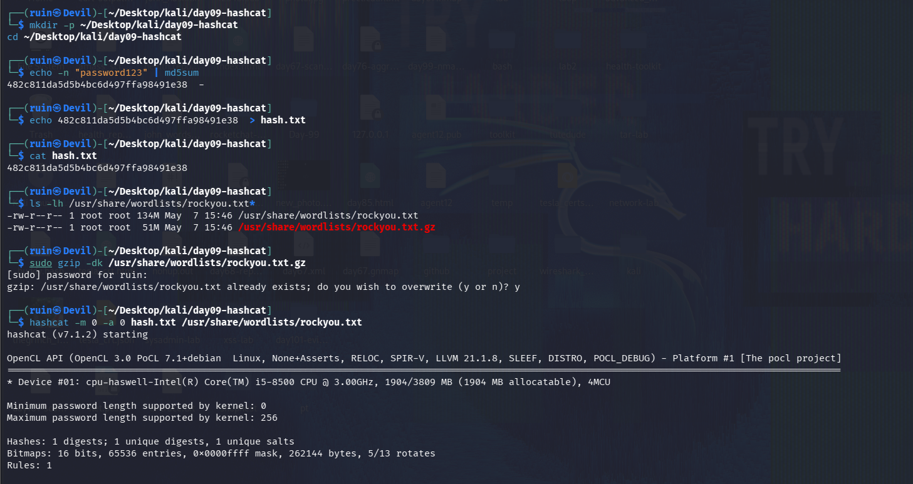
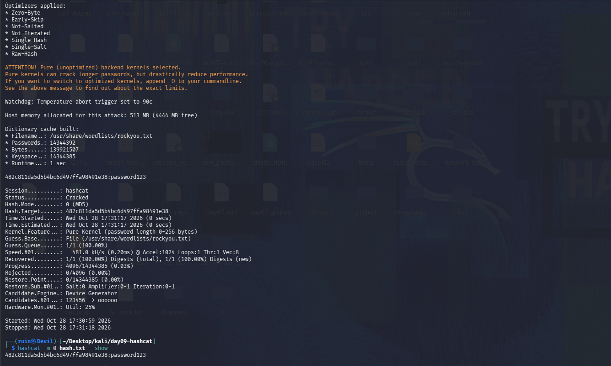
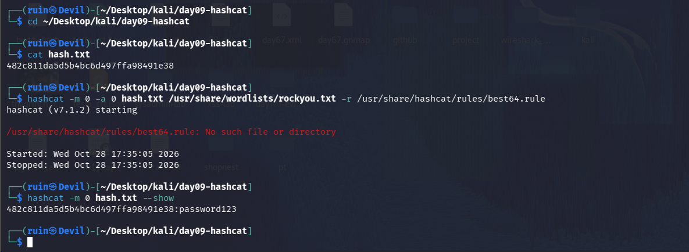
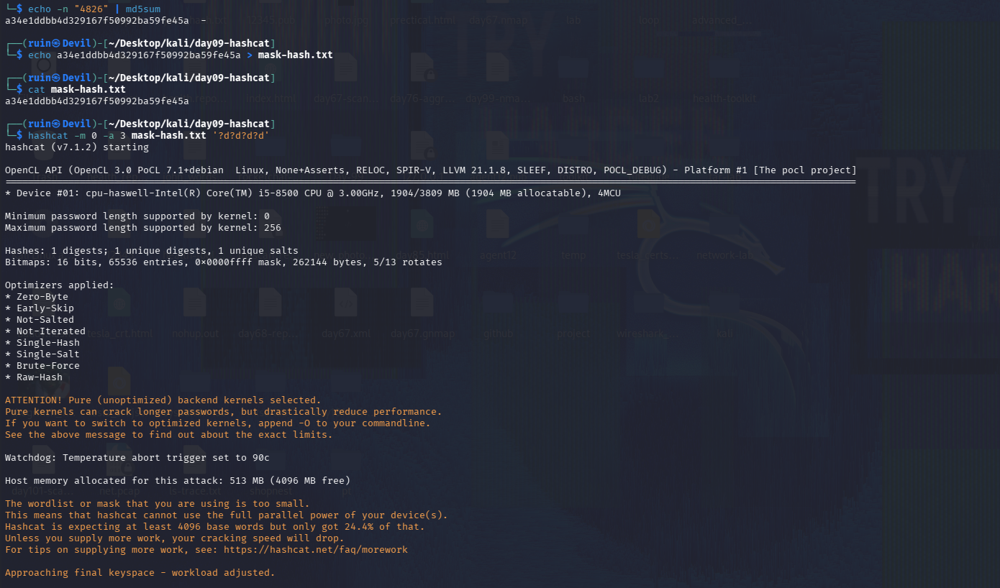
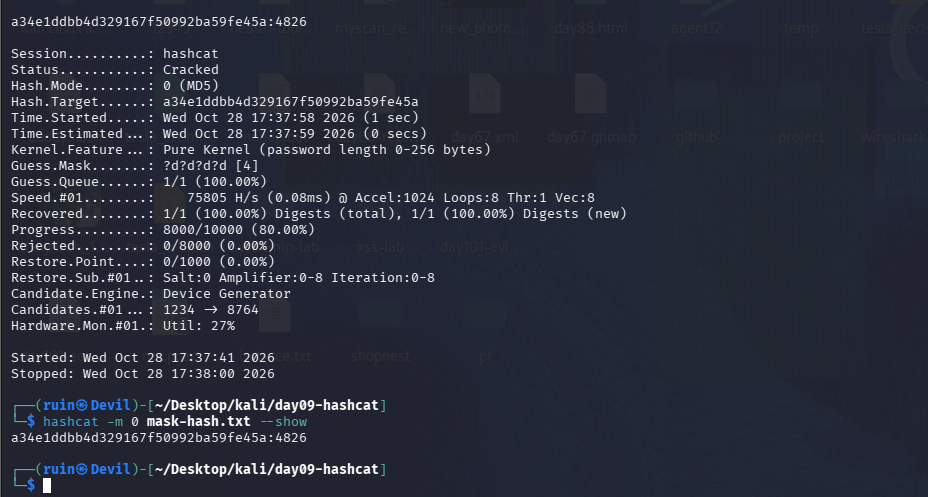
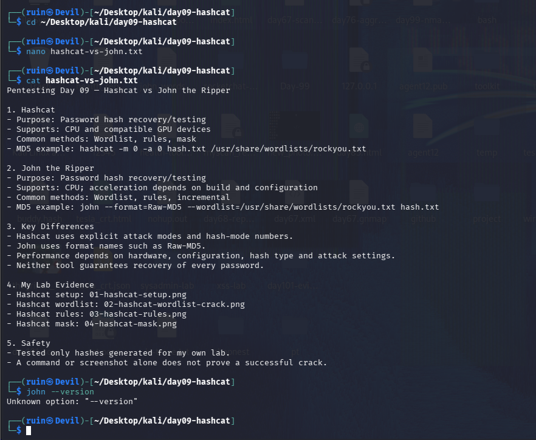

# ⚡ Pentesting Day 09: hashcat (CPU/GPU Password Cracking)

<p align="center">
  
  
  
  
</p>

> Day 08 (John) ended on a reminder to always double-check a hash file has a real value in it. I carried that habit into today — `cat`-ing every hash file before attacking it — and it paid off when a different file turned out to be missing instead. ⚡

---

## 🏆 Day 08 Recap — What John Taught Me

- A placeholder string (`PASTE_MD5_HASH_HERE`) left in a hash file made John correctly report "No password hashes loaded" — not a John bug, a setup mistake.
- A properly-built MD5 of `password123` cracked in 2 seconds with wordlist + rules.
- Lesson: verify the input before trusting a tool's result.

---

## 🎯 Mission Briefing

hashcat does the same job as John — recovering passwords from hashes — but is built around GPU-style parallel attack modes (`-m` for hash type, `-a` for attack type). My VM has **CPU only, no GPU**, so I tested wordlist, rule-based, and mask attacks on that.

```
⚡ MISSION: Crack Test Hashes With hashcat
──────────────────────────────────────────
[x] Check version and compute devices (-I)
[x] Wordlist attack on a real MD5 hash
[x] Rule-based attack attempt (best64.rule)
[x] Mask attack on a digits-only password
[x] Compare hashcat vs John the Ripper
──────────────────────────────────────────
STATUS: Pentesting Day 09 — Done (one real gotcha: missing rule file)
```

---

## ⚡ Quick Theory

```
-m <mode>     ->  hash type (0 = MD5, 1400 = SHA-256, 1800 = sha512crypt, ...)
-a 0          ->  straight / wordlist attack
-a 0 ... -r   ->  wordlist + a rules file (mangling: caps, leet, appended digits)
-a 3          ->  mask attack: a known pattern, brute-forced (?l lower, ?u upper, ?d digit, ?s symbol)
--show        ->  display already-cracked results from hashcat's cache, no re-attack
```

hashcat can use CPU or GPU as a "device" — `-I` lists what's available. A CPU-only device still works, just slower than a GPU would be.

> ⚖️ **Scope:** only hashes I generated myself.

---

## 💻 Lab: Commands + My Real Output

*(Machine: Kali Linux, user `ruin`, CPU: Intel i5-8500, no GPU)*

### 🏗️ Step 0 — Version and device check
```bash
$ which hashcat
/usr/bin/hashcat
$ hashcat --version
v7.1.2

$ hashcat -I
OpenCL Platform ID #1
  Name....: Portable Computing Language

  Backend Device ID #01
    Type..........: CPU
    Vendor........: GenuineIntel
    Name..........: cpu-haswell-Intel(R) Core(TM) i5-8500 CPU @ 3.00GHz
    Processor(s)..: 4
    Memory.Total..: 3809 MB (limited to 1904 MB allocatable in one block)
```
hashcat **v7.1.2**, running on **CPU only** via PoCL (Portable Computing Language, a CPU-based OpenCL implementation) — no GPU in this VM, which is completely normal and expected.



### 🔍 Part A — Wordlist attack on a real MD5 hash
```bash
$ mkdir -p ~/Desktop/kali/day09-hashcat && cd ~/Desktop/kali/day09-hashcat
$ echo -n "password123" | md5sum
482c811da5d5b4bc6d497ffa98491e38  -
$ echo 482c811da5d5b4bc6d497ffa98491e38 > hash.txt
$ cat hash.txt
482c811da5d5b4bc6d497ffa98491e38

$ ls -lh /usr/share/wordlists/rockyou.txt*
-rw-r--r-- 1 root root 134M May  7 15:46 /usr/share/wordlists/rockyou.txt
$ sudo gzip -dk /usr/share/wordlists/rockyou.txt.gz
gzip: /usr/share/wordlists/rockyou.txt already exists; do you wish to overwrite (y or n)? y

$ hashcat -m 0 -a 0 hash.txt /usr/share/wordlists/rockyou.txt
...
Dictionary cache built:
* Filename..: /usr/share/wordlists/rockyou.txt
* Passwords.: 14344392
* Keyspace..: 14344385

482c811da5d5b4bc6d497ffa98491e38:password123

Status...........: Cracked
Speed.#01........: 481.0 kH/s (0.20ms) @ Accel:1024 Loops:1 Thr:1 Vec:8
Recovered........: 1/1 (100.00%) Digests, 1/1 (100.00%) Digests (new)
Progress.........: 4096/14344385 (0.03%)
Started: Wed Oct 28 17:30:59 2026
Stopped: Wed Oct 28 17:31:18 2026

$ hashcat -m 0 hash.txt --show
482c811da5d5b4bc6d497ffa98491e38:password123
```
I `cat`'d `hash.txt` first and confirmed it held the real hash — no placeholder this time. hashcat cracked `password123` at **481.0 kH/s**, finding it after only **4,096 of 14.3 million** candidates (0.03% into the wordlist) — `password123` is near the very top of rockyou.txt.




### 🔍 Part B — Rule-based attack attempt
```bash
$ cat hash.txt
482c811da5d5b4bc6d497ffa98491e38

$ hashcat -m 0 -a 0 hash.txt /usr/share/wordlists/rockyou.txt -r /usr/share/hashcat/rules/best64.rule
hashcat (v7.1.2) starting
/usr/share/hashcat/rules/best64.rule: No such file or directory
Started: Wed Oct 28 17:35:05 2026
Stopped: Wed Oct 28 17:35:05 2026

$ hashcat -m 0 hash.txt --show
482c811da5d5b4bc6d497ffa98491e38:password123
```
The rules attempt **never actually ran** — `/usr/share/hashcat/rules/best64.rule` doesn't exist at that path on this install, so hashcat failed immediately (started and stopped in the same second). The `--show` result afterward is just the **Part A crack from the cache**, not a new rules-based crack — I need to find where (or whether) rule files are actually installed before this step counts as done.



### 🔍 Part C — Mask attack
```bash
$ echo -n "4826" | md5sum
a34e1ddbb4d329167f50992ba59fe45a  -
$ echo a34e1ddbb4d329167f50992ba59fe45a > mask-hash.txt
$ cat mask-hash.txt
a34e1ddbb4d329167f50992ba59fe45a

$ hashcat -m 0 -a 3 mask-hash.txt '?d?d?d?d'
...
The wordlist or mask that you are using is too small.
This means that hashcat cannot use the full parallel power of your device(s).
Hashcat is expecting at least 4096 base words but only got 24.4% of that.
Approaching final keyspace - workload adjusted.

Status...........: Cracked
Hash.Mode........: 0 (MD5)
Guess.Mask.......: ?d?d?d?d [4]
Speed.#01........:  75805 H/s (0.08ms)
Recovered........: 1/1 (100.00%) Digests (new)
Progress.........: 8000/10000 (80.00%)
Candidates.#01...: 1234 -> 8764

$ hashcat -m 0 mask-hash.txt --show
a34e1ddbb4d329167f50992ba59fe45a:4826
```
A 4-digit mask (`?d?d?d?d`, 10,000 possible candidates) cracked in under a second at **75,805 H/s**, stopping at 80% through the keyspace. hashcat warned that **10,000 candidates is too small to use the CPU's full parallelism** — note for next time: a longer/more complex mask gives it enough work to run efficiently.




### 🔍 Part D — hashcat vs John, and a leftover John quirk
```bash
$ cat hashcat-vs-john.txt
Pentesting Day 09 — Hashcat vs John the Ripper

1. Hashcat
- Purpose: Password hash recovery/testing
- Supports: CPU and compatible GPU devices
- Common methods: Wordlist, rules, mask

2. John the Ripper
- Purpose: Password hash recovery/testing
- Supports: CPU; acceleration depends on build and configuration
- Common methods: Wordlist, rules, incremental

3. Key Differences
- Hashcat uses explicit attack modes and hash-mode numbers.
- John uses format names such as Raw-MD5.
- Performance depends on hardware, configuration, hash type and attack settings.
- Neither tool guarantees recovery of every password.

$ john --version
Unknown option: "--version"
```
My own comparison notes are above. Also confirmed: this build of **John doesn't recognize `--version`** as a flag (it needs `john` with no args, or `--test`, to show its info) — a small but real difference from hashcat, which does accept `--version` directly.



---

## 🧪 What I Actually Found

- [x] hashcat **v7.1.2**, CPU-only (Intel i5-8500, no GPU) via PoCL
- [x] Wordlist attack cracked `password123` (MD5) at **481.0 kH/s**, found at 0.03% into rockyou.txt
- [x] Rules attempt **failed to run** — `best64.rule` not found at the expected path; result shown was the cached Part A crack, not a new one
- [x] Mask attack `?d?d?d?d` cracked `4826` at **75,805 H/s**, with a "too small keyspace for full parallelism" warning
- [x] Own written comparison of hashcat vs John (purpose, supported hardware, methods, key differences)
- [x] Found that this John build doesn't support `--version` as a flag
- [ ] A genuine rules-based crack — still need to locate the correct rule file path and re-run

---

## 🎯 Mini Challenges

> **🥊 Challenge 1: Did the Rules Attack Actually Crack Anything?**
> `--show` displayed `password123` after the rules command. Does that prove `-r best64.rule` worked?

<details>
<summary>My answer</summary>

No. The rules command itself errored out immediately with "No such file or directory" and never ran an attack — Started and Stopped timestamps were identical. `--show` just displays whatever is already in hashcat's cache from Part A's earlier wordlist crack. To actually test rules, I need to find the real path to a rule file (or install one) and re-run.

</details>

> **🥊 Challenge 2: Why Was 10,000 Candidates "Too Small"?**
> hashcat warned the mask attack's keyspace was too small for full parallelism, yet it still cracked the hash. What does that warning actually mean?

<details>
<summary>My answer</summary>

It's a performance note, not an error — hashcat's CPU device can test many candidates at once, but a 4-digit mask only has 10,000 total combinations, not enough to keep every parallel "lane" busy. The attack still completes correctly, just not as efficiently as it would on a larger keyspace (e.g. a 6+ character mask).

</details>

> **🥊 Challenge 3: Why Did `password123` Crack at Only 0.03% Progress?**
> hashcat found the password after testing just 4,096 of 14.3 million words. What does that say about this password choice?

<details>
<summary>My answer</summary>

`password123` is extremely common, so it sits near the very start of rockyou.txt (a list built from real leaked passwords, roughly ordered by popularity). The fast crack isn't about hashcat being unusually powerful here — it's a direct reflection of how weak and common that password is in the real world.

</details>

> **🥊 Challenge 4: hashcat vs John — What's the Real Difference?**
> Both cracked `password123`-style hashes with a wordlist. What's actually different between them?

<details>
<summary>My answer</summary>

hashcat is built from the ground up around explicit, GPU-friendly attack modes (`-a 0/1/3/6/7`) and numeric hash modes (`-m`), designed to scale heavily with parallel hardware. John identifies hashes by format name (e.g. `Raw-MD5`) and historically leans more CPU-centric, though Jumbo builds do support external GPU acceleration. On this CPU-only VM, both worked, but hashcat is the one built to really shine once real GPU hardware is available.

</details>

---

## 🧩 Quick Brain Check

1. What's the difference between `-m` and `-a` in a hashcat command?
2. Why did the rules attack fail, and how is that different from a hash simply "not cracking"?
3. What does the "wordlist or mask too small" warning actually mean?
4. Why did `password123` crack almost instantly compared to a random 4-digit PIN taking a full mask sweep?
5. What's one concrete way CPU-only cracking differs from GPU-accelerated cracking?

---

## 🐛 Errors / Gotchas I Hit

- **`best64.rule` not found at `/usr/share/hashcat/rules/`** — the rules attack command failed instantly instead of running. Still need to locate the correct path on this install (check `dpkg -L hashcat | grep rule` or `locate best64.rule`) before this step is actually complete.
- **`john --version` → "Unknown option"** — this Jumbo build of John doesn't support that flag the way hashcat does; worth remembering the two tools don't share command conventions.
- **`--show` after a failed attack silently displayed an old cached result** — easy to mistake for a fresh success if you don't check the Started/Stopped timestamps in the run just before it.
- **Mask attack's keyspace-too-small warning** — not an error, just a performance note; the crack still completed correctly.

---

## 🔐 Security Relevance

The wordlist crack is the clearest real-world lesson: a password as common as `password123` falls almost instantly — not because hashcat is exotic, but because that exact password is already in every major leaked-password list. The missing rule file is its own lesson from the tester's side: a cracking run that "completes" doesn't mean it tested what you intended — always check that an attack actually started and ran before trusting its result (same theme as Day 06/07/08).

---

## 🧠 Today's Takeaway

hashcat and John solve the same problem with different conventions — hash-mode numbers vs format names, explicit attack-type flags vs separate command styles. The real findings today were in the details: a missing rule file meant Part B never actually ran despite `--show` looking like a success, and a weak, common password (`password123`) cracked almost instantly while a short digits-only PIN still needed a full (if fast) keyspace sweep. Checking that an attack genuinely started — not just that `--show` printed something — is this week's recurring habit, carried over cleanly from Day 08.

---

⬅️ [Back to Pentesting index](/Pentesting) | ➡️ Next up: **Day 10**
