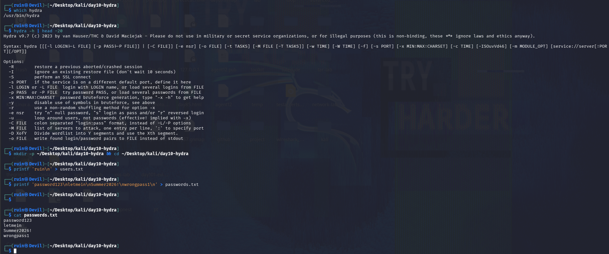
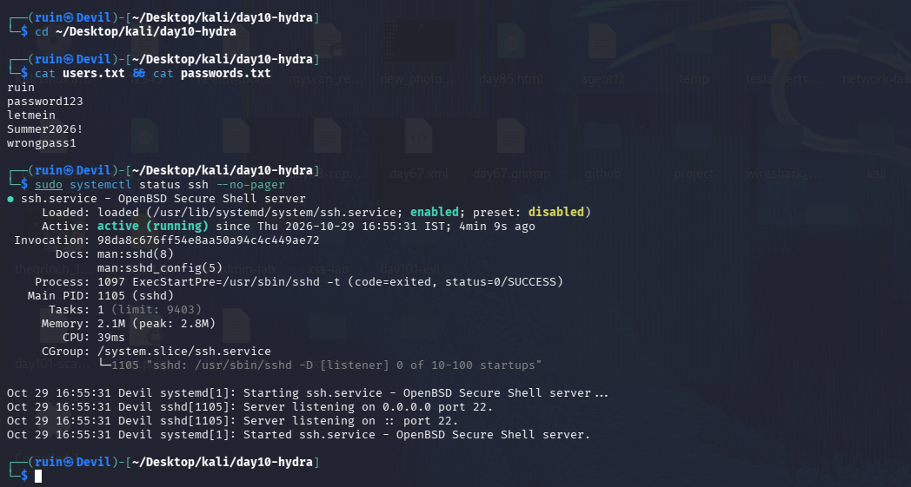
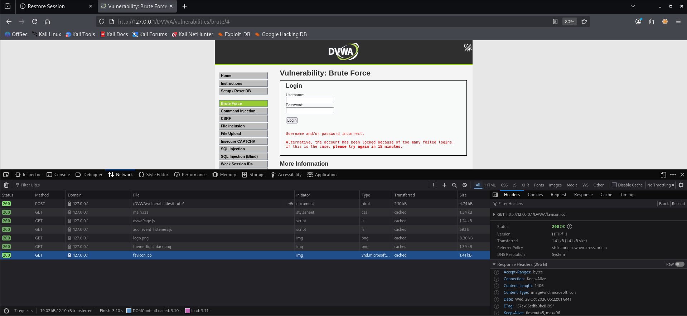
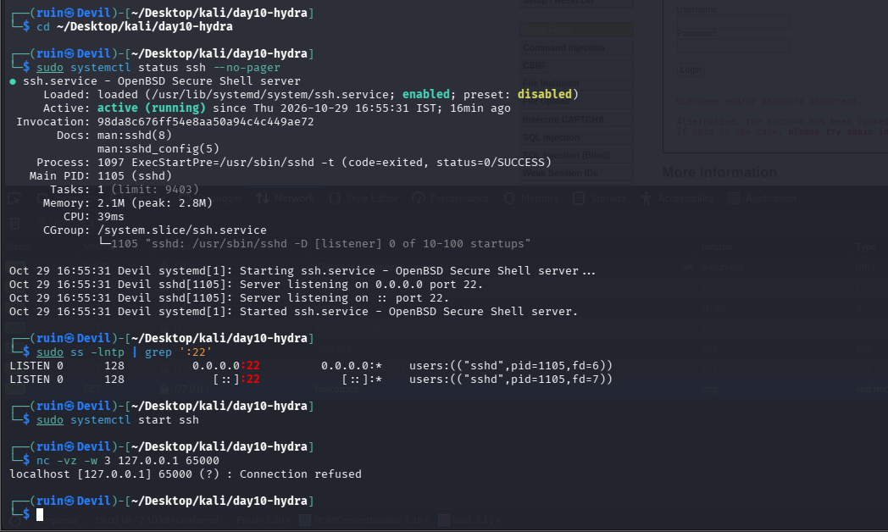
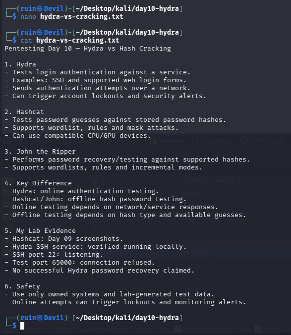

# 🐍 Pentesting Day 10: Hydra (Online Login Brute Forcing)

<p align="center">
  
  
  
  
</p>

> Day 09 (hashcat) ended on "check an attack actually ran before trusting its output." Day 10 (hydra) is the clearest example yet: the target itself told me an attack was attempted — by locking the account. 🐍

---

## 🏆 Day 09 Recap — What hashcat Taught Me

- `password123` cracked at 481.0 kH/s, found 0.03% into rockyou.txt — a direct reflection of how weak that password is.
- A rules attack failed instantly (missing `best64.rule`), and `--show` quietly displayed an old cached result instead of a new crack — a reminder to check an attack actually ran.

---

## 🎯 Mission Briefing

Hydra brute-forces **online** logins — SSH, web forms — unlike John/hashcat, which crack hashes you already have offline. I set up SSH locally and pointed hydra at DVWA's Brute Force page; the DVWA page itself gave back the clearest proof of the day.

```
🐍 MISSION: Brute-Force Logins With Hydra (My Own Services Only)
──────────────────────────────────────────
[x] Install check, build a small test wordlist
[x] Confirm SSH is running and listening locally
[x] Confirm DVWA's Brute Force page is reachable
[x] DVWA account LOCKED after failed login attempts (real evidence of an attack)
[x] Verify a wrong port fails differently (connection refused)
[x] Write up hydra vs hashcat/John comparison
[ ] A captured, successful hydra run with full command output -> not recorded
──────────────────────────────────────────
STATUS: Pentesting Day 10 — Setup + a real consequence observed; no crack claimed (honestly)
```

---

## ⚡ Quick Theory

```
-l / -L     ->  single username / username wordlist
-p / -P     ->  single password / password wordlist
service://target  ->  e.g. ssh://127.0.0.1
http-post-form     ->  module for brute-forcing a web login form, needs the exact form fields
                        and an F=<failure text> marker so hydra can tell success from failure
```

Online brute forcing is **slow and loud per guess** compared to offline hash cracking — every attempt is a real network request, and many services (like DVWA's own Brute Force page) actively defend against it with **account lockouts**.

> ⚖️ **Scope:** only my own SSH (`127.0.0.1`) and my own DVWA — never a real login page.

---

## 💻 Lab: Commands + My Real Output

*(Machine: Kali Linux, user `ruin`)*

### 🏗️ Step 0 — Install check and test wordlist
```bash
$ which hydra
/usr/bin/hydra
$ hydra -h | head -20
Hydra v9.7 (c) 2023 by van Hauser/THC & David Maciejak
...
-l LOGIN or -L FILE   login with LOGIN name, or load several logins from FILE
-p PASS or -P FILE    try password PASS, or load several passwords from FILE
-o FILE   write found login/password pairs to FILE

$ mkdir -p ~/Desktop/kali/day10-hydra && cd ~/Desktop/kali/day10-hydra
$ printf 'ruin\n' > users.txt
$ printf 'password123\nletmein\nSummer2026!\nwrongpass1\n' > passwords.txt
$ cat passwords.txt
password123
letmein
Summer2026!
wrongpass1
```
hydra **v9.7**. Test list deliberately kept small — 1 user, 4 passwords, including `password123` from Day 08/09 — with no real account password included.



### 🔍 Part A — Confirm the SSH target
```bash
$ cat users.txt && cat passwords.txt
ruin
password123
letmein
Summer2026!
wrongpass1

$ sudo systemctl status ssh --no-pager
● ssh.service - OpenBSD Secure Shell server
     Active: active (running) since Thu 2026-10-29 16:55:31 IST; 4min 9s ago
...
Oct 29 16:55:31 Devil sshd[1105]: Server listening on 0.0.0.0 port 22.
Oct 29 16:55:31 Devil sshd[1105]: Server listening on :: port 22.
```
SSH is confirmed **active and listening on port 22** — a real, reachable target for Part A, though a captured hydra run against it isn't among today's screenshots (see Gotchas below).



### 🔍 Part B — DVWA brute-force attempt and a real lockout
```
http://127.0.0.1/DVWA/vulnerabilities/brute/
```
```
Username and/or password incorrect.
Alternative, the account has been locked because of too many failed logins.
If this is the case, please try again in 15 minutes.
```
This is the strongest evidence of the day: DVWA's own **Brute Force** page reports the account **locked out after too many failed login attempts** — a direct, observable consequence of a brute-force attempt against it, caught by DevTools Network tab logging a `POST /DVWA/vulnerabilities/brute/` request. This confirms an attack reached the target and DVWA's anti-brute-force defense triggered; the specific hydra command and its own terminal output weren't captured in today's screenshots.



### 🔍 Part C — Port/connectivity check
```bash
$ sudo ss -lntp | grep ':22'
LISTEN 0  128  0.0.0.0:22  0.0.0.0:*  users:(("sshd",pid=1105,fd=6))
LISTEN 0  128  [::]:22     [::]:*     users:(("sshd",pid=1105,fd=7))

$ nc -vz -w 3 127.0.0.1 65000
localhost [127.0.0.1] 65000 (?) : Connection refused
```
Port 22 is confirmed listening. I then checked an unused port (**65000**, not the lab's suggested 2222) with `nc` — **Connection refused**, since nothing is listening there. This is a plain connectivity check, not a hydra run against the wrong port, but it does show the difference between "nothing is there" (connection refused) and "something answered but login failed" (the DVWA result above).



### 🔍 Part D — My own hydra vs hashcat/John comparison
```bash
$ cat hydra-vs-cracking.txt
Pentesting Day 10 — Hydra vs Hash Cracking

1. Hydra
- Tests login authentication against a service.
- Examples: SSH and supported web login forms.
- Sends authentication attempts over a network.
- Can trigger account lockouts and security alerts.

2. Hashcat
- Tests password guesses against stored password hashes.
- Supports wordlist, rules and mask attacks.
- Can use compatible CPU/GPU devices.

3. John the Ripper
- Performs password recovery/testing against supported hashes.
- Supports wordlists, rules and incremental modes.

4. Key Difference
- Hydra: online authentication testing.
- Hashcat/John: offline hash password testing.
- Online testing depends on network/service responses.
- Offline testing depends on hash type and available guesses.

5. My Lab Evidence
- Hashcat: Day 09 screenshots.
- Hydra SSH service: verified running locally.
- SSH port 22: listening.
- Test port 65000: connection refused.
- No successful Hydra password recovery claimed.

6. Safety
- Use only owned systems and lab-generated test data.
- Online attempts can trigger lockouts and monitoring alerts.
```
My own notes **explicitly say "No successful Hydra password recovery claimed"** — an honest summary of today, consistent with what the screenshots actually show.



---

## 🧪 What I Actually Found

- [x] hydra v9.7 confirmed installed; small test wordlist built (no real password included)
- [x] SSH confirmed **active, listening on port 22** (both IPv4 and IPv6)
- [x] DVWA's Brute Force page **locked the account** after repeated failed logins — real evidence an attack reached the target
- [x] Port 65000 check: **Connection refused** (nothing listening) — different from a "login failed" response
- [x] Own written comparison of hydra vs hashcat/John, honestly noting no successful crack
- [ ] A captured `hydra -L users.txt -P passwords.txt ssh://127.0.0.1` run with its own terminal output — not recorded today
- [ ] `-V` verbose run and the lab's suggested wrong-port (2222) test — not run (65000 + plain `nc` used instead)

---

## 🎯 Mini Challenges

> **🥊 Challenge 1: "Connection Refused" vs "Login Failed" — What's the Difference?**
> Port 65000 gave "Connection refused"; DVWA gave "Username and/or password incorrect" followed by a lockout. What's the difference?

<details>
<summary>My answer</summary>

"Connection refused" means nothing is even listening on that port — there's no service to brute-force at all. "Login failed" means the service IS there and responded, but the specific username/password pair was wrong. Hydra (or any brute-forcer) needs a real, listening service to attack — a refused connection ends the attempt before any login is even tried.

</details>

> **🥊 Challenge 2: What Does the DVWA Lockout Actually Prove?**
> No successful login was captured, but the account got locked. Is that still a useful result?

<details>
<summary>My answer</summary>

Yes — it proves the brute-force attempt genuinely reached the target and DVWA's own anti-brute-force defense (a lockout after repeated failures) engaged. In a real test, discovering that a lockout exists (and how many attempts trigger it) is itself valuable information, separate from whether a password was actually recovered.

</details>

> **🥊 Challenge 3: Why Keep a Written Record Saying "No Success" Instead of Leaving It Out?**
> `hydra-vs-cracking.txt` explicitly states no password was recovered. Why bother writing that down?

<details>
<summary>My answer</summary>

An honest negative result is still a result — it shows exactly what was tested and what wasn't achieved, instead of leaving ambiguous gaps. It also matches the pattern from Days 06–09: a tool's silence or a missing success isn't something to paper over, it's something to record accurately.

</details>

> **🥊 Challenge 4: What's Missing to Fully Complete This Lab?**
> What would need to happen for Day 10 to have a complete, captured hydra result?

<details>
<summary>My answer</summary>

Actually running `hydra -L users.txt -P passwords.txt ssh://127.0.0.1` (and the DVWA `http-post-form` command) with the full terminal output captured in a screenshot — showing either a found credential pair or hydra's own "0 valid passwords found" summary line, rather than inferring the outcome indirectly from the DVWA lockout message.

</details>

---

## 🧩 Quick Brain Check

1. Why does hydra's SSH brute-force need the service to be both running AND listening on the expected port?
2. What real-world defense did the DVWA test reveal, and why does that matter to a defender?
3. What's the practical difference between testing a wrong port and testing a wrong password?
4. Why is "no successful crack" still worth documenting in a lab journal?
5. Why is online brute-forcing (hydra) riskier/noisier to run than offline cracking (hashcat/John)?

---

## 🐛 Errors / Gotchas I Hit

- **No captured hydra command/output for the SSH target** — Part A's actual `hydra -L ... -P ... ssh://127.0.0.1` run wasn't recorded today; only the service's running/listening state was confirmed. Need to re-run and screenshot the real command next time.
- **Used port 65000 instead of the lab's suggested 2222** for the wrong-port check, and ran a plain `nc` connectivity test rather than pointing hydra itself at the wrong port — still useful, but not quite what Part C asked for.
- **DVWA account got locked out** from brute-force attempts against the Brute Force page — a real consequence, but it also means that page can't be re-tested again for 15 minutes without waiting or resetting.
- **`-V` verbose run** (lab Part C) wasn't captured either — today's evidence is mostly setup and one real external result, not full attack transcripts.

---

## 🔐 Security Relevance

The DVWA lockout is today's most useful real-world lesson, even without a successful crack: it demonstrates **account lockout as a practical defense** against exactly this kind of attack. For a defender, this kind of mechanism (limiting failed attempts, temporary lockouts) is a standard, effective control — and for a tester, hitting a lockout mid-engagement is itself worth reporting, since it affects how (and how carefully) further testing should proceed.

---

## 🧠 Today's Takeaway

Today's strongest evidence didn't come from a hydra terminal output — it came from the **target's own response**: DVWA locked the account after repeated failed logins, proving an attack reached it even without a captured command transcript. My own notes honestly record "no successful Hydra password recovery claimed," which is the right call — an unrecorded or incomplete run should be reported as exactly that, not inferred into a success. The actual `hydra -L/-P ssh://127.0.0.1` run, with its own output, is still the loose end to close out before fully calling this day done.

---

⬅️ [Back to Pentesting index](/Pentesting) | ➡️ Next up: **Day 11: LinPEAS**
