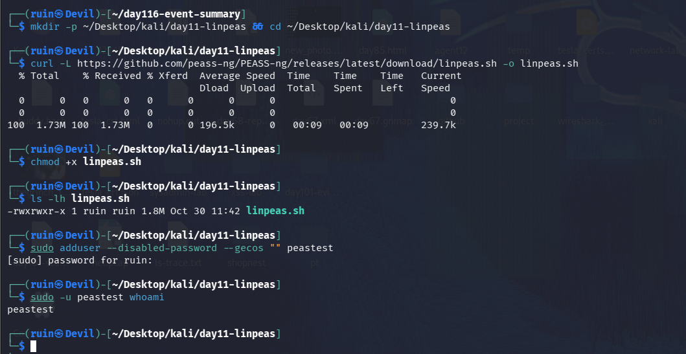
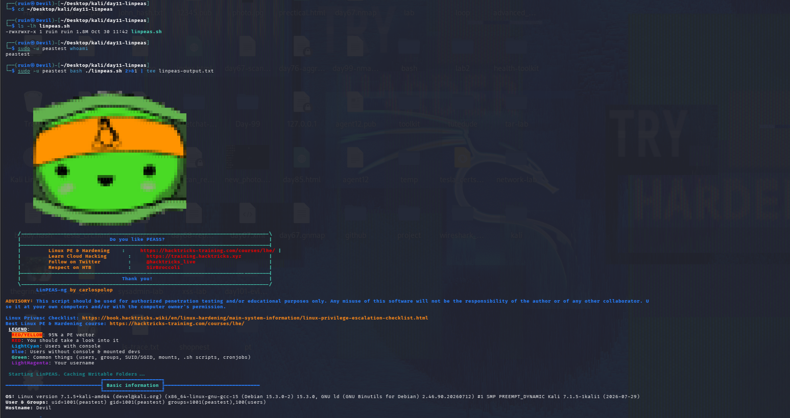
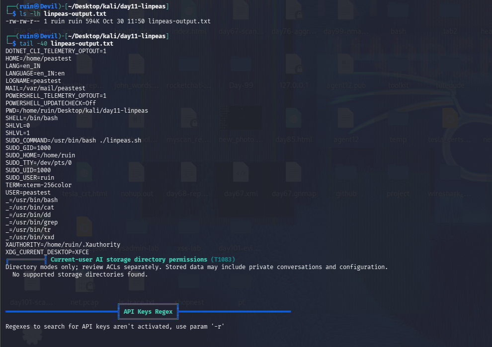
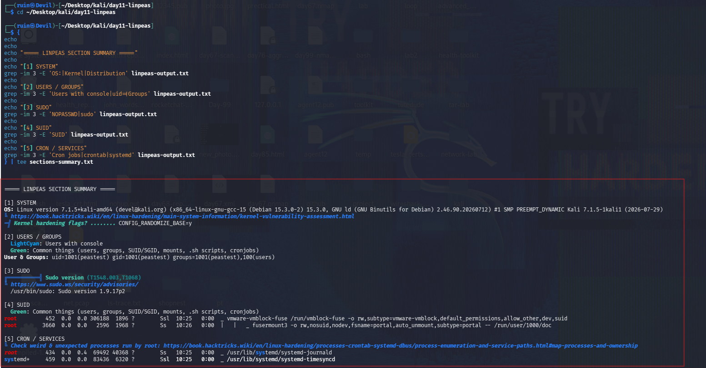
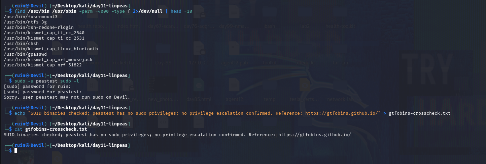
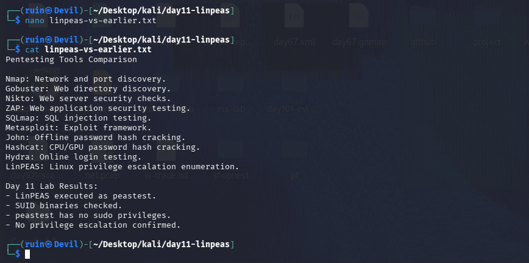

# 🩻 Pentesting Day 11: LinPEAS (Linux Privilege Escalation Enumeration)

<p align="center">
  
  
  
  
</p>

> Day 10 (Hydra) worked from OUTSIDE a machine, over the network. Day 11 flips that completely — LinPEAS runs INSIDE the machine, as a low-privilege user, looking for a way up to root. 🩻

---

## 🏆 Day 10 Recap — What Hydra Taught Me

- DVWA's own account-lockout feature triggered after repeated failed logins — real proof an attack reached the target, even without a captured hydra command.
- My own notes honestly recorded "no successful Hydra password recovery claimed" rather than papering over the gap.

---

## 🎯 Mission Briefing

LinPEAS enumerates a Linux system from the inside, looking for privilege escalation paths: SUID binaries, sudo permissions, cron jobs, writable files, and more. I ran it as a genuine low-privilege test user (`peastest`) — not as root — to see exactly what a limited foothold could actually discover.

```
🩻 MISSION: Enumerate Privilege Escalation Paths With LinPEAS
──────────────────────────────────────────
[x] Download linpeas.sh, create a low-privilege test user
[x] Run the full scan AS that low-privilege user, save output
[x] Build a section summary (SUID, sudo, cron) from the saved output
[x] Confirm SUID binaries present; confirm NO sudo privileges for the test user
[x] Cross-reference findings against GTFOBins
[x] Write up LinPEAS vs every tool from Day 03–10
──────────────────────────────────────────
STATUS: Pentesting Day 11 — Done. Honest result: no privilege escalation path found (by design — no misconfiguration existed yet)
```

---

## ⚡ Quick Theory

```
SUID binaries   ->  run with the file OWNER's privileges (often root), regardless of who executes them
sudo -l          ->  lists what the current user is allowed to run via sudo
Cron jobs        ->  scheduled tasks; a world-writable script run by root is a classic privesc path
```

LinPEAS color-codes its findings — **red/yellow** lines are worth investigating, **green** is normal/expected. Running it as a low-privilege user (not root) matters because that's exactly the starting point a real attacker would have after gaining initial access.

> ⚖️ **Scope:** LinPEAS only reads and reports, but still only run it on a system I own.

---

## 💻 Lab: Commands + My Real Output

*(Machine: Kali Linux, user `ruin`; test user: `peastest`)*

### 🏗️ Step 0 — Download LinPEAS, create the test user
```bash
$ mkdir -p ~/Desktop/kali/day11-linpeas && cd ~/Desktop/kali/day11-linpeas
$ curl -L https://github.com/peass-ng/PEASS-ng/releases/latest/download/linpeas.sh -o linpeas.sh
100  1.73M  100  1.73M ... 239.7k
$ chmod +x linpeas.sh
$ ls -lh linpeas.sh
-rwxrwxr-x 1 ruin ruin 1.8M Oct 30 11:42 linpeas.sh

$ sudo adduser --disabled-password --gecos "" peastest
$ sudo -u peastest whoami
peastest
```
`linpeas.sh` downloaded at **1.8 MB**, and `peastest` is confirmed as a real, separate low-privilege account.



### 🔍 Part A — Full scan as the low-privilege user
```bash
$ sudo -u peastest bash ./linpeas.sh 2>&1 | tee linpeas-output.txt
...
LEGEND:
  RED/YELLOW: 95% a PE vector
  RED: You should take a look into it
  LightCyan: Users with console
  Green: Common things (users, groups, SUID/SGID, mounts, .sh scripts, cronjobs)
  LightMagenta: Your username

Starting LinPEAS. Caching Writable Folders ...
Basic information
OS: Linux version 7.1.5+kali-amd64 ... Kali 7.1.5-1kali1 (2026-07-29)
User & Groups: uid=1001(peastest) gid=1001(peastest) groups=1001(peastest),100(users)
Hostname: Devil
```
Ran correctly as `peastest` (`uid=1001`), **not** as root or via unrestricted sudo — the scan sees exactly what this low-privilege account can see.



```bash
$ ls -lh linpeas-output.txt
-rw-rw-r-- 1 ruin ruin 594K Oct 30 11:50 linpeas-output.txt
$ tail -40 linpeas-output.txt
...
Current-user AI storage directory permissions (T1083)
  No supported storage directories found.

API Keys Regex
  Regexes to search for API keys aren't activated, use param '-r'
```
Output saved: **594 KB**. Two things worth noting from the tail: LinPEAS checked for AI-tool storage directories (a newer check) and found none — not a finding, just an empty check — and it explicitly told me the **API key regex scan was skipped** because I didn't pass the `-r` flag. That's a real gap in this run, not a "nothing found" result.



### 🔍 Part B — Section summary from the saved output
```bash
$ { echo "===== LINPEAS SECTION SUMMARY ====="
echo "[1] SYSTEM"; grep -im3 -E 'OS:|Kernel|Distribution' linpeas-output.txt
echo "[2] USERS / GROUPS"; grep -im3 -E 'Users with console|uid=|Groups' linpeas-output.txt
echo "[3] SUDO"; grep -im3 -E 'NOPASSWD|sudo' linpeas-output.txt
echo "[4] SUID"; grep -im3 -E 'SUID' linpeas-output.txt
echo "[5] CRON / SERVICES"; grep -im3 -E 'Cron jobs|crontab|systemd' linpeas-output.txt
} | tee sections-summary.txt

[3] SUDO
Sudo version (T1548.003,T1068)
/usr/bin/sudo: Sudo version 1.9.17p2

[4] SUID
Green: Common things (users, groups, SUID/SGID, mounts, .sh scripts, cronjobs)
root 452 0.0 0.0 306188 1896 ? Ssl 10:25 0:00 _ vmware-vmblock-fuse ...
root 3660 0.0 0.0 2596 1968 ? Ss 10:26 0:00 | | _ fusermount3 ...
```
Pulled five focused sections (system, users/groups, sudo, SUID, cron/services) straight out of the full 594 KB report instead of reading it all top-to-bottom.



### 🔍 Part C — SUID binaries and sudo check
```bash
$ find /usr/bin /usr/sbin -perm -4000 -type f 2>/dev/null | head -10
/usr/bin/fusermount3
/usr/bin/ntfs-3g
/usr/bin/rsh-redone-rlogin
/usr/bin/kismet_cap_ti_cc_2540
/usr/bin/kismet_cap_ti_cc_2531
/usr/bin/chsh
/usr/bin/kismet_cap_linux_bluetooth
/usr/bin/gpasswd
/usr/bin/kismet_cap_nrf_mousejack
/usr/bin/kismet_cap_nrf_51822

$ sudo -u peastest sudo -l
[sudo] password for peastest:
Sorry, user peastest may not run sudo on Devil.

$ echo "SUID binaries checked; peastest has no sudo privileges; no privilege escalation confirmed. Reference: https://gtfobins.github.io/" > gtfobins-crosscheck.txt
```
10 SUID binaries found — all standard Kali/system packages (`fusermount3`, `ntfs-3g`, `chsh`, `gpasswd` are typical; the `kismet_cap_*` entries belong to Kali's Kismet wireless-capture tool). **Nothing unusual or custom** in this list. `sudo -l` as `peastest` confirmed **no sudo privileges at all** — exactly as expected, since no misconfiguration had been deliberately introduced yet.



### 🔍 Part D — LinPEAS vs every tool so far
```bash
$ cat linpeas-vs-earlier.txt
Pentesting Tools Comparison

Nmap: Network and port discovery.
Gobuster: Web directory discovery.
Nikto: Web server security checks.
ZAP: Web application security testing.
SQLmap: SQL injection testing.
Metasploit: Exploit framework.
John: Offline password hash cracking.
Hashcat: CPU/GPU password hash cracking.
Hydra: Online login testing.
LinPEAS: Linux privilege escalation enumeration.

Day 11 Lab Results:
- LinPEAS executed as peastest.
- SUID binaries checked.
- peastest has no sudo privileges.
- No privilege escalation confirmed.
```
My own one-line summary of every tool so far, plus an honest Day 11 verdict: **no privilege escalation path was found** — which is the correct, expected result here, since this system had no deliberate misconfiguration (that's what Day 12 sets up on purpose).



---

## 🧪 What I Actually Found

- [x] `linpeas.sh` downloaded (1.8 MB), `peastest` low-privilege user created and confirmed (`uid=1001`)
- [x] Full scan run correctly **as `peastest`**, output saved (**594 KB**, `linpeas-output.txt`)
- [x] Sudo version detected: **1.9.17p2**
- [x] **10 SUID binaries found**, all standard system/Kali packages — nothing unusual
- [x] `sudo -l` as `peastest` → **"may not run sudo on Devil"** — confirmed no sudo access
- [x] **API key regex checks were skipped** — LinPEAS explicitly said to use `-r` to activate them
- [x] "AI storage directory" check ran but found nothing (empty result, not a finding)
- [x] Own written comparison + honest verdict: **no privilege escalation confirmed**

---

## 🎯 Mini Challenges

> **🥊 Challenge 1: Is "No Privilege Escalation Confirmed" a Failure?**
> Today ended with no way to become root. Is that a bad result?

<details>
<summary>My answer</summary>

No — it's the correct, honest result for this system as it stands. LinPEAS only reports what it finds; with no deliberate misconfiguration yet (no risky sudo rule, no writable root-owned script), there's genuinely nothing to escalate through. An empty result here is accurate, not a failed scan.

</details>

> **🥊 Challenge 2: Why Does the Skipped API-Key Regex Check Matter?**
> LinPEAS said the API key scan wasn't activated. How is that different from "no API keys found"?

<details>
<summary>My answer</summary>

"Not activated" means that check never ran at all — it's a gap in coverage, not a clean result. "No API keys found" would mean it searched and found nothing. Reporting these the same way would be misleading; next time I'd add `-r` to actually run that check before concluding nothing's there.

</details>

> **🥊 Challenge 3: Why Are the SUID Binaries Found Here Not Concerning?**
> 10 SUID binaries were listed. Why isn't that itself a vulnerability?

<details>
<summary>My answer</summary>

Every one of them is a normal, expected system package (`fusermount3`, `ntfs-3g`, `chsh`, `gpasswd`, and Kismet's capture helpers) — they're SUID by design, for legitimate reasons, and don't have a known GTFOBins abuse technique that a low-privilege user could exploit here. SUID itself isn't the problem; an *unusual or misconfigured* SUID binary would be.

</details>

> **🥊 Challenge 4: How Does This Set Up Day 12?**
> Day 11 confirmed no path to root exists. What does that mean for GTFOBins tomorrow?

<details>
<summary>My answer</summary>

It means Day 12 has to deliberately introduce a misconfiguration (a sudo rule on a GTFOBins-listed binary like `find`) to have something real to escalate through — rather than relying on this system having one by accident. Today's honest "nothing found" is exactly why that setup step exists.

</details>

---

## 🧩 Quick Brain Check

1. Why run LinPEAS as a low-privilege user instead of as root?
2. What's the difference between a check that "found nothing" and one that was "not activated"?
3. Why aren't all SUID binaries automatically a security problem?
4. What does `sudo -l` tell you, and why did it matter here?
5. Why is privilege escalation enumeration (LinPEAS) a different phase of testing than everything from Day 03–10?

---

## 🐛 Errors / Gotchas I Hit

- **API key regex checks were skipped** — needed the `-r` flag to activate them; this run's "nothing found" in that area is actually "nothing checked."
- **"AI storage directory" check found nothing** — a newer LinPEAS check with an empty result; worth remembering it's a miss, not evidence of anything.
- Everything else ran cleanly: the low-privilege user, the full scan, the section-summary extraction, and the sudo/SUID checks all worked as expected on the first attempt.

---

## 🔐 Security Relevance

This is the local, post-access half of a penetration test: once you have *any* foothold, the next question is always "can I become someone more privileged?" Today's honest answer — no — is itself useful reporting: it tells a defender this particular account has no obvious local escalation path right now, via SUID or sudo. That assurance is only as good as the checks that actually ran, which is why the skipped API-key regex matters: an incomplete scan shouldn't be reported as a clean one.

---

## 🧠 Today's Takeaway

LinPEAS is the tool that flips the whole week's perspective — instead of attacking a service from outside, it enumerates what a low-privilege user can already see from inside. Today's result was a clean, correctly-earned "nothing to escalate through," with one real gap (the unactivated API key check) honestly noted rather than ignored. That sets up Day 12 perfectly: GTFOBins needs an actual misconfiguration to demonstrate a technique, and today confirmed this system doesn't have one by accident.

---

⬅️ [Back to Pentesting index](/Pentesting) | ➡️ Next up: **Day 12: GTFOBins**
