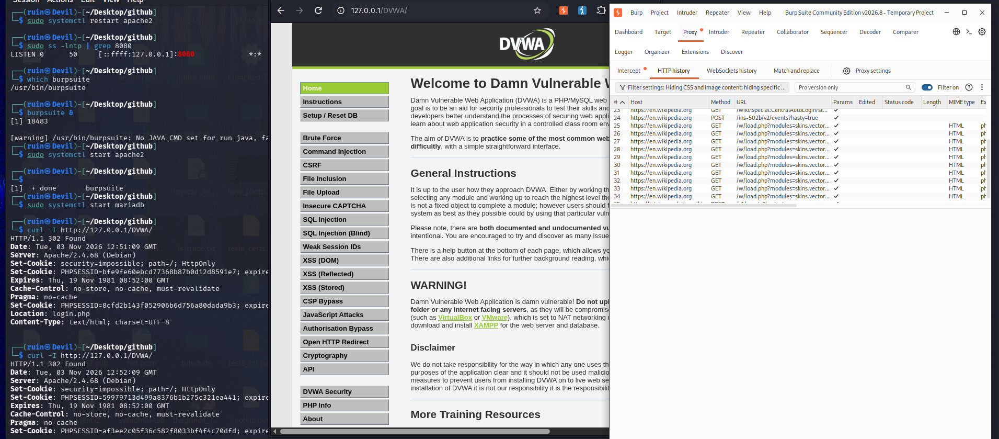
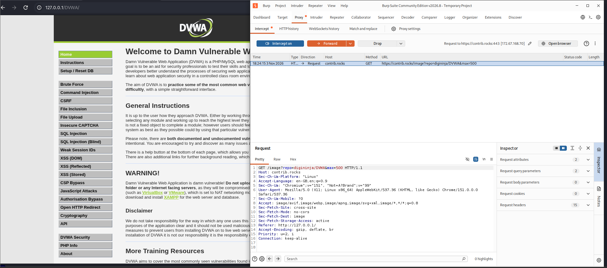
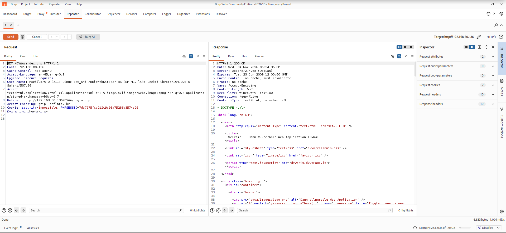
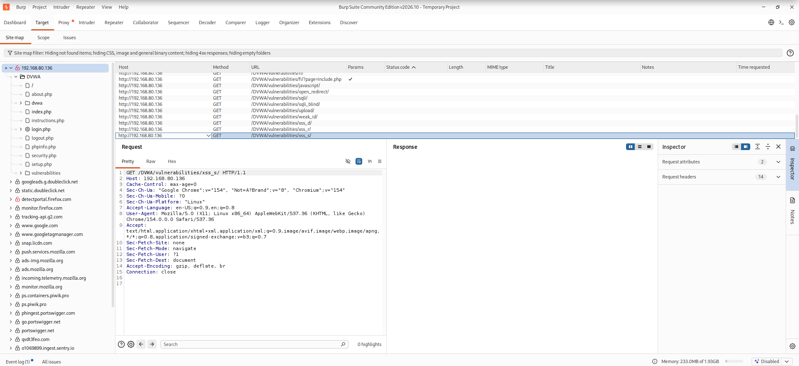
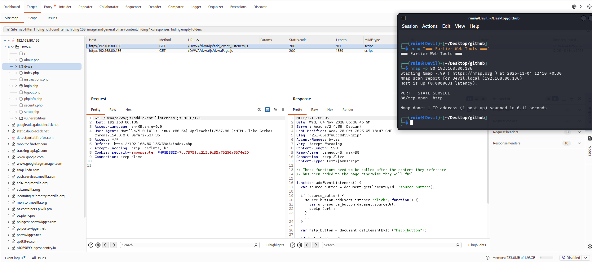

# 🕸️ Pentesting Day 13: Burp Suite (Intercepting Proxy)

<p align="center">
  
  
  
  
</p>

> Day 12 (GTFOBins) was the first fully clean success of the phase. Day 13 fills a gap from Day 02 — Burp Suite, the tool that was skipped back then in favor of Shodan. It's less of a single command and more of a way of watching traffic, and today's run shows exactly why "watching everything" needs scoping.

---

## 🏆 Day 12 Recap — What GTFOBins Taught Me

- Baseline confirmed clean → misconfiguration deliberately added and validated → GTFOBins Sudo technique matched → actual root achieved (`uid=0`) → fully cleaned up and re-verified.
- The one fully end-to-end success of the phase so far, start to finish.

---

## 🎯 Mission Briefing

Burp Suite sits between the browser and the target as a proxy, letting me see and replay every request. Unlike every scanner so far, it doesn't send its own traffic by default — it watches (and can modify) **mine**. Today's run used Burp's core tabs — Intercept, Repeater, HTTP history, Site map — against DVWA.

```
🕸️ MISSION: Watch and Replay My Own Browser Traffic Through Burp
──────────────────────────────────────────
[x] Launch Burp, confirm its proxy listener and DVWA reachability
[x] Capture live traffic with Intercept ON
[x] Use Repeater to resend a request and inspect the response
[x] Build up Proxy HTTP history and a Site map from browsing
[x] Compare Burp's approach to every scanner used so far
[ ] The actual DVWA login POST request, captured in Intercept -> not in today's evidence
──────────────────────────────────────────
STATUS: Pentesting Day 13 — Core Burp workflow done; two real scoping gaps found (see below)
```

---

## ⚡ Quick Theory

```
Proxy -> Intercept     ->  pause and inspect/edit a request before it's sent
Proxy -> HTTP history   ->  a log of every request/response that passed through, filtered by Site map's rules
Repeater                ->  resend a captured request with manual edits, compare responses
Target -> Site map      ->  the site structure Burp has observed from browsing
```

Burp's proxy listens on `127.0.0.1:8080` by default; the browser is pointed at it so every request — not just the page you're actively clicking through — passes through Burp first.

> ⚖️ **Scope:** only browsed `127.0.0.1`/DVWA-related targets while Intercept was active.

---

## 💻 Lab: Commands + My Real Output

*(Machine: Kali Linux, user `ruin`; Burp Suite Community Edition)*

### 🏗️ Step 0 — Launch Burp, confirm the proxy and the target
```bash
$ which burpsuite
/usr/bin/burpsuite
$ burpsuite &
[warning] /usr/bin/burpsuite: No JAVA_CMD set for run_java, fa...

$ sudo ss -lntp | grep 8080
LISTEN 0  50  [::ffff:127.0.0.1]:8080

$ sudo systemctl start apache2
$ sudo systemctl start mariadb
$ curl -I http://127.0.0.1/DVWA/
HTTP/1.1 302 Found
Set-Cookie: security=impossible; path=/; HttpOnly
Set-Cookie: PHPSESSID=bfe9fe60ebcd77368b87b0d12d8591e7; expires=...
Location: login.php
```
Burp's proxy is listening only on **`127.0.0.1:8080`** (loopback, not every interface) — confirmed with `ss`. DVWA answers but redirects to `login.php`, and its `security` cookie reads **`impossible`** — the highest DVWA security level, not the `low` level most of this phase's DVWA labs have used. I didn't reset it before this run.



### 🔍 Part A — Intercept catches more than just "my" request
```
Proxy -> Intercept ON
Browsed DVWA with the Firefox proxy pointed at Burp
```
```
Request to https://contrib.rocks:443 [172.67.168.70]
GET /image?repo=digininja/DVWA&max=500 HTTP/1.1
Host: contrib.rocks
Referer: http://127.0.0.1/
```
The request Intercept actually caught and held was a **background image request to `contrib.rocks`** — a third-party contributor-avatar widget embedded on DVWA's own instructions page — not the DVWA login form submission I was aiming to catch. This is the real lesson of Intercept: it pauses **every** request the browser sends while it's on, including embedded third-party resources, not just the page you're actively interacting with.



### 🔍 Part B — Repeater: resend and inspect a request
```
Repeater tab:
GET /DVWA/index.php HTTP/1.1
Host: 192.168.80.136
Cookie: security=impossible; PHPSESSID=7dd7975fcc212c9c95a75236a3574e20
```
```
Response: HTTP/1.1 200 OK
Server: Apache/2.4.68 (Debian)
<title>Welcome :: Damn Vulnerable Web Application (DVWA)</title>
```
Sent `GET /DVWA/index.php` manually through Repeater and got the full DVWA login page HTML back — confirming Repeater can resend a captured request on demand and show exactly what comes back, independent of the browser.



### 🔍 Part C — Site map and HTTP history after normal browsing
```
Target -> Site map (192.168.80.136):
/DVWA/vulnerabilities/sqli/
/DVWA/vulnerabilities/sqli_blind/
/DVWA/vulnerabilities/upload/
/DVWA/vulnerabilities/weak_id/
/DVWA/vulnerabilities/xss_d/
/DVWA/vulnerabilities/xss_r/
/DVWA/vulnerabilities/xss_s/
```
```
Proxy -> HTTP history (same session, different run):
24  https://en.wikipedia.org  GET  /wiki/Special:CentralAutoLogin/...
26  https://en.wikipedia.org  GET  /load.php?modules=skins.vector...
... (dozens more en.wikipedia.org entries)
```
Site map correctly built up the DVWA vulnerability page structure from browsing. But **HTTP history was dominated by `en.wikipedia.org` requests** — unrelated background traffic from another open tab or process also routed through the same system-wide proxy setting, not from DVWA at all.



### 🔍 Part D — Comparing targets and tools
```bash
$ echo "=== Earlier Web Tools ==="
$ nmap -p 80 192.168.80.136
PORT   STATE SERVICE
80/tcp open  http
```
A quick nmap check confirmed `192.168.80.136` (used in Parts B/C) has port 80 open — but this is a **different target address** from Part A/Step 0's `127.0.0.1`. Both appear to be reachable DVWA instances, but today's evidence is split across two addresses rather than one consistent target.



---

## 🧪 What I Actually Found

- [x] Burp's proxy confirmed listening on `127.0.0.1:8080` only
- [x] DVWA reachable, but its `security` cookie was set to **`impossible`**, not `low`, for this run
- [x] Intercept caught a real request — but a **third-party background image load** (`contrib.rocks`), not the DVWA login form
- [x] Repeater successfully resent `GET /DVWA/index.php` and returned the full page
- [x] Site map correctly mapped DVWA's vulnerability pages from normal browsing
- [x] **HTTP history was polluted with unrelated `en.wikipedia.org` traffic** — no Target scope was set to filter it
- [x] Two different target addresses appear across today's screenshots: `127.0.0.1` (Step 0) and `192.168.80.136` (Parts B–D)
- [ ] The actual DVWA login POST request, captured and inspected in Intercept — not in today's evidence

---

## 🎯 Mini Challenges

> **🥊 Challenge 1: Why Did Intercept Catch a Third-Party Request Instead of the Login Form?**
> The goal was to catch DVWA's login POST. Intercept caught a `contrib.rocks` image request instead. Why?

<details>
<summary>My answer</summary>

Intercept pauses **every** request the proxied browser sends while it's on — including background/embedded resources like a GitHub contributor-avatar widget on DVWA's instructions page — not just the specific action I was performing. Whichever request happens to be in flight when Intercept grabs one is what gets shown; there's no guarantee it's the one I was aiming for. To reliably catch the login POST, I'd need to submit the login form as close as possible to turning Intercept on, or filter/scope out the noise first.

</details>

> **🥊 Challenge 2: Why Was HTTP History Full of Wikipedia Traffic?**
> None of today's work involved Wikipedia. Why did it dominate the history list?

<details>
<summary>My answer</summary>

Burp's proxy was set system-wide (or at least browser-wide) without a **Target → Scope** restricting it to DVWA. Any other tab or background process using the same browser profile routes through the same proxy, so unrelated traffic (Wikipedia, in this case) fills the history right alongside the traffic I actually care about. Setting a scope to `127.0.0.1`/DVWA would filter the history down to just the relevant requests.

</details>

> **🥊 Challenge 3: Does the `security=impossible` Cookie Matter for Today's Work?**
> DVWA's security was set to the highest level instead of `low`. Does that invalidate today's results?

<details>
<summary>My answer</summary>

Not for what Day 13 actually tests — Intercept, Repeater, Site map, and HTTP history are proxy *mechanics*, not exploitation, so they work the same regardless of DVWA's security level. It would matter a lot if I were trying to actually exploit one of the vulnerability pages (like Day 21/22's manual XSS/CSRF/command injection) under `impossible` instead of `low` — worth resetting before any exploitation-focused DVWA day.

</details>

> **🥊 Challenge 4: Two Target Addresses — Which Is the Real DVWA Today?**
> Step 0 confirmed `127.0.0.1`; Parts B-D show `192.168.80.136`. What should I check before trusting either?

<details>
<summary>My answer</summary>

Given Day 07's lesson about verifying a target before trusting scan results, the honest answer is: I don't yet know for certain whether these are two different DVWA instances (e.g. one on the Kali box itself, one on a separate VM) or a networking quirk. Before relying on `192.168.80.136` specifically, I'd want to check its own hostname/login banner the same way Day 07 eventually suggested for Metasploitable2, rather than assume it's the same DVWA as `127.0.0.1`.

</details>

---

## 🧩 Quick Brain Check

1. Why does Intercept pause requests the user didn't directly trigger?
2. What does Target → Scope actually filter, and why does its absence matter here?
3. What's the practical difference between what Repeater shows and what the browser itself would show for the same request?
4. Why might `security=impossible` not block today's specific exercises, but matter a lot for a different kind of DVWA day?
5. Why is having two different target addresses in one day's evidence worth flagging rather than ignoring?

---

## 🐛 Errors / Gotchas I Hit

- **No DVWA login POST captured in Intercept** — a background `contrib.rocks` image request got caught instead. The core workflow (pause → inspect → forward) still worked; the *specific* target request didn't line up with what I intended to catch.
- **HTTP history flooded with unrelated `en.wikipedia.org` traffic** — no Target scope was configured, so Burp logged everything passing through its proxy, not just DVWA.
- **DVWA's security cookie was `impossible`, not `low`** — didn't reset it before this run. Harmless for today's proxy-mechanics focus, but a reminder to check security level explicitly before any exploitation-focused DVWA session.
- **Two different target addresses appear across the day** (`127.0.0.1` in Step 0, `192.168.80.136` in Parts B-D) — not resolved today; worth confirming which is the intended target before building further on either.
- **Burp version drifted mid-session** — some screenshots show Community Edition v2026.8, others v2026.10, suggesting an update happened between launches.

---

## 🔐 Security Relevance

Burp's core value is visibility: it shows every request a browser actually sends, not just the ones a person consciously clicks through — which is exactly how today caught an unexpected third-party request and a flood of unrelated traffic. For a real test, this is precisely why **scoping matters**: an unscoped proxy session mixes signal (the target's own traffic) with noise (everything else the browser happens to be doing), and in a real engagement an unscoped Intercept/Repeater session risks accidentally touching something outside the agreed target.

---

## 🧠 Today's Takeaway

Burp Suite's core tabs all worked mechanically — Intercept paused traffic, Repeater resent and displayed a response, Site map and HTTP history logged browsing — but today's actual catches were the lesson: an unscoped proxy watches **everything**, not just the target, which is why Intercept grabbed a third-party image request instead of the DVWA login, and why HTTP history filled up with Wikipedia traffic. Before the next Burp session, setting a proper Target → Scope and confirming DVWA's actual address and security level first would turn today's incidental findings into a clean, intentional capture.

---

⬅️ [Back to Pentesting index](/Pentesting) | ➡️ Next up: **Day 14: OpenVAS**
