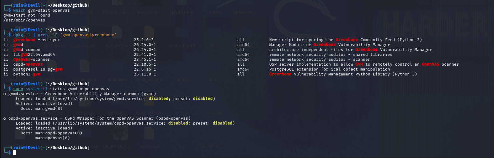
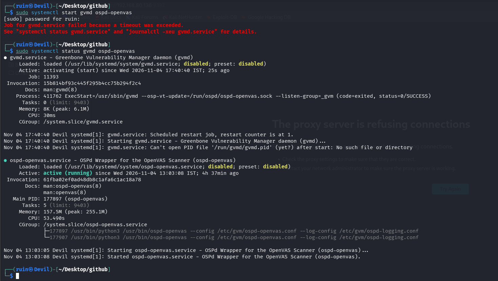
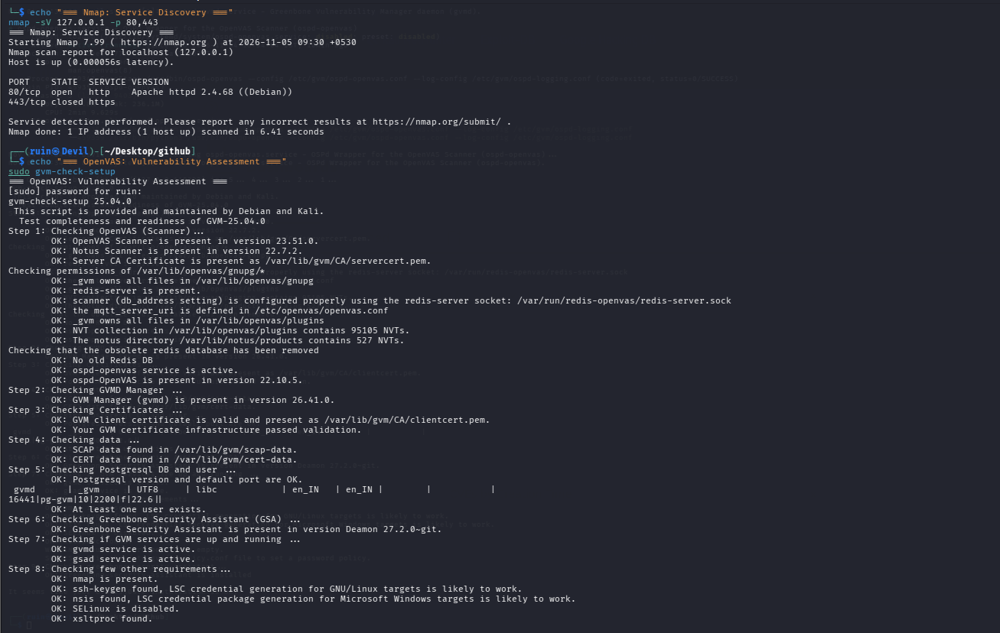
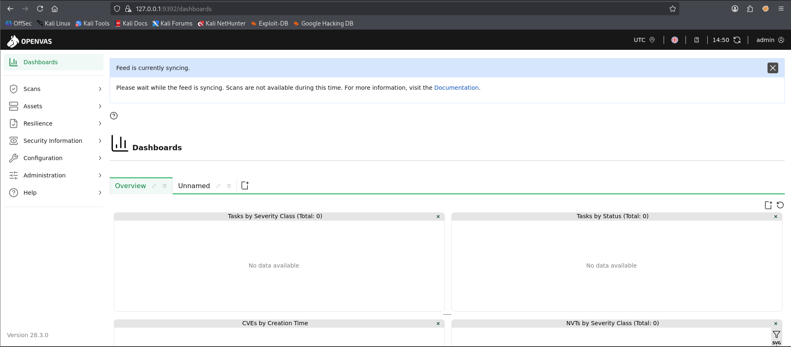
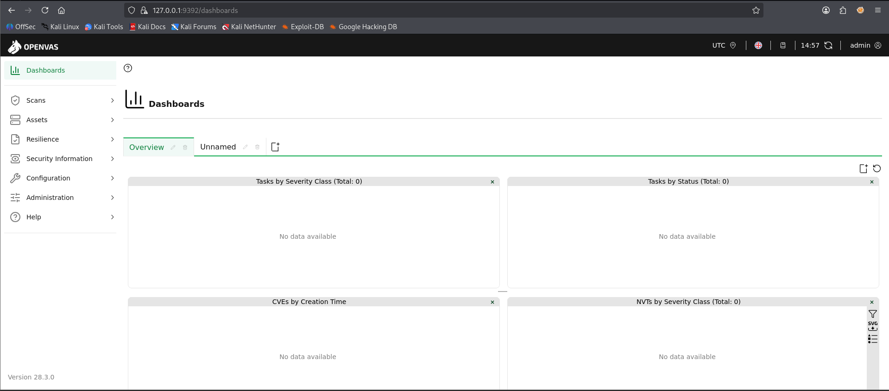

# 🩻 Pentesting Day 14: OpenVAS / Greenbone (Vulnerability Scanner)

<p align="center">
  
  
  
  
</p>

> Day 13 (Burp Suite) showed that an unscoped tool watches everything, not just the target. Day 14 (OpenVAS) is a different kind of lesson: a service that looks broken (a timed-out `gvmd` start) can still come up fine a few minutes later — and today got all the way to a clean setup check and a logged-in dashboard, but stopped one step short of an actual scan.

---

## 🏆 Day 13 Recap — What Burp Suite Taught Me

- Burp's Intercept caught a third-party `contrib.rocks` image request instead of the DVWA login POST I was aiming for — proof it pauses *everything*, not just the action I was performing.
- HTTP history filled up with unrelated `en.wikipedia.org` traffic because no Target → Scope was set.
- Lesson: an unscoped proxy session mixes real signal with noise.

---

## 🎯 Mission Briefing

OpenVAS/GVM is a full vulnerability assessment platform, not a single-purpose scanner like nikto or ZAP. A Day 12 screenshot had already hinted it was installed (`/etc/sudoers.d/ospd-openvas`), so today started by confirming that instead of assuming a fresh install was needed — and found a genuinely thorough, mostly-working setup, with one real gap: no scan was actually created or run.

```
🩻 MISSION: Get GVM/OpenVAS Running and Scan My Own Target
──────────────────────────────────────────
[x] Confirm GVM/Greenbone packages already installed
[x] Diagnose the initial "both services dead" state
[x] Work through a gvmd startup timeout
[x] gvm-check-setup passes almost everything cleanly
[x] Log into the GSA web UI as admin
[x] Confirm feed syncing blocks scans, then wait it out
[ ] Create a scan Target + Task              -> not done
[ ] Run a scan and review the report          -> not reached
──────────────────────────────────────────
STATUS: Pentesting Day 14 — Setup fully diagnosed and working; no scan run yet
```

---

## ⚡ Quick Theory

```
gvmd           ->  Greenbone Vulnerability Manager daemon - the "brain," manages tasks/scans
ospd-openvas    ->  wraps the actual OpenVAS scanner engine
gsad            ->  Greenbone Security Assistant - the web UI (GSA), port 9392 by default
gvm-check-setup ->  diagnostic script: checks every component, certs, DB, NVT feed, permissions
Feed syncing     ->  GVM downloads/updates its vulnerability-check database; scans are blocked
                     while this is in progress
```

> ⚖️ **Scope:** target confirmed as `127.0.0.1`, my own machine, before anything else.

---

## 💻 Lab: Commands + My Real Output

*(Machine: Kali Linux, user `ruin`)*

### 🏗️ Step 0 — Confirm what's already installed
```bash
$ which gvm-start openvas
gvm-start not found
/usr/sbin/openvas

$ dpkg -l | grep -iE 'gvm|openvas|greenbone'
ii  greenbone-feed-sync   25.2.0-3   New script for syncing the Greenbone Community Feed
ii  gvmd                  26.24.0-1  Manager Module of Greenbone Vulnerability Manager
ii  gvmd-common            26.24.0-1  architecture independent files for GVM
ii  libgvm22t64:amd64      22.41.0-1  remote network security auditor - shared libraries
ii  openvas-scanner        23.45.1-1  remote network security auditor - scanner
ii  ospd-openvas           22.10.5-1  OSP server implementation to allow GVM to control OpenVAS
ii  postgresql-18-pg-gvm    22.6.15-1  PostgreSQL extension for ical object manipulation
ii  python3-gvm             26.11.0-1  Greenbone Vulnerability Management Python Library

$ sudo systemctl status gvmd ospd-openvas
○ gvmd.service   ... Active: inactive (dead)
○ ospd-openvas.service ... Active: inactive (dead)
```
Confirmed: **GVM/Greenbone is already fully installed** — no `gvm-setup` needed, matching the hint from Day 12. There's no `gvm-start` convenience script on this Kali install, so services are controlled directly with `systemctl`. Both services started out **inactive**.



### 🔍 Part A — Starting the services hit a real timeout
```bash
$ sudo systemctl start gvmd ospd-openvas
Job for gvmd.service failed because a timeout was exceeded.
See "systemctl status gvmd.service" and "journalctl -xeu gvmd.service" for details.

$ sudo systemctl status gvmd ospd-openvas
● gvmd.service - Greenbone Vulnerability Manager daemon (gvmd)
    Active: activating (start) since Wed 2026-11-04 17:40:40 IST; 25s ago
    Job: 11393
...
Nov 04 17:40:40 Devil systemd[1]: gvmd.service: Scheduled restart job, restart counter is at 1.
Nov 04 17:40:40 Devil systemd[1]: gvmd.service: Can't open PID file '/run/gvmd/gvmd.pid' (yet?) after start: No such file or directory

● ospd-openvas.service - OSPd Wrapper for the OpenVAS Scanner (ospd-openvas)
    Active: active (running) since Wed 2026-11-04 13:03:08 IST; 4h 37min ago
```
`gvmd` **timed out on its first start attempt** and was caught mid-restart (`activating`, restart counter 1, missing PID file "yet?"). `ospd-openvas`, meanwhile, was already running from **4h37min earlier** — it had started successfully well before this session. This looked like a real failure in the moment.



### 🔍 Part B — It actually came up fine: a clean `gvm-check-setup`
```bash
$ nmap -sV 127.0.0.1 -p 80,443
PORT    STATE  SERVICE VERSION
80/tcp  open   http    Apache httpd 2.4.68 ((Debian))
443/tcp closed https

$ sudo gvm-check-setup
gvm-check-setup 25.04.0
Step 1: Checking OpenVAS (Scanner) ...
        OK: OpenVAS Scanner is present in version 23.51.0.
        OK: Notus Scanner is present in version 22.7.2.
        OK: NVT collection in /var/lib/openvas/plugins contains 95105 NVTs.
        OK: The notus directory in /var/lib/notus/products contains 527 NVTs.
        OK: ospd-openvas service is active.
Step 2: Checking GVM Manager (gvmd) ...
        OK: GVM Manager (gvmd) is present in version 26.41.0.
Step 3: Checking Certificates ...
        OK: Your GVM certificate infrastructure passed validation.
Step 5: Checking Postgresql DB and user ...
        OK: At least one user exists.
Step 6: Checking Greenbone Security Assistant (GSA) ...
        OK: Greenbone Security Assistant is present in version Deamon 27.2.0-git.
Step 7: Checking if GVM services are up and running ...
        OK: gvmd service is active.
        OK: gsad service is active.
Step 8: Checking few other requirements ...
        OK: nmap is present.
        OK: SELinux is disabled.
        OK: xsltproc found.
```
Despite the earlier timeout, **`gvmd` had come up successfully by the time this ran** — `gvm-check-setup` passed essentially every check: scanner version, 95,105 NVTs loaded, certificates valid, database present, GSA web UI present, both `gvmd` and `gsad` active. The web target (`127.0.0.1:80`) was also confirmed reachable first, same "verify before trusting" habit from Day 07.



### 🔍 Part C — Logging into the web UI, and the feed-sync wait
```
http://127.0.0.1:9392/dashboards
```
First visit (14:50):
```
Feed is currently syncing.
Please wait while the feed is syncing. Scans are not available during this time.
```
Second visit, seven minutes later (14:57):
```
Dashboards — logged in as admin
Tasks by Severity Class (Total: 0)   Tasks by Status (Total: 0)
CVEs by Creation Time                 NVTs by Severity Class (Total: 0)
```
Logged into the GSA web UI (**GSA version 28.3.0**) successfully as `admin`. The first visit was blocked by an active **feed sync** — GVM downloading its vulnerability-check data, during which scans are disabled. Waiting it out worked; the dashboard then loaded cleanly, but every panel reads **"No data available" / Total: 0"** — no Target or Task has been created yet.




---

## 🧪 What I Actually Found

- [x] GVM/Greenbone fully installed already (`gvmd` 26.24.0-1, `openvas-scanner` 23.45.1-1, `ospd-openvas` 22.10.5-1, and more) — no `gvm-setup` needed
- [x] No `gvm-start` script on this install — services controlled directly via `systemctl`
- [x] `gvmd` **timed out on its first start**, caught mid-restart with a missing PID file
- [x] `ospd-openvas` was already running independently, well before this session (4h37min uptime)
- [x] `gvm-check-setup` later passed **nearly every check**: scanner, 95,105 NVTs, certs, Postgres, GSA, both services active
- [x] Target `127.0.0.1:80` confirmed reachable (Apache 2.4.68) before trusting anything further
- [x] Logged into the GSA web UI as `admin` (version 28.3.0) after waiting out an active feed sync
- [ ] **No Target or Task was created** — Dashboards shows 0 everywhere
- [ ] No scan was run, no report reviewed, no comparison against Day 04 (nikto) or Day 05 (ZAP) findings possible yet

---

## 🎯 Mini Challenges

> **🥊 Challenge 1: Was the `gvmd` Timeout a Real Failure?**
> `systemctl start gvmd` reported a failed timeout, but `gvm-check-setup` later showed it active. What actually happened?

<details>
<summary>My answer</summary>

`gvmd` takes time to initialize (database checks, certificate validation, NVT sync bookkeeping) on first start, and systemd's default start timeout wasn't long enough to wait for all of it. Systemd reported the start as failed and began a scheduled restart, but the service kept initializing in the background and came up successfully shortly after — so the "failure" was really just systemd's patience running out, not a real problem with the service. Checking with `gvm-check-setup` or `systemctl status` again a few minutes later, rather than trusting the first error message, was the right move.

</details>

> **🥊 Challenge 2: What Does "Feed Is Currently Syncing" Actually Block?**
> Scans were unavailable during the sync. Why?

<details>
<summary>My answer</summary>

GVM's vulnerability checks (NVTs — Network Vulnerability Tests) come from a regularly-updated feed. While that feed is actively syncing, the scan engine can't reliably start a scan against a consistent, complete rule set, so GVM disables scanning until the sync finishes. It's a safeguard against running a scan on a half-updated vulnerability database, not an error.

</details>

> **🥊 Challenge 3: Why Does Every Dashboard Panel Read "Total: 0"?**
> The dashboard loaded cleanly and I'm logged in as admin. Why no data?

<details>
<summary>My answer</summary>

GVM only has data to show once a **Target** (what to scan) and a **Task** (which scan config, against which target) have actually been created and run. Logging in just confirms the platform itself works — it doesn't create or run anything on its own. "Total: 0" everywhere is expected and correct for a fresh install that hasn't had a scan configured yet, not a sign of a problem.

</details>

> **🥊 Challenge 4: What's the Very Next Step From Here?**
> Setup is confirmed clean. What's the smallest next action to actually get a result?

<details>
<summary>My answer</summary>

Scans → Targets → New Target (host: `127.0.0.1`), then Scans → Tasks → New Task picking that target and a scan config like "Full and fast," then start it. No more diagnosis needed — the setup checks are done; the only thing missing is actually telling GVM what to scan.

</details>

---

## 🧩 Quick Brain Check

1. Why did `gvmd` report a failed timeout but end up running successfully anyway?
2. What specifically does `gvm-check-setup` verify that a simple "is it running" check wouldn't catch?
3. Why are scans disabled during a feed sync?
4. What's the difference between the platform being "up" (logged in, dashboard loads) and actually having scan data?
5. Why is re-checking a service's status a few minutes later sometimes the right call instead of treating the first error as final?

---

## 🐛 Errors / Gotchas I Hit

- **`gvm-start` not found** — this Kali install doesn't ship that convenience wrapper; `systemctl start gvmd ospd-openvas` directly is the way to go here.
- **`gvmd` timed out on first start**, with a "Can't open PID file (yet?)" message mid-restart — looked like a hard failure but resolved on its own; confirmed later via `gvm-check-setup` rather than panicking at the first error.
- **First web UI visit was blocked by an active feed sync** — not a bug, just had to wait and revisit.
- **No scan was actually created or run this session** — the setup/diagnosis work ate the whole session; Parts B and C of the original lab plan (create a Target+Task, review a report) are still ahead.

---

## 🔐 Security Relevance

Nothing exploitable was found today, because nothing was scanned yet — but the real-world lesson is about **tool reliability itself**: a vulnerability scanner that silently failed to start would be worse than one that errors loudly, because a tester might assume "no findings" when really "no scan ran at all." `gvm-check-setup`'s job is exactly to catch that gap before it becomes a false sense of security — confirming the platform is genuinely ready, not just that a command didn't crash.

---

## 🧠 Today's Takeaway

Day 14 turned into a setup-and-diagnosis day rather than a scan-and-review day, and that's an honest, useful result on its own: GVM was already installed, a real `gvmd` startup timeout got correctly worked through rather than ignored, and `gvm-check-setup` confirmed the whole stack — scanner, manager, certs, database, web UI — is genuinely healthy. The dashboard loading with `admin` logged in and every panel at zero is exactly the state before any scan exists, not a sign something's wrong. Creating a Target and Task is now a small, well-prepared next step rather than a leap into an unverified setup.

---

⬅️ [Back to Pentesting index](/Pentesting) | ➡️ Next up: **Day 15: enum4linux-ng**
