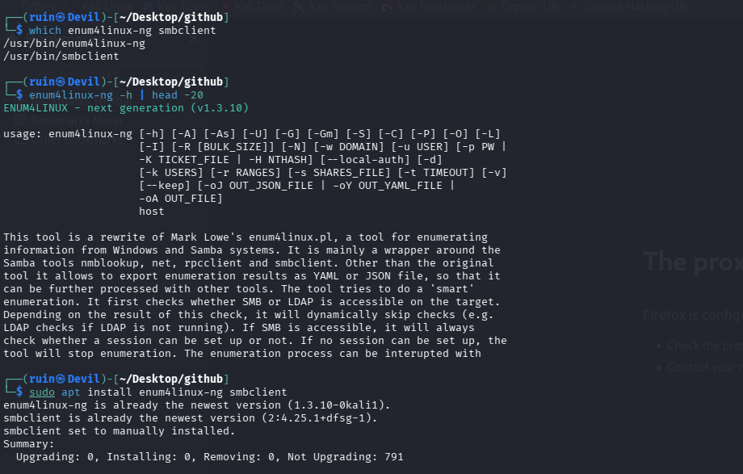
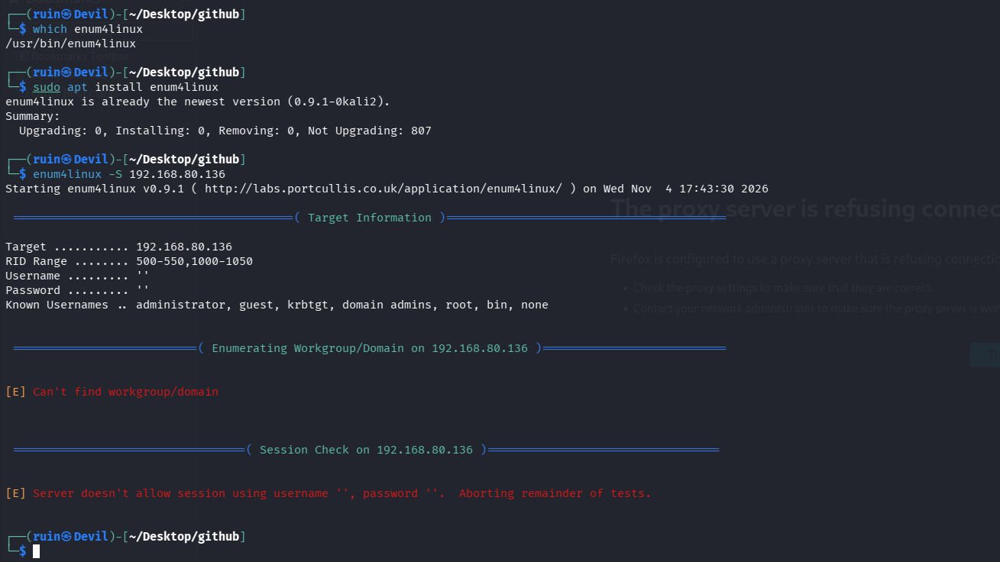
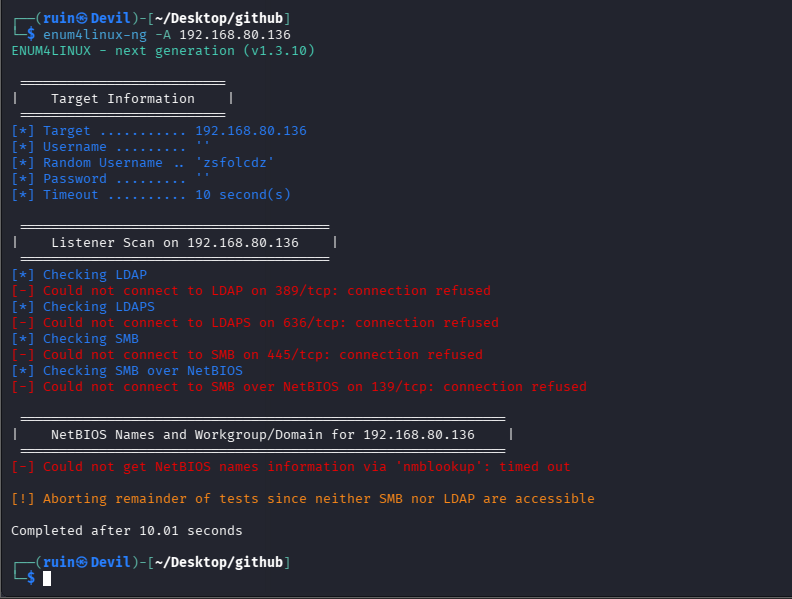
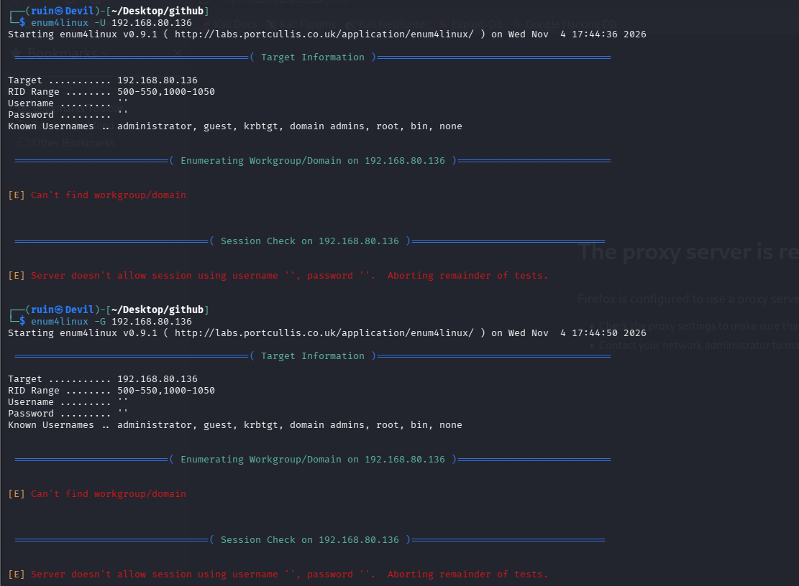
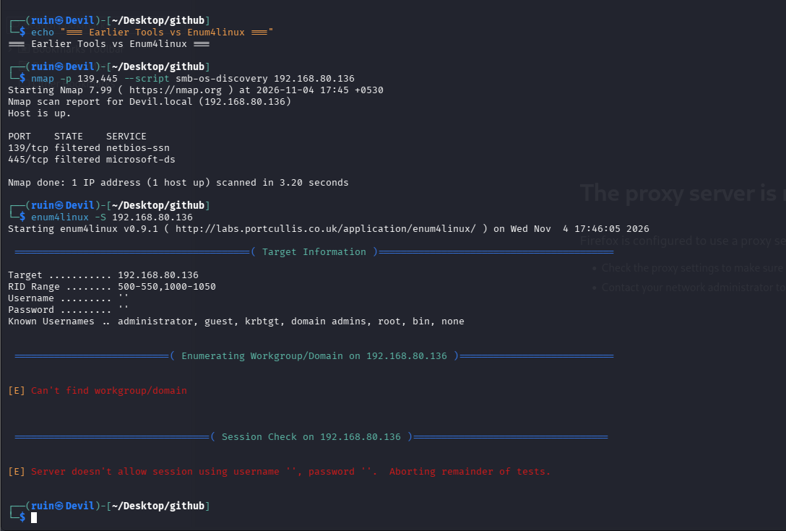

# 📂 Pentesting Day 15: enum4linux-ng / SMB Enumeration

<p align="center">
  
  
  
  
</p>

> Day 14 (OpenVAS) was a setup-and-diagnosis day that never reached an actual scan. Day 15 is the opposite shape: every tool ran cleanly and completely — and the honest result is that **SMB still isn't actually reachable on this target**, the same suspicion Day 07 raised and never resolved.

---

## 🏆 Day 14 Recap — What OpenVAS Taught Me

- A `gvmd` startup timeout looked like a real failure but resolved on its own — confirmed later via `gvm-check-setup`, not the first error message.
- Logging into the GSA web UI with every dashboard panel at "Total: 0" was the expected state before any scan existed, not a problem.

---

## 🎯 Mission Briefing

SMB enumeration maps out shares, users, and groups on a Windows/Samba target. Before touching anything, Day 07's lesson applied again: **re-verify the target is actually reachable** before trusting what enumeration finds — and today's re-verification confirms it genuinely isn't, cleanly and consistently, across two different tools.

```
📂 MISSION: Enumerate SMB on 192.168.80.136, Verifying the Target First
──────────────────────────────────────────
[x] Confirm enum4linux-ng, legacy enum4linux, and smbclient installed
[x] Re-verify ports 139/445 with nmap (Day 07 lesson applied)
[x] Run enum4linux-ng -A (full enumeration)
[x] Run legacy enum4linux -S / -U / -G for comparison
[ ] Shares found           -> none, SMB not accessible
[ ] Users/groups found      -> none, no session could be established
──────────────────────────────────────────
STATUS: Pentesting Day 15 — Clean, consistent "not accessible" result across every tool run
```

---

## ⚡ Quick Theory

```
enum4linux-ng    ->  modern rewrite; checks LDAP, LDAPS, SMB, SMB-over-NetBIOS,
                      "smartly" skips tests that can't succeed given earlier results
enum4linux (old)  ->  the original Perl tool; wraps nmblookup, net, rpcclient, smbclient
"filtered" (nmap)  ->  no response at all to the probe - usually a firewall silently dropping it
"refused" (direct connect)  ->  the port actively sent back a rejection (RST) - usually means
                                  nothing is listening there at all
```

> ⚖️ **Scope:** `192.168.80.136`, the same lab target used across Days 07, 13-14.

---

## 💻 Lab: Commands + My Real Output

*(Machine: Kali Linux, user `ruin`)*

### 🏗️ Step 0 — Install check
```bash
$ which enum4linux-ng smbclient
/usr/bin/enum4linux-ng
/usr/bin/smbclient
$ enum4linux-ng -h | head -20
ENUM4LINUX - next generation (v1.3.10)

$ sudo apt install enum4linux-ng smbclient
enum4linux-ng is already the newest version (1.3.10-0kali1).
smbclient is already the newest version (2:4.25.1+dfsg-1).
```
Both the modern `enum4linux-ng` (v1.3.10) and `smbclient` confirmed installed.



### 🔍 Re-verify the target first (Day 07 lesson)
```bash
$ nmap -p 139,445 --script smb-os-discovery 192.168.80.136
PORT    STATE    SERVICE
139/tcp filtered netbios-ssn
445/tcp filtered microsoft-ds
```
Same result as before: both SMB ports show **filtered**, not open. This matches the suspicion from Day 07 — this target still doesn't look like a real, fully-exposed Metasploitable2 box.



### 🔍 Part A — enum4linux-ng full enumeration
```bash
$ enum4linux-ng -A 192.168.80.136
ENUM4LINUX - next generation (v1.3.10)

[*] Target .......... 192.168.80.136
[*] Random Username .. 'zsfolcdz'
[*] Timeout .......... 10 second(s)

Listener Scan on 192.168.80.136
[*] Checking LDAP
[-] Could not connect to LDAP on 389/tcp: connection refused
[*] Checking LDAPS
[-] Could not connect to LDAPS on 636/tcp: connection refused
[*] Checking SMB
[-] Could not connect to SMB on 445/tcp: connection refused
[*] Checking SMB over NetBIOS
[-] Could not connect to SMB over NetBIOS on 139/tcp: connection refused

[-] Could not get NetBIOS names information via 'nmblookup': timed out
[!] Aborting remainder of tests since neither SMB nor LDAP are accessible

Completed after 10.01 seconds
```
`enum4linux-ng`'s own connection attempts report **"connection refused"** on every port — not "filtered" like nmap's SYN scan, but an active rejection. It correctly aborted the rest of its tests once it confirmed neither SMB nor LDAP could be reached, instead of grinding through checks that couldn't possibly succeed.



### 🔍 Part B — legacy enum4linux, three ways, for comparison
```bash
$ which enum4linux
/usr/bin/enum4linux
$ sudo apt install enum4linux
enum4linux is already the newest version (0.9.1-0kali2).

$ enum4linux -S 192.168.80.136
[E] Can't find workgroup/domain
[E] Server doesn't allow session using username '', password ''.  Aborting remainder of tests.

$ enum4linux -U 192.168.80.136
[E] Can't find workgroup/domain
[E] Server doesn't allow session using username '', password ''.  Aborting remainder of tests.

$ enum4linux -G 192.168.80.136
[E] Can't find workgroup/domain
[E] Server doesn't allow session using username '', password ''.  Aborting remainder of tests.
```
Ran the original `enum4linux` three separate ways — shares (`-S`), users (`-U`), groups (`-G`) — and got the **exact same failure** every time: it can't even find the workgroup/domain, let alone establish a session. Both the old and new tool agree completely.




---

## 🧪 What I Actually Found

- [x] `enum4linux-ng` v1.3.10, legacy `enum4linux` v0.9.1, and `smbclient` all confirmed installed
- [x] `nmap` re-confirms ports 139/445 as **filtered** (same as Day 07)
- [x] `enum4linux-ng -A` reports **connection refused** on LDAP (389), LDAPS (636), SMB (445), and SMB-over-NetBIOS (139) — a stronger, more specific signal than nmap's "filtered"
- [x] `nmblookup` timed out trying to get NetBIOS names
- [x] Legacy `enum4linux -S`/`-U`/`-G` all fail identically: can't find the workgroup/domain, server refuses a null session
- [ ] **No shares found** — SMB not accessible
- [ ] **No usernames or groups found** — no session could ever be established

---

## 🎯 Mini Challenges

> **🥊 Challenge 1: "Filtered" (nmap) vs "Connection Refused" (enum4linux-ng) — Contradiction?**
> nmap called the ports filtered; enum4linux-ng called the connection refused. Are these contradicting each other?

<details>
<summary>My answer</summary>

Not necessarily — they're different kinds of probes. nmap's SYN scan got no response at all (consistent with a firewall silently dropping the packet = "filtered"). enum4linux-ng makes a full TCP connection attempt, which can get an active rejection (RST) from either the OS or a different point in the path even when an earlier SYN probe saw nothing back. Both results agree on the one thing that matters: **nothing usable is listening on 139/445 right now**, however exactly the rejection happens.

</details>

> **🥊 Challenge 2: Why Did enum4linux-ng Stop Early?**
> It aborted the rest of its tests after the connection checks failed. Is that a weakness?

<details>
<summary>My answer</summary>

No — it's the smarter behavior the tool's own help text describes: it checks whether SMB or LDAP is reachable first, and skips tests that depend on a working connection if neither is. Grinding through user/group/share enumeration attempts against a target that's already confirmed unreachable would just waste 10+ more seconds for the same "can't connect" result, which legacy `enum4linux` demonstrated three separate times.

</details>

> **🥊 Challenge 3: Does This Confirm or Deny Day 07's Suspicion?**
> Day 07 suspected `192.168.80.136` might not be a real, fully-exposed Metasploitable2 box. Does today's result settle that?

<details>
<summary>My answer</summary>

It strengthens the suspicion without fully proving it. A genuine Metasploitable2 VM ships with Samba wide open specifically so SMB enumeration like this succeeds easily — getting a clean "refused" across LDAP, LDAPS, SMB, and NetBIOS on this address, on top of Day 07's hostname-matching red flag, makes it more likely this target either isn't the real Metasploitable2, or that VM simply isn't powered on / reachable on this network right now. Settling it for certain still needs checking Metasploitable2's own console directly, as Day 07 originally concluded.

</details>

> **🥊 Challenge 4: Three Tools, Same Answer — Was Running All Three Worth It?**
> enum4linux-ng, and legacy enum4linux three separate ways, all agree SMB isn't reachable. Was that redundant?

<details>
<summary>My answer</summary>

Not redundant — it's what makes today's "nothing found" result trustworthy rather than a one-off fluke. If only one tool had failed, I might suspect a bug or a bad flag in that specific run. Getting the identical failure from the modern tool's full scan AND three separate legacy-tool runs is strong, consistent evidence that the target itself is the reason, not the tooling.

</details>

---

## 🧩 Quick Brain Check

1. Why might nmap report "filtered" while a direct connection attempt reports "refused" for the same port?
2. What does `enum4linux-ng`'s "smart" early-abort behavior save, compared to legacy `enum4linux`?
3. Why does running the same check with two different tools (old and new enum4linux) matter for confidence in a negative result?
4. What would need to happen to actually resolve Day 07's open question about this target's identity?
5. Why is "SMB not accessible" today still a useful, reportable finding rather than a wasted session?

---

## 🐛 Errors / Gotchas I Hit

- None in the tools themselves — every command ran cleanly and failed/aborted in exactly the way its own output explained. The only "gotcha" is the target itself: SMB genuinely isn't reachable on `192.168.80.136` right now, consistent with Day 07's unresolved suspicion about this address.
- `nmblookup` timed out rather than erroring immediately — consistent with a target that isn't responding to NetBIOS queries at all, not just refusing SMB specifically.

---

## 🔐 Security Relevance

A consistent "can't connect" across multiple tools and multiple enumeration angles (shares, users, groups, LDAP) is itself a real, reportable finding: SMB is not exposed on this host right now, whatever the reason. In a real engagement, this is exactly the kind of result that closes out a line of investigation — not because the target is secure in general, but because this particular attack surface isn't present to test. The next useful step is the same one Day 07 left open: confirm what `192.168.80.136` actually is, directly, before spending more time enumerating it.

---

## 🧠 Today's Takeaway

Every tool today agreed, cleanly and immediately: SMB isn't reachable on this target. That's not a failed lab day — it's a well-supported negative result, backed by nmap's port state, enum4linux-ng's connection-level detail, and three independent legacy-tool runs all landing on the same conclusion. The open thread from Day 07 is still open: before assuming this address is a real, intentionally-vulnerable Metasploitable2 box, its identity needs confirming directly, not inferred from another round of enumeration against it.

---

⬅️ [Back to Pentesting index](/Pentesting) | ➡️ Next up: **Day 16: aircrack-ng**
