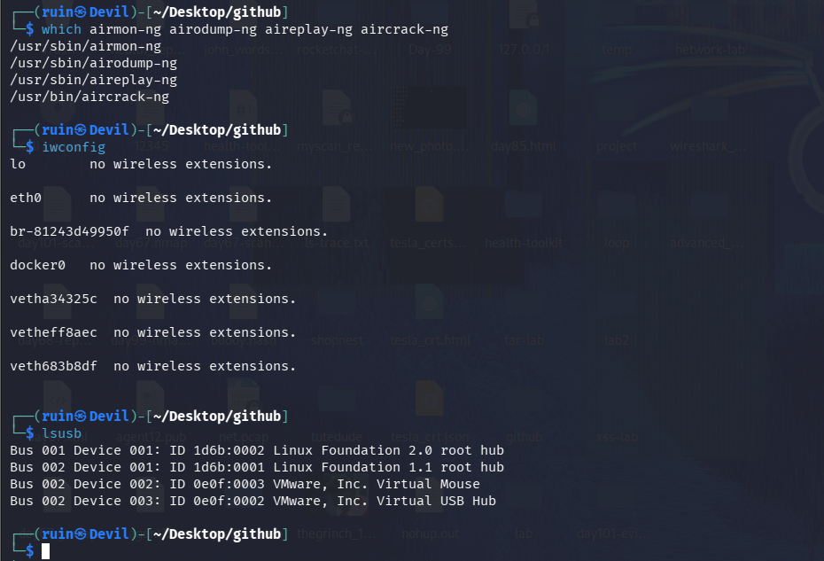
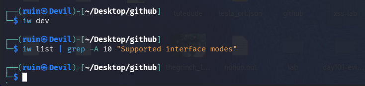
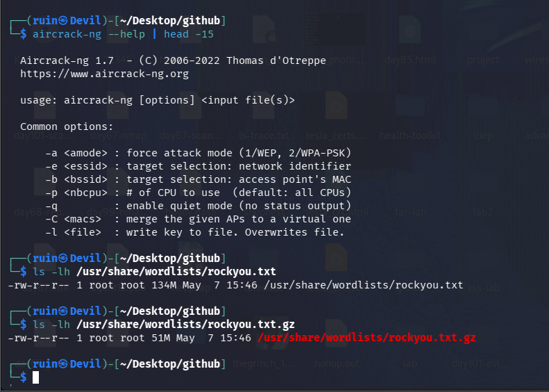
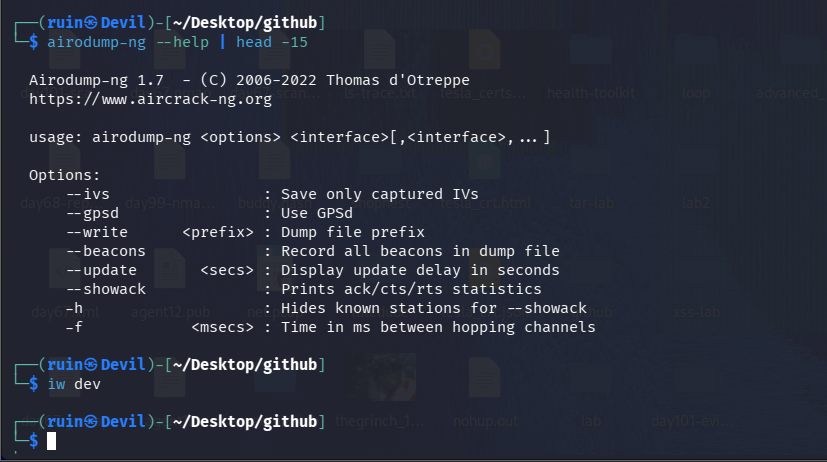
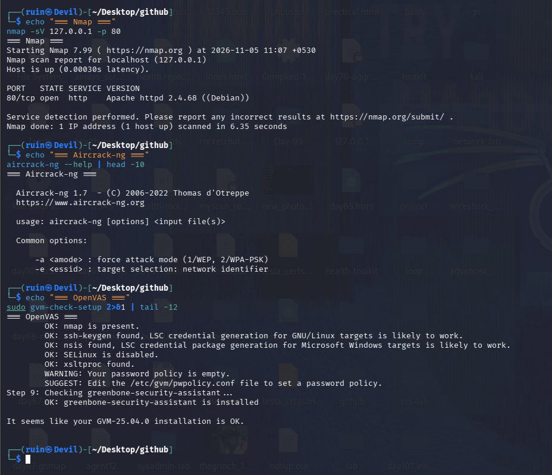

# 📡 Pentesting Day 16: aircrack-ng (Wireless Basics)

<p align="center">
  
  
  
  
</p>

> Day 15 (enum4linux) ended with a clean, consistent "not reachable" across three tools. Day 16 hits the same kind of honest wall for a different reason: this Kali VM genuinely has no wireless hardware to capture anything with — and confirming that properly, instead of guessing, is today's real result.

---

## 🏆 Day 15 Recap — What enum4linux Taught Me

- `enum4linux-ng`, and legacy `enum4linux` run three separate ways, all agreed: SMB isn't reachable on `192.168.80.136`.
- A consistent negative result across multiple tools is trustworthy, not a wasted session.
- Day 07's open question about that target's real identity is still unresolved.

---

## 🎯 Mission Briefing

aircrack-ng attacks Wi-Fi traffic directly — a completely different attack surface from every tool since Day 03, all of which worked over IP. That needs a wireless adapter that supports monitor mode, which a VM usually doesn't have passed through. Today's lab checked for that honestly, confirmed it isn't available, and wrote up the workflow from documentation instead of faking a live capture.

```
📡 MISSION: Check for Real Wireless Hardware, Document Honestly Either Way
──────────────────────────────────────────
[x] Confirm the aircrack-ng suite is installed
[x] Check every network interface with iwconfig
[x] Check for wireless devices with iw dev / iw list
[x] Check for a USB Wi-Fi adapter with lsusb
[x] Confirm: no monitor-mode-capable interface exists in this environment
[ ] Monitor mode, live scan, handshake capture -> not possible without real hardware
──────────────────────────────────────────
STATUS: Pentesting Day 16 — Honest "no hardware" result, fully verified, not just assumed
```

---

## ⚡ Quick Theory

```
Monitor mode       ->  a wireless adapter mode that captures raw 802.11 frames, not just
                        traffic addressed to it - required before any of this works at all
airmon-ng           ->  enables/disables monitor mode on a supported adapter
airodump-ng          ->  captures nearby network traffic once in monitor mode
aireplay-ng           ->  sends crafted frames (e.g. deauth) to force a handshake
aircrack-ng            ->  cracks a captured WPA handshake against a wordlist
```

Most VM setups (including this one) have no physical wireless radio passed through — only virtual network interfaces (`eth0`, Docker bridges, `veth*` pairs), none of which can ever support monitor mode because they aren't Wi-Fi hardware at all.

> ⚖️ **Scope:** this is the one phase topic where the legal line is sharpest — own hardware, own network only. Today never got far enough to need that line tested.

---

## 💻 Lab: Commands + My Real Output

*(Machine: Kali Linux, user `ruin`)*

### 🏗️ Step 0 — Tool and hardware check
```bash
$ which airmon-ng airodump-ng aireplay-ng aircrack-ng
/usr/sbin/airmon-ng
/usr/sbin/airodump-ng
/usr/sbin/aireplay-ng
/usr/bin/aircrack-ng

$ iwconfig
lo         no wireless extensions.
eth0       no wireless extensions.
br-81243d49950f  no wireless extensions.
docker0    no wireless extensions.
vetha34325c  no wireless extensions.
vetheff8aec   no wireless extensions.
veth683b8df   no wireless extensions.

$ lsusb
Bus 001 Device 001: ID 1d6b:0002 Linux Foundation 2.0 root hub
Bus 002 Device 001: ID 1d6b:0001 Linux Foundation 1.1 root hub
Bus 002 Device 002: ID 0e0f:0003 VMware, Inc. Virtual Mouse
Bus 002 Device 003: ID 0e0f:0002 VMware, Inc. Virtual USB Hub
```
The full aircrack-ng suite is installed. **Every single interface** — including the Docker bridge and veth pairs from containers running on this box — reports **"no wireless extensions."** `lsusb` confirms the only USB devices present are VMware's own virtual mouse and hub — **no physical or passed-through Wi-Fi adapter at all.**



### 🔍 Confirming it two more ways
```bash
$ iw dev
(no output - no wireless devices registered)

$ iw list | grep -A 10 "Supported interface modes"
(no output - no wireless phy present to list modes for)
```
Both `iw dev` (lists wireless devices) and `iw list` (lists wireless radio capabilities) returned **nothing at all** — not an error, just confirmation there's no wireless radio for the kernel to report on. Three independent checks (`iwconfig`, `iw dev`, `iw list`) and `lsusb` all agree: **there is no monitor-mode-capable hardware in this environment**, full stop.



### 🔍 Reading the tools' own help, and checking a wordlist for later
```bash
$ airodump-ng --help | head -15
Airodump-ng 1.7  - (C) 2006-2022 Thomas d'Otreppe
  --ivs              : Save only captured IVs
  --write <prefix>   : Dump file prefix
  --beacons          : Record all beacons in dump file
  -f <msecs>         : Time in ms between hopping channels

$ aircrack-ng --help | head -15
Aircrack-ng 1.7  - (C) 2006-2022 Thomas d'Otreppe
  -a <amode> : force attack mode (1/WEP, 2/WPA-PSK)
  -e <essid> : target selection: network identifier
  -b <bssid> : target selection: access point's MAC
  -l <file>  : write key to file. Overwrites file.

$ ls -lh /usr/share/wordlists/rockyou.txt
-rw-r--r-- 1 root root 134M May  7 15:46 /usr/share/wordlists/rockyou.txt
```
Since live capture isn't possible, I read through `airodump-ng` and `aircrack-ng`'s own `--help` output to understand the real workflow, and confirmed `rockyou.txt` (134 MB) is already available for whenever a real handshake capture is possible — the same wordlist used in Day 08/09's password cracking.




### 🔍 Quick comparison against earlier days
```bash
$ nmap -sV 127.0.0.1 -p 80
80/tcp open  http  Apache httpd 2.4.68 ((Debian))

$ aircrack-ng --help | head -10
Aircrack-ng 1.7 - usage: aircrack-ng [options] <input file(s)>

$ sudo gvm-check-setup 2>&1 | tail -12
OK: nmap is present.
OK: ssh-keygen found, LSC credential generation for GNU/Linux targets is likely to work.
OK: nsis found, LSC credential package generation for Microsoft Windows targets is likely to work.
OK: SELinux is disabled.
OK: xsltproc found.
WARNING: Your password policy is empty.
OK: greenbone-security-assistant is installed
It seems like your GVM-25.04.0 installation is OK.
```
A quick nmap sanity check confirmed my own Apache is still reachable (the usual IP-based tooling still works fine — it's specifically wireless hardware that's missing). I also re-ran `gvm-check-setup` out of curiosity: Day 14's GVM setup now reports **"installation is OK"** cleanly, with no warnings beyond an empty password policy — confirming the `gvmd` timeout from that day really was a one-time startup hiccup, not a lasting problem.



---

## 🧪 What I Actually Found

- [x] Full aircrack-ng suite (`airmon-ng`, `airodump-ng`, `aireplay-ng`, `aircrack-ng` v1.7) installed and working
- [x] `iwconfig`: every interface (including Docker/veth) reports "no wireless extensions"
- [x] `iw dev` and `iw list`: both return nothing — no wireless device registered at all
- [x] `lsusb`: only VMware's own virtual mouse/hub — no physical or passed-through Wi-Fi adapter
- [x] `rockyou.txt` (134 MB) confirmed available for a future real handshake crack
- [x] Bonus finding: Day 14's `gvmd` issue is now fully resolved — `gvm-check-setup` reports a clean "installation is OK"
- [ ] Monitor mode, network scanning, handshake capture — none possible without real hardware

---

## 🎯 Mini Challenges

> **🥊 Challenge 1: Why Check Four Different Ways (iwconfig, iw dev, iw list, lsusb) Instead of Stopping at the First One?**
> `iwconfig` alone already showed no wireless extensions. Why keep checking?

<details>
<summary>My answer</summary>

Each tool checks a slightly different layer: `iwconfig` is the older wireless-extensions interface (can miss newer devices that only support `nl80211`), `iw dev`/`iw list` check the modern `nl80211` interface directly, and `lsusb` checks at the hardware level regardless of driver support. Getting the same "nothing here" answer from all four, rather than just one, turns "probably no hardware" into a confirmed, defensible conclusion — the same multi-tool-agreement pattern from Day 15.

</details>

> **🥊 Challenge 2: Is a "No Hardware" Result a Wasted Lab Day?**
> Nothing was captured or cracked today. Did the day accomplish anything real?

<details>
<summary>My answer</summary>

No — confirming the constraint properly (four independent checks, not just assuming) is itself a legitimate, documented result, and reading the tools' actual `--help` output to understand the real workflow (`-a`/`-e`/`-b` for aircrack-ng, `--write`/`-f` for airodump-ng) means I know exactly what to run the moment real hardware is available, rather than starting from zero later.

</details>

> **🥊 Challenge 3: What Does the rockyou.txt Check Have to Do With Wireless?**
> Why check a wordlist file on a day with no capture?

<details>
<summary>My answer</summary>

Once a WPA handshake is captured, cracking it is a wordlist attack against the handshake — structurally the same job as Day 08 (John) and Day 09 (hashcat) did against password hashes, just with `aircrack-ng -w rockyou.txt` as the tool. Confirming the wordlist is ready now means that step won't be a surprise blocker later.

</details>

> **🥊 Challenge 4: What Changed Between Day 14 and Today With OpenVAS?**
> `gvm-check-setup` now reports "installation is OK," cleanly. What does that confirm from Day 14?

<details>
<summary>My answer</summary>

It confirms Day 14's `gvmd` startup timeout really was a temporary hiccup, not an ongoing problem — exactly what Day 14's own conclusion predicted but couldn't fully prove at the time. Seeing a clean re-check days later, unprompted, is stronger evidence than the original check alone.

</details>

---

## 🧩 Quick Brain Check

1. Why can't a Docker bridge or veth interface ever support monitor mode, no matter how it's configured?
2. What's the difference between what `iwconfig` checks and what `iw list` checks?
3. Why does confirming "no hardware" with multiple tools matter more than just checking once?
4. What would need to change in this environment for Parts A-C of the original lab plan to actually run?
5. Why is reading a tool's `--help` output a legitimate substitute for hands-on practice when hardware isn't available?

---

## 🐛 Errors / Gotchas I Hit

- **No wireless hardware available** — not an error exactly, but the defining constraint of the whole day. Confirmed thoroughly rather than assumed after one check.
- **`iw dev` and `iw list` returned completely empty** rather than an error message — worth knowing that "no output" here means "nothing to report," not a broken command.
- Everything else ran cleanly: tool installation, help output, wordlist check, and the bonus OpenVAS re-check all worked exactly as expected.

---

## 🔐 Security Relevance

Wireless security testing needs physical access to RF — there's no way to meaningfully test Wi-Fi security from a VM with no radio, the same way Day 06-07's lesson was "verify your target," this is "verify your capability before planning around it." For a real engagement, confirming hardware support (and getting an external USB adapter with known monitor-mode support, like several common Realtek/Atheros chipsets) is a pre-engagement logistics step, not something to discover mid-test.

---

## 🧠 Today's Takeaway

Today's honest result — no wireless hardware, confirmed four independent ways — is exactly the outcome the lab's own fallback path anticipated, and documenting it properly (rather than skipping the day or faking a capture) is the right call. Reading `airodump-ng` and `aircrack-ng`'s actual options prepared the real workflow for whenever an external adapter is available, and a bonus re-check confirmed Day 14's OpenVAS setup is now genuinely healthy. The pattern continues: a tool (or in this case, a whole category of tools) is only as useful as what's actually available to run it against — and knowing that for certain beats assuming it either way.

---

⬅️ [Back to Pentesting index](/Pentesting) | ➡️ Next up: **Day 17: CrackMapExec**
