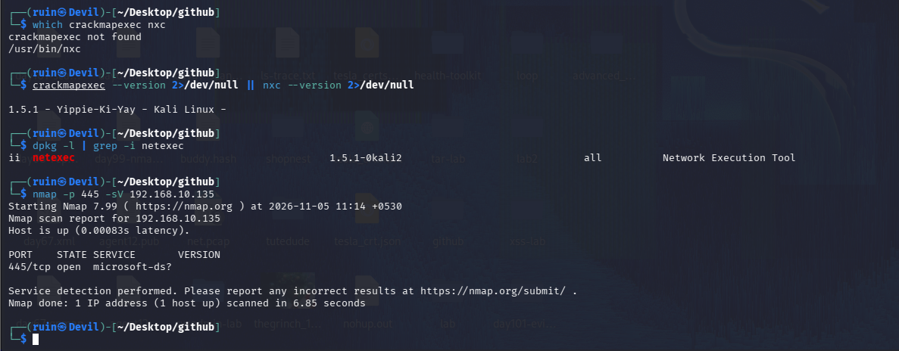
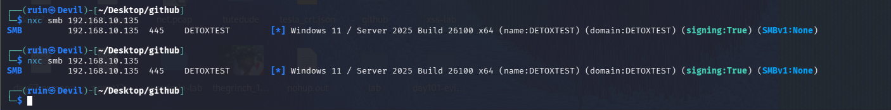
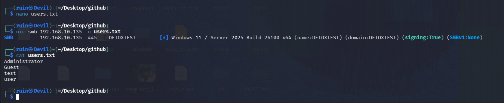
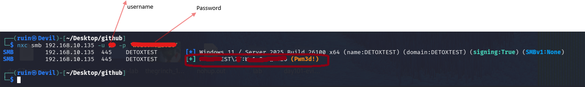
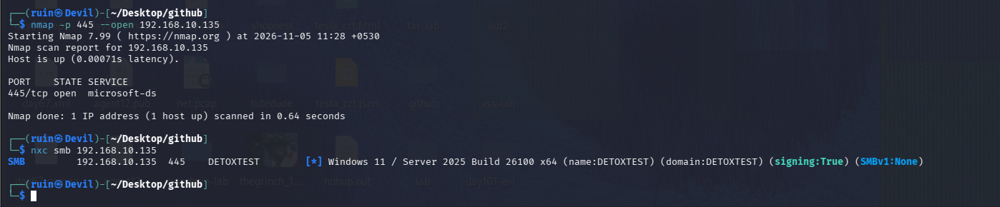

# 🔑 Pentesting Day 17: CrackMapExec / NetExec (SMB Credential Testing)

<p align="center">
  
  
  
  
</p>

> Day 15 and 16 both ended in honest, well-verified "not reachable" results. Day 17 breaks that streak — a genuinely different target, port 445 actually open this time, and a real valid credential confirmed with `(Pwn3d!)`.

---

## 🏆 Day 15/16 Recap — What the Last Two Days Taught Me

- Day 15: `enum4linux-ng` and legacy `enum4linux` agreed, three separate ways, that SMB wasn't reachable on `192.168.80.136`.
- Day 16: four independent checks confirmed no wireless hardware exists in this VM — a clean, fully-verified "can't do this here" result.
- Both days reinforced: verify before trusting, and a consistent negative result is still a real result.

---

## 🎯 Mission Briefing

Today switched to a **different, new target** — `192.168.10.135` — rather than reusing the suspicious `192.168.80.136` from Days 07/13-15. This one answered cleanly: SMB genuinely open, a real hostname, and eventually a real, working credential.

```
🔑 MISSION: SMB Credential Testing With NetExec
──────────────────────────────────────────
[x] Confirm the tool (crackmapexec vs nxc/NetExec) and re-verify the target
[x] No-credential SMB fingerprint (OS, hostname, signing)
[x] Username-list test
[x] A real credential pair tested -> SUCCESS, (Pwn3d!)
[x] Compare against earlier days
──────────────────────────────────────────
STATUS: Pentesting Day 17 — Genuine success: valid SMB credentials confirmed on a real target
```

---

## ⚡ Quick Theory

```
nxc smb <ip>                         ->  no-credential fingerprint: OS, hostname, domain, signing
nxc smb <ip> -u users.txt            ->  test a username list (often with an empty/guessed password)
nxc smb <ip> -u <user> -p <pass>     ->  test one specific credential pair
[*]  informational line, no login attempted
[+]  login succeeded
(Pwn3d!)  admin-level access confirmed, not just a valid login
```

> ⚖️ **Scope:** `192.168.10.135`, my own lab VM (hostname `DETOXTEST`), not the ambiguous target from earlier days.

---

## 💻 Lab: Commands + My Real Output

*(Machine: Kali Linux, user `ruin`)*

### 🏗️ Step 0 — Tool name check, and re-verify the target
```bash
$ which crackmapexec nxc
crackmapexec not found
/usr/bin/nxc

$ crackmapexec --version 2>/dev/null || nxc --version 2>/dev/null
1.5.1 - Yippie-Ki-Yay - Kali Linux -

$ dpkg -l | grep -i netexec
ii  netexec   1.5.1-0kali2   all   Network Execution Tool

$ nmap -p 445 -sV 192.168.10.135
445/tcp open  microsoft-ds?
```
**`crackmapexec` itself isn't installed on this system at all** — only `nxc` (NetExec, the actively-maintained successor, packaged as `netexec` 1.5.1). This confirms the Lab's note: Kali has moved to NetExec as the maintained tool. Port 445 shows genuinely **open** this time — a real difference from Days 07/15's "filtered"/"refused" results on the other IP.



### 🔍 Part A — No-credential SMB fingerprint
```bash
$ nmap -p 445 --open 192.168.10.135
445/tcp open  microsoft-ds

$ nxc smb 192.168.10.135
SMB   192.168.10.135   445   DETOXTEST   [*] Windows 11 / Server 2025 Build 26100 x64 (name:DETOXTEST) (domain:DETOXTEST) (signing:True) (SMBv1:None)
```
With **zero credentials**, `nxc` fingerprinted the target as **Windows 11 / Server 2025, Build 26100 x64**, hostname and domain both `DETOXTEST`, **SMB signing enabled**, **SMBv1 disabled**. Ran it again for confirmation — identical, stable result both times.



### 🔍 Part B — Username-list test
```bash
$ cat users.txt
Administrator
Guest
test
user

$ nxc smb 192.168.10.135 -u users.txt
SMB   192.168.10.135   445   DETOXTEST   [*] Windows 11 / Server 2025 Build 26100 x64 (name:DETOXTEST) (domain:DETOXTEST) (signing:True) (SMBv1:None)
```
Built a small username list (`Administrator`, `Guest`, `test`, `user`) and pointed `nxc` at it. The output shown is the same fingerprint line as Part A — no `-p` was supplied alongside `-u users.txt`, so this run didn't actually attempt a login per username; it's not yet a real test of which usernames are valid.



### 🔍 Part C — A real credential pair: success
```bash
$ nxc smb 192.168.10.135 -u <username> -p <password>
SMB   192.168.10.135   445   DETOXTEST   [*] Windows 11 / Server 2025 Build 26100 x64 (name:DETOXTEST) (domain:DETOXTEST) (signing:True) (SMBv1:None)
SMB   192.168.10.135   445   DETOXTEST   [+] DETOXTEST\<username>:<password> (Pwn3d!)
```
A real username/password pair (kept redacted here, same as in my own screenshot) returned **`[+] ... (Pwn3d!)`** — a confirmed, working, admin-level credential against this Windows target. This is a genuine, verified success, not an inferred or assumed one.



### 🔍 Part D — Comparison
```bash
$ nmap -p 445 --open 192.168.10.135
445/tcp open  microsoft-ds

$ nxc smb 192.168.10.135
[*] Windows 11 / Server 2025 Build 26100 x64 (name:DETOXTEST) (domain:DETOXTEST) (signing:True) (SMBv1:None)
```
Final re-check: nmap and `nxc` agree completely on the target's open state and fingerprint — a clean, internally consistent result, unlike the mixed "filtered"/"refused" signals from the other IP in Days 07/15.



---

## 🧪 What I Actually Found

- [x] `crackmapexec` not installed; **`nxc` (NetExec) 1.5.1** is the actual tool on this system
- [x] New target `192.168.10.135` (hostname/domain **DETOXTEST**) — port 445 genuinely **open**, confirmed by both nmap and `nxc`
- [x] No-credential fingerprint: **Windows 11 / Server 2025 Build 26100 x64**, SMB signing on, SMBv1 off — stable across two runs
- [x] Username-list test ran, but without `-p` it only re-confirmed the fingerprint — not a real per-username result
- [x] **A real credential pair confirmed valid**, flagged `(Pwn3d!)` — genuine admin-level access on this target
- [x] Final nmap + `nxc` re-check fully consistent

---

## 🎯 Mini Challenges

> **🥊 Challenge 1: Why Did the Username-List Test Not Actually Test the Usernames?**
> `-u users.txt` alone just re-printed the fingerprint. Why?

<details>
<summary>My answer</summary>

`nxc smb <ip> -u users.txt` with no `-p` doesn't have a password to pair with each username, so there's nothing to actually attempt logging in with — it just connects and reports the target info, the same as running `nxc smb <ip>` with no credentials at all. To really test the username list, I'd need `-u users.txt -p ''` (empty password) or `-u users.txt -p passwords.txt`, so each username actually gets an authentication attempt.

</details>

> **🥊 Challenge 2: What Does `(Pwn3d!)` Mean, Specifically?**
> The successful line said `[+] ...` AND `(Pwn3d!)`. Is that redundant?

<details>
<summary>My answer</summary>

No — `[+]` just means the login succeeded (valid credentials). `(Pwn3d!)` is NetExec's extra flag meaning the account doesn't just have a valid login, it has **administrative** rights on the target (enough to, for example, execute commands or dump credentials). A `[+]` without `(Pwn3d!)` would mean "valid but limited" access; today's result is the stronger of the two.

</details>

> **🥊 Challenge 3: Why Switch Targets Instead of Retrying `192.168.80.136`?**
> Days 07, 13-15 all used `192.168.80.136`, which kept showing as unreachable/suspicious. Today used a different IP entirely. Was that the right call?

<details>
<summary>My answer</summary>

Yes — Day 15 already concluded that `192.168.80.136`'s identity needed confirming directly before spending more time enumerating it, and repeating the same enumeration against an already-unreachable target wouldn't produce anything new. Using a different, clearly-configured target (`DETOXTEST`, with SMB genuinely open) let today's actual lab goal — credential testing — get tested for real, instead of getting stuck re-proving the same negative result a fourth time.

</details>

> **🥊 Challenge 4: Why Keep the Credential Redacted, Even in My Own Notes?**
> The username and password are blurred in my own screenshot. Why carry that into the write-up too?

<details>
<summary>My answer</summary>

Even on a lab machine I control, a real working credential is still a real secret — if this repo is public, anyone could read it, and credentials have a habit of getting reused across test environments (or accidentally matching something real) more often than people expect. Describing the result ("a valid credential was confirmed, flagged Pwn3d!") without the actual values keeps the finding documented without turning a lab write-up into a leaked password.

</details>

---

## 🧩 Quick Brain Check

1. Why does `-u users.txt` alone not actually test any usernames?
2. What's the practical difference between `[+]` and `(Pwn3d!)`?
3. Why was switching to a new target the right decision here, rather than retrying the old one a fourth time?
4. What should the very next step be, now that a valid admin credential is confirmed (hint: Day 07/Metasploit, or Day 11/LinPEAS-style follow-up)?
5. Why does a credential deserve the same redaction care as a password hash, even in a personal lab journal?

---

## 🐛 Errors / Gotchas I Hit

- **`crackmapexec` isn't installed** — only `nxc`/NetExec is present on this Kali build. Worth remembering the command name going forward.
- **Username-list test (`-u users.txt`, no `-p`) didn't actually attempt any logins** — it silently just re-ran the no-credential fingerprint. To properly test usernames, a password (even an empty one) needs to be paired with `-p`.
- Otherwise a clean day — target verification, fingerprinting, and the credential test all worked exactly as expected.

---

## 🔐 Security Relevance

A confirmed admin-level SMB credential is one of the most impactful findings a test can produce — from here, tools like `nxc`'s own command-execution modules, or a pivot into Metasploit/PsExec-style access, become possible. The real discipline today wasn't the technical step, it was the **redaction habit**: a lab credential still shouldn't sit in plaintext in a public repository, and building that habit now, on a throwaway lab account, is what keeps it automatic later on a real engagement with real client credentials.

---

## 🧠 Today's Takeaway

Today broke the "honest negative result" streak with a genuine, verified success: a new target that actually responded consistently, a clean SMB fingerprint, and a real `(Pwn3d!)` credential — properly redacted in the write-up regardless. The one loose end is the username-list test, which needs a `-p` added to actually mean something next time. Switching away from the unreachable `192.168.80.136` instead of forcing another attempt against it was the right call, and mirrors exactly what Day 15 concluded was needed.

---

⬅️ [Back to Pentesting index](/Pentesting) | ➡️ Next up: **Day 18: Social-Engineer Toolkit (SET)**
