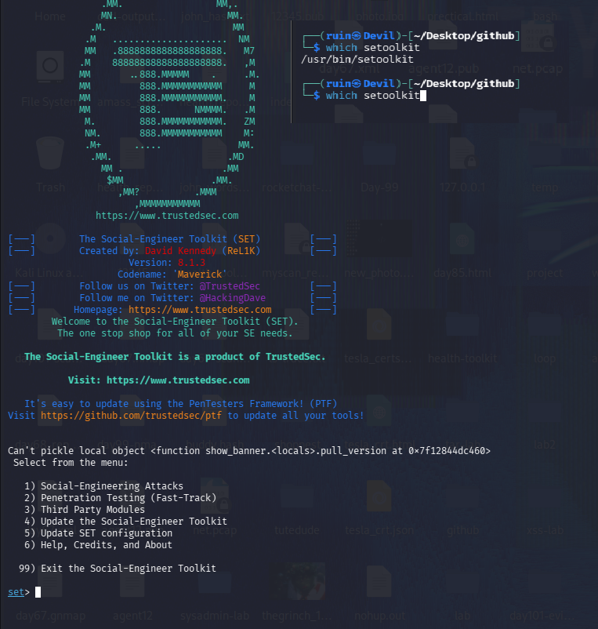
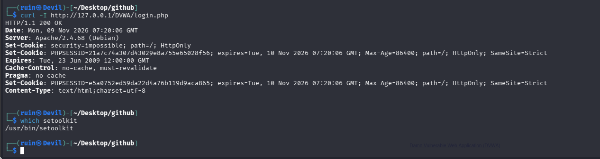
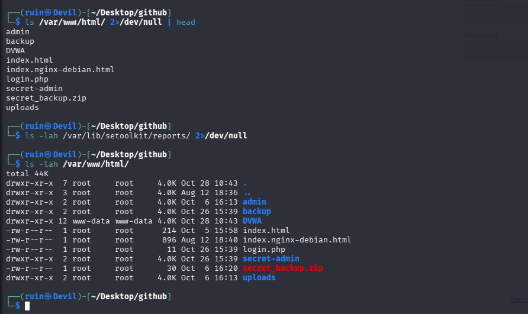
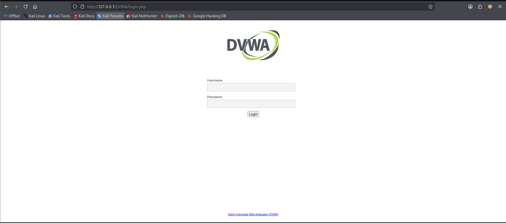
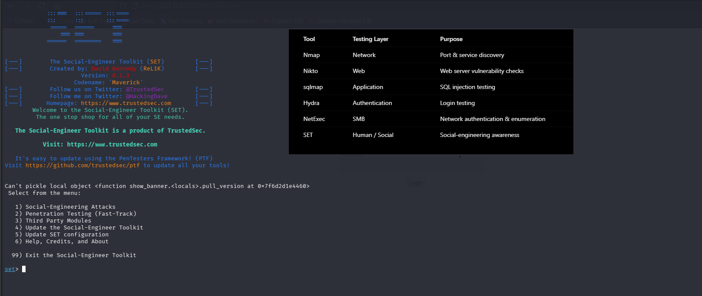

# 🎭 Pentesting Day 18: Social-Engineer Toolkit (SET)

<p align="center">
  
  
  
  
</p>

> Day 17 (NetExec) broke a two-day streak of honest negative results with a real `(Pwn3d!)` success. Day 18 returns to a more familiar shape: the environment is fully confirmed and ready, but the actual Credential Harvester exercise — cloning DVWA's login page and capturing a fake submission — wasn't carried out this session.

---

## 🏆 Day 17 Recap — What NetExec Taught Me

- Switched to a new, genuinely reachable target (`DETOXTEST`) instead of retrying the unresponsive IP from Days 07/13-15.
- A real, redacted credential pair tested valid, flagged `(Pwn3d!)` — admin-level access confirmed.
- Lesson carried here: redact sensitive output even in a personal lab journal.

---

## 🎯 Mission Briefing

SET attacks the human layer rather than a technical weakness — a cloned login page that harvests whatever a victim types into it. Today's "victim" was supposed to be myself, on `127.0.0.1`, with fake test credentials only. Setup and reconnaissance were thorough; the actual clone-and-capture exercise is the piece still outstanding.

```
🎭 MISSION: Clone a Login Page and Harvest a Fake Credential Submission
──────────────────────────────────────────
[x] Confirm setoolkit is installed, launch it, reach the main menu
[x] Confirm DVWA's real login page is reachable (curl, then a direct visit)
[x] Check for any existing SET reports (none found)
[ ] Social-Engineering Attacks -> Website Attack Vectors -> Credential Harvester -> Site Cloner  -> not selected
[ ] Clone http://127.0.0.1/DVWA/login.php                                                         -> not done
[ ] Visit the clone myself and submit fake test credentials                                       -> not done
[ ] Captured data reviewed in the SET terminal / report file                                       -> not reached
──────────────────────────────────────────
STATUS: Pentesting Day 18 — Environment confirmed and ready; core harvesting exercise not run yet
```

---

## ⚡ Quick Theory

```
Social-Engineering Attacks -> Website Attack Vectors -> Credential Harvester Attack Method
  -> Site Cloner: copies a real login page's look, serves it locally, and logs whatever
                   gets typed into it before (optionally) forwarding to the real site
```

Unlike every tool since Day 03, SET doesn't exploit a technical flaw — it relies entirely on someone trusting a page that looks legitimate. That's exactly why this lab is scoped to `127.0.0.1` and my own browser only.

> ⚖️ **Scope:** `127.0.0.1`/DVWA only, never shared or hosted anywhere reachable by anyone else.

---

## 💻 Lab: Commands + My Real Output

*(Machine: Kali Linux, user `ruin`)*

### 🏗️ Step 0 — Confirm the tool and launch it
```bash
$ which setoolkit
/usr/bin/setoolkit
$ setoolkit
...
Can't pickle local object <function show_banner.<locals>.pull_version at 0x7f12844dc460>
 Select from the menu:

  1) Social-Engineering Attacks
  2) Penetration Testing (Fast-Track)
  3) Third Party Modules
  4) Update the Social-Engineer Toolkit
  5) Update SET configuration
  6) Help, Credits, and About

 99) Exit the Social-Engineer Toolkit

set>
```
SET **v8.1.3** ("Maverick") launched and reached its main menu. A `Can't pickle local object <...pull_version...>` warning printed on startup — harmless, doesn't block the menu (confirmed by reaching it cleanly both times I launched SET today).



### 🔍 Confirming the real target, and checking for prior reports
```bash
$ ls /var/www/html/ 2>/dev/null | head
admin
backup
DVWA
index.html
index.nginx-debian.html
login.php
secret-admin
secret_backup.zip
uploads

$ ls -lah /var/lib/setoolkit/reports/ 2>/dev/null
(no output)
```
The web root still has `secret-admin` and `secret_backup.zip` — leftovers from Day 03's gobuster lab, confirming this is the same long-running DVWA install, not a fresh one. No SET reports exist yet, confirming nothing has been harvested so far.



```bash
$ curl -I http://127.0.0.1/DVWA/login.php
HTTP/1.1 200 OK
Server: Apache/2.4.68 (Debian)
Set-Cookie: security=impossible; path=/; HttpOnly
Set-Cookie: PHPSESSID=21a7c74a307d43029e8a755e65028f56; ...
```
DVWA's real login page confirmed reachable — though its `security` cookie is still **`impossible`**, the same observation from Day 13.



I then visited the page directly in the browser — this is DVWA's own, real login page, not a SET-generated clone:



### 🔍 My own comparison notes
```
Step 3 — Comparison Table

Tool       Testing Layer    Purpose
Nmap       Network          Port & service discovery
Nikto      Web              Web server vulnerability checks
sqlmap     Application      SQL injection testing
Hydra      Authentication   Login testing
NetExec    SMB              Network authentication & enumeration
SET        Human / Social   Social-engineering awareness
```
A clean one-line summary of where each tool so far fits — SET's own row correctly describes it as testing the **human** layer, distinct from every network/application-layer tool above it.



---

## 🧪 What I Actually Found

- [x] SET v8.1.3 confirmed installed, launches cleanly to its main menu
- [x] A harmless `pull_version` pickling warning appears on every launch
- [x] DVWA's real login page confirmed reachable (`200 OK`), `security=impossible` cookie noted (same as Day 13)
- [x] `/var/lib/setoolkit/reports/` is empty — no prior harvest exists
- [x] Web root still carries `secret-admin`/`secret_backup.zip` from Day 03, confirming a continuous DVWA install across the whole phase
- [x] Own comparison table correctly places SET as the human-layer tool, distinct from every network/app-layer tool prior
- [ ] **Site Cloner was never run** — no cloned page was ever served
- [ ] **No fake credential was ever submitted or captured** — the core exercise of the day

---

## 🎯 Mini Challenges

> **🥊 Challenge 1: What's the Difference Between the Page I Visited and What SET Would Have Served?**
> Screenshot 3 shows DVWA's real login page. What would be different about a Site-Cloner version?

<details>
<summary>My answer</summary>

Visually, likely almost nothing — that's the entire point of a credential harvester clone, to look identical to the real thing. The real difference is underneath: the real DVWA page's form posts to DVWA's own PHP backend and actually checks the password; a SET clone's form would post to SET's own listener instead, logging whatever was typed before (optionally) forwarding to the real site. Nothing in a screenshot of the page itself would prove which one I was looking at — only checking where the form actually submits to would.

</details>

> **🥊 Challenge 2: Why Does an Empty `reports/` Folder Matter Here?**
> I checked for prior SET reports and found none. Why is that worth noting?

<details>
<summary>My answer</summary>

It's confirmation, not just an aside — it proves no harvest (fake or otherwise) happened in an earlier session either, so today's "nothing captured" result isn't hiding a forgotten earlier success. An honest empty check is better than assuming.

</details>

> **🥊 Challenge 3: Why Leave the `secret-admin`/`secret_backup.zip` Files Noted Rather Than Just Ignored?**
> Those files are unrelated to today's SET exercise. Why mention them?

<details>
<summary>My answer</summary>

They're a useful continuity marker — proof this is the same DVWA install that's been built on since Day 03's gobuster lab, not a fresh reset. It also matters for scope: anything found while poking around the filesystem is still worth noting honestly, even if it's not today's main finding, rather than only reporting what I was specifically looking for.

</details>

> **🥊 Challenge 4: What's the Smallest Next Step to Actually Complete This Lab?**
> Setup is fully confirmed. What's left?

<details>
<summary>My answer</summary>

From SET's main menu: `1) Social-Engineering Attacks → 2) Website Attack Vectors → 3) Credential Harvester Attack Method → 2) Site Cloner`, enter `127.0.0.1` for the POST-back IP and `http://127.0.0.1/DVWA/login.php` as the URL to clone, then visit `http://127.0.0.1` myself and submit an obviously fake username/password. The terminal running SET should then print the captured POST data live — that's the one piece of evidence still missing.

</details>

---

## 🧩 Quick Brain Check

1. Why can't a screenshot of a login page alone prove whether it's the real page or a clone?
2. Why check for existing reports before assuming today's harvest attempt is the first one?
3. What's the significance of finding Day 03's leftover test files still present today?
4. Why does `security=impossible` on DVWA matter less for a social-engineering exercise than it would for an exploitation-focused day?
5. What's the one piece of evidence that would turn today's setup work into a complete Day 18?

---

## 🐛 Errors / Gotchas I Hit

- **`Can't pickle local object <function show_banner.<locals>.pull_version>`** prints on every SET launch — cosmetic, doesn't block reaching the menu.
- **The core Credential Harvester exercise wasn't run this session** — Site Cloner was never selected, so there's no cloned page, no fake submission, and no captured data to review. Today's evidence is entirely setup/reconnaissance.
- **DVWA's `security` cookie is still `impossible`**, same unresolved note from Day 13 — irrelevant to a social-engineering exercise specifically, but still worth resetting before any exploitation-focused DVWA day.

---

## 🔐 Security Relevance

Even without a completed harvest, today's filesystem check reinforced a real lesson: the `secret-admin` and `secret_backup.zip` files from Day 03 are still sitting in the web root, over two weeks of lab days later. In a real environment, forgotten test artifacts like these are exactly the kind of low-effort finding an attacker (or a credential-harvesting clone page, for that matter) could exploit — "temporary" test files have a way of becoming permanent.

---

## 🧠 Today's Takeaway

Day 18 confirmed everything needed to run a credential-harvester exercise — SET launches cleanly, DVWA's real login page is reachable, no prior report exists to confuse today's result — but stopped short of the exercise itself. That's an honest, documented gap rather than a skipped day: the next session just needs to actually walk through Site Cloner, visit the clone, and submit one fake credential to capture real evidence.

---

⬅️ [Back to Pentesting index](/Pentesting) | ➡️ Next up: **Day 19: Report Writing**
