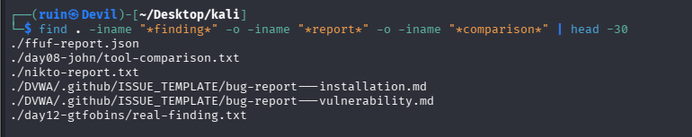
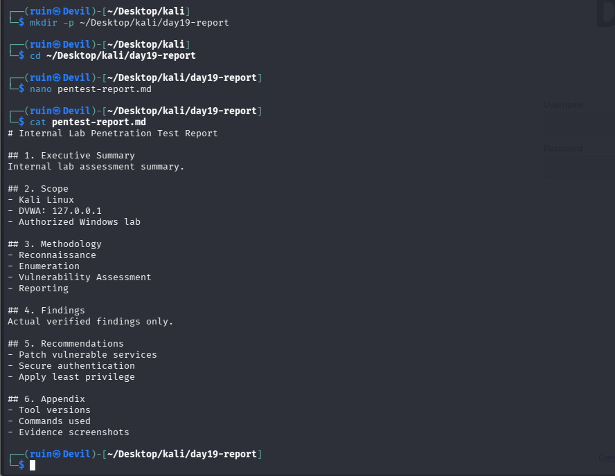
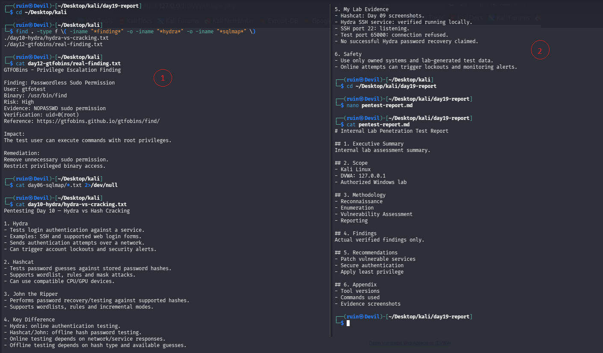
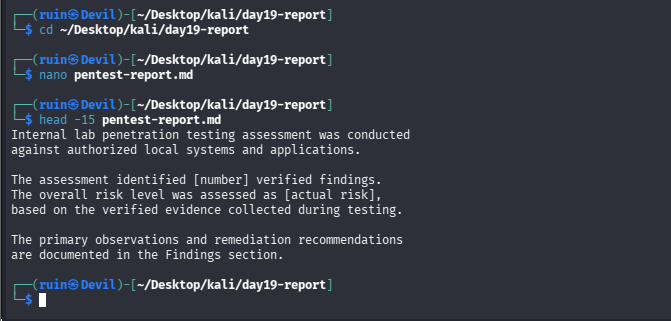
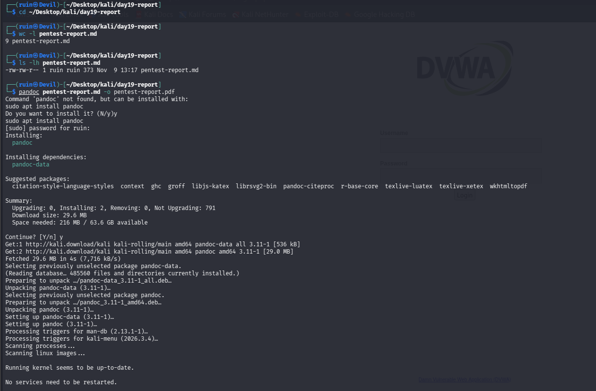

# 📝 Pentesting Day 19: Writing an Actual Pentest Report

<p align="center">
  
  
  
  
</p>

> Day 18 (SET) confirmed the environment was fully ready but stopped short of the actual exercise. Day 19 has the exact same shape, which is a fitting, slightly ironic result for the one day about *writing things down properly*: a well-structured report skeleton, real evidence correctly located — but the Findings and Executive Summary were never actually filled in.

---

## 🏆 Day 18 Recap — What SET Taught Me

- Setup and reconnaissance were thorough (tool launched, target confirmed, no stale reports existed) — but the core Credential Harvester exercise itself was never run.
- Lesson: confirming the environment is ready is not the same as completing the exercise.

---

## 🎯 Mission Briefing

No new tool today — the goal was turning 18 days of real lab work into one structured report, the way a real engagement ends. I gathered the evidence files correctly, built a proper 6-section skeleton, and located this phase's strongest finding (Day 12) and its comparison notes (Day 10) — but today's own Day 18 lesson repeated itself: the report stayed a 9-line skeleton, with its Findings and Executive Summary sections left as placeholder text.

```
📝 MISSION: Build a Report From Real Saved Findings, Days 01-18
──────────────────────────────────────────
[x] Gather real evidence files across the phase (find, by name pattern)
[x] Build the 6-section report skeleton
[x] Locate Day 12's real finding and Day 10's comparison notes
[x] Confirm Day 06 (sqlmap) genuinely has no saved finding file
[ ] Paste the real findings INTO the Findings section    -> still just placeholder text
[ ] Fill the Executive Summary with real values           -> [number] and [actual risk] left unfilled
[x] Install pandoc
[ ] Confirm the PDF export actually completed              -> not verified
──────────────────────────────────────────
STATUS: Pentesting Day 19 — Skeleton + evidence-gathering done; the actual writing wasn't
```

---

## ⚡ Quick Theory

```
Executive Summary  ->  written LAST, for a non-technical reader, once findings are known
Scope               ->  exact targets, what was in/out of bounds
Methodology          ->  the phases actually followed, in order
Findings             ->  one per REAL result: Title, Risk, Evidence, Impact, Remediation
Recommendations       ->  prioritized, High risk first
Appendix              ->  tool versions, raw commands, links to day folders
```

> 📝 Everything in the report is supposed to come from real saved findings across Days 01–18 — no invented content, same honesty standard as every lab day.

---

## 💻 Lab: Commands + My Real Output

*(Machine: Kali Linux, user `ruin`)*

### 🏗️ Step 0 — Gather what actually exists
```bash
$ find . -iname "*finding*" -o -iname "*report*" -o -iname "*comparison*" | head -30
./ffuf-report.json
./day08-john/tool-comparison.txt
./nikto-report.txt
./DVWA/.github/ISSUE_TEMPLATE/bug-report---installation.md
./DVWA/.github/ISSUE_TEMPLATE/bug-report---vulnerability.md
./day12-gtfobins/real-finding.txt
```
Found a short but real list: Day 03's ffuf report, Day 08's tool-comparison, Day 04's nikto report, and — most importantly — **Day 12's `real-finding.txt`**, the phase's one fully-documented, successful finding.



### 🔍 Part A — Build the skeleton
```bash
$ mkdir -p ~/Desktop/kali/day19-report && cd ~/Desktop/kali/day19-report
$ nano pentest-report.md
$ cat pentest-report.md
# Internal Lab Penetration Test Report

## 1. Executive Summary
Internal lab assessment summary.

## 2. Scope
- Kali Linux
- DVWA: 127.0.0.1
- Authorized Windows lab

## 3. Methodology
- Reconnaissance
- Enumeration
- Vulnerability Assessment
- Reporting

## 4. Findings
Actual verified findings only.

## 5. Recommendations
- Patch vulnerable services
- Secure authentication
- Apply least privilege

## 6. Appendix
- Tool versions
- Commands used
- Evidence screenshots
```
A clean, correctly-structured 6-section skeleton. Note the **Findings section already shows its eventual problem**: `Actual verified findings only.` is an instruction to myself, not actual content yet.



### 🔍 Part B — Locating real findings (but not pasting them in)
```bash
$ cd ~/Desktop/kali
$ find . -type f \( -iname "*finding*" -o -iname "*hydra*" -o -iname "*sqlmap*" \)
./day10-hydra/hydra-vs-cracking.txt
./day12-gtfobins/real-finding.txt

$ cat day12-gtfobins/real-finding.txt
GTFOBins - Privilege Escalation Finding
Finding: Passwordless Sudo Permission
User: gtfotest
Binary: /usr/bin/find
Risk: High
Evidence: NOPASSWD sudo permission
Verification: uid=0(root)
Reference: https://gtfobins.github.io/gtfobins/find/
Impact: The test user can execute commands with root privileges.
Remediation: Remove unnecessary sudo permission. Restrict privileged binary access.

$ cat day06-sqlmap/*.txt 2>/dev/null
(no output)

$ cat day10-hydra/hydra-vs-cracking.txt
Pentesting Day 10 — Hydra vs Hash Cracking
1. Hydra ... 2. Hashcat ... 3. John the Ripper ... 4. Key Difference ...
```
Correctly pulled up Day 12's full real finding and Day 10's comparison notes. `day06-sqlmap/*.txt` returned **nothing** — confirming Day 06's sqlmap session genuinely never produced a saved finding, consistent with that day's own honest "false negative" conclusion. But after viewing all of this, **`cat pentest-report.md` at the end of this same session still shows the Findings section unchanged** — `Actual verified findings only.` — the real Day 12 content was read, not written in.



### 🔍 Part C — Executive Summary, written last but still templated
```bash
$ cd ~/Desktop/kali/day19-report
$ nano pentest-report.md
$ head -15 pentest-report.md
Internal lab penetration testing assessment was conducted against
authorized local systems and applications.

The assessment identified [number] verified findings.
The overall risk level was assessed as [actual risk],
based on the verified evidence collected during testing.

The primary observations and remediation recommendations
are documented in the Findings section.
```
The Executive Summary was revisited, as planned, after the findings were already located — but it still reads as a **fill-in-the-blank template**: `[number]` and `[actual risk]` were never replaced with real values (Day 12's one finding, High risk).



### 🔍 Part D — Finalizing: a 9-line report, and an unconfirmed export
```bash
$ cd ~/Desktop/kali/day19-report
$ wc -l pentest-report.md
9 pentest-report.md
$ ls -lh pentest-report.md
-rw-rw-r-- 1 ruin ruin 373 Nov  9 13:17 pentest-report.md

$ pandoc pentest-report.md -o pentest-report.pdf
Command 'pandoc' not found, but can be installed with:
sudo apt install pandoc
Do you want to install it? (N/y)y
...
Setting up pandoc (3.11-1)...
No services need to be restarted.
```
The final report is only **9 lines, 373 bytes** — confirming the skeleton was never actually filled with the findings and summary content that were gathered earlier. `pandoc` wasn't installed, so the PDF export triggered an install (29.6 MB, succeeded) — but the screenshot ends at the apt install finishing, **before `pandoc` was run again** to actually confirm the PDF was produced.



---

## 🧪 What I Actually Found

- [x] Real evidence files correctly located across the phase (`find` by name pattern)
- [x] A proper 6-section report skeleton built, matching a real report's shape
- [x] Day 12's complete, real finding located and read (`real-finding.txt`)
- [x] Day 06's sqlmap folder confirmed to have **no saved finding file at all** — consistent with that day's honest outcome
- [x] Day 10's comparison notes located and read
- [x] `pandoc` installed successfully
- [ ] **The Findings section was never filled in** — still reads `Actual verified findings only.`
- [ ] **The Executive Summary still has unfilled placeholders** — `[number]`, `[actual risk]`
- [ ] **The final report is only 9 lines / 373 bytes** — skeleton only, no real content added
- [ ] **PDF export not confirmed** — `pandoc` install finished, but the actual conversion afterward isn't shown

---

## 🎯 Mini Challenges

> **🥊 Challenge 1: Is Locating a Finding the Same as Reporting It?**
> Day 12's real finding was `cat`'d in full during this session. Why doesn't that count as "done"?

<details>
<summary>My answer</summary>

No — reading a file and writing it into the report are two different actions, and only the second one produces a usable report. A client (or future-me) can't read my terminal history; they can only read `pentest-report.md`. Today's session correctly did the research half of report-writing but not the writing half, which is the actual deliverable.

</details>

> **🥊 Challenge 2: Why Does a 9-Line Report Matter More Than It Sounds?**
> 9 lines isn't necessarily "wrong" — reports can be short. What's the real problem?

<details>
<summary>My answer</summary>

It's not the length itself, it's that the skeleton's own placeholder text (`Actual verified findings only.`, `[number]`, `[actual risk]`) is still present unchanged. A short REAL report (Day 12's one finding, clearly written up) would be legitimately fine; a short report that's just unfilled template headers isn't a report at all yet — it's a to-do list formatted like one.

</details>

> **🥊 Challenge 3: What Does the Empty `day06-sqlmap/*.txt` Result Actually Confirm?**
> `cat day06-sqlmap/*.txt` returned nothing. Is that itself useful?

<details>
<summary>My answer</summary>

Yes — it's a consistency check across the whole phase's journal: Day 06's own README already concluded sqlmap got redirected to a login page and never actually tested the real target, so no real finding should exist to find. Getting literally no output here confirms that earlier honest conclusion rather than contradicting it — the record stays internally consistent.

</details>

> **🥊 Challenge 4: What's the Smallest Next Step to Actually Finish This Report?**
> The skeleton and evidence are both ready. What's left?

<details>
<summary>My answer</summary>

Open `pentest-report.md` one more time and: (1) replace the Findings section's placeholder line with Day 12's actual finding, pasted in full; (2) replace `[number]` with `1` and `[actual risk]` with `High` in the Executive Summary; (3) re-run `pandoc pentest-report.md -o pentest-report.pdf` and confirm with `ls -lh pentest-report.pdf` that a real file came out the other end. None of this requires new research — everything needed is already found and sitting in the terminal history from today.

</details>

---

## 🧩 Quick Brain Check

1. Why is "I found the finding" different from "I reported the finding"?
2. What does a report full of unfilled `[placeholder]` text actually communicate to a reader?
3. Why is an empty result from `day06-sqlmap/*.txt` reassuring rather than concerning?
4. Why does checking a tool's actual output (not just that the command ran) matter for the `pandoc` step specifically?
5. What's the risk of treating "I gathered everything I need" as the same milestone as "I'm done"?

---

## 🐛 Errors / Gotchas I Hit

- **Findings section never actually filled in** — Day 12's finding was read in full but not pasted into `pentest-report.md`. The report still shows its own placeholder instruction text.
- **Executive Summary left templated** — `[number]` and `[actual risk]` were never replaced with the real values (1 finding, High risk) that were already known by that point in the session.
- **Final report is 9 lines / 373 bytes** — essentially just the skeleton, confirming the above two gaps directly.
- **PDF export not confirmed** — `pandoc` installed successfully, but the command wasn't shown running again afterward, so there's no `ls -lh pentest-report.pdf` or similar proof a PDF actually exists.

---

## 🔐 Security Relevance

This is exactly the failure mode a real engagement can't afford: all the right research was done — the real finding was located, the right structure was built, even a true negative (Day 06) was correctly confirmed — but none of it reached the actual deliverable a client would read. A pentest report that exists only as gathered terminal history and an unfilled template communicates nothing. The technical work and the write-up are two separate, equally necessary steps, and today is a clean demonstration of stopping one step before the finish line on the second one.

---

## 🧠 Today's Takeaway

Day 19 produced a genuinely good skeleton and correctly gathered every piece of real evidence it needed — Day 12's full finding, Day 10's comparison, and a confirmed-empty Day 06 — but the report itself stayed a 9-line template with its placeholders untouched. That's not a wasted day; it's a precise, honest account of exactly where the work stopped, with every piece needed to finish it already sitting in today's own terminal history. The actual writing — pasting the finding in, replacing two bracketed placeholders, and confirming the PDF — is a five-minute task away, not a research problem.

---

⬅️ [Back to Pentesting index](/Pentesting) | ➡️ Next up: **Day 20: Full-Chain Capstone**
