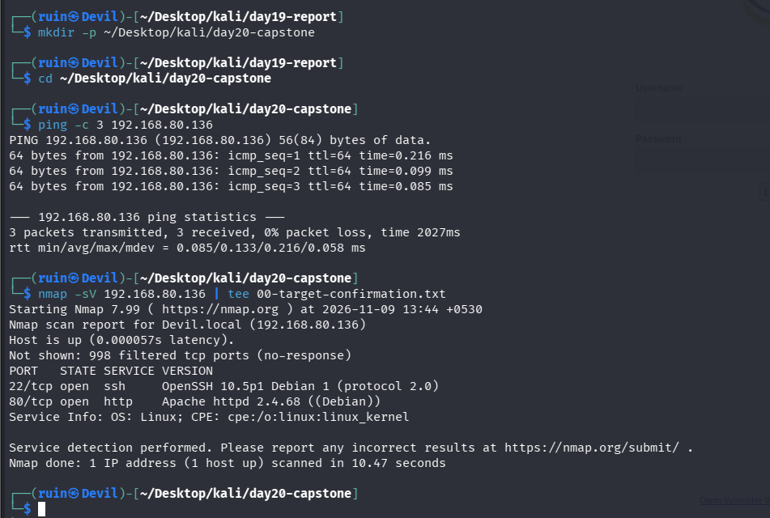
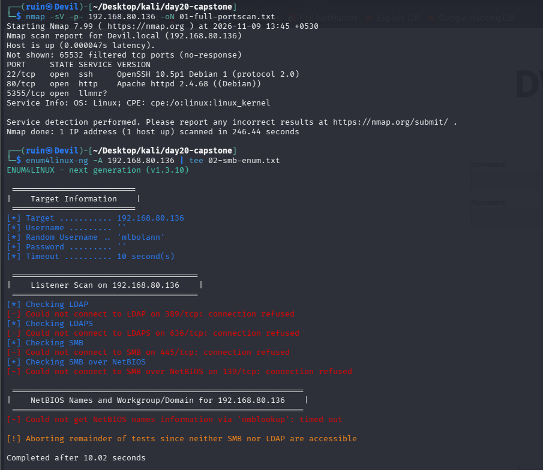
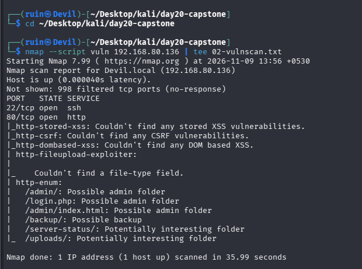
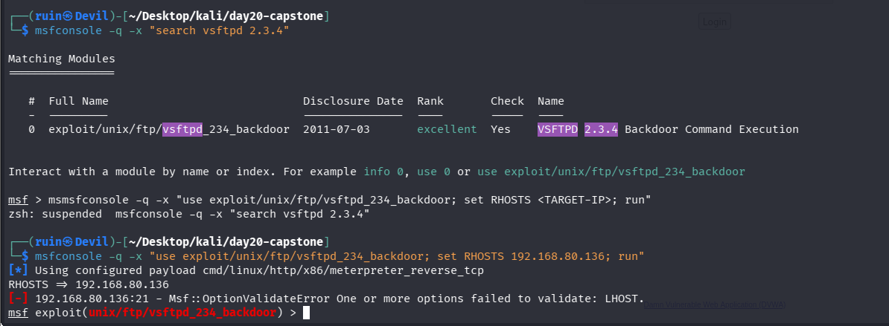
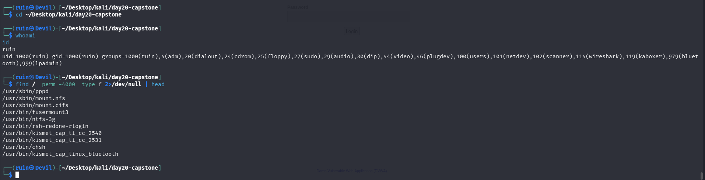

# 🏁 Pentesting Day 20: Full-Chain Challenge (Capstone)

<p align="center">
  
  
  
  
</p>

> Day 19's report stayed an unfilled template. Day 20 asked me to chain every phase together on one target, end to end — and the honest result is that the chain made it cleanly through recon and vulnerability scanning, then broke at exploitation, for the same two reasons that have followed `192.168.80.136` since Day 07.

---

## 🏆 Day 19 Recap — What Report Writing Taught Me

- Real evidence (Day 12's finding, Day 10's comparison) was correctly located but never pasted into the actual report — the deliverable stayed a 9-line skeleton.
- Lesson: finding something and reporting it are two separate steps, and only the second one produces something a reader can use.

---

## 🎯 Mission Briefing

The capstone's own rule was explicit: don't skip a phase just because an earlier day on that topic hit a snag — re-attempt it for real. Today re-ran recon, vulnerability scanning, and an exploitation attempt against `192.168.80.136`, the same target whose identity Day 07 first questioned and Day 15 never resolved.

```
🏁 MISSION: One Target, Every Phase, Chained — No Skipping Snagged Days
──────────────────────────────────────────
[x] Phase 0: Lock and confirm the target
[x] Phase A: Recon — full port scan + SMB enumeration
[x] Phase B: Vulnerability scanning — nmap NSE vuln scripts
[ ] Phase C: Exploitation -> attempted, failed (bad config AND the targeted service isn't open)
[ ] Phase D: Post-exploitation -> no access was ever gained; this phase shows MY OWN machine, not the target
[ ] Phase E: Report -> not shown in today's evidence
──────────────────────────────────────────
STATUS: Pentesting Day 20 — Chain held through Phase B, broke cleanly at Phase C
```

---

## ⚡ Quick Theory

A real engagement is one continuous chain — each phase's output feeds the next:
```
Recon          ->  what's open becomes the attack surface for scanning
Vuln scanning   ->  what's found becomes a candidate for exploitation
Exploitation     ->  success becomes the foothold for post-exploitation
Post-exploitation ->  findings become the report's evidence
```
If a phase produces nothing usable, the chain honestly stops there — it doesn't get to fake its way into the next phase.

> ⚖️ **Scope:** `192.168.80.136`, same target used across Days 07, 13-17, 20.

---

## 💻 Lab: Commands + My Real Output

*(Machine: Kali Linux, user `ruin`)*

### 🏗️ Phase 0 — Lock and confirm the target
```bash
$ ping -c 3 192.168.80.136
3 packets transmitted, 3 received, 0% packet loss, time 2027ms
rtt min/avg/max/mdev = 0.085/0.133/0.216/0.058 ms

$ nmap -sV 192.168.80.136 | tee 00-target-confirmation.txt
Not shown: 998 filtered tcp ports (no-response)
PORT   STATE SERVICE VERSION
22/tcp open  ssh     OpenSSH 10.5p1 Debian 1 (protocol 2.0)
80/tcp open  http    Apache httpd 2.4.68 ((Debian))
```
Target responds to ping with **sub-millisecond latency** — very fast for a separate VM, worth keeping in mind. Two ports open: SSH (OpenSSH 10.5p1) and HTTP (Apache 2.4.68) — the exact same version strings seen on this address in earlier days.



### 🔍 Phase A — Recon: full port scan and SMB enumeration
```bash
$ nmap -sV -p- 192.168.80.136 -oN 01-full-portscan.txt
Not shown: 65532 filtered tcp ports (no-response)
PORT     STATE SERVICE VERSION
22/tcp   open  ssh     OpenSSH 10.5p1 Debian 1 (protocol 2.0)
80/tcp   open  http    Apache httpd 2.4.68 ((Debian))
5355/tcp open  llmnr?
Nmap done: 1 IP address (1 host up) scanned in 246.44 seconds

$ enum4linux-ng -A 192.168.80.136 | tee 02-smb-enum.txt
[*] Checking SMB
[-] Could not connect to SMB on 445/tcp: connection refused
[-] Could not connect to SMB over NetBIOS on 139/tcp: connection refused
[!] Aborting remainder of tests since neither SMB nor LDAP are accessible
```
The full `-p-` scan found **one more open port than every earlier scan of this address**: **5355/tcp, llmnr?** — a service nmap can't confidently identify. SMB enumeration repeated **exactly** Day 15's result: connection refused on every port, aborted early.



### 🔍 Phase B — Vulnerability scanning: nmap's vuln scripts
```bash
$ nmap --script vuln 192.168.80.136 | tee 02-vulnscan.txt
PORT   STATE SERVICE
22/tcp open  ssh
80/tcp open  http
|_http-stored-xss: Couldn't find any stored XSS vulnerabilities.
|_http-csrf: Couldn't find any CSRF vulnerabilities.
|_http-dombased-xss: Couldn't find any DOM based XSS.
| http-fileupload-exploiter:
|_  Couldn't find a file-type field.
| http-enum:
|   /admin/: Possible admin folder
|   /login.php: Possible admin folder
|   /admin/index.html: Possible admin folder
|   /backup/: Possible backup
|   /server-status: Potentially interesting folder
|_  /uploads/: Potentially interesting folder
```
nmap's automated vuln scripts didn't confirm XSS, CSRF, or file-upload issues directly, but `http-enum` surfaced exactly the kind of paths DVWA is known for (`/admin/`, `/login.php`, `/backup/`, `/server-status`, `/uploads/`) — candidates for the next phase, not confirmed vulnerabilities themselves.



### 🔍 Phase C — Exploitation: failed on two counts
```bash
$ msfconsole -q -x "search vsftpd 2.3.4"
0  exploit/unix/ftp/vsftpd_234_backdoor  2011-07-03  excellent  Yes  VSFTPD 2.3.4 Backdoor Command Execution

$ msfconsole -q -x "use exploit/unix/ftp/vsftpd_234_backdoor; set RHOSTS 192.168.80.136; run"
[*] Using configured payload cmd/linux/http/x86/meterpreter_reverse_tcp
RHOSTS => 192.168.80.136
[-] 192.168.80.136:21 - Msf::OptionValidateError One or more options failed to validate: LHOST.
```
Picked the classic `vsftpd_234_backdoor` exploit — but this attempt was doomed **two ways at once**: `LHOST` (my own IP, needed for the reverse connection) was never set, so Metasploit refused to even try; and separately, **port 21 (FTP) was never found open** in either of today's port scans — only 22, 80, and 5355 are open on this target right now. Fixing the `LHOST` error wouldn't have helped, since the service this exploit targets isn't running here.



### 🔍 Phase D — "Post-exploitation": actually my own machine, not the target
```bash
$ whoami; id
ruin
uid=1000(ruin) gid=1000(ruin) groups=1000(ruin),4(adm),20(dialout),24(cdrom),25(floppy),
27(sudo),29(audio),30(dip),44(video),46(plugdev),100(users),101(netdev),102(scanner),
114(wireshark),119(kaboxer),979(bluetooth),999(lpadmin)

$ find / -perm -4000 -type f 2>/dev/null | head
/usr/sbin/pppd
/usr/sbin/mount.nfs
/usr/sbin/mount.cifs
/usr/bin/fusermount3
/usr/bin/ntfs-3g
/usr/bin/rsh-redone-rlogin
/usr/bin/kismet_cap_ti_cc_2540
/usr/bin/kismet_cap_ti_cc_2531
/usr/bin/chsh
/usr/bin/kismet_cap_linux_bluetooth
```
Since Phase C never succeeded, there's no shell on the target to run these commands from. **This `whoami`/`id`/SUID output is from my own Kali machine**, not `192.168.80.136` — it's the same local account (`ruin`) and the same SUID list Day 11's LinPEAS already found on this box. This is a real gap to flag clearly: it must not be read as evidence of access to the target.



### 📋 Phase E — Report
Not captured in today's evidence — no screenshot of a capstone report was provided for this session.

---

## 🧪 What I Actually Found

- [x] Target confirmed alive: SSH + HTTP open, consistent version strings with earlier days
- [x] Full port scan found a **new** open port compared to earlier scans: **5355/tcp (llmnr?)**
- [x] SMB enumeration repeated Day 15's exact "connection refused" result — consistent, not a fluke
- [x] nmap's vuln scripts found candidate web paths (`/admin/`, `/login.php`, `/backup/`, `/server-status`, `/uploads/`) but confirmed no XSS/CSRF/upload vulnerability directly
- [ ] **Exploitation failed** — `vsftpd_234_backdoor` errored on a missing `LHOST`, and separately targets port 21, which isn't open on this host today
- [ ] **No real post-exploitation evidence** — the `whoami`/`id`/SUID output shown is from my own machine, not the target
- [ ] **No report produced** for this session

---

## 🎯 Mini Challenges

> **🥊 Challenge 1: Why Did the Exploit Fail Even Before Reaching the Network?**
> The error was about `LHOST`, not a connection problem. What does that mean?

<details>
<summary>My answer</summary>

`vsftpd_234_backdoor` uses a reverse-connection payload (`meterpreter_reverse_tcp`), which needs to know `LHOST` — my own IP — so the target knows where to connect back to. Metasploit validates all required options before sending a single packet, so this failed at the configuration stage, before any network traffic to the target happened at all. It's a setup mistake, not evidence about the target.

</details>

> **🥊 Challenge 2: Would Fixing LHOST Have Made This Exploit Work?**
> If I'd set `LHOST` correctly, would the exploit have succeeded?

<details>
<summary>My answer</summary>

No — today's own full port scan shows only 22, 80, and 5355 open. Port 21 (FTP, where vsftpd would run) isn't open on this target at all right now, so this specific exploit was never going to work here regardless of the `LHOST` fix. I picked an exploit based on a classic Metasploitable2 vulnerability without first checking that the matching port was actually open on today's scan — the recon output from Phase A already had the answer.

</details>

> **🥊 Challenge 3: Why Flag Phase D as "Not Real" Instead of Just Showing the Output?**
> The `whoami`/`id`/SUID commands did run successfully. Why not count that as a result?

<details>
<summary>My answer</summary>

Because it would misrepresent what happened — that output describes my own Kali account and its own SUID binaries (the same list Day 11 already found locally), not anything about `192.168.80.136`. Presenting it without this caveat would make it look like a shell was obtained on the target when it wasn't. Calling it out explicitly is the only honest way to include it.

</details>

> **🥊 Challenge 4: What's the New, Useful Finding From Today Despite the Failed Exploitation?**
> Exploitation didn't work. Was anything new actually learned?

<details>
<summary>My answer</summary>

Yes — the full `-p-` scan found **port 5355 (llmnr?) open**, which no earlier day's scan of this address had reported (prior scans used smaller port ranges or specific port lists). That's a genuinely new recon finding worth following up on, independent of whether exploitation succeeded.

</details>

---

## 🧩 Quick Brain Check

1. Why does Metasploit validate options like `LHOST` before attempting any network connection?
2. Why should a specific exploit choice always be checked against the current recon results first?
3. What's the risk of presenting local-machine output as if it came from a remote target?
4. Why is finding a new open port (5355) still a useful result on a day where exploitation failed?
5. What would need to be true for Phase C to actually succeed on a re-attempt?

---

## 🐛 Errors / Gotchas I Hit

- **`LHOST` was never set** before running the vsftpd exploit — Metasploit correctly refused to proceed rather than silently failing later.
- **Port 21 isn't open on this target today** — picked a well-known Metasploitable2 exploit without re-checking it against today's own Phase A results first, which already showed only 22/80/5355 open.
- **Phase D's output is from my own machine, not the target** — included deliberately, but must be read with that caveat; it is not evidence of access gained.
- **No report was produced** for this session — Phase E is an open item, same unfinished-deliverable pattern as Day 19.
- A stray typo (`msmsfconsole`) caused a harmless suspended shell job — no impact, just noise in the terminal history.

---

## 🔐 Security Relevance

The useful, reportable result today isn't a successful exploit — it's a clean chain of evidence showing **what is and isn't exposed right now**: SSH and HTTP open and fingerprinted, a newly-found LLMNR port worth investigating, SMB confirmed closed consistent with three separate days of testing, and several candidate web paths from `http-enum` that line up with DVWA's structure. A real engagement reports exactly this kind of boundary clearly, rather than forcing a weak or mismatched exploit attempt just to have an exploitation-phase result to show.

---

## 🧠 Today's Takeaway

The capstone's own rule — don't skip a snagged phase, re-attempt it for real — was followed honestly, and the honest result is that the chain broke at exploitation for a fixable, understood reason: a missing `LHOST` on an exploit that, it turns out, targeted a port that isn't even open on this host today. Recon and vulnerability scanning both produced real, usable findings (a new port, several candidate web paths), and Phase D's local-machine output is flagged clearly rather than left to look like something it isn't. The next real attempt needs an exploit chosen to match today's actual open ports — 22, 80, or the newly-found 5355 — not a classic Metasploitable2 exploit assumed to still apply.

---

⬅️ [Back to Pentesting index](/Pentesting) | ➡️ **Phase complete.** Next phase: Cloud / DevOps
