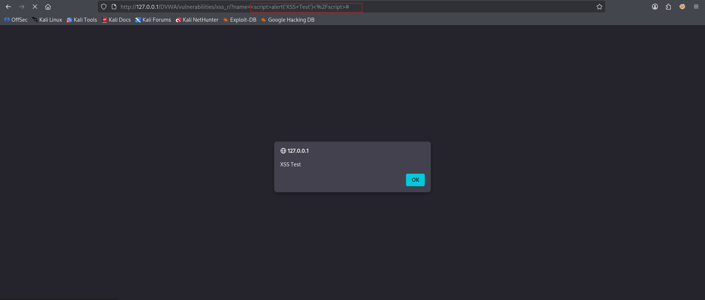
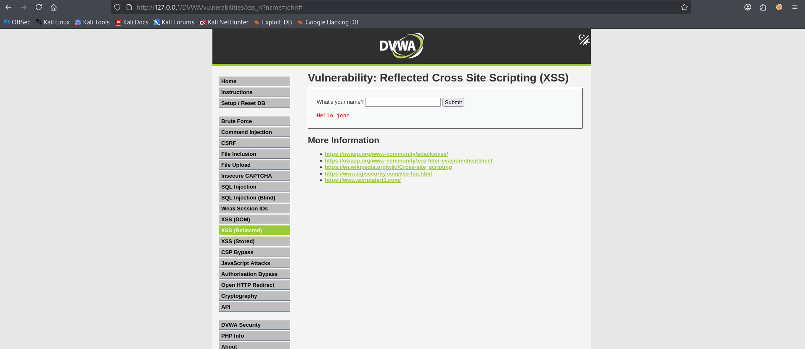
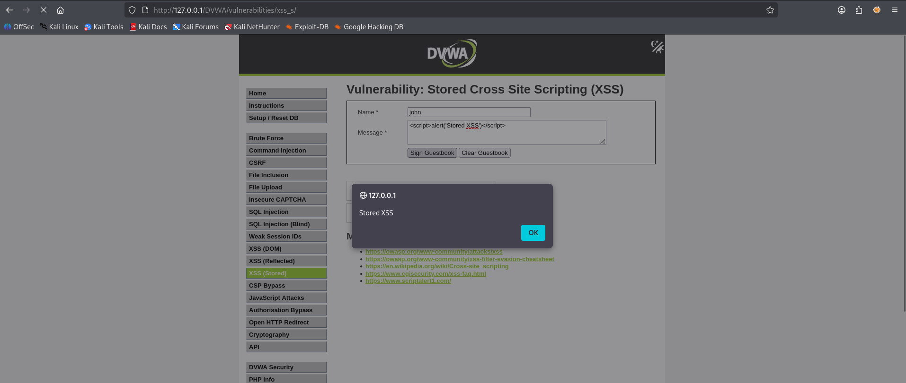
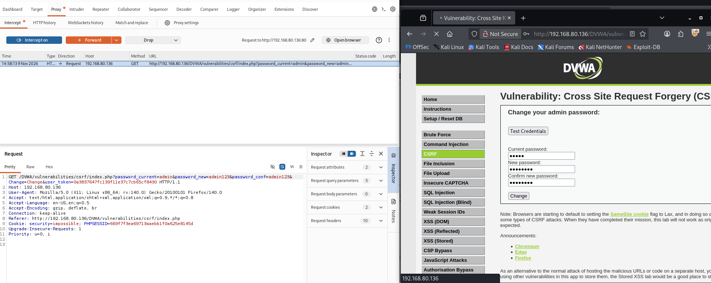
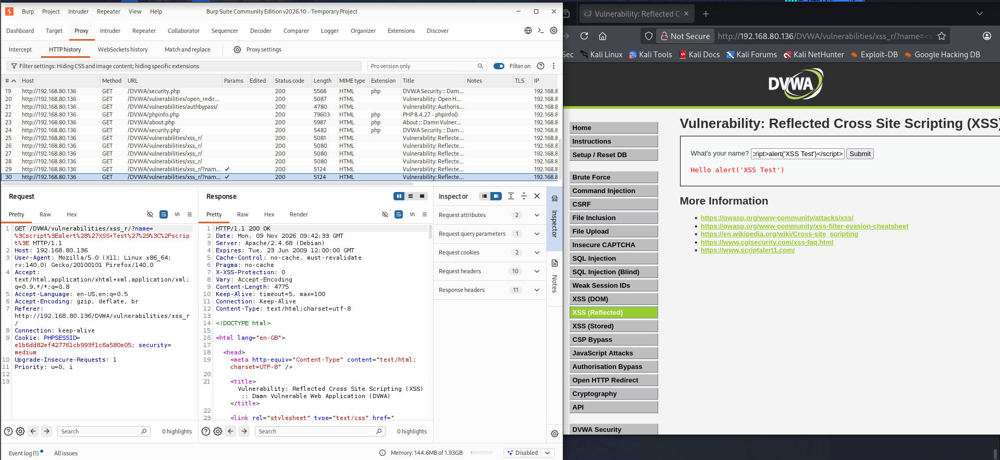

# 🎯 Pentesting Day 21: DVWA Manual Exploitation — XSS + CSRF

<p align="center">
  
  
  
  
</p>

> Day 20 closed out the scanner-driven half of this phase with a chain that broke honestly at exploitation. Day 21 opens the manual half — no scanners, every payload typed by hand — and gets a real, clean win on both XSS types, plus a genuinely useful half-finding on CSRF that's worth understanding rather than glossing over.

---

## 🏆 Day 20 Recap — What the Capstone Taught Me

- The full-chain attempt broke at exploitation: a missing `LHOST` and a mismatched port (21 not open) — a setup mistake stacked on a wrong assumption.
- Lesson: always match an exploit choice against the current recon results, not a remembered "classic" vulnerability.

---

## 🎯 Mission Briefing

No scanner today — every XSS payload and the CSRF request were built and tested by hand. Work happened across **two DVWA instances**: `127.0.0.1` at low security for the baseline XSS tests, and `192.168.80.136` (viewed through Burp) for the CSRF exploration and the medium-security retest.

```
🎯 MISSION: Exploit XSS and CSRF on DVWA, by Hand
──────────────────────────────────────────
[x] Reflected XSS at low security -> confirmed, alert fires
[x] Stored XSS at low security -> confirmed, alert fires on submission
[~] CSRF -> real request captured and inspected via Burp; success not confirmed
[x] Reflected XSS retested at medium -> payload neutralized, and HOW it was neutralized is visible
──────────────────────────────────────────
STATUS: Pentesting Day 21 — Both XSS types confirmed; CSRF understood but not proven successful
```

---

## ⚡ Quick Theory

```
Reflected XSS  ->  payload in the request, reflected straight back in the response, not stored
Stored XSS      ->  payload saved server-side (e.g. a guestbook message), fires for every future visitor
CSRF             ->  a forged request riding the victim's existing session/cookies
SameSite=Lax     ->  a modern browser cookie default that blocks cookies on many cross-site requests,
                     which is exactly what breaks the classic "separate HTML page" CSRF trick
```

> ⚖️ **Scope:** DVWA on `127.0.0.1` and `192.168.80.136` only.

---

## 💻 Lab: Commands + My Real Output

### 🔍 Part A — Reflected XSS (low security, `127.0.0.1`)
```
URL: http://127.0.0.1/DVWA/vulnerabilities/xss_r/?name=<script>alert('XSS+Test')<%2Fscript>#
```
Submitting `<script>alert('XSS Test')</script>` into the "What's your name?" field fired a real alert box reading **"XSS Test"** — the payload executed as JavaScript, confirmed directly in the URL and the popup.



A clean, non-malicious submission (`?name=john`) for comparison shows the normal behavior: `Hello john` printed as plain text, no alert — confirming the alert in the payload case was really the script executing, not a coincidence.



### 🔍 Part B — Stored XSS (low security, `127.0.0.1`)
```
Name: john
Message: <script>alert('Stored XSS')</script>
```
Signing the guestbook with that message fired an alert reading **"Stored XSS"** immediately on submission.



> **Gap to note:** the Lab's real test for *Stored* vs *Reflected* is whether the alert fires again on a plain page **reload**, with nothing resubmitted. That specific reload screenshot isn't among today's evidence — what's confirmed is that the payload executed on submission, not that it persisted.

### 🔍 Part C — CSRF (`192.168.80.136`, via Burp)
```
GET /DVWA/vulnerabilities/csrf/index.php?password_current=admin&password_new=admin123
    &password_conf=admin123&Change=Change&user_token=0a3837647fc139f1le37c7cb65cf8430
```
Intercepting DVWA's own CSRF form submission in Burp revealed something important: **this page now requires `password_current` AND a `user_token`** — not the bare `password_new`/`password_conf`/`Change` parameters the classic low-security CSRF attack relies on. The page itself displays a note:

> "Browsers are starting to default to setting the SameSite cookie flag to Lax, and in doing so some types of CSRF attacks... this lab will not work as originally..." — DVWA's own instructions



This is a genuinely useful finding, but **not a confirmed successful attack**: what's captured here is the legitimate in-page form submission (with the real token DVWA generated for that session), not a forged request from a separate, standalone page succeeding without one. No login-with-the-new-password screenshot exists to confirm the forgery actually worked.

### 🔍 Part D — Reflected XSS retested at medium security
```
Cookie: security=medium
Payload: <script>alert('XSS Test')</script>
Result displayed: Hello alert('XSS Test')
```
The **exact same payload that fired cleanly at low security** got **neutralized at medium** — but not in the way a full block would look. The response shows `Hello alert('XSS Test')` printed as **plain text**, meaning DVWA's medium-level filter stripped the literal `<script>` and `</script>` tag text but left the JavaScript-looking content between them untouched as a string. This is exactly DVWA's well-known medium-level defense: a single, case-sensitive `str_replace` of the literal substring `<script>`, not real sanitization.



---

## 🧪 What I Actually Found

- [x] Reflected XSS confirmed working at low security — real alert fired from a URL parameter
- [x] Stored XSS confirmed working at low security — real alert fired on guestbook submission
- [ ] Stored XSS persistence (alert firing again on a plain reload) — not captured in today's evidence
- [~] CSRF: the real form's parameters captured via Burp, revealing a `user_token` and `password_current` requirement, plus DVWA's own SameSite=Lax warning — but no confirmed successful forged request from a separate page
- [x] Medium-security retest: the same Reflected XSS payload was visibly **tag-stripped, not fully sanitized** — `<script>` removed as a literal string, inner content left as plain text

---

## 🎯 Mini Challenges

> **🥊 Challenge 1: Why Does "Hello alert('XSS Test')" as Plain Text Matter More Than Just "It Got Blocked"?**
> The medium payload didn't fire, but it didn't just vanish either. Why does the exact remaining text matter?

<details>
<summary>My answer</summary>

Because it reveals the *mechanism* of the filter, not just its existence. If DVWA had fully sanitized the input, nothing resembling the payload would appear at all. Seeing `Hello alert('XSS Test')` printed literally shows the filter did one specific, narrow thing: removed the literal string `<script>` (and its closing tag), nothing more. That's exactly the kind of filter a different tag (``, `<svg onload=...>`) or a case variation (`<ScRiPt>`) can get around — the bypass ideas from the Lab's reference sheet aren't guesses, they follow directly from what this output shows.

</details>

> **🥊 Challenge 2: Does Capturing the Real CSRF Request in Burp Prove the Vulnerability Exists?**
> The request with `password_current` and `user_token` was captured. Is that proof CSRF works here?

<details>
<summary>My answer</summary>

No — it proves the opposite of the classic low-security CSRF attack's assumption. The whole point of the basic attack is that a forged request succeeds *without* a token and *without* knowing the current password. Seeing both required here means this DVWA instance's CSRF page isn't at the permissive "low" behavior the standalone-HTML-file trick depends on. To actually test CSRF here, I'd need to either find a way to also forge/know the token (much harder, often the actual point of a CSRF defense working correctly) or specifically set this page to `low` security and retry with the standalone HTML file.

</details>

> **🥊 Challenge 3: Why Mention DVWA's Own SameSite=Lax Warning Instead of Just Trying the Attack Anyway?**
> The page itself warned the classic attack might not work. Why does that matter for today's result?

<details>
<summary>My answer</summary>

It reframes what a "failed" CSRF attempt would mean. If I'd built the standalone `csrf-attack.html` file and it hadn't worked, the honest conclusion wouldn't be "CSRF doesn't exist here" — modern browsers' `SameSite=Lax` default now blocks many cross-site cookie-bearing requests by default, which is a real, current web-security development, not a DVWA quirk. Noting this up front means any future retest result (success or failure) gets interpreted correctly instead of either overclaiming a vulnerability or wrongly concluding the page is secure.

</details>

> **🥊 Challenge 4: Why Report the Stored-XSS Reload Check as Missing Instead of Just Not Mentioning It?**
> The Lab specifically asked for a reload test. Why call out that it's absent rather than quietly skip the point?

<details>
<summary>My answer</summary>

Because the reload check is the entire reason Stored XSS is considered more dangerous than Reflected — persistence without resubmission. Claiming "Stored XSS confirmed" without that check would overstate what was actually shown: an alert firing on submission is also exactly what Reflected XSS looks like. Flagging the gap keeps the two vulnerability types honestly distinguished rather than blurred together.

</details>

---

## 🧩 Quick Brain Check

1. What does `Hello alert('XSS Test')` printed as text, rather than an alert firing, tell you about DVWA's medium-level filter specifically?
2. Why isn't an alert firing on submission enough to prove Stored XSS, as opposed to Reflected?
3. What does requiring a `user_token` do to the classic CSRF attack's assumptions?
4. Why does a browser's `SameSite=Lax` default matter for CSRF attacks that were documented years before that default existed?
5. Why keep two different DVWA instances/security levels straight in one day's notes instead of treating all the evidence as one consistent target?

---

## 🐛 Errors / Gotchas I Hit

- **Worked across two different DVWA instances** (`127.0.0.1` for Parts A/B, `192.168.80.136` for Part C/D) — the findings are real for each one individually, but it means today's results aren't all from a single consistent target/session.
- **CSRF's "success" was never actually confirmed** — what's captured is the legitimate form submission with a real token, not a forged cross-site request succeeding. Easy to mistake this capture for a successful attack if not read carefully.
- **No reload screenshot for Stored XSS** — the persistence check that actually distinguishes it from Reflected XSS wasn't captured this session.
- **DVWA's own page flagged a relevant, current browser-security change** (`SameSite=Lax`) that affects whether the classic CSRF technique even applies anymore — worth remembering for any future CSRF testing, not just DVWA.

---

## 🔐 Security Relevance

The medium-security finding is the clearest real-world lesson: a filter that removes one literal string (`<script>`) isn't sanitization, it's a pattern match — and pattern matches have edges attackers can step around. The CSRF finding, even though incomplete, is equally real: modern browser defaults are quietly closing off a whole historical class of attacks, which is good for defenders but means older training material (and older real applications relying on "nobody will notice this is unprotected") can no longer be assumed vulnerable the way it used to be.

---

## 🧠 Today's Takeaway

Both XSS types were cleanly, manually exploited with hand-crafted payloads — no scanner needed, and the medium-security retest didn't just show a block, it showed exactly how DVWA's filter works, which is more useful than a pass/fail result alone. CSRF is the honest loose end: the real request structure was captured and understood, including a genuinely current reason (`SameSite=Lax`) the classic attack might not even apply as written anymore, but no forged request was shown succeeding. That's a specific, well-understood gap to close next — not a vague "try again."

---

⬅️ [Back to Pentesting index](/Pentesting) | ➡️ Next up: **Day 22: DVWA Manual — Command Injection + File Upload**
