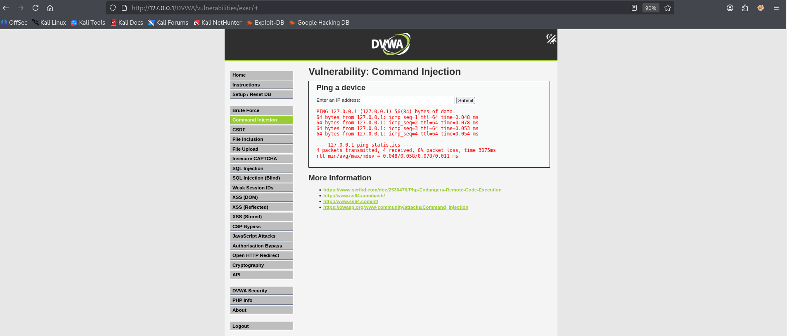
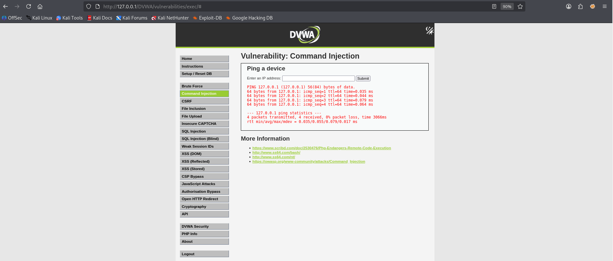
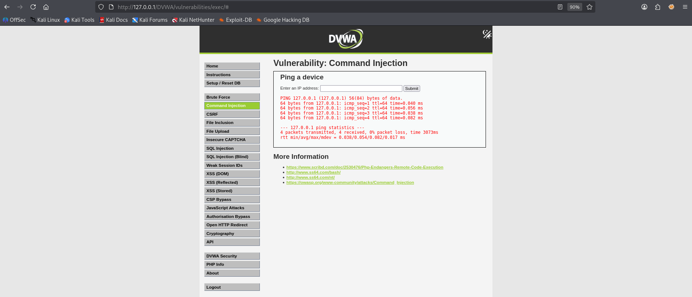
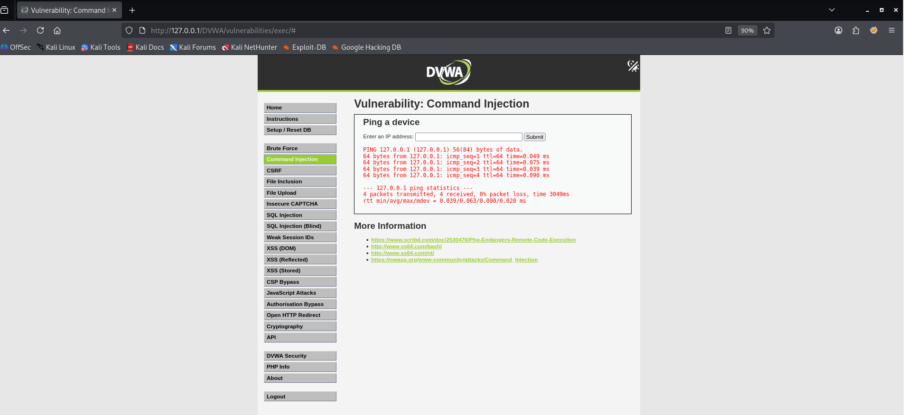
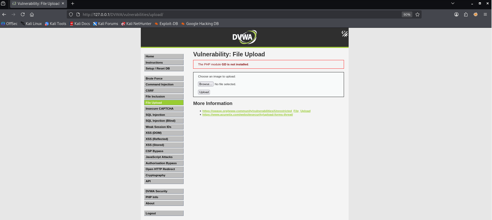
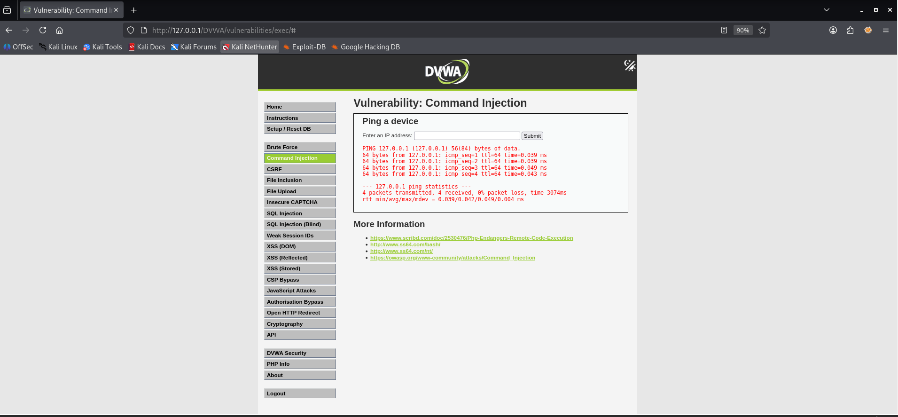
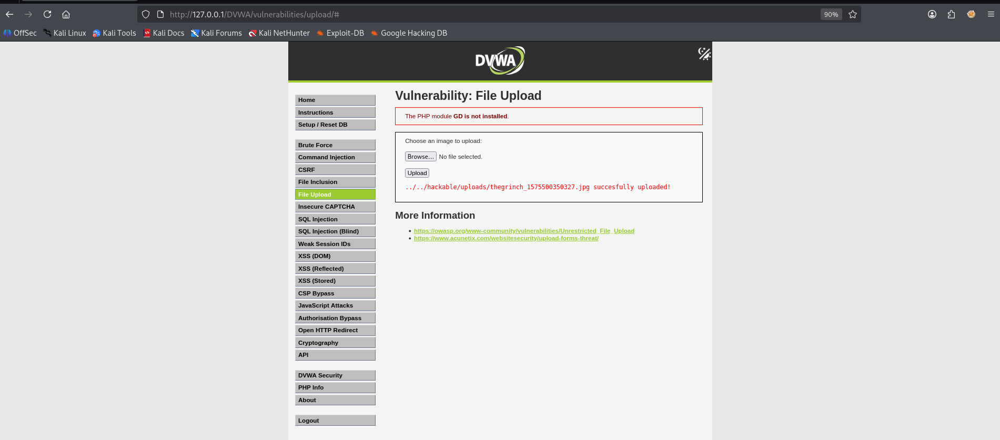
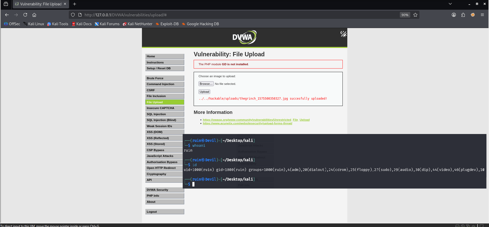

# ⚠️ Pentesting Day 22: DVWA Manual Exploitation — Command Injection + File Upload

<p align="center">
  
  
  
  
</p>

> Day 21 landed two clean manual wins (Reflected and Stored XSS) plus an honestly incomplete CSRF attempt. Day 22 flips that ratio: every page involved is confirmed working, tested consistently across **all four DVWA security levels** — but the actual exploitation step, on both Command Injection and File Upload, was never attempted.

---

## 🏆 Day 21 Recap — What XSS/CSRF Taught Me

- Reflected and Stored XSS both fired cleanly with hand-crafted `<script>` payloads at low security.
- The medium-security retest showed exactly *how* DVWA's filter works (tag-stripping, not real sanitization), which was more useful than a simple pass/fail.
- CSRF's real request was captured and understood, but no forged request was shown succeeding — an honest gap, not a false claim.

---

## 🎯 Mission Briefing

Today's goal was code execution — via a chained Command Injection payload, and via an uploaded PHP webshell. What actually happened across all 8 screenshots was baseline verification: the Command Injection page tested at **low, medium, high, and impossible** security, and the File Upload page confirmed reachable with one upload — but every single test submitted a **plain, non-malicious IP address** or a **stock demo image**, never an actual injection payload or a webshell.

```
⚠️ MISSION: Get Code Execution via Command Injection and an Uploaded Webshell
──────────────────────────────────────────
[x] Command Injection page confirmed working, at ALL FOUR security levels
[x] File Upload page confirmed reachable; one file (a stock demo image) uploaded successfully
[x] Noted: the GD PHP module is not installed on this DVWA instance
[ ] An actual injected command (&&, ;, | chained onto the ping) -> never submitted, at any level
[ ] A PHP webshell built and uploaded                          -> never attempted
[ ] Code execution confirmed via the ping form or an uploaded shell -> not achieved
──────────────────────────────────────────
STATUS: Pentesting Day 22 — Baseline fully verified across every security level; exploitation not attempted
```

---

## ⚡ Quick Theory

```
Command Injection  ->  app passes user input straight to a shell command; chaining with
                       &&, ;, or | lets you run your own commands alongside the intended one
File Upload (unrestricted) ->  uploading a .php file that runs $_GET-controlled system() gives
                               a reusable webshell, IF the upload isn't actually restricted
```

> ⚖️ **Scope:** DVWA on `127.0.0.1` only.

---

## 💻 Lab: Commands + My Real Output

### 🔍 Command Injection — baseline tested at every security level
At every one of the four security levels, the exact same test was run: submitting the plain, valid address `127.0.0.1` into the "Ping a device" form.

**Low:**
```
PING 127.0.0.1 (127.0.0.1) 56(84) bytes of data.
4 packets transmitted, 4 received, 0% packet loss, time 3075ms
```


**Medium:**
```
PING 127.0.0.1 (127.0.0.1) 56(84) bytes of data.
4 packets transmitted, 4 received, 0% packet loss, time 3066ms
```


**High:**
```
PING 127.0.0.1 (127.0.0.1) 56(84) bytes of data.
4 packets transmitted, 4 received, 0% packet loss, time 3073ms
```


**Impossible:**
```
PING 127.0.0.1 (127.0.0.1) 56(84) bytes of data.
4 packets transmitted, 4 received, 0% packet loss, time 3049ms
```


Two more views of the same unmodified ping test, confirming the page's baseline behavior is identical and stable across repeated visits:




**Every single one of these eight tests submitted the same plain `127.0.0.1` — none of them included an injected command.** This confirms the form works correctly for its intended purpose at all four security levels, which is useful groundwork, but it is not yet a test of the vulnerability itself.

### 🔍 File Upload — reachability and one stock upload
```
http://127.0.0.1/DVWA/vulnerabilities/upload/
The PHP module GD is not installed.
../../hackable/uploads/thegrinch_1575500350327.jpg succesfully uploaded!
```
The page is reachable and accepts uploads — a file was successfully stored under `hackable/uploads/`. However, **this was DVWA's own stock demo image** (`thegrinch_...jpg`), not a PHP file, and not a webshell. The page also displays a warning that **the GD PHP module is not installed**.




A terminal overlay shows `whoami` → `ruin` and `id` → `uid=1000(ruin)...` — but this is a **local terminal on my own Kali machine**, opened alongside the browser. It is not output from the uploaded file and does not demonstrate any code execution on the DVWA server.



---

## 🧪 What I Actually Found

- [x] Command Injection page confirmed working identically at **low, medium, high, and impossible** security — same valid input, same successful ping, every time
- [x] File Upload page reachable; a stock demo image uploaded successfully to `hackable/uploads/`
- [x] **The GD PHP module is not installed** on this DVWA instance — noted, not yet investigated for impact
- [ ] **No command injection payload was ever submitted** — no `&&`, `;`, or `|` chaining attempted at any security level
- [ ] **No PHP webshell was built or uploaded** — only a stock image was tested
- [ ] **No code execution was demonstrated** — the `whoami`/`id` output shown is from my own machine, not the target

---

## 🎯 Mini Challenges

> **🥊 Challenge 1: Does Testing All Four Security Levels With a Valid IP Prove Anything Useful?**
> Every security level gave the identical, successful ping result. Is that result worth keeping?

<details>
<summary>My answer</summary>

Yes, as a baseline — it confirms the page's core functionality (actually pinging an address) works the same regardless of security level, which makes sense: DVWA's security setting changes how *malicious* input is filtered, not how valid input is processed. This is useful groundwork (the form definitely works, so any later failure to inject would be about the injection attempt itself, not a broken form) but it isn't a security test by itself — no filter was ever exercised because no injection was ever attempted.

</details>

> **🥊 Challenge 2: Why Does "GD Module Not Installed" Matter for a File Upload Test?**
> The page displayed this warning on every visit. Why note it specifically?

<details>
<summary>My answer</summary>

DVWA's File Upload page uses the GD library at higher security levels to actually open and inspect uploaded images (checking real dimensions/content, not just the filename or MIME type). Without GD installed, those specific checks may be skipped or error out rather than behave as documented — which could mean "high" or "impossible" security here doesn't fully match what the lab's own write-ups describe. This is worth testing directly (does a `.php` file upload get rejected the same way at high security without GD as it would with GD installed?) rather than assuming.

</details>

> **🥊 Challenge 3: Why Is the Uploaded Demo Image Not Evidence of a File Upload Vulnerability?**
> A file was uploaded successfully. Doesn't that confirm the vulnerability?

<details>
<summary>My answer</summary>

No — it confirms the upload *feature* works for a normal, harmless image, which is expected behavior on any functioning upload form, vulnerable or not. The actual vulnerability being tested is whether the form accepts a file it *shouldn't* — specifically a `.php` file that would execute code when visited. Uploading only a `.jpg` never exercises that check at all, so today's upload says nothing about whether the page is actually exploitable.

</details>

> **🥊 Challenge 4: Why Flag the Local Terminal Output So Explicitly?**
> The `whoami`/`id` screenshot could look like proof of a webshell working. Why call that out directly?

<details>
<summary>My answer</summary>

Because without that callout, someone skimming the screenshots could reasonably conclude code execution was achieved on DVWA, when what's actually shown is an unrelated terminal window on my own machine. This is exactly the kind of mistake that matters in real reporting: presenting coincidental or unrelated evidence next to a vulnerable page, without being explicit about what it actually demonstrates, overstates a finding.

</details>

---

## 🧩 Quick Brain Check

1. Why does a valid-input test behave identically across all four DVWA security levels?
2. What specifically would need to change in today's Command Injection tests to actually test the vulnerability?
3. Why doesn't a successful image upload say anything about whether a malicious file would also be accepted?
4. What could the missing GD module mean for how "high" or "impossible" security actually behaves here, and how would you find out for certain?
5. Why is it important to label unrelated evidence (like a local terminal) clearly, rather than leaving its relevance ambiguous?

---

## 🐛 Errors / Gotchas I Hit

- **No injection payload was ever submitted** — all eight Command Injection screenshots show the same plain `127.0.0.1` ping, at every security level, with no `&&`/`;`/`|` chaining attempted.
- **No webshell was built or uploaded** — the one successful upload was DVWA's own stock demo image, not a `.php` file.
- **A local terminal's `whoami`/`id` output was captured alongside the File Upload page** — easy to misread as evidence of code execution on the target; it isn't, and today's write-up calls that out directly.
- **The GD PHP module is missing** — noted but not yet tested for its actual effect on the File Upload page's filtering behavior.

---

## 🔐 Security Relevance

Confirming a form works correctly for legitimate input, across every security level, is a reasonable first step — but it's recon, not exploitation. The real findings this lab is designed to produce (what a chained command reveals about the web server's user, and whether a `.php` file slips past the upload filter) require actually submitting the malicious input, which didn't happen today. A report built only from today's evidence would have to say, honestly, "the forms work; the vulnerabilities themselves were not tested" — which is a very different, far less useful statement than "Command Injection and File Upload are exploitable here."

---

## 🧠 Today's Takeaway

Today thoroughly confirmed the plumbing — both vulnerable pages are reachable, both work correctly for their intended, non-malicious use, and that was verified consistently across all four DVWA security levels rather than just once. But the actual exploitation step for both Command Injection and File Upload — the entire point of the lab — wasn't attempted: no chained command, no PHP webshell, no demonstrated code execution. The next session just needs to do what the original Lab sheet specified: submit `127.0.0.1 && whoami` (and similar) into the ping form, and build and upload `<?php system($_GET['cmd']); ?>` instead of a stock image.

---

⬅️ [Back to Pentesting index](/Pentesting) | ➡️ Next up: **Day 23: Subdomain Enumeration**
