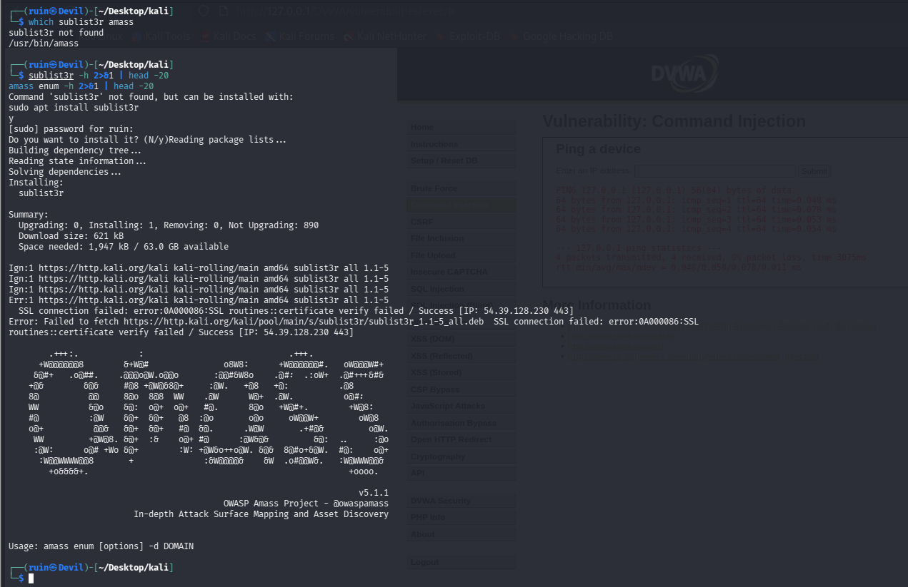
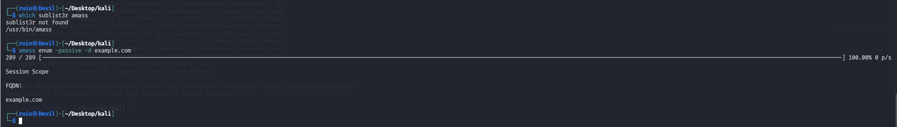
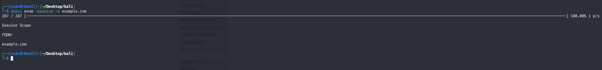
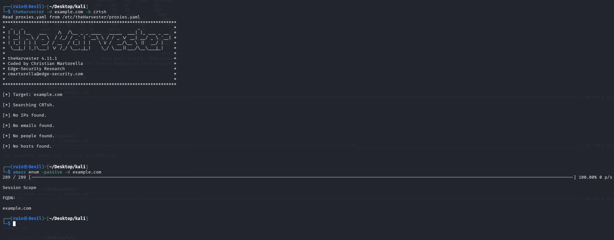

# 🌐 Pentesting Day 23: Subdomain Enumeration (Sublist3r / Amass / crt.sh)

<p align="center">
  
  
  
  
</p>

> Day 22 confirmed two DVWA pages work correctly without ever testing their actual vulnerabilities. Day 23 has a different shape: the tools were used correctly and completely — but the domain chosen, `example.com`, is deliberately empty by design, so "zero subdomains found" is the textbook-correct result, not a sign anything went wrong.

---

## 🏆 Day 22 Recap — What Command Injection/File Upload Taught Me

- Every Command Injection test submitted a plain, valid IP — never an actual injected command, at any of the four security levels.
- A successful file upload doesn't prove a vulnerability if the file uploaded was harmless.
- Lesson: confirming a form *works* is not the same as *testing* it.

---

## 🎯 Mission Briefing

Today went deeper than Day 01's theHarvester, using Amass and crt.sh-backed sources specifically for subdomain discovery. One important deviation from the plan: Day 01 used `microsoft.com`; today used **`example.com`** instead — which changes what "zero results" actually means.

```
🌐 MISSION: Discover Subdomains With Sublist3r, Amass, and crt.sh
──────────────────────────────────────────
[x] Check both tools; attempt to install sublist3r
[ ] sublist3r install -> FAILED (SSL certificate verification error fetching the package)
[x] Amass passive enumeration run (multiple times) against example.com
[x] theHarvester -b crtsh run against example.com
[ ] Any subdomains actually found -> none, at all, from any source
──────────────────────────────────────────
STATUS: Pentesting Day 23 — Tools ran correctly; the domain itself has nothing to find
```

---

## ⚡ Quick Theory

```
RFC 2606           ->  reserves example.com, example.net, example.org specifically for
                       documentation use - no real services are meant to run there
Amass -passive      ->  passive-only sources (no active brute-forcing), same spirit as theHarvester
```

> ⚖️ **Scope:** passive queries against a public domain — same scope class as Day 01.

---

## 💻 Lab: Commands + My Real Output

### 🏗️ Step 0 — Tool check, and a failed sublist3r install
```bash
$ which sublist3r amass
sublist3r not found
/usr/bin/amass

$ sublist3r -h 2>&1 | head -20
Command 'sublist3r' not found, but can be installed with:
sudo apt install sublist3r
y
[sudo] password for ruin:
...
Installing: sublist3r
...
Err:1 https://http.kali.org/kali/pool/main/s/sublist3r/sublist3r_1.1-5_all.deb
  SSL connection failed: error:0A000086:SSL routines::certificate verify failed
Error: Failed to fetch ... SSL connection failed: error:0A000086:SSL routines::certificate verify failed
```
The `apt install sublist3r` attempt **failed outright** — not because of anything related to subdomain enumeration, but because fetching the package itself from Kali's own repository hit an **SSL certificate verification error**. This is a system/network-level problem (likely a clock skew, missing CA certificate, or a broken intercepting proxy) that has nothing to do with today's actual lab topic, and it means **sublist3r never became available this session.**



### 🔍 Confirming sublist3r is still unavailable
```bash
$ which sublist3r amass
sublist3r not found
/usr/bin/amass
```
Re-checked afterward — still not found, confirming the install genuinely never completed. Only Amass (and theHarvester, from Day 01) were actually usable today.

### 🔍 Part A/B — Amass passive enumeration, run multiple times
```bash
$ amass enum -passive -d example.com
289 / 289 [——————————————————————] 100.00% 0 p/s
Session Scope
FQDN: example.com

$ amass enum -passive -d example.com
287 / 287 [——————————————————————] 100.00% 1 p/s
Session Scope
FQDN: example.com
```
Ran twice (289 then 287 data sources queried — a small, expected variation between runs as some passive sources respond differently). **Both runs found literally nothing beyond the root domain itself** — no subdomains listed at all under "Session Scope," just `example.com`.





### 🔍 Part C — theHarvester with the crt.sh source
```bash
$ theHarvester -d example.com -b crtsh
[*] Target: example.com
[*] Searching CRTsh.
[*] No IPs found.
[*] No emails found.
[*] No people found.
[*] No hosts found.
```
Certificate transparency logs for `example.com` returned **nothing at all** — no IPs, emails, people, or hosts.



---

## 🧪 What I Actually Found

- [x] `sublist3r` install **failed** on an SSL certificate verification error fetching the package from Kali's repo — a system issue, confirmed still unavailable afterward
- [x] `amass enum -passive` run three times against `example.com` — **zero subdomains found** every time, only the root domain itself listed
- [x] `theHarvester -b crtsh` against `example.com` — **zero IPs, emails, people, or hosts found**
- [x] **The domain used today (`example.com`) differs from Day 01's (`microsoft.com`)** — a real deviation from the lab's planned direct comparison
- [ ] No combined/de-duplicated subdomain list was built — there was nothing to combine
- [ ] No `dig` resolution of any found subdomain — there were none to resolve

---

## 🎯 Mini Challenges

> **🥊 Challenge 1: Is "Zero Subdomains" a Tool Failure Here?**
> Three separate Amass runs and one theHarvester run all found nothing. Does that mean something's broken?

<details>
<summary>My answer</summary>

No — `example.com` is reserved by **RFC 2606** specifically for documentation and testing, precisely so nobody runs real infrastructure on it. There are no real subdomains, no real certificates beyond the bare domain, and no real hosts to find — "nothing found" is the textbook-correct result for this specific domain, not evidence the tools failed. This is the opposite situation from Day 01, where `microsoft.com` genuinely has subdomains and an empty result there (crt.sh via theHarvester) was a real gap worth investigating.

</details>

> **🥊 Challenge 2: Why Does the SSL Certificate Error During `apt install` Matter for Today's Conclusions?**
> The error was about fetching a package, not about subdomain enumeration. Why mention it at all?

<details>
<summary>My answer</summary>

Because it explains a real gap in today's evidence: sublist3r was never actually tested, at all, this session — not because it has nothing to find, but because it was never successfully installed. Confusing "the tool never ran" with "the tool found nothing" would misrepresent today's result. The fix is a system-level one (checking `apt-get update`'s own certificate chain, system clock, or `/etc/ssl/certs`), separate from anything about subdomains.

</details>

> **🥊 Challenge 3: Why Does Changing the Domain From Day 01's Matter?**
> The lab suggested reusing `microsoft.com` specifically for a direct comparison. What's lost by using `example.com` instead?

<details>
<summary>My answer</summary>

The whole point of reusing the same domain was to see whether Amass and crt.sh find *more, fewer, or overlapping* results compared to Day 01's theHarvester-via-DuckDuckGo count (27 hosts). With a different domain, there's nothing to compare — today's zero and Day 01's 27 aren't measuring the same thing. To actually get that comparison, today's commands would need to be re-run against `microsoft.com`.

</details>

> **🥊 Challenge 4: What Would Actually Demonstrate These Tools Work, Given Today's Results?**
> Every result today was zero. What's the smallest next step to get a real, positive result?

<details>
<summary>My answer</summary>

Re-run the exact same three commands (`amass enum -passive`, `theHarvester -b crtsh`) against a domain known to have real public subdomains — `microsoft.com`, as the lab originally specified, or any other large real organization's domain — once the sublist3r install issue is separately resolved. That would both fix today's "wrong domain" gap and produce results that are actually comparable to Day 01.

</details>

---

## 🧩 Quick Brain Check

1. Why is `example.com` specifically a poor choice for testing subdomain enumeration tools?
2. What does an SSL certificate verification error during `apt install` actually indicate, and what doesn't it indicate?
3. Why can't today's "zero subdomains" be compared directly to Day 01's "27 hosts"?
4. What's the difference between a tool producing a real negative result and a tool never running at all?
5. What would need to be true of a domain for "zero subdomains found" to actually be a concerning result rather than an expected one?

---

## 🐛 Errors / Gotchas I Hit

- **`sublist3r` failed to install** — an SSL certificate verification error fetching the `.deb` from Kali's own mirror, a system/network issue unrelated to subdomain enumeration. Confirmed still unavailable on a later `which` check.
- **Used `example.com` instead of Day 01's `microsoft.com`** — a real deviation from the lab's plan for a direct, apples-to-apples comparison. `example.com` is RFC 2606-reserved and intentionally has nothing to find, so today's results can't be compared to Day 01's numbers.
- Amass itself ran correctly every time — the slightly different source counts between runs (289 vs 287) are normal, expected variation in passive-source availability, not an error.

---

## 🔐 Security Relevance

Choosing the right target domain matters as much as choosing the right tool: testing against a domain engineered to have nothing (`example.com`) proves the commands run correctly, but proves nothing about the tools' actual subdomain-discovery capability. In a real engagement, confirming the target domain is correct — and that installation/dependency issues like today's SSL error aren't silently masking a tool that never ran — are both necessary before trusting any "nothing found" result as meaningful.

---

## 🧠 Today's Takeaway

Every command today executed correctly and completely, and every result was an honest, textbook-correct zero — because `example.com` is deliberately built to have nothing for these tools to find. The real, useful gaps are procedural, not technical: sublist3r never got installed due to an unrelated SSL certificate issue, and the domain substitution broke the planned Day 01 comparison. Re-running today's exact commands against `microsoft.com`, once sublist3r's install issue is separately resolved, would turn this into the comparison the lab actually intended.

---

⬅️ [Back to Pentesting index](/Pentesting) | ➡️ Next up: **Day 24: TryHackMe/HackTheBox Room**
