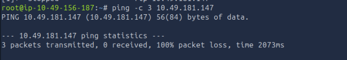
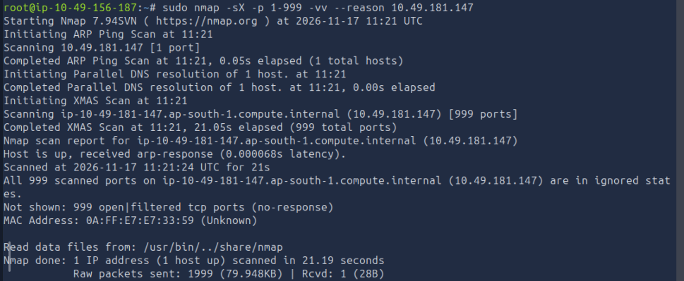
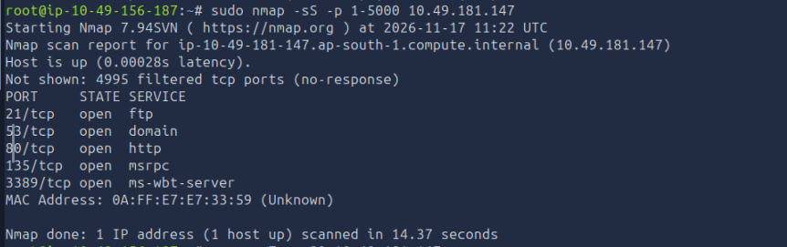
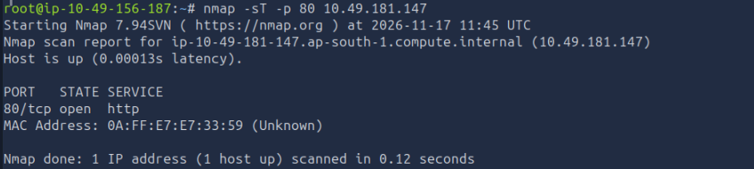
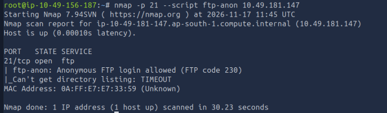

# 🚩 Pentesting Day 24: A Real TryHackMe Room — Recon Phase

<p align="center">
  
  
  
  
</p>

> Day 23 confirmed every subdomain tool worked correctly against a domain deliberately engineered to have nothing to find. Day 24 is the opposite: a real TryHackMe box, reached over the platform's own VPN, that actually has something — a real anonymous-FTP misconfiguration — but only the recon phase was completed before this session's evidence ends.

---

## 🏆 Day 23 Recap — What Subdomain Enumeration Taught Me

- Every tool ran correctly against `example.com`; the zero results were the domain's fault, not the tools'.
- A changed target (wrong domain) breaks a planned comparison even when every command works.

---

## 🎯 Mission Briefing

No lab sheet to follow step-by-step today — the point was picking a room and working it with whatever Days 01–23 taught, deciding what to run next myself. Connected to TryHackMe's VPN (attacker box `10.49.156.187`, target `10.49.181.147`, hosted on AWS `ap-south-1`) and ran my own recon sequence: a ping, three different nmap scan types, and a targeted NSE script once FTP showed up open.

```
🚩 MISSION: Work a Real THM Room With My Own Judgment, No Guided Lab Sheet
──────────────────────────────────────────
[x] Connect to the platform VPN, target reachable
[x] Recon: ping, Xmas scan, SYN scan, TCP connect scan
[x] A specific finding followed up with a targeted NSE script (ftp-anon)
[ ] Foothold (actually using the anonymous FTP access) -> not reached in this session
[ ] Privilege escalation                                 -> not reached
[ ] Write-up of the full chain                            -> not reached
──────────────────────────────────────────
STATUS: Pentesting Day 24 — Recon phase complete and genuinely informative; foothold not attempted yet
```

---

## ⚡ Quick Theory

```
-sS (SYN scan)     ->  the standard, reliable scan; needs root; fast and accurate
-sT (connect scan)  ->  completes the full TCP handshake; works without root, slightly noisier
-sX (Xmas scan)      ->  sends FIN+PSH+URG flags together; relies on RFC-compliant RST
                        responses to tell open from closed - many real-world hosts/firewalls
                        don't follow that RFC behavior, making results ambiguous
ftp-anon (NSE script)  ->  specifically checks whether an FTP server accepts the
                           well-known "anonymous" login
```

> ⚖️ **Scope:** only through TryHackMe's own VPN, against the room's own assigned target IP.

---

## 💻 Lab: Commands + My Real Output

*(Attacker: `root@ip-10-49-156-187`, Target: `10.49.181.147`)*

### 🏗️ Step 0 — Connect and confirm reachability
```bash
$ ping -c 3 10.49.181.147
PING 10.49.181.147 (10.49.181.147) 56(84) bytes of data.
--- 10.49.181.147 ping statistics ---
3 packets transmitted, 0 received, 100% packet loss, time 2073ms
```
**ICMP is completely blocked** — 100% packet loss on a plain ping, even though (as the scans below confirm) the host is genuinely up and has multiple open ports. This is a common, deliberate setup in cloud-hosted lab environments: ping disabled, TCP services still reachable.



### 🔍 Part A — Recon: three scan types, three different pictures
```bash
$ sudo nmap -sX -p 1-999 -vv --reason 10.49.181.147
Not shown: 999 open|filtered tcp ports (no-response)
```
An **Xmas scan** (`-sX`) on the first 999 ports came back completely **ambiguous** — every single port reported `open|filtered`, meaning the target never sent the RST response this scan type relies on to tell the two states apart. Not a useful result by itself, but consistent with a target/firewall that doesn't follow the RFC behavior Xmas scans depend on.



```bash
$ sudo nmap -sS -p 1-5000 10.49.181.147
Not shown: 4995 filtered tcp ports (no-response)
PORT     STATE SERVICE
21/tcp   open  ftp
53/tcp   open  domain
80/tcp   open  http
135/tcp  open  msrpc
3389/tcp open  ms-wbt-server
```
A **SYN scan** (`-sS`) across 5,000 ports cut straight through that ambiguity: **5 ports genuinely open** — FTP (21), DNS (53), HTTP (80), MSRPC (135), and **RDP (3389)**. The combination of `msrpc` and `ms-wbt-server` is a strong signal this target is **Windows**, not a Linux box like most of this phase's Metasploitable2-style targets.



```bash
$ nmap -sT -p 80 10.49.181.147
PORT   STATE SERVICE
80/tcp open  http
```
A **TCP connect scan** on port 80 specifically **agrees exactly** with the SYN scan's result — a clean cross-check using a completely different scan technique.



### 🔍 Part B — Following up on FTP: a real finding
```bash
$ nmap -p 21 --script ftp-anon 10.49.181.147
PORT   STATE SERVICE
21/tcp open  ftp
| ftp-anon: Anonymous FTP login allowed (FTP code 230)
|_Can't get directory listing: TIMEOUT
```
Ran the `ftp-anon` NSE script specifically against the one service most likely to have an easy misconfiguration. **Anonymous FTP login is genuinely allowed** (FTP code 230, a real successful login) — but the actual directory listing **timed out**, likely a passive/active FTP data-channel issue through whatever firewall sits in front of this target. The login itself is confirmed; browsing the file listing isn't, yet.



---

## 🧪 What I Actually Found

- [x] VPN connected, target confirmed alive (via nmap, despite ICMP being blocked)
- [x] Xmas scan: fully ambiguous (`open|filtered` on every port) — not useful alone, but informative about the target's firewall behavior
- [x] SYN scan: **5 genuinely open ports** — 21 (FTP), 53 (DNS), 80 (HTTP), 135 (MSRPC), 3389 (RDP)
- [x] Port profile strongly suggests a **Windows** target — a different OS family from most of this phase's Linux-based labs
- [x] TCP connect scan cross-confirms port 80, matching the SYN scan exactly
- [x] **Anonymous FTP login confirmed working** (FTP code 230) — a real, exploitable misconfiguration
- [ ] FTP directory listing — attempted, **timed out**, not yet resolved
- [ ] Actual foothold via FTP (uploading/downloading files, or pivoting from access) — not attempted yet
- [ ] Privilege escalation, flags, and write-up — not reached in this session

---

## 🎯 Mini Challenges

> **🥊 Challenge 1: Why Run Three Different Scan Types Instead of Just One?**
> The Xmas scan gave nothing useful; the SYN scan gave a clear answer. Why bother with Xmas at all?

<details>
<summary>My answer</summary>

Different scan types behave differently against different firewalls/hosts, and you don't always know in advance which one will actually work. The Xmas scan's uniform `open|filtered` result is itself informative: it tells me this target's firewall likely drops packets rather than sending RSTs for closed ports, which explains *why* that scan type is ambiguous here specifically — useful context even from a scan that "failed" to distinguish states.

</details>

> **🥊 Challenge 2: What Does the Open Port Combination (135, 3389) Actually Tell You?**
> MSRPC and RDP showed up together. Why does that combination matter?

<details>
<summary>My answer</summary>

Both are specifically Windows services — MSRPC (135) handles Windows' remote procedure call infrastructure, and RDP (3389) is Windows Remote Desktop. Seeing them together is a strong, early signal this is a Windows target, which changes what kind of follow-up makes sense (Windows-specific enumeration and exploitation, not Linux-style LinPEAS/GTFOBins from Days 11-12) before even logging into anything.

</details>

> **🥊 Challenge 3: Is "Anonymous Login Allowed But Listing Times Out" a Confirmed Finding or Not?**
> The login succeeded but browsing files didn't. How should this be reported?

<details>
<summary>My answer</summary>

As a confirmed, partial finding — the misconfiguration itself (anonymous access being permitted at all) is proven by the successful FTP code 230 login, independent of whether I can browse the listing yet. The timeout is a separate, follow-up problem (likely passive vs. active FTP mode, or a firewall blocking the data channel) that needs solving to actually use the access, not a reason to doubt the login succeeded.

</details>

> **🥊 Challenge 4: What's the Smallest Next Step From Here?**
> Recon is solid. What's the next concrete action?

<details>
<summary>My answer</summary>

Retry the FTP connection with explicit passive mode (`ftp -p` or an FTP client forcing PASV), since active-mode data connections are a classic cause of exactly this kind of listing timeout behind a firewall/NAT. If that resolves it, the next step is just browsing and downloading whatever anonymous FTP exposes — the actual foothold this recon pointed toward.

</details>

---

## 🧩 Quick Brain Check

1. Why did the Xmas scan return the same ambiguous result for every single port?
2. Why does cross-checking a SYN scan's result with a TCP connect scan on the same port add confidence?
3. What does the 135+3389 port combination suggest about the target's OS, and why does that matter before going further?
4. What's the likely cause of an FTP login succeeding but the directory listing timing out?
5. Why is confirmed anonymous access still a real finding even before a single file has been browsed?

---

## 🐛 Errors / Gotchas I Hit

- **Ping gave 100% packet loss** despite the host being genuinely up — ICMP is blocked while TCP services remain reachable; don't rule out a target just because it doesn't answer ping.
- **Xmas scan returned `open|filtered` for every port** — not a useful result on its own here, though it did hint at the target's firewall behavior (no RSTs sent).
- **FTP directory listing timed out** even though the anonymous login itself succeeded — a data-channel issue (likely active vs. passive FTP mode) still to resolve.
- Didn't record which specific TryHackMe room this is — worth noting in future sessions for clearer documentation.

---

## 🔐 Security Relevance

This session is a clean example of recon actually paying off: three different scan techniques gave three different pictures (one ambiguous, two in full agreement), narrowing down to a genuine, confirmed misconfiguration — anonymous FTP access — on what the port profile suggests is a Windows host. Reporting the login as confirmed while being explicit that the listing is still blocked keeps the finding honest: proven access, not-yet-demonstrated impact.

---

## 🧠 Today's Takeaway

Recon alone, done carefully with multiple techniques, already produced a real, actionable finding: anonymous FTP login works on a likely-Windows target. The day stopped at a solvable technical snag (the data-channel timeout) rather than reaching a foothold, privilege escalation, or write-up — an honest, partial result that mirrors this whole phase's pattern of documenting exactly where the work actually stopped, not where it was supposed to.

---

⬅️ [Back to Pentesting index](/Pentesting) | ➡️ Next up: **Day 25: Phase Retrospective**
