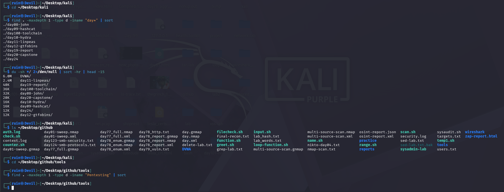
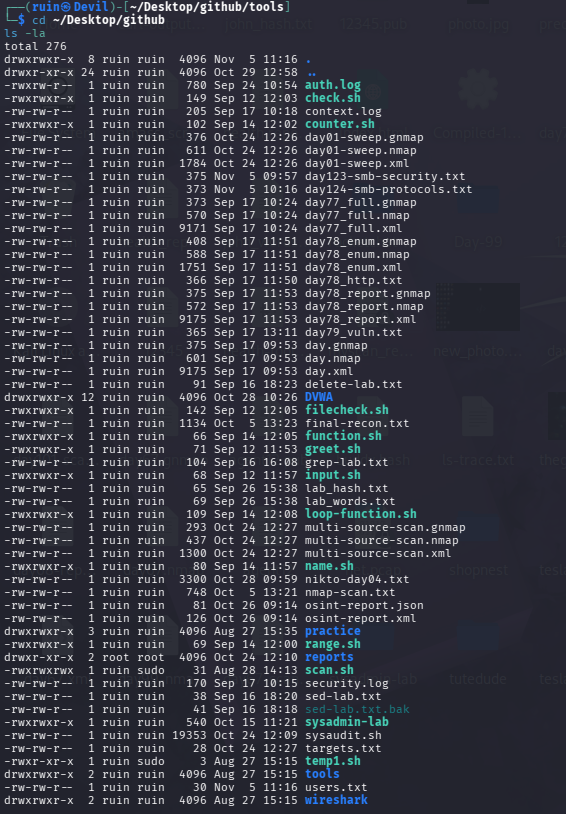
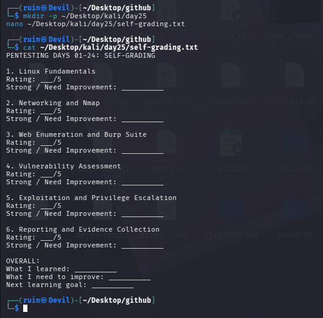
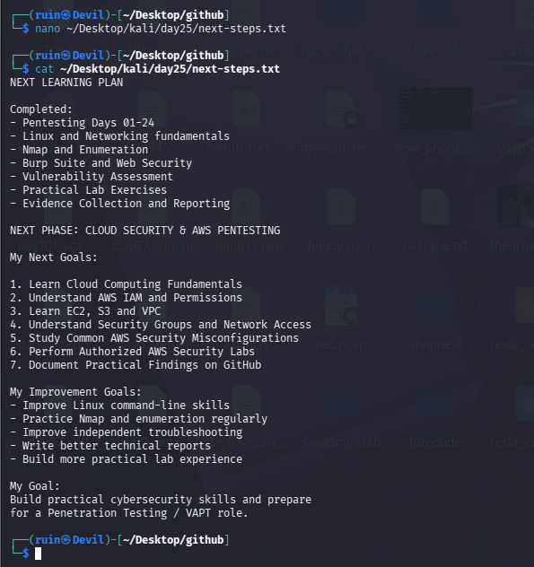
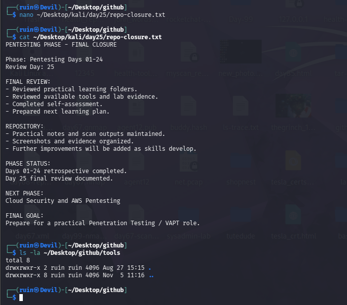

# 🏁 Pentesting Day 25: Phase Retrospective + Repo Wrap-Up (Final Day)

<p align="center">
  
  
  
</p>

> Day 24 ended with real, confirmed recon findings on a live THM box, stopped short of a foothold. Day 25 is the mirror of that: the written reflection is genuinely good, but the inventory step uncovered something more important than any single day's technical result — the actual folder structure on disk doesn't match the documentation structure this whole phase has been built around.

---

## 🏆 Day 24 Recap — What the TryHackMe Room Taught Me

- Anonymous FTP login confirmed on a likely-Windows target, through careful multi-technique recon — a genuine finding, honestly reported as partial (listing timed out, foothold not reached).
- Recon alone, done with multiple scan types, can produce real results worth following up on.

---

## 🎯 Mission Briefing

The final day of the phase: step back, look at 24 days of real work as a whole, grade it honestly, and close the phase out properly before moving to Cloud/AWS. The reflective writing (next steps, repo closure) came out well. The inventory step — actually listing what exists on disk — surfaced a structural gap worth fixing before calling this phase truly "closed."

```
🏁 MISSION: Honest Retrospective + Repo Closure
──────────────────────────────────────────
[x] Full folder inventory — lab workspace AND the GitHub repo
[x] Self-grading template created
[ ] Self-grading template actually filled in  -> every rating and comment left blank
[x] Next-steps / learning plan written, with real, specific content
[x] Repo-closure summary written, with real, specific content
[!] Inventory reveals: most day-folders are missing from the lab workspace, and the
    GitHub repo has no Pentesting/ folder structure at all
──────────────────────────────────────────
STATUS: Pentesting Day 25 — Reflection done well; a real repo-organization gap found and documented
```

---

## 💻 What I Actually Ran

### 🔍 Step 0 — Inventory: lab workspace and the repo
```bash
$ cd ~/Desktop/kali
$ find . -maxdepth 1 -type d -iname "day*" | sort
./day08-john
./day09-hashcat
./day100-toolchain
./day10-hydra
./day11-linpeas
./day12-gtfobins
./day19-report
./day20-capstone
./day24

$ du -sh */ 2>/dev/null | sort -hr | head -15
6.0M   DVWA/
2.4M   day11-linpeas/
40K    day19-report/
36K    day100-toolchain/
32K    day08-john/
20K    day20-capstone/
16K    day10-hydra/
16K    day09-hashcat/
12K    day24/
12K    day12-gtfobins/

$ ls ~/Desktop/github
auth.log  day01-sweep.gnmap  day77_full.nmap  day78_report.xml  ...
day123-smb-security.txt  day124-smb-protocols.txt  DVWA/  reports/  sysadmin-lab/  wireshark/  ...

$ cd ~/Desktop/github/tools
$ find . -maxdepth 1 -type d -iname "Pentesting" | sort
(no output)
```
This is today's real finding. Only **9 day-folders** matching a `dayNN-*` pattern exist in the lab workspace — Days 08, 09, 10, 11, 12, 19, 20, 24, plus an unexplained `day100-toolchain`. Days 01-07, 13-18, 21-23, and 25 itself don't show up in this search. The GitHub repo's root (`~/Desktop/github`) is a **flat mix of loose files** — `day01-sweep.*`, but also `day77_full.*`, `day78_*`, `day79_vuln.txt`, `day123-smb-security.txt`, `day124-smb-protocols.txt` — and a search for a `Pentesting` folder under `~/Desktop/github/tools` returned **nothing at all**.



```bash
$ cd ~/Desktop/github/tools
$ ls -la ~/Desktop/github
total 276
auth.log  check.sh  context.log  counter.sh  day01-sweep.gnmap  day01-sweep.nmap
day01-sweep.xml  day123-smb-security.txt  day124-smb-protocols.txt  day77_full.gnmap
day77_full.nmap  day77_full.xml  day78_enum.gnmap  day78_enum.nmap  day78_enum.xml
day78_http.txt  day78_report.gnmap  day78_report.nmap  day78_report.xml  day79.gnmap
day79.nmap  day79.xml  day79_vuln.txt  delete-lab.txt  DVWA/  filecheck.sh
final-recon.txt  function.sh  greet.sh  grep-lab.txt  input.sh  lab_hash.txt
lab_words.txt  loop-function.sh  multi-source-scan.gnmap  multi-source-scan.nmap
multi-source-scan.xml  name.sh  nikto-day04.txt  nmap-scan.txt  osint-report.json
osint-report.xml  practice/  range.sh  reports/  scan.sh  security.log  sed-lab.txt
sed-lab.txt.bak  sysadmin-lab/  sysaudit.sh  targets.txt  temp1.sh  tools/  users.txt
wireshark/
```
Every single one of these files and folders sits **directly in the repo root** — there's no `Networking/`, `Sysadmin/`, or `Pentesting/` folder visible anywhere in this listing, despite day numbers here spanning from `day01` to `day124`.



### 🔍 Self-grading — created, never filled in
```bash
$ mkdir -p ~/Desktop/kali/day25
$ nano ~/Desktop/kali/day25/self-grading.txt
$ cat ~/Desktop/kali/day25/self-grading.txt
PENTESTING DAYS 01-24: SELF-GRADING

1. Linux Fundamentals
Rating: ___/5
Strong / Need Improvement: ________
... (five more categories, identical blank pattern)
OVERALL:
What I learned: ________
What I need to improve: ________
Next learning goal: ________
```
The self-grading template has the right structure — six categories plus an overall section — but **every single rating and comment was left as the literal blank placeholder**. This is the same pattern Day 19's report hit: the template is correct, the actual reflection was never written in.



### 🔍 Next-steps — written in full, with real content
```bash
$ cat ~/Desktop/kali/day25/next-steps.txt
NEXT LEARNING PLAN

Completed:
- Pentesting Days 01-24
- Linux and Networking fundamentals
- Nmap and Enumeration
- Burp Suite and Web Security
- Vulnerability Assessment
- Practical Lab Exercises
- Evidence Collection and Reporting

NEXT PHASE: CLOUD SECURITY & AWS PENTESTING

My Next Goals:
1. Learn Cloud Computing Fundamentals
2. Understand AWS IAM and Permissions
3. Learn EC2, S3 and VPC
4. Understand Security Groups and Network Access
5. Study Common AWS Security Misconfigurations
6. Perform Authorized AWS Security Labs
7. Document Practical Findings on GitHub

My Improvement Goals:
- Improve Linux command-line skills
- Practice Nmap and enumeration regularly
- Improve independent troubleshooting
- Write better technical reports
- Build more practical lab experience
```
Unlike the self-grading file, this one is **fully written out**, with a specific, concrete next phase and a real list of goals — a genuinely useful closing document.



### 🔍 Repo closure — written in full
```bash
$ cat ~/Desktop/kali/day25/repo-closure.txt
PENTESTING PHASE - FINAL CLOSURE

Phase: Pentesting Days 01-24
Review Day: 25

FINAL REVIEW:
- Reviewed practical learning folders.
- Reviewed available tools and lab evidence.
- Completed self-assessment.
- Prepared next learning plan.

PHASE STATUS:
Days 01-24 retrospective completed.
Day 25 final review documented.

NEXT PHASE:
Cloud Security and AWS Pentesting

FINAL GOAL:
Prepare for a practical Penetration Testing / VAPT role.

$ ls -la ~/Desktop/github/tools
total 8
drwxrwxr-x 2 ruin ruin 4096 Aug 27 15:15 .
drwxrwxr-x 8 ruin ruin 4096 Nov  5 11:16 ..
```
The closure summary is written and clear — but the final check, `~/Desktop/github/tools`, shows that folder is **completely empty** (just `.` and `..`), reinforcing today's main finding: the tooling/structure this closure summary describes isn't actually reflected on disk yet.



---

## 🧪 What I Actually Found

- [x] `next-steps.txt` and `repo-closure.txt` are both genuinely well-written, with specific, real content
- [ ] **`self-grading.txt` was created but never filled in** — every rating and comment is still the blank template
- [!] **Only 9 of the expected day-folders exist** in `~/Desktop/kali` under a `dayNN-*` naming pattern (08, 09, 10, 11, 12, 19, 20, 24, plus an unexplained `day100-toolchain`)
- [!] **`~/Desktop/github` has no `Pentesting/`, `Networking/`, or `Sysadmin/` subfolder** — everything sits loose in the repo root
- [!] **Day numbers found in the repo root span `day01` to `day124`** (`day77`, `day78`, `day79`, `day100`, `day123`, `day124` all present) — suggesting the real numbering scheme may be one continuous count across every phase, not a fresh "Day 01-25" count per phase
- [x] `~/Desktop/github/tools` exists but is **completely empty**

---

## 🎯 Mini Challenges

> **🥊 Challenge 1: Why Does an Unfilled Template Still Count as Partial Progress?**
> `self-grading.txt` has no actual ratings. Is creating the file worth anything?

<details>
<summary>My answer</summary>

Yes, narrowly — the six categories chosen (Linux Fundamentals, Networking/Nmap, Web Enumeration/Burp, Vulnerability Assessment, Exploitation/Privesc, Reporting) are a genuinely reasonable breakdown of the phase, so the structure itself is useful. But structure without content is exactly Day 19's lesson repeated: a template isn't a finished deliverable, and "I made the file" shouldn't be reported as "I did the self-assessment."

</details>

> **🥊 Challenge 2: Why Does the day01/day77/day100/day123 Range Matter More Than It Looks?**
> These are just file names. Why treat this as a significant finding?

<details>
<summary>My answer</summary>

Because it reveals an assumption that may not match reality: that "Pentesting" is its own self-contained "Day 01-25" sequence with its own folder. If the real, lived numbering is one continuous count across the entire multi-phase journal (Networking, Sysadmin, Pentesting, and whatever comes next), then every "Day 01", "Day 02"-style folder name used throughout this phase's documentation may need to be reconciled against whatever the *actual* day number was when that work happened. This is exactly the kind of structural mismatch that's much cheaper to catch and fix now, at a phase boundary, than after it compounds into the next phase.

</details>

> **🥊 Challenge 3: Why Is an Empty `tools/` Folder Worth Flagging Specifically?**
> It's just an empty directory. Why does that matter?

<details>
<summary>My answer</summary>

Because `repo-closure.txt` describes "repository: practical notes and scan outputs maintained" as a completed item, and `tools/` being empty is a small, concrete, checkable piece of evidence against that specific claim. It's a reminder that a closure summary's bullet points should be spot-checked against the actual filesystem, not just written from memory of what *should* be there.

</details>

> **🥊 Challenge 4: What's the Single Most Useful Next Action From Today?**
> Given everything found, what's the smallest fix with the biggest payoff?

<details>
<summary>My answer</summary>

Before starting the Cloud/AWS phase, spend one session reconciling the actual folder structure: decide on ONE numbering scheme going forward (continuous across all phases, like the `day77`-`day124` evidence suggests, or fresh-per-phase, like this write-up has assumed), then either rename/move the existing `dayNN-*` folders to match it or document clearly which scheme applies where. Doing this now, at a clean phase boundary, is far cheaper than discovering the mismatch mid-way through Cloud/AWS work.

</details>

---

## 🧩 Quick Brain Check

1. Why is a correctly-structured but empty template not the same as a completed self-assessment?
2. What does the day77-day124 range in the repo root suggest about the real numbering scheme across phases?
3. Why check a written summary's claims against the actual filesystem rather than trusting the summary alone?
4. What's the risk of starting a new phase (Cloud/AWS) without resolving today's folder-structure finding first?
5. Why is a retrospective day, by design, more likely to surface organizational gaps than any single technical lab day?

---

## 🐛 Errors / Gotchas I Hit

- **`self-grading.txt` left entirely blank** — the one piece of today's reflection that didn't get finished.
- **Most `dayNN-*` folders from this phase aren't present in `~/Desktop/kali`** under the naming pattern searched — either they exist under different names, were cleaned up, or genuinely were never created as separate folders; worth a closer manual check.
- **No `Pentesting/` (or `Networking/`/`Sysadmin/`) folder exists in the GitHub repo** — everything found is loose in the repo root, mixed with day numbers (`77`-`124`) that don't fit a "Pentesting Days 01-25" framing.
- **`~/Desktop/github/tools` is empty**, despite being referenced as containing maintained tooling/notes.
- **`day100-toolchain` is unexplained** — not clearly part of either the Pentesting or a later phase's numbering; worth checking what it actually contains.

---

## 🔐 Security Relevance

This mirrors a real consulting/engagement lesson: a tidy closing summary is only as trustworthy as the evidence behind it. Writing "repository maintained, evidence organized" without checking the actual folder structure is the documentation equivalent of reporting "patched" without re-scanning to confirm it. Catching this gap during a dedicated retrospective — rather than assuming everything written matches what's on disk — is exactly the discipline this whole phase has been building toward.

---

## 🧠 Today's Takeaway

The written reflection succeeded exactly where it mattered (a concrete, specific next-phase plan) and fell short exactly where Day 19 predicted it might (an unfilled template). But the real value of today was the inventory step: it surfaced a genuine mismatch between the clean "Pentesting Day 01-25" structure this phase's documentation has assumed throughout, and the messier, differently-numbered reality actually on disk. That's not a failure of the phase — it's exactly what a retrospective is for, and it's a far better time to find this than after the Cloud/AWS phase has already built on top of it.

---

⬅️ [Back to Pentesting index](/Pentesting) | 🏁 **Pentesting phase complete (Days 01-25).** Next phase: **Cloud Security and AWS Pentesting**
