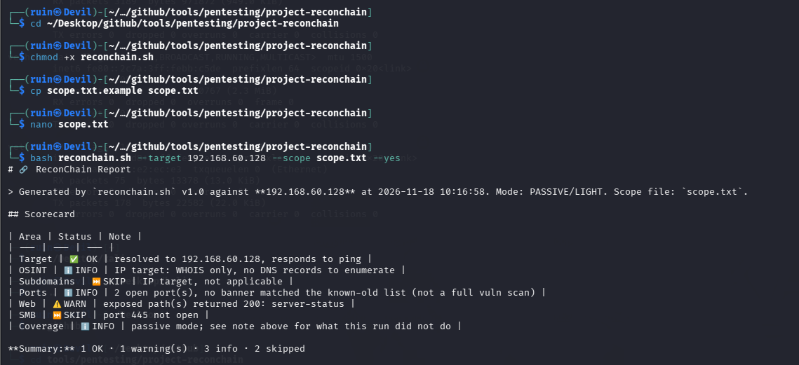
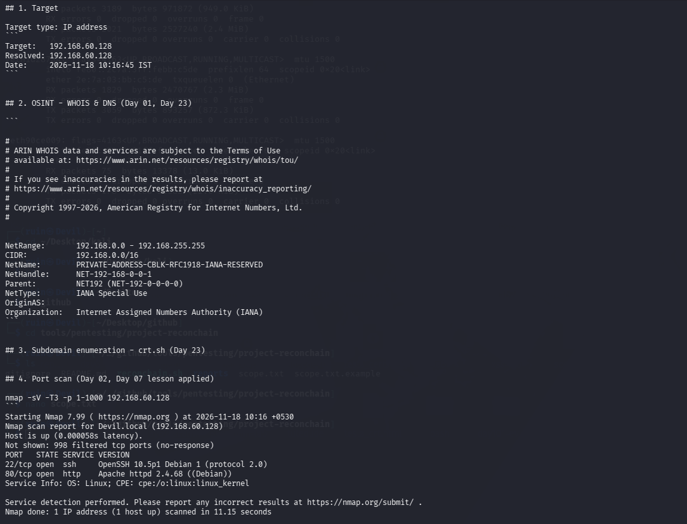
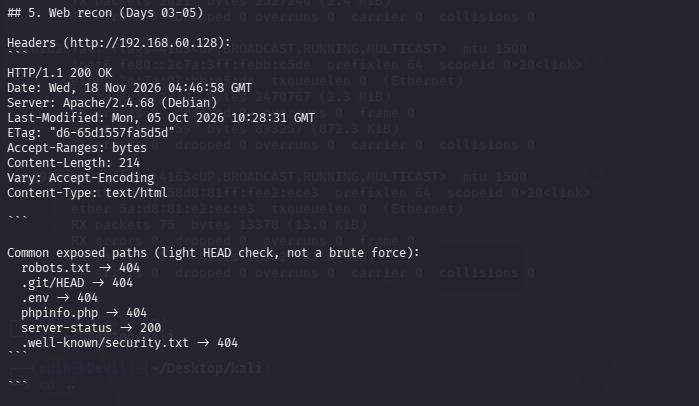
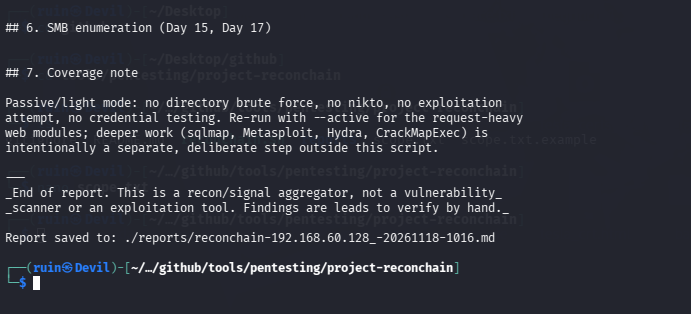

# 🔗 reconchain — Scope-Gated Recon & Vulnerability-Signal Aggregator

<p align="center">
  
  
  
  
</p>

> One script that chains the recon tools from 25 days of practice — OSINT, subdomain discovery, port scanning, web and SMB enumeration, a known-vulnerable-banner check — into a single Markdown report. **It refuses to run against anything you haven't explicitly put in a scope file, and makes you type `CONFIRM` before it touches the target at all.**

---

## 🎯 What This Project Is

`reconchain.sh` is the capstone of the Pentesting phase of my [tools journal](../../README.md). Instead of running theHarvester, nmap, crt.sh, gobuster, nikto and enum4linux-ng by hand and copy-pasting results into notes, it runs the early-phase checks in one go and writes a single report with a scorecard on top and the evidence underneath — the same shape as the Sysadmin phase's [sysaudit](../../Sysadmin/Project-Sysaudit/).

**Why scope-gating is the whole point of this project, not a side feature:** every tool from Days 01–24 is only as safe as the authorization behind it. A script that automates them without that check automates the mistake too. `reconchain.sh` will not scan a target that isn't listed, word-for-word, in a scope file you control — no flag bypasses that, only editing the file does.

**What it is not:** a vulnerability scanner (see Day 14's OpenVAS for that), an exploitation framework (Metasploit, sqlmap, Hydra are each deliberately separate, manual steps), or a replacement for a real rules-of-engagement document. It's a recon aggregator built from commands I learned and ran myself, with a safety gate I can explain line by line.

---

## 🧭 What It Checks

| # | Phase | What it does | Mode | Learned on |
| --- | --- | --- | --- | --- |
| 1 | Target | resolves the target, checks it responds to ping | passive | Day 07 (verify before trusting) |
| 2 | OSINT | WHOIS + DNS records (A/MX/NS/TXT) | passive | Day 01, Day 23 |
| 3 | Subdomains | queries crt.sh (certificate transparency logs) | passive | Day 23 |
| 4 | Port scan | `nmap -sV`, top 1000 ports by default | passive-ish | Day 02, Day 07 |
| 5 | Web recon | headers, TLS cert, HEAD checks on common exposed paths | passive-ish | Days 03–05 |
| 5b | Web recon (active) | full `gobuster dir` wordlist brute force, full `nikto` scan | **active only** | Day 03, Day 04 |
| 6 | SMB enumeration | `enum4linux-ng -A` if port 445 is open | passive-ish | Day 15, Day 17 |
| 7 | Known-vulnerable banners | matches service banners against a short list of known-old versions (vsftpd 2.3.4, old OpenSSH/Apache/ProFTPD) | read-only logic on captured banners | Day 04, Day 07 |
| 8 | Coverage note | states plainly what this run did and did NOT do | — | Day 19 (honest reporting) |

Every status is one of: ✅ OK, ⚠️ WARN, ℹ️ INFO, ⏭️ SKIP (the tool isn't installed, or the check doesn't apply to this target).

**Default mode is passive/light.** Full directory brute-forcing (gobuster) and a full nikto scan only run with `--active` — those two send hundreds to thousands of requests and are the kind of noisy, request-heavy traffic that needs a deliberate opt-in, not a default.

---

## 🚀 Quick Start

```bash
git clone https://github.com/Jeetendra-sanatani/tools-journal.git
cd tools-journal/Pentesting/Project-ReconChain

cp scope.txt.example scope.txt
nano scope.txt                               # add ONLY targets you're authorized to test

./reconchain.sh --target 127.0.0.1 --scope scope.txt            # passive/light run
./reconchain.sh --target 127.0.0.1 --scope scope.txt --active   # adds gobuster + nikto
./reconchain.sh --target 127.0.0.1 --scope scope.txt --yes      # skip the typed CONFIRM prompt
bash reconchain.sh --help
```

If you want to run it as `./reconchain.sh`, first `chmod +x reconchain.sh` (files uploaded through the GitHub web page lose the executable bit, which is why the examples also show `bash`).

**Requirements:** bash and standard tools (`curl`, `grep`, `awk`, `sed`). Everything else is optional: a missing tool (`nmap`, `whois`, `dig`, `jq`, `gobuster`, `nikto`, `enum4linux-ng`, `openssl`) shows up as SKIP in the scorecard instead of breaking the script.

---

## 🔒 Safety: The Scope Gate

This is what makes the project actually useful instead of just automated:

1. **Scope file check.** `--target` must appear, exact match, on its own line in `--scope FILE` (comments `#` and blank lines ignored). If it isn't there, the script exits immediately with status `2` and touches nothing.
2. **Typed confirmation.** Unless `--yes` is passed, the script prints the target, the scope file, and the mode (passive or active), then requires you to type the literal word `CONFIRM` before anything runs.
3. **Passive by default.** Directory brute-forcing (`gobuster`) and a full `nikto` scan — the two noisiest, most request-heavy modules — only run with `--active`.
4. **Nothing is exploited.** This script enumerates and signals; it never attempts a login, an injection, or an exploit module. Days 06, 07, 10, 17 (sqlmap, Metasploit, Hydra, CrackMapExec) stay separate, deliberate steps.
5. **`scope.txt` is git-ignored.** Only `scope.txt.example` is tracked, so a real engagement's actual target list never ends up in a public repo by accident.

A scope file and a typed prompt are not a substitute for a real signed authorization — they're a minimum bar this script refuses to operate below.

---

## 📋 Report Format

The report starts with a scorecard, followed by one section per phase with the raw evidence in code blocks.

> ⚠️ **Illustrative example with made-up values.** It shows the shape of a report, not the result of a real run. See "My Run" below for the real thing.

```markdown
## Scorecard

| Area | Status | Note |
| --- | --- | --- |
| Target | ✅ OK | resolved to 127.0.0.1, responds to ping |
| OSINT | ✅ OK | WHOIS + DNS records gathered (passive, public data) |
| Subdomains | ℹ️ INFO | 4 subdomain(s) found via crt.sh, review for anything unexpected |
| Ports | ⚠️ WARN | 5 open port(s); known-old version banner(s) seen: vsftpd 2.3.4 |
| Web | ✅ OK | headers/paths checked, nothing obviously exposed |
| SMB | ℹ️ INFO | SMB enumerated, review the share/user list above manually |
```

---

## 📸 My Run

Real run of `bash reconchain.sh --target <metasploitable-ip> --scope scope.txt --active` against my own Metasploitable2 VM.

**The scorecard**



**Target, OSINT and port scan** (the "verify before trusting" step from Day 07)



**Web recon and the known-vulnerable banner match**



**SMB enumeration and the coverage note**



---

## ⚙️ Settings

A few values at the top of the script can be changed:

| Variable | Default | Meaning |
| --- | --- | --- |
| `PORT_RANGE_LIGHT` | `1-1000` | nmap port range used in passive/light mode (`--active` switches to `-p-`, all ports) |
| `NMAP_TIMING` | `-T3` | nmap timing template |
| `HTTP_TIMEOUT` | `8` | seconds, for curl/openssl checks |
| `GOBUSTER_WORDLIST` | `/usr/share/wordlists/dirb/common.txt` | wordlist used only in `--active` mode |
| `VULN_BANNERS` | a short pipe-separated list | known-old version strings checked against open-port banners |

---

## 🧱 Design Notes

- **No `set -e`.** Many of the commands fail normally (a tool is missing, a port is closed, DNS doesn't resolve). Each phase handles its own failure and reports it, instead of the whole script aborting.
- **The scope gate runs before anything else**, including argument validation beyond required fields — refusing early is cheaper than refusing after a port scan already fired.
- **Confirmation is skippable (`--yes`), the scope check is not.** `--yes` is for when you trust your own `scope.txt`, e.g. re-running against the same lab VM repeatedly; it never bypasses the scope-file match itself.
- **`--active` is one flag, not per-module.** Keeping it binary (not `--gobuster`, `--nikto` separately) means the report always says clearly which mode a run was in, with no partial-active ambiguity.
- **Exit codes:** `0` normally, `1` with `--strict` when there's at least one WARN, `2` for bad options, a missing scope match, or a declined confirmation.

---

## ⚠️ Limitations (honest list)

- **This is a recon/signal aggregator, not a vulnerability scanner.** The known-vulnerable-banner check is a short, hand-picked list of version strings, not a CVE database — a WARN here is a lead to check manually, not a confirmed finding. For real vulnerability assessment, see Day 14's OpenVAS.
- **It doesn't exploit anything**, by design. A port being open and a banner matching `VULN_BANNERS` doesn't mean access was gained — Days 06, 07, 10, 17 cover that separately, deliberately, one target at a time.
- **The scope gate is a safety net I built for myself, not a security boundary against a determined misuse.** Anyone editing `scope.txt` can defeat it; its value is in making unauthorized use require a conscious, visible step rather than happening by default or by accident.
- **Passive mode's port scan (`1-1000`) can miss services on unusual ports.** `--active` scans all 65535 but takes much longer and is far noisier.
- **crt.sh and WHOIS depend on external services** being reachable and not rate-limiting; a SKIP or an empty result there doesn't necessarily mean nothing exists (same lesson as Day 01).
- **Reports contain target details** (open ports, banners, subdomains, WHOIS data). They are git-ignored, same as `scope.txt`, so a real target's report never ends up in a public repository by accident.

---

## 📂 Project Structure

```text
Project-ReconChain/
├── README.md
├── reconchain.sh         # the recon script
├── scope.txt.example     # template - copy to scope.txt and edit
├── .gitignore             # keeps scope.txt and generated reports out of the repo
├── Screenshots/           # my own runs
└── reports/               # generated reports (git-ignored)
```

---

## 🔗 How It Connects to the Journal

| Day | Tool | Used here for |
| --- | --- | --- |
| 01 | theHarvester | the OSINT phase's spirit — passive, multi-source lookups |
| 02, 07 | nmap / verify-the-target lesson | port scan phase, and WHY the target gets resolved + pinged first |
| 03, 04 | gobuster, nikto | the `--active`-only web recon modules |
| 06, 07, 10, 17 | sqlmap, Metasploit, Hydra, CrackMapExec | explicitly kept OUT of this script — enumerate here, exploit separately, on purpose |
| 11, 12 | LinPEAS, GTFOBins | the "findings are leads to verify, not proof" framing in the banner check |
| 14 | OpenVAS | what this script is deliberately NOT (a vulnerability scanner) |
| 15, 17 | enum4linux-ng, CrackMapExec | the SMB enumeration phase |
| 19, 20 | Report writing, capstone | the report shape itself, and the coverage-note habit |
| 23 | Sublist3r / Amass / crt.sh | the subdomain enumeration phase |
| 25 | Retrospective | the recurring lesson this whole project is built around: verify before you trust a tool's silence |

---

<p align="center">
🛠️ Practice • 📝 Document • 🔐 Scope First<br/>
<b>Built from tools I ran myself, one at a time — chained safely, on purpose.</b>
</p>
