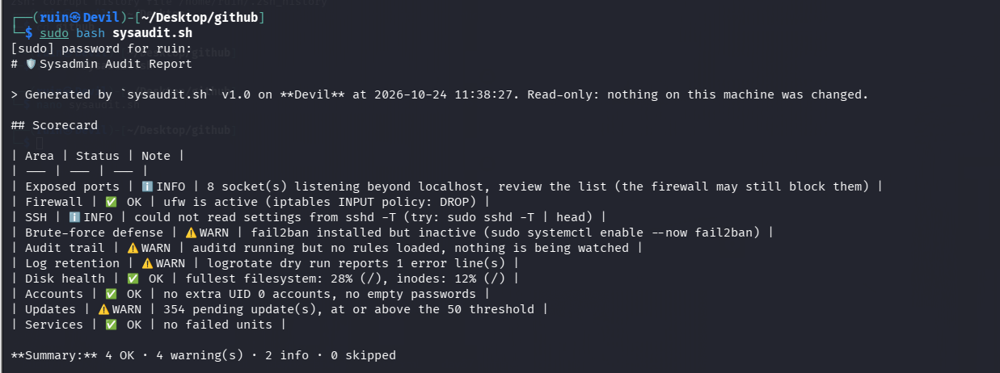
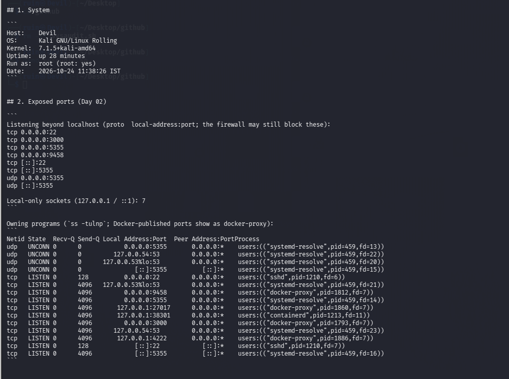
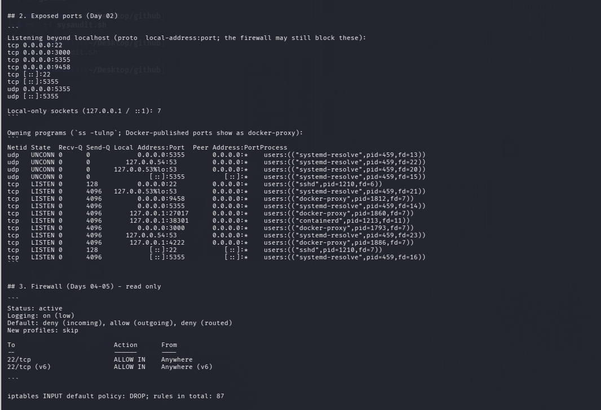
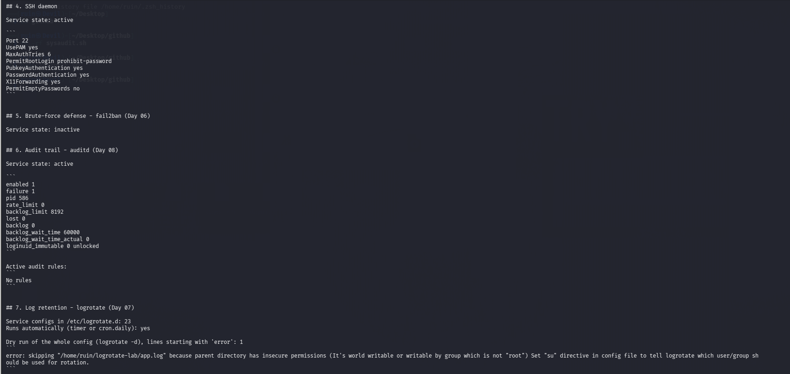
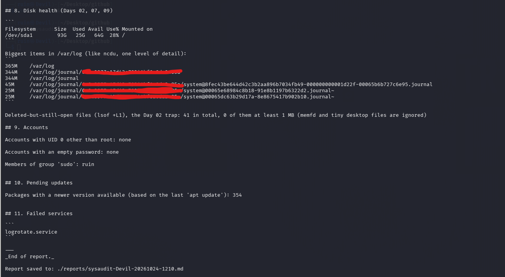

# 🛡️ sysaudit — A Read-Only Server Health & Hardening Audit

<p align="center">
  
  
  
  
</p>

> One script that asks a Linux machine the questions a sysadmin asks every day: **What's exposed? What blocks it? What stops brute force? Who's watching? Is it housekept?** It answers with a Markdown scorecard, using the tools from Sysadmin Days 01-10.

---

## 🎯 What This Project Is

`sysaudit.sh` is the capstone of the Sysadmin phase of my [tools journal](../../README.md). Instead of running ten tools by hand and remembering what each one said, it runs the checks in one go and writes a single report with a scorecard on top and the evidence underneath.

**It only reads.** It never changes firewall rules, services, files, users or packages.

**What it is not:** a compliance scanner or a replacement for proper tools like Lynis. It's a small, readable script built from commands I learned and ran myself, with simple rules I can explain line by line.

---

## 🧭 What It Checks

| # | Check | What it looks at | Warns when | Learned on |
| --- | --- | --- | --- | --- |
| 1 | System | host, OS, kernel, uptime, who is running it | (info only) | — |
| 2 | Exposed ports | `ss -tuln`: sockets listening beyond `127.0.0.1` / `::1` (the firewall may still block them) | a risky service port listens beyond localhost (FTP, Telnet, SMB, RDP, MySQL, PostgreSQL, Redis, MongoDB, Docker API, and a few more) | Day 02 (lsof) |
| 3 | Firewall | `ufw status`, `iptables -S` default policy (read only) | INPUT policy is ACCEPT, or no firewall tooling at all | Days 04-05 |
| 4 | SSH daemon | `sshd -T`: port, root login, password logins, empty passwords | root login or empty passwords allowed, or password logins on | Day 06 context |
| 5 | Brute-force defense | fail2ban service, jails, currently banned IPs | not installed, not running, or no jail enabled | Day 06 |
| 6 | Audit trail | auditd service, `auditctl -s`, number of loaded rules | not installed, not running, or running with zero rules | Day 08 |
| 7 | Log retention | logrotate configs, daily timer/cron, dry run errors, huge log files | no schedule, dry-run errors, or a log file over 100 MB | Day 07 |
| 8 | Disk health | `df -h`, inode use, biggest items in `/var/log`, `lsof +L1` | a filesystem at or above 85%, or a deleted-but-open file of 1 MB or more holding space (tiny `memfd` and desktop files are ignored) | Days 02, 07, 09 |
| 9 | Accounts | extra UID 0 accounts, empty passwords, sudo group members | an extra UID 0 account or an empty password | — |
| 10 | Updates | `apt list --upgradable` | 50 or more pending updates | — |
| 11 | Services | `systemctl --failed` | any failed unit | — |

Every status is one of: ✅ OK, ⚠️ WARN, ℹ️ INFO, ⏭️ SKIP (the check needs root, or the tool isn't installed).

---

## 🚀 Quick Start

```bash
git clone https://github.com/Jeetendra-sanatani/tools-journal.git
cd tools-journal/Sysadmin/Project-Sysaudit

sudo bash sysaudit.sh                       # full audit
sudo bash sysaudit.sh --out my-report.md     # choose the report file
sudo bash sysaudit.sh --strict               # exit status 1 if any check warns
bash sysaudit.sh --help
```

If you want to run it as `./sysaudit.sh`, first `chmod +x sysaudit.sh` (files uploaded through the GitHub web page lose the executable bit, which is why the examples use `bash`).

**Requirements:** bash and standard tools (`awk`, `sed`, `grep`, `df`, `du`, `find`). Everything else is optional: a missing tool (`ss`, `ufw`, `fail2ban-client`, `auditctl`, `logrotate`, `lsof`, `apt`, `systemctl`) shows up as SKIP or WARN in the scorecard instead of breaking the script.

**Without root** the script still runs, but skips what needs root: firewall rules, `sshd -T`, fail2ban and auditd details, the shadow file and `lsof +L1`.

---

## 🔒 Safety: What It Runs

All commands only read state. The complete list:

`id`, `hostname`, `uname`, `uptime`, `date`, `ss -tuln` (`-tulnp` as root), `ufw status verbose`, `iptables -S`, `nft list ruleset`, `sshd -T`, `fail2ban-client status [jail]`, `auditctl -s` and `-l`, `logrotate -d` (a dry run), `systemctl is-active / is-enabled / --failed`, `df`, `du`, `find`, `lsof +L1`, `getent`, `apt list --upgradable`, and reads of `/etc/passwd`, `/etc/shadow`, `/etc/os-release`.

The only thing it writes is its own report file.

---

## 📋 Report Format

The report starts with a scorecard, followed by one section per check with the raw evidence in code blocks.

> ⚠️ **Illustrative example with made-up values.** It shows the shape of a report, not the result of a real run. See "My Run" below for the real thing.

```markdown
## Scorecard

| Area | Status | Note |
| --- | --- | --- |
| Exposed ports | ℹ️ INFO | 3 socket(s) listening beyond localhost, review the list (the firewall may still block them) |
| Firewall | ✅ OK | ufw is active (iptables INPUT policy: DROP) |
| SSH | ⚠️ WARN | port 22: password logins enabled (keys + fail2ban recommended) |
| Brute-force defense | ✅ OK | active, 1 jail(s): sshd; currently banned: 0 |
| Audit trail | ⚠️ WARN | auditd running but no rules loaded, nothing is being watched |
| Log retention | ✅ OK | 12 config(s), scheduled daily, no big logs, dry run clean |
| Disk health | ✅ OK | fullest filesystem: 47% (/), inodes: 2% (/) |
```

---

## 📸 My Run

Real run of `sudo bash sysaudit.sh` on my Kali VM.

**The scorecard**



**System info and exposed ports** (`ss -tulnp` shows which program owns each port; Docker-published ports appear as `docker-proxy`)



**Exposed ports and the firewall** (`ufw` active, default deny incoming, only SSH allowed)



**SSH, fail2ban, auditd and log retention** (fail2ban inactive, auditd running with no rules, and a logrotate config skipped for insecure permissions)



**Disk health, accounts, updates and services**



## ⚙️ Thresholds

Four values at the top of the script can be changed:

| Variable | Default | Meaning |
| --- | --- | --- |
| `DISK_WARN` | `85` | warn when a filesystem (space or inodes) is this % full |
| `UPDATES_WARN` | `50` | warn when this many apt updates are pending |
| `BIGLOG_MB` | `100` | warn about any single file in `/var/log` bigger than this |
| `DELETED_MIN_MB` | `1` | only count deleted-but-open files at least this big |

---

## 🧱 Design Notes

- **No `set -e`.** Many of the commands fail normally (a tool is missing, a service is off). Each check handles its own failure and reports it, instead of the whole script aborting.
- **Parsing is simple on purpose.** `ss` output is split with `awk`; addresses starting with `127.` or `::1` count as local, everything else counts as reachable. A specific interface address (such as `10.0.2.15`) counts as reachable too.
- **Key names are compared in lowercase.** `sshd -T` prints `port` on some versions and `Port` on others, so the SSH check ignores case. If the security settings aren't listed at all, the row says so instead of guessing.
- **Root-only checks say so.** A skipped check is shown as SKIP with the reason, never silently dropped and never reported as OK.
- **Exit codes:** `0` normally, `1` with `--strict` when there's at least one WARN, `2` for bad options.

---

## ⚠️ Limitations (honest list)

- The scorecard is a **set of heuristics, not a security verdict.** A green scorecard doesn't mean a machine is secure; a warning isn't always a problem (password logins on a lab VM are a judgement call).
- "Listening beyond localhost" is not the same as "reachable from the internet": the exposed-ports check reads `ss` and doesn't combine it with the firewall rules. Ports published by Docker (they show up as `docker-proxy`) are a special case, because Docker adds its own firewall rules that `ufw`'s incoming rules don't always cover.
- Risky-port detection uses a fixed list of well-known ports. A service on an unusual port isn't flagged as risky, only listed under reachable sockets.
- The firewall check reads `ufw` and `iptables`. On Docker hosts, Docker adds its own rules, which the script doesn't interpret. On nftables-only setups it only points you to `nft list ruleset`.
- The update count comes from the last `apt update`; if the package lists are stale, so is the number.
- Only Debian-family systems (Kali, Debian, Ubuntu) are the target. Other distributions will mostly show SKIPs.
- **Reports contain details of the machine** (open ports, accounts, services). They are ignored by `.gitignore` so a real server's report doesn't end up in a public repository by accident.

---

## 📂 Project Structure

```text
Project-Sysaudit/
├── README.md
├── sysaudit.sh          # the audit script
├── .gitignore           # keeps generated reports out of the repo
├── Screenshots/         # my own runs
└── reports/             # generated reports (git-ignored)
```

---

## 🔗 How It Connects to the Journal

| Day | Tool | Used here for |
| --- | --- | --- |
| 01 | tmux | running the audit next to live logs while testing |
| 02 | lsof | exposed ports, deleted-but-open files |
| 03 | strace | debugging when a check misbehaved (`strace -f -e trace=execve bash sysaudit.sh`) |
| 04-05 | iptables | firewall policy, read only |
| 06 | fail2ban | brute-force defense check |
| 07 | logrotate | retention and dry-run check |
| 08 | auditd | audit trail check |
| 09 | ncdu / df | disk and big-log check |
| 10 | capstone | this project, and the scorecard from the Day 10 lab |

---

<p align="center">
🛠️ Practice • 📝 Document • 🔐 Secure<br/>
<b>Built from tools I ran myself, one at a time.</b>
</p>
